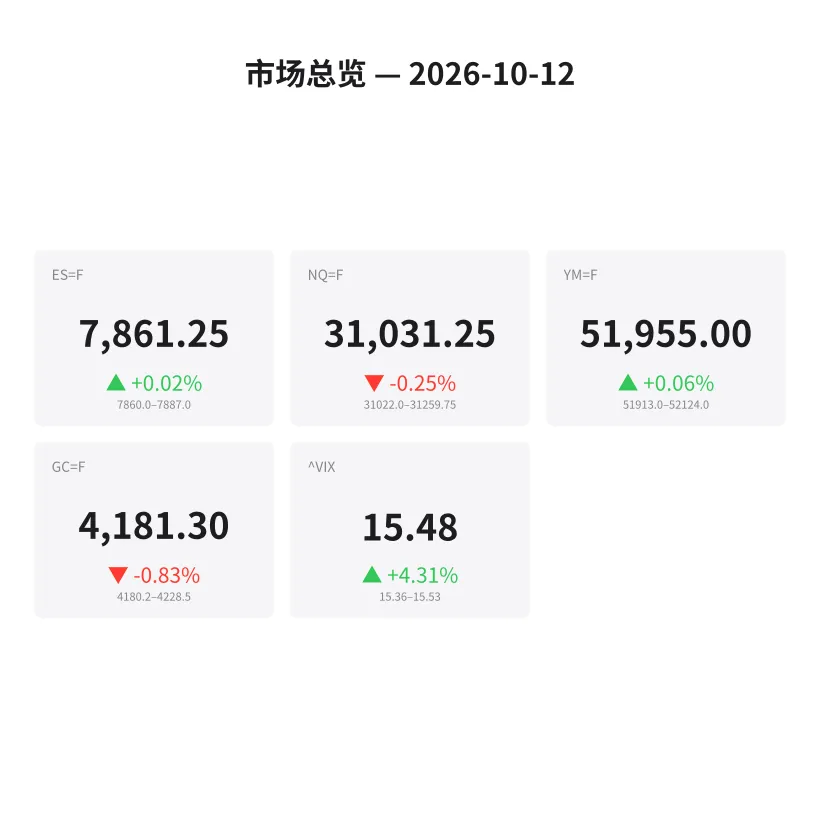
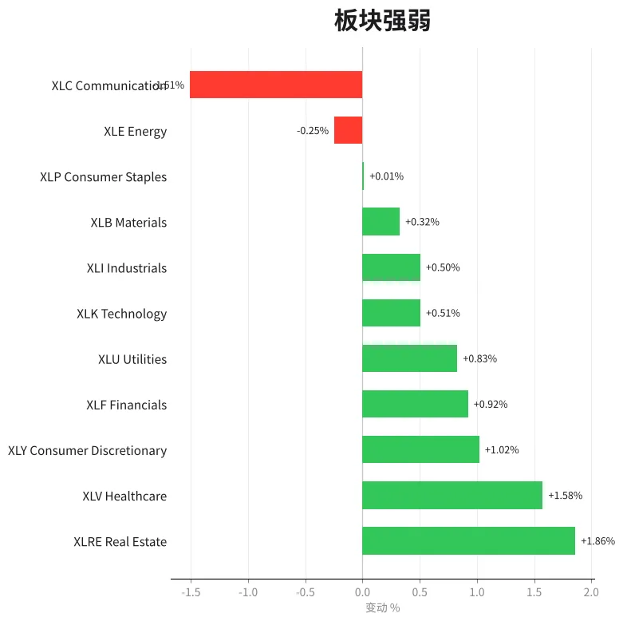
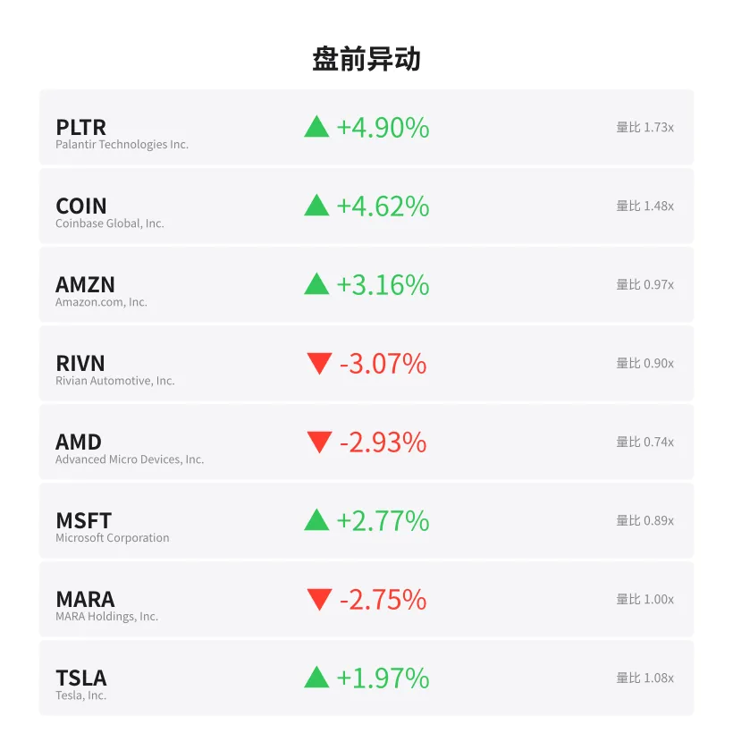
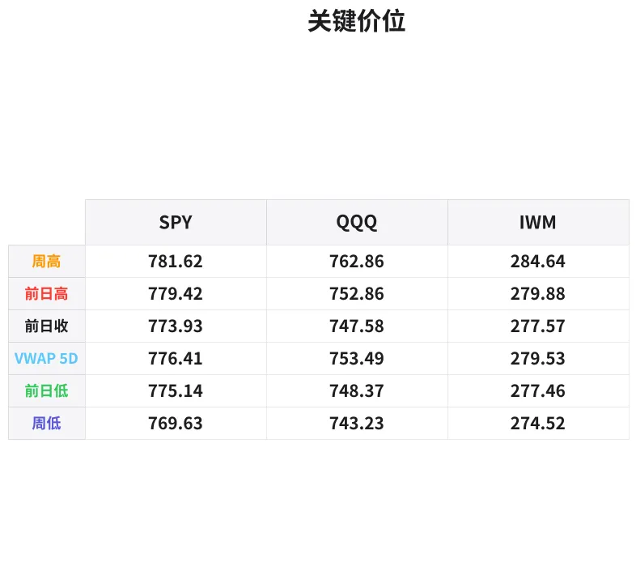

# 盘前分析报告 — 2026-10-12
*生成时间: 12:45:49 UTC*

---
## 数据速览

---
## 一、宏观环境

> [!info]- 详细数据：指数期货 & VIX
> ### 1.1 指数期货 & VIX
> | 品种 | 现价 | 涨跌幅 | 前收 | 日高 | 日低 |
> |------|------|--------|------|------|------|
> | ES=F | 7861.25 | +0.02% | 7859.75 | 7887.0 | 7860.0 |
> | NQ=F | 31031.25 | -0.25% | 31108.75 | 31289.25 | 31022.0 |
> | YM=F | 51955.0 | +0.06% | 51926.0 | 52131.0 | 51913.0 |
> | GC=F | 4181.3 | -0.83% | 4216.3 | 4242.3 | 4180.2 |
> | ^VIX | 15.48 | +4.31% | 14.84 | 15.53 | 15.36 |

> [!info]- 详细数据：隔夜走势
> ### 1.2 隔夜走势（Globex）
> | 品种 | 隔夜高 | 隔夜低 | 区间 | 亚洲高 | 亚洲低 | 欧洲高 | 欧洲低 |
> |------|--------|--------|------|--------|--------|--------|--------|
> | ES=F | 7887.0 | 7860.0 | 27.0 | 7887.0 | 7881.0 | 7884.0 | 7860.0 |
> | NQ=F | 31259.75 | 31022.0 | 237.75 | 31259.75 | 31195.5 | 31214.5 | 31030.0 |
> | YM=F | 52124.0 | 51913.0 | 211.0 | 52124.0 | 52095.0 | 52118.0 | 51913.0 |
> | GC=F | 4228.5 | 4180.2 | 48.3 | 4228.5 | 4202.9 | 4217.0 | 4191.6 |
> | ^VIX | 15.53 | 15.36 | 0.17 | — | — | 15.53 | 15.36 |

> [!info]- 详细数据：板块强弱
> ### 1.3 板块强弱
> | ETF | 板块 | 涨跌幅 |
> |-----|------|--------|
> | XLRE | Real Estate | +1.86% |
> | XLV | Healthcare | +1.58% |
> | XLY | Consumer Discretionary | +1.02% |
> | XLF | Financials | +0.92% |
> | XLU | Utilities | +0.83% |
> | XLK | Technology | +0.51% |
> | XLI | Industrials | +0.50% |
> | XLB | Materials | +0.32% |
> | XLP | Consumer Staples | +0.01% |
> | XLE | Energy | -0.25% |
> | XLC | Communication | -1.51% |

---
## 三、盘前异动

> [!info]- 详细数据：盘前异动
> | 代码 | 名称 | 现价 | 缺口 | 量比 |
> |------|------|------|------|------|
> | PLTR | Palantir Technologies Inc. | 208.53 | +4.90% | 1.73x |
> | COIN | Coinbase Global, Inc. | 179.95 | +4.62% | 1.48x |
> | AMZN | Amazon.com, Inc. | 262.1 | +3.16% | 0.97x |
> | RIVN | Rivian Automotive, Inc. | 13.89 | -3.07% | 0.9x |
> | AMD | Advanced Micro Devices, Inc. | 602.49 | -2.93% | 0.74x |
> | MSFT | Microsoft Corporation | 537.1 | +2.77% | 0.89x |
> | MARA | MARA Holdings, Inc. | 9.64 | -2.75% | 1.0x |
> | TSLA | Tesla, Inc. | 382.4 | +1.97% | 1.08x |
> | GS | Goldman Sachs Group, Inc. (The) | 897.75 | +1.72% | 0.95x |
> | BAC | Bank of America Corporation | 54.51 | +1.68% | 0.78x |

---
## 四、关键价位

> [!info]- 详细数据：SPY 关键价位
> ### SPY
> | 价位类型 | 价格 |
> |----------|------|
> | Prior Day High | 779.42 |
> | Prior Day Low | 775.14 |
> | Prior Day Close | 773.93 |
> | Premarket Price | 778.7601 |
> | Approx Vwap 5D | 776.41 |
> | Weekly High | 781.62 |
> | Weekly Low | 769.63 |

> [!info]- 详细数据：QQQ 关键价位
> ### QQQ
> | 价位类型 | 价格 |
> |----------|------|
> | Prior Day High | 752.86 |
> | Prior Day Low | 748.365 |
> | Prior Day Close | 747.58 |
> | Premarket Price | 749.93 |
> | Approx Vwap 5D | 753.49 |
> | Weekly High | 762.86 |
> | Weekly Low | 743.23 |

> [!info]- 详细数据：IWM 关键价位
> ### IWM
> | 价位类型 | 价格 |
> |----------|------|
> | Prior Day High | 279.88 |
> | Prior Day Low | 277.46 |
> | Prior Day Close | 277.57 |
> | Premarket Price | 278.63 |
> | Approx Vwap 5D | 279.53 |
> | Weekly High | 284.64 |
> | Weekly Low | 274.52 |

---
## 五、AI 技术分析 & 操盘建议

## 第一部分：隔夜市场回顾

### 亚洲时段（约 18:00–02:00 ET）
- **ES** 亚洲时段窄幅震荡于 7881–7887，仅 6 点区间，体现周末后开盘的低波动特征。买方在 7881 守住，未出现明显抛压。
- **NQ** 亚洲段相对强势，高点 31259.75 为隔夜最高，区间 31195–31259。科技板块在亚洲段有资金流入。
- **GC** 黄金亚洲段交投于 4202–4228，高点 4228.5 亦为隔夜最高，随后一路走弱。

### 欧洲时段（约 02:00–09:30 ET）
- **ES** 欧洲段明显走弱，从 7884 跌至 7860，回吐亚洲段全部涨幅。卖压集中在欧洲后半段，多方在 7860（隔夜低点 = 前收 7859.75 附近）企稳。
- **NQ** 欧洲段跌幅更大，从 31214 跌至 31030，跌近 185 点。NQ 相对 ES 表现出明显弱势，反映科技板块资金流出。
- **GC** 欧洲段持续承压，从 4217 跌至 4191，并在晚段进一步下探至 4180 附近的隔夜低点。美元走强或避险情绪降温施压黄金。

### 对美盘的启示
1. **ES/NQ 分化**：ES 仅微涨 0.02% 持稳前收附近，NQ 下跌 0.25% 且交投于隔夜低点区域。这种分化暗示科技成长股面临压力，价值/防御板块获得青睐。
2. **欧洲卖盘主导**：三大品种均在欧洲段创日低，美盘开盘可能延续这一弱势，除非出现催化剂反转。
3. **VIX 升 4.31% 至 15.48**：虽绝对水平不高，但单日 4%+ 的升幅暗示机构在增加对冲，需警惕盘中波动放大。
4. **板块轮动信号强烈**：XLRE（+1.86%）、XLV（+1.58%）领涨，XLC（-1.51%）大幅落后，典型的防御性轮动，暗示大资金在降低风险敞口。

## 第二部分：期货品种分析

### ES（E-mini S&P 500）— 当前 7861.25

**多周期结构：**
- **日线**：前收 7859.75，盘前微涨 +0.02%，几乎平开。周高 7887 对应隔夜高点，周低远在 7860 下方（需参考更长周期）。整体处于周内区间上半部。
- **隔夜**：区间 7860–7887（27 点），属于极窄区间。亚洲段高位 7887 未能在欧洲段延续，欧洲段回落至 7860。
- **关键结构**：7860 为隔夜低点与前收汇合区（7859.75），构成强支撑。7887 为隔夜高点，也是周高附近的阻力。

**关键价位：**
| 级别 | 价格 | 说明 |
|------|------|------|
| R3 | 7900 | 整数关口心理阻力 |
| R2 | 7887 | 隔夜高 / 亚洲高 / 周高 |
| R1 | 7875 | 隔夜区间中值 |
| **现价** | **7861** | |
| S1 | 7860 | 隔夜低 / 欧洲低 |
| S2 | 7855 | 前收下方 5 点 |
| S3 | 7840 | 扩展支撑 |

**方向偏见**：中性偏多 | 置信度 60%
- 多方守住前收 + 隔夜低点 7860 汇合区，只要不破此位，偏多。
- 但 VIX 上升 + 防御轮动限制上行空间。

**做多计划：**
- 入场区间：7858–7862（隔夜低 + 前收汇合区回踩）
- 止损：7852（隔夜低下方 8 点）
- T1：7875（隔夜中值，+13 点）
- T2：7887（隔夜高，+25 点）
- 失效条件：跌破 7850 并放量确认

**做空计划：**
- 入场区间：7884–7888（隔夜高阻力区测试失败）
- 止损：7895（隔夜高上方 8 点）
- T1：7870（中值回落，+14 点）
- T2：7860（回测支撑，+24 点）
- 失效条件：放量突破 7895 并站稳

---

### NQ（E-mini Nasdaq 100）— 当前 31031.25

**多周期结构：**
- **日线**：前收 31108.75，盘前下跌 -0.25%（-77 点）。NQ 弱于 ES，反映科技板块承压。
- **隔夜**：区间 31022–31259.75（237.75 点），区间相当宽。亚洲高 31259 → 欧洲低 31030，几乎单边下跌。
- **关键结构**：当前交投于隔夜低点 31022 附近，属于弱势位置。前收 31108 构成上方阻力。

**关键价位：**
| 级别 | 价格 | 说明 |
|------|------|------|
| R3 | 31260 | 隔夜高 / 亚洲高 |
| R2 | 31150 | 隔夜区间中上部 |
| R1 | 31108 | 前收盘价 |
| **现价** | **31031** | |
| S1 | 31022 | 隔夜低 |
| S2 | 31000 | 整数关口 |
| S3 | 30950 | 扩展支撑 |

**方向偏见**：偏空 | 置信度 65%
- 欧洲段大幅抛售，当前测试隔夜低点。
- AMD 盘前 -2.93% 拖累半导体板块，XLC -1.51%。
- NQ/ES 比值走弱是空头信号。

**做空计划（顺势）：**
- 入场区间：31080–31110（反弹至前收附近遇阻）
- 止损：31150（隔夜中上部）
- T1：31025（回测隔夜低，+55 点）
- T2：30950（扩展目标，+130 点）
- 失效条件：放量收复 31150 并站稳

**做多计划（逆势抄底）：**
- 入场区间：31000–31025（隔夜低 + 整数关口汇合）
- 止损：30975（整数关口下方 25 点）
- T1：31080（+55 点）
- T2：31150（+125 点）
- 失效条件：跌破 30975，打开 30900 下行空间

---

### GC（黄金期货）— 当前 4181.3

**多周期结构：**
- **日线**：前收 4216.3，盘前大跌 -0.83%（-35 点）。黄金走势最弱，三大品种中跌幅最大。
- **隔夜**：区间 4180.2–4228.5（48.3 点），从亚洲高一路下跌至隔夜低。
- **关键结构**：当前紧贴隔夜低点 4180，属于极弱位置。如果 4180 失守，可能加速下行。

**关键价位：**
| 级别 | 价格 | 说明 |
|------|------|------|
| R3 | 4230 | 隔夜高附近 |
| R2 | 4216 | 前收盘价 |
| R1 | 4200 | 整数关口 / 亚洲低附近 |
| **现价** | **4181** | |
| S1 | 4180 | 隔夜低 |
| S2 | 4170 | 隔夜低下方 10 点 |
| S3 | 4150 | 扩展支撑 |

**方向偏见**：偏空 | 置信度 70%
- 隔夜单边下跌，卖压持续。
- 美元走强打压金价。
- 防御板块走强但黄金未跟随，说明避险资金流入债券而非黄金。

**做空计划（顺势）：**
- 入场区间：4192–4200（反弹至欧洲低 / 整数关口遇阻）
- 止损：4210（前收下方 6 点）
- T1：4180（回测隔夜低，+12 点）
- T2：4165（扩展目标，+27 点）
- 失效条件：放量收复 4210

**做多计划（逆势抄底）：**
- 入场区间：4175–4182（隔夜低支撑区）
- 止损：4168（隔夜低下方 12 点）
- T1：4195（+13 点）
- T2：4210（+28 点）
- 失效条件：跌破 4168 触发止损猎杀

## 第三部分：ETF品种分析

### SPY（SPDR S&P 500 ETF）— 盘前 778.76

**关键价位：**
| 级别 | 价格 | 说明 |
|------|------|------|
| R2 | 781.62 | 周高（主要阻力） |
| R1 | 779.42 | 前日高（即刻阻力） |
| **盘前** | **778.76** | |
| S1 | 776.41 | 5日VWAP |
| S2 | 775.14 | 前日低 |
| S3 | 773.93 | 前收盘 |
| S4 | 769.63 | 周低 |

**分析：**
SPY 盘前跳空高开至 778.76，距前日高 779.42 仅 0.66 点。缺口方向向上，站在 5 日 VWAP（776.41）上方，结构偏多。但距周高 781.62 仅约 3 点，上方空间有限。XLRE、XLV 等防御板块领涨为 SPY 提供支撑，但 XLC -1.51% 的拖累和 VIX 上升限制追高空间。

**交易计划：**
- **做多**：回踩 776.00–777.00（5日VWAP附近），止损 775.00，T1 779.40（PDH），T2 781.60（WH）
- **做空**：PDH 779.40–780.00 测试失败后做空，止损 781.00，T1 777.00，T2 776.00（VWAP）
- **突破做多**：放量突破 779.50 站稳，追多至 781.60，止损 778.50
- **关注**：779.42（PDH）是今日最关键的分水岭。站上则看 781.62，跌破 776 则回看 774。

---

### QQQ（Invesco QQQ Trust）— 盘前 749.93

**关键价位：**
| 级别 | 价格 | 说明 |
|------|------|------|
| R3 | 762.86 | 周高 |
| R2 | 753.49 | 5日VWAP（重要阻力） |
| R1 | 752.86 | 前日高 |
| **盘前** | **749.93** | |
| S1 | 748.365 | 前日低 |
| S2 | 747.58 | 前收盘 |
| S3 | 743.23 | 周低 |

**分析：**
QQQ 盘前 749.93 跳空高开但力度明显弱于 SPY。关键弱势信号：盘前价仍在 5 日 VWAP（753.49）下方运行，且距前日高 752.86 还有近 3 点。NQ 期货 -0.25% 的弱势、AMD 盘前 -2.93% 以及 XLC -1.51% 均暗示科技板块面临压力。

QQQ 与 SPY 的相对弱势是今日最重要的主题之一。如果 QQQ 无法收复 5 日 VWAP 753.49，空头将持续占优。

**交易计划：**
- **做多**：回踩 748.00–749.00（PDL 附近），止损 747.00，T1 751.00，T2 752.80（PDH）
- **做空**：反弹至 752.00–753.00（PDH + VWAP 汇合阻力）遇阻做空，止损 754.50，T1 750.00，T2 748.50
- **关注**：QQQ 若跌破 747.58（PDC）将确认弱势，下看 745–743.23（WL）。反之，放量突破 753.50 改变偏空格局。

## 第四部分：今日市场总览

### 整体情绪判断
**中性偏谨慎** — 表面看指数平稳（ES 平开、SPY 小幅高开），但底层信号透露不安：
- VIX +4.31% 至 15.48，单日升幅高于正常范围，暗示机构加大对冲
- 板块轮动呈明显防御特征（XLRE、XLV、XLU 领涨，XLC、XLE 落后）
- NQ/ES 比值走弱，科技成长股领跌
- 黄金大跌 -0.83% 但防御板块走强，说明避险资金选择流入国债而非商品

### VIX 分析
- VIX 15.48，+4.31%（前值 14.84）
- 隔夜区间 15.36–15.53，区间极窄（0.17）但方向向上
- 15.48 仍处于低位区间，不构成恐慌，但升势值得警惕
- 若美盘 VIX 突破 16，预计波动放大，适当缩小仓位

### 需回避的时间窗口
- **09:30–10:00 ET**：开盘前 30 分钟避免追高/追低，等待方向确认。尤其今日缺口小、方向不明朗，开盘假突破概率较高。
- **12:30–13:30 ET**：午后低量期，流动性差，易出现假信号。
- **Columbus Day 影响**：今日为哥伦布日/原住民日，债券市场休市。银行休市可能导致成交量低于正常水平，放大毛刺和假突破。务必注意量能验证。

### 板块轮动解读
| 轮动方向 | 板块 | 信号 |
|----------|------|------|
| 资金流入 | XLRE +1.86%, XLV +1.58%, XLU +0.83% | 防御性/利率敏感板块走强 |
| 中性 | XLF +0.92%, XLY +1.02%, XLI +0.50% | 金融/可选消费/工业正常 |
| 资金流出 | XLC -1.51%, XLE -0.25% | 通信服务大幅落后、能源弱 |

XLRE 领涨暗示市场预期利率走低或维持低位。XLC 大幅落后可能与个别大型通信/社交媒体股相关新闻有关，值得关注 META/GOOG 等个股动向。

### 盘前异动关注
- **PLTR +4.90%**：领涨，量比 1.73x，AI/数据板块情绪积极
- **COIN +4.62%**：加密相关走强，量比 1.48x，关注比特币走势联动
- **AMZN +3.16%**：权重股走强利好 SPY/QQQ
- **AMD -2.93%**：半导体龙头下跌，与 NQ 弱势一致，关注费城半导体指数
- **TSLA +1.97%**：可选消费板块 XLY 走强的贡献者

---

### 🎯 核心交易论点

**今日是"分化行情"——ES/SPY 相对强势但上方受限，NQ/QQQ 明显偏弱。首选策略是做多 ES 空 NQ 的配对交易，或在 NQ/QQQ 反弹至阻力区（NQ 31100、QQQ 752–753）做空。由于 Columbus Day 量能可能偏低，严格控制仓位，所有交易以隔夜区间为锚点，破位严格止损。**
