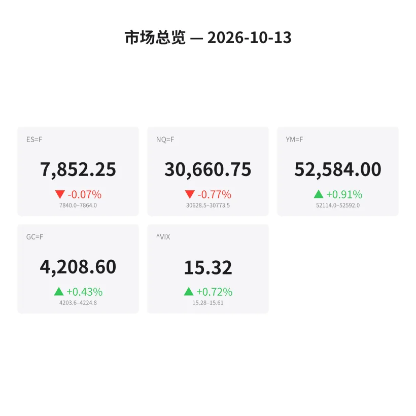
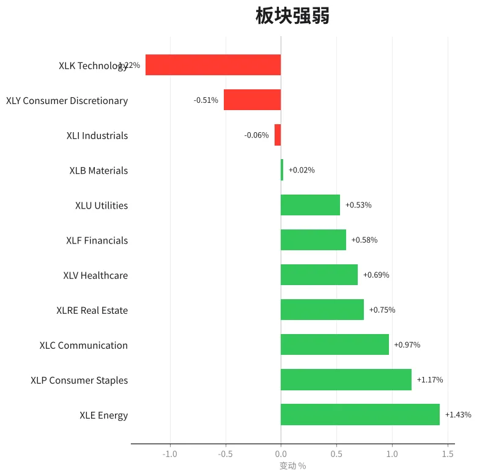
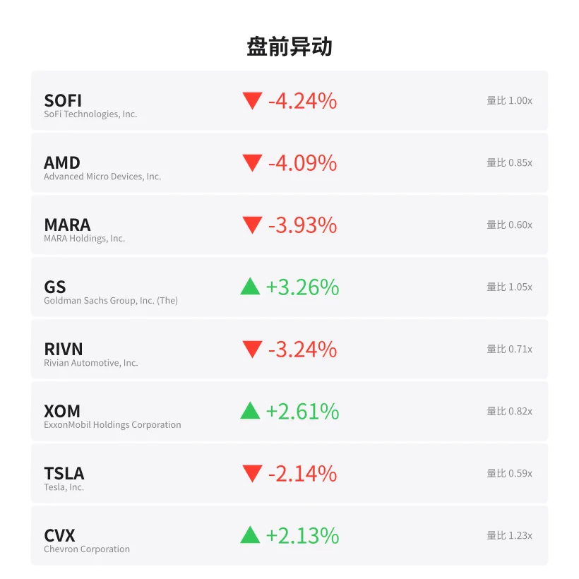
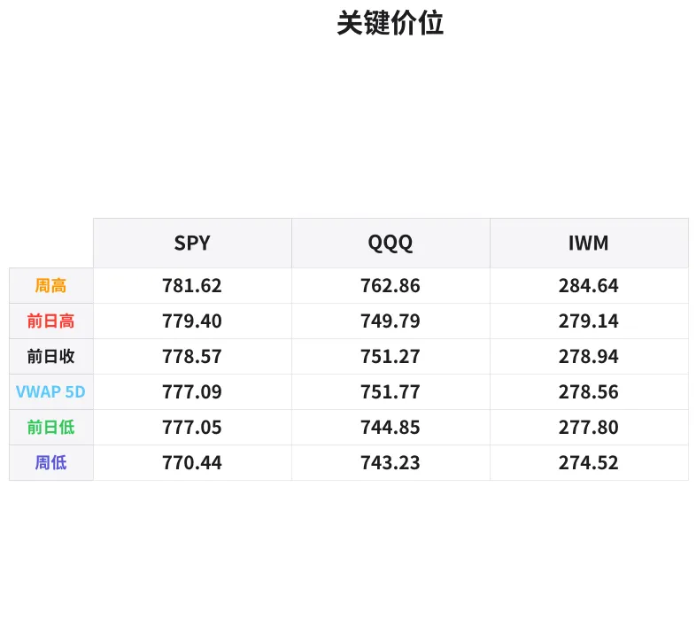

# 盘前分析报告 — 2026-10-13
*生成时间: 12:45:16 UTC*

---
## 数据速览

---
## 一、宏观环境

> [!info]- 详细数据：指数期货 & VIX
> ### 1.1 指数期货 & VIX
> | 品种 | 现价 | 涨跌幅 | 前收 | 日高 | 日低 |
> |------|------|--------|------|------|------|
> | ES=F | 7852.25 | -0.07% | 7858.0 | 7864.0 | 7836.0 |
> | NQ=F | 30660.75 | -0.77% | 30898.25 | 30906.0 | 30604.75 |
> | YM=F | 52584.0 | +0.91% | 52110.0 | 52592.0 | 52095.0 |
> | GC=F | 4208.6 | +0.43% | 4190.6 | 4224.8 | 4173.7 |
> | ^VIX | 15.32 | +0.72% | 14.84 | 15.61 | 15.28 |

> [!info]- 详细数据：隔夜走势
> ### 1.2 隔夜走势（Globex）
> | 品种 | 隔夜高 | 隔夜低 | 区间 | 亚洲高 | 亚洲低 | 欧洲高 | 欧洲低 |
> |------|--------|--------|------|--------|--------|--------|--------|
> | ES=F | 7864.0 | 7840.0 | 24.0 | 7852.25 | 7840.0 | 7864.0 | 7845.0 |
> | NQ=F | 30773.5 | 30628.5 | 145.0 | 30741.25 | 30636.5 | 30773.5 | 30628.5 |
> | YM=F | 52592.0 | 52114.0 | 478.0 | 52279.0 | 52230.0 | 52563.0 | 52114.0 |
> | GC=F | 4224.8 | 4203.6 | 21.2 | 4224.8 | 4211.4 | 4217.9 | 4203.6 |
> | ^VIX | 15.61 | 15.28 | 0.33 | — | — | 15.61 | 15.28 |

> [!info]- 详细数据：板块强弱
> ### 1.3 板块强弱
> | ETF | 板块 | 涨跌幅 |
> |-----|------|--------|
> | XLE | Energy | +1.43% |
> | XLP | Consumer Staples | +1.17% |
> | XLC | Communication | +0.97% |
> | XLRE | Real Estate | +0.75% |
> | XLV | Healthcare | +0.69% |
> | XLF | Financials | +0.58% |
> | XLU | Utilities | +0.53% |
> | XLB | Materials | +0.02% |
> | XLI | Industrials | -0.06% |
> | XLY | Consumer Discretionary | -0.51% |
> | XLK | Technology | -1.22% |

---
## 三、盘前异动

> [!info]- 详细数据：盘前异动
> | 代码 | 名称 | 现价 | 缺口 | 量比 |
> |------|------|------|------|------|
> | SOFI | SoFi Technologies, Inc. | 15.13 | -4.24% | 1.0x |
> | AMD | Advanced Micro Devices, Inc. | 583.21 | -4.09% | 0.85x |
> | MARA | MARA Holdings, Inc. | 9.27 | -3.93% | 0.6x |
> | GS | Goldman Sachs Group, Inc. (The) | 924.5 | +3.26% | 1.05x |
> | RIVN | Rivian Automotive, Inc. | 13.51 | -3.24% | 0.71x |
> | XOM | ExxonMobil Holdings Corporation | 173.35 | +2.61% | 0.82x |
> | TSLA | Tesla, Inc. | 374.5 | -2.14% | 0.59x |
> | CVX | Chevron Corporation | 216.5 | +2.13% | 1.23x |
> | NVDA | NVIDIA Corporation | 224.47 | -2.10% | 0.67x |
> | AAPL | Apple Inc. | 343.64 | +2.08% | 0.72x |

---
## 四、关键价位

> [!info]- 详细数据：SPY 关键价位
> ### SPY
> | 价位类型 | 价格 |
> |----------|------|
> | Prior Day High | 779.397 |
> | Prior Day Low | 777.05 |
> | Prior Day Close | 778.57 |
> | Premarket Price | 777.6 |
> | Approx Vwap 5D | 777.09 |
> | Weekly High | 781.62 |
> | Weekly Low | 770.44 |

> [!info]- 详细数据：QQQ 关键价位
> ### QQQ
> | 价位类型 | 价格 |
> |----------|------|
> | Prior Day High | 749.79 |
> | Prior Day Low | 744.845 |
> | Prior Day Close | 751.27 |
> | Premarket Price | 740.72 |
> | Approx Vwap 5D | 751.77 |
> | Weekly High | 762.86 |
> | Weekly Low | 743.23 |

> [!info]- 详细数据：IWM 关键价位
> ### IWM
> | 价位类型 | 价格 |
> |----------|------|
> | Prior Day High | 279.14 |
> | Prior Day Low | 277.795 |
> | Prior Day Close | 278.94 |
> | Premarket Price | 278.34 |
> | Approx Vwap 5D | 278.56 |
> | Weekly High | 284.64 |
> | Weekly Low | 274.52 |

---
## 五、AI 技术分析 & 操盘建议

## 第一部分：隔夜市场回顾

### 亚洲时段（Globex 亚盘）
- **ES** 在亚盘窄幅震荡，区间 7840–7852.25，仅 12 点波动，明显缩量盘整态势。买盘在 7840 附近有支撑，但缺乏上攻动力。
- **NQ** 亚盘相对弱势，区间 30636.5–30741.25（约 105 点），重心偏下，反映亚太科技股承压带动的风险偏好下移。
- **GC** 黄金亚盘维持高位 4211.4–4224.8，避险情绪有所升温。
- **整体判断**：亚盘资金呈现避险倾向，科技权重拖累指数，黄金走强暗示部分资金从风险资产向避险资产轮动。

### 欧洲时段（Globex 欧盘）
- **ES** 欧盘区间扩大至 7845–7864，一度上探隔夜高点 7864，但未能有效突破，随后回落。
- **NQ** 欧盘进一步走弱至 30628.5，刷新隔夜低点，卖压在欧盘时段加剧，科技板块资金流出明显。
- **YM** 道指期货逆势走强，欧盘区间 52114–52563，涨幅 +0.91%，价值股/蓝筹股受到追捧。
- **GC** 欧盘回落至 4203.6–4217.9，从亚盘高位小幅回撤，但整体仍维持强势。

### 对美盘的启示
1. **ES/NQ 分化加剧**：ES 微跌 -0.07% vs NQ -0.77%，YM +0.91%，科技与价值板块严重分化。NQ 在欧盘不断探低，美盘开盘可能面临进一步抛压，尤其如果 NVDA/AMD 等权重股延续弱势。
2. **VIX 15.32 小幅走高**：波动率温和抬升，尚未到恐慌区域（20+），但 +0.72% 的变化需注意——若 VIX 突破 16，空头信号增强。
3. **板块轮动极度明显**：XLE +1.43%、XLP +1.17% 领涨（防御/能源），XLK -1.22% 垫底。这是经典的「风险下移 + 资金轮动」格局，短线不宜追多科技。
4. **量价配合**：大部分异动股量比偏低（TSLA 0.59x、NVDA 0.67x），说明盘前缺口更多是情绪驱动而非机构主力出货，开盘后需观察成交量确认。

## 第二部分：期货品种分析

### ES（E-mini S&P 500）— 现价 7852.25

**多时间框架分析：**
- **日线**：上周五收 7858，周一盘前微跌 -0.07%，整体处于高位震荡。周线区间 7836–7864，波动收窄至仅 28 点，暗示方向选择临近。
- **4H**：从隔夜走势来看，7864 形成短期阻力（隔夜高 = 欧盘高），7836 为隔夜低点支撑。当前价格 7852 在区间中部偏上。
- **1H/15M**：开盘大概率围绕 7850 拉锯。若开盘前 30 分钟守住 7840 以上，则反弹概率增大；若跌破 7836 则打开下行空间。

**关键价位：**
| 类型 | 价位 | 说明 |
|------|------|------|
| 强阻力 | 7864 | 隔夜/欧盘高点，突破则看 7880 |
| 弱阻力 | 7858 | 前收盘价 |
| 中枢 | 7850 | 盘前现价附近 |
| 弱支撑 | 7840 | 隔夜低/亚盘低 |
| 强支撑 | 7836 | 日内最低点 |
| 极端支撑 | 7820 | 心理整数位 + 前几日低位区域 |

**方向偏见：中性偏空（55% 空）**
- 理由：NQ 领跌拖累 ES，板块轮动向防御板块倾斜，VIX 小幅走高。但 ES 自身跌幅极小，YM 还在涨，多空分歧大。

**交易计划：**
- **空单入场**：7858–7864 区间（前收 + 隔夜高阻力），止损 7872（隔夜高上方 8 点），目标 T1: 7840，T2: 7820
- **多单入场**：7836–7840 区间（隔夜低支撑 + SPY VWAP5D 对应区域），止损 7828，目标 T1: 7858，T2: 7870
- **失效条件**：若 NQ 反转走强且科技股跳空回补，空单偏见失效；若 VIX 突破 16 且 ES 跌破 7836，多单逻辑失效。

---

### NQ（E-mini Nasdaq 100）— 现价 30660.75

**多时间框架分析：**
- **日线**：NQ 盘前 -0.77%，从前收 30898 跌至 30660，跌幅为三大指数中最大。日线明显弱于 ES/YM。
- **4H**：隔夜区间 30628.5–30773.5（145 点），欧盘低点 30628.5 成为关键支撑。区间比 ES 宽得多，波动率更高。
- **1H/15M**：在亚盘和欧盘持续走低，结构性空头趋势明显。短线看 30600 是否能守住。

**关键价位：**
| 类型 | 价位 | 说明 |
|------|------|------|
| 强阻力 | 30900 | 前收盘价 |
| 弱阻力 | 30773 | 隔夜/欧盘高点 |
| 弱阻力 | 30740 | 亚盘高点 |
| 中枢 | 30660 | 盘前现价 |
| 弱支撑 | 30628 | 隔夜最低点 |
| 强支撑 | 30600 | 整数关口 |
| 极端支撑 | 30500 | 心理大关 |

**方向偏见：偏空（65% 空）**
- 理由：AMD -4.09%、NVDA -2.10%、TSLA -2.14% 权重股集体下挫；XLK -1.22% 板块最弱；隔夜持续走低无反弹迹象；QQQ 盘前 740.72 已跌破前日低 744.845。

**交易计划：**
- **空单入场**：30730–30775 区间（反弹至亚盘高/隔夜高），止损 30820，目标 T1: 30630，T2: 30500
- **多单入场**：30600 整数关口（需配合明显放量止跌信号），止损 30550，目标 T1: 30740，T2: 30830
- **失效条件**：若 NVDA/AMD 盘前反转跳空回补，空头逻辑削弱；若 NQ 站稳 30775 以上则趋势反转。

---

### GC（COMEX 黄金）— 现价 4208.6

**多时间框架分析：**
- **日线**：GC +0.43%，连续走强。前收 4190.6，当前 4208.6，日线维持上升趋势。
- **4H**：隔夜区间 4203.6–4224.8（21.2 点），亚盘冲高 4224.8 后回落，欧盘在 4203.6–4217.9 整理。
- **1H/15M**：多头结构，但 4224.8 高点形成短期阻力。

**关键价位：**
| 类型 | 价位 | 说明 |
|------|------|------|
| 强阻力 | 4225 | 隔夜/亚盘高点 |
| 弱阻力 | 4218 | 欧盘高点 |
| 中枢 | 4208 | 盘前现价 |
| 弱支撑 | 4203 | 欧盘低/隔夜低 |
| 强支撑 | 4190 | 前收盘价 |
| 极端支撑 | 4174 | 日内最低点 |

**方向偏见：偏多（60% 多）**
- 理由：避险情绪升温（VIX 走高 + 科技股下挫），黄金隔夜维持强势。板块轮动中黄金是受益品种。

**交易计划：**
- **多单入场**：4203–4208 区间（回踩欧盘低点附近），止损 4195，目标 T1: 4225，T2: 4240
- **空单入场**：4224–4228 区间（亚盘高阻力），止损 4235，目标 T1: 4208，T2: 4195
- **失效条件**：若美元指数急涨且美债收益率跳升，黄金多头逻辑失效；若科技股反转风险偏好回升，避险需求消退。

## 第三部分：ETF品种分析

### SPY — 盘前 777.60

**关键价位汇总：**
| 类型 | 价位 | 说明 |
|------|------|------|
| 周高 | 781.62 | 本周最高点，强阻力 |
| 前日高 | 779.40 | PDH，日内第一阻力 |
| 前日收 | 778.57 | 缺口上沿 |
| 盘前价 | 777.60 | 小幅跳空低开 |
| 5日VWAP | 777.09 | 机构成本线，关键支撑 |
| 前日低 | 777.05 | PDL，与VWAP5D高度重合 |
| 周低 | 770.44 | 极端支撑 |

**分析：**
- SPY 盘前 777.60，低开约 1 点（-0.12%），位于前日低 777.05 和 5 日 VWAP 777.09 上方紧贴位置。
- **PDL + VWAP5D 高度重合（777.05–777.09）**——这是今天最关键的多空分界线。若开盘后守住该区域，可能形成 VWAP 回归交易（mean reversion），反弹目标看 778.57（前收）和 779.40（PDH）。
- 若 777.00 失守，下方真空较大，次一档支撑在 775 整数位附近，极端看 770.44（周低）。

**交易计划：**
- **多单（回归交易）**：777.00–777.20 区间（PDL + VWAP5D 双重支撑），需见开盘 15 分钟止跌信号（放量长下影线或 delta 翻正）。止损 776.40，T1: 778.57，T2: 779.40
- **空单（跌破交易）**：跌破 776.90 且放量确认，止损 777.50，T1: 775.00，T2: 773.00
- **注意**：今天 SPY 走势很可能滞后于 QQQ——若 QQQ 企稳，SPY 大概率跟随反弹；若 QQQ 继续破位，SPY 的 777 支撑不保。

---

### QQQ — 盘前 740.72

**关键价位汇总：**
| 类型 | 价位 | 说明 |
|------|------|------|
| 周高 | 762.86 | 本周最高，遥远 |
| 5日VWAP | 751.77 | 机构成本线，远高于现价 |
| 前日收 | 751.27 | 缺口上沿 |
| 前日高 | 749.79 | PDH |
| 前日低 | 744.85 | PDL，已被盘前击穿 |
| 周低 | 743.23 | 上一档支撑 |
| 盘前价 | 740.72 | 已跌破周低！|
| 极端支撑 | 738.00 | 整数位 + 前期低位区域 |

**分析：**
- QQQ 盘前 740.72，**已跌破前日低 744.85 和周低 743.23**——这是今天最重要的信号。
- 盘前缺口约 -10.55 点（-1.40%），属于较大缺口。在缺口方向上，科技权重股（AMD -4.09%、NVDA -2.10%、TSLA -2.14%）全面下挫，缺口回补概率较低。
- 5 日 VWAP 751.77 远在上方，机构持仓整体处于浮亏状态，可能引发更多止损盘。
- **关键观察**：若开盘 30 分钟内 QQQ 无法反弹至 743 以上，可能进一步下探 738 甚至 735。

**交易计划：**
- **空单（顺势）**：开盘反弹至 743–744 区间（回测周低/PDL 翻阻），止损 745.50，T1: 740.00，T2: 738.00
- **多单（逆势抄底，高风险）**：738.00 附近整数位支撑 + 需要明显的 bid 回升和 delta 翻正，止损 736.50，T1: 743.00，T2: 745.00
- **不建议做的事**：在 740–743 之间追空——此区域已经是缺口后第一段下跌的位置，追入空间有限，风报比差。

## 第四部分：今日市场总览

### 整体情绪判断
**中性偏空**——三大指数分化严重，科技股（NQ/QQQ）领跌，价值股（YM）逆势走强，典型的风险轮动日。不适合单边重仓追趋势，适合耐心等待关键价位的反应式交易。

### VIX 分析
- VIX 15.32（+0.72%），处于低波动率环境但边际走高。
- 隔夜区间 15.28–15.61，未突破 16 关口。
- **16.00 是今天的关键分界线**：若 VIX 升穿 16，意味着市场风险偏好进一步下移，空头信号增强，科技股可能加速下行。若 VIX 维持在 15.5 以下，则当前的科技股弱势可能只是短期轮动而非趋势性转变。

### 需要回避的时间窗口
1. **9:30–10:00 ET 开盘前 30 分钟**：今天缺口较大（QQQ -1.4%），开盘波动剧烈且方向不确定，散户情绪主导，不适合立即入场。等待开盘 15-30 分钟后的方向确认。
2. **13:00–14:00 ET 午间低流动性**：成交量萎缩，假突破多。
3. **如有重大经济数据发布**（关注财经日历），数据前后 5 分钟避开。

### 板块轮动解读
- **强势板块**：能源（XLE +1.43%）、必需消费（XLP +1.17%）、通信（XLC +0.97%）——典型的防御+价值组合。
- **弱势板块**：科技（XLK -1.22%）、可选消费（XLY -0.51%）——成长股资金流出。
- **轮动含义**：资金从高 beta 成长股流向低 beta 防御股。这种轮动通常持续 1–3 天，但如果伴随 VIX 持续走高（>16），可能演变为更大的调整。
- **值得关注的反向信号**：如果开盘后 XLK 止跌企稳或 NVDA 跳空回补，说明轮动力度减弱，NQ/QQQ 可能快速反弹。

### 核心交易论点

> **今日是科技与价值的分化日。NQ/QQQ 弱势明确，优先做 NQ 反弹后的空单（30730–30775 做空）；ES 走势中性，适合区间交易（7840–7864）；GC 偏多但追高风险大，等回踩 4203–4208 再接。不追空 QQQ 740 以下，不追多 ES 7855 以上。耐心等价位，不做中间价。**
