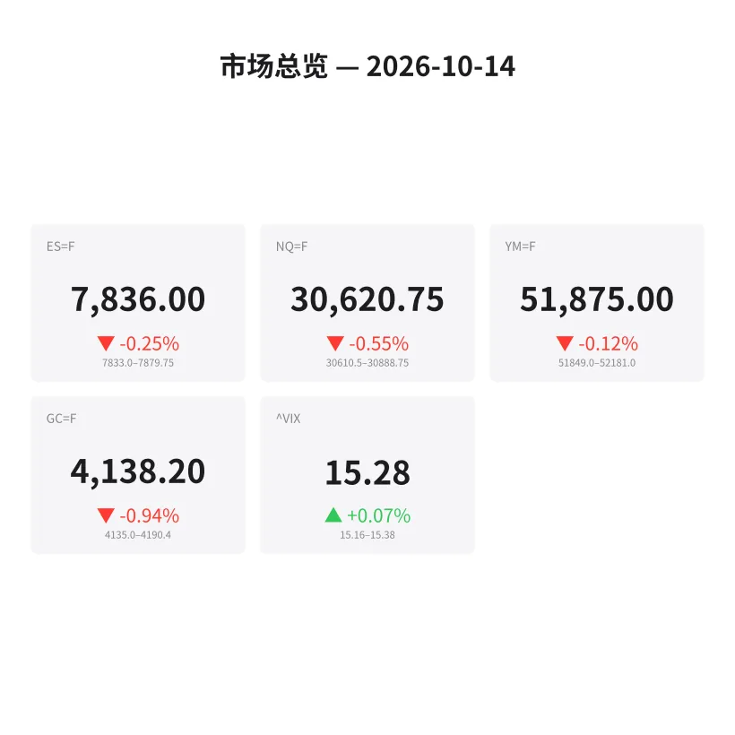
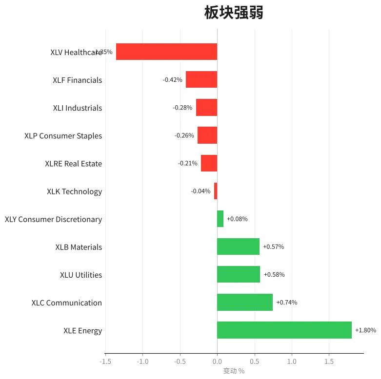
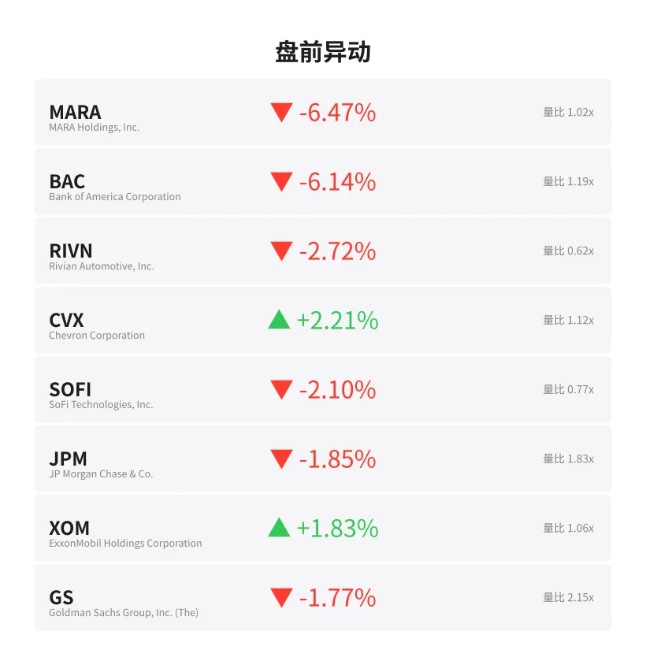
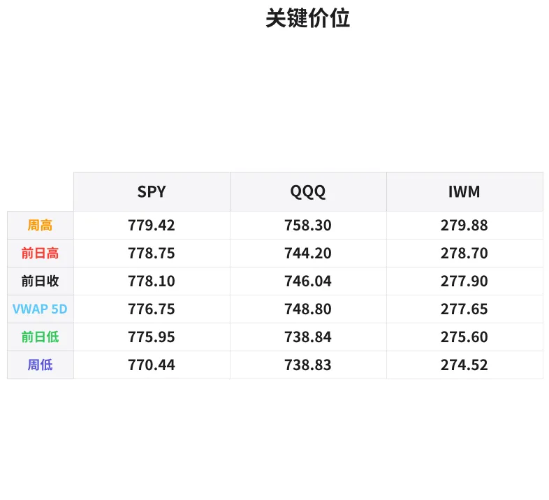

# 盘前分析报告 — 2026-10-14
*生成时间: 12:45:05 UTC*

---
## 数据速览

---
## 一、宏观环境

> [!info]- 详细数据：指数期货 & VIX
> ### 1.1 指数期货 & VIX
> | 品种 | 现价 | 涨跌幅 | 前收 | 日高 | 日低 |
> |------|------|--------|------|------|------|
> | ES=F | 7836.0 | -0.25% | 7855.75 | 7879.75 | 7835.25 |
> | NQ=F | 30620.75 | -0.55% | 30791.5 | 30891.5 | 30615.0 |
> | YM=F | 51875.0 | -0.12% | 51935.0 | 52181.0 | 51852.0 |
> | GC=F | 4138.2 | -0.94% | 4177.3 | 4193.5 | 4137.2 |
> | ^VIX | 15.28 | +0.07% | 15.27 | 15.38 | 15.16 |

> [!info]- 详细数据：隔夜走势
> ### 1.2 隔夜走势（Globex）
> | 品种 | 隔夜高 | 隔夜低 | 区间 | 亚洲高 | 亚洲低 | 欧洲高 | 欧洲低 |
> |------|--------|--------|------|--------|--------|--------|--------|
> | ES=F | 7879.75 | 7833.0 | 46.75 | 7874.25 | 7861.25 | 7874.0 | 7856.25 |
> | NQ=F | 30888.75 | 30610.5 | 278.25 | 30888.75 | 30745.75 | 30861.75 | 30705.25 |
> | YM=F | 52181.0 | 51849.0 | 332.0 | 52056.0 | 51996.0 | 52181.0 | 51972.0 |
> | GC=F | 4190.4 | 4135.0 | 55.4 | 4190.4 | 4171.1 | 4186.5 | 4158.0 |
> | ^VIX | 15.38 | 15.16 | 0.22 | — | — | 15.38 | 15.16 |

> [!info]- 详细数据：板块强弱
> ### 1.3 板块强弱
> | ETF | 板块 | 涨跌幅 |
> |-----|------|--------|
> | XLE | Energy | +1.80% |
> | XLC | Communication | +0.74% |
> | XLU | Utilities | +0.58% |
> | XLB | Materials | +0.57% |
> | XLY | Consumer Discretionary | +0.08% |
> | XLK | Technology | -0.04% |
> | XLRE | Real Estate | -0.21% |
> | XLP | Consumer Staples | -0.26% |
> | XLI | Industrials | -0.28% |
> | XLF | Financials | -0.42% |
> | XLV | Healthcare | -1.35% |

---
## 三、盘前异动

> [!info]- 详细数据：盘前异动
> | 代码 | 名称 | 现价 | 缺口 | 量比 |
> |------|------|------|------|------|
> | MARA | MARA Holdings, Inc. | 8.83 | -6.47% | 1.02x |
> | BAC | Bank of America Corporation | 51.23 | -6.14% | 1.19x |
> | RIVN | Rivian Automotive, Inc. | 13.17 | -2.72% | 0.62x |
> | CVX | Chevron Corporation | 219.76 | +2.21% | 1.12x |
> | SOFI | SoFi Technologies, Inc. | 14.91 | -2.10% | 0.77x |
> | JPM | JP Morgan Chase & Co. | 328.1 | -1.85% | 1.83x |
> | XOM | ExxonMobil Holdings Corporation | 175.3 | +1.83% | 1.06x |
> | GS | Goldman Sachs Group, Inc. (The) | 878.1 | -1.77% | 2.15x |
> | TSLA | Tesla, Inc. | 371.72 | -1.67% | 0.56x |
> | META | Meta Platforms, Inc. | 754.27 | +1.52% | 1.4x |

---
## 四、关键价位

> [!info]- 详细数据：SPY 关键价位
> ### SPY
> | 价位类型 | 价格 |
> |----------|------|
> | Prior Day High | 778.75 |
> | Prior Day Low | 775.95 |
> | Prior Day Close | 778.1 |
> | Premarket Price | 775.21 |
> | Approx Vwap 5D | 776.75 |
> | Weekly High | 779.42 |
> | Weekly Low | 770.44 |

> [!info]- 详细数据：QQQ 关键价位
> ### QQQ
> | 价位类型 | 价格 |
> |----------|------|
> | Prior Day High | 744.2 |
> | Prior Day Low | 738.84 |
> | Prior Day Close | 746.04 |
> | Premarket Price | 738.51 |
> | Approx Vwap 5D | 748.8 |
> | Weekly High | 758.3 |
> | Weekly Low | 738.83 |

> [!info]- 详细数据：IWM 关键价位
> ### IWM
> | 价位类型 | 价格 |
> |----------|------|
> | Prior Day High | 278.7 |
> | Prior Day Low | 275.6 |
> | Prior Day Close | 277.9 |
> | Premarket Price | 273.48 |
> | Approx Vwap 5D | 277.65 |
> | Weekly High | 279.88 |
> | Weekly Low | 274.52 |

---
## 五、AI 技术分析 & 操盘建议

## 第一部分：隔夜市场回顾

### 亚盘（约 18:00–02:00 ET）

亚盘整体偏强运行。ES 在 7861–7874 区间窄幅震荡，NQ 在亚盘创出隔夜最高点 30888.75，显示亚洲资金在周一开盘后有一定买入意愿。GC 亚盘同样走出日内最高 4190.4，说明避险情绪在亚洲时段有所升温。整体来看，亚盘定调偏多，但成交量有限，未形成趋势性突破。

### 欧盘（约 02:00–09:30 ET）

进入欧盘后，抛压逐渐加重。ES 从 7874 一路走低至 7856 附近，NQ 更是从 30861 跌至 30705。金融股财报利空（BAC -6.14%、JPM -1.85%、GS -1.77%）成为欧盘抛售的主要催化剂。GC 同步走弱至 4158，意味着并非单纯的风险偏好转换，而是全面的去杠杆/获利了结行为。

### 对美盘的启示

1. **价格结构偏空**：ES 和 NQ 均已跌破前日收盘价和隔夜区间中枢，盘前价格逼近隔夜低点（ES 7833, NQ 30610），开盘可能面临对隔夜低点的测试甚至击穿。
2. **VIX 低位钝化**：VIX 15.28 几乎无波动（+0.07%），在指数走弱的情况下 VIX 未明显走高，暗示市场认为下跌空间有限，或者大资金通过期权结构对冲而非直接做多 VIX。
3. **板块分化剧烈**：能源 XLE +1.80% 独领风骚，医疗 XLV -1.35% 垫底，金融股遭抛售——这种板块轮动格局意味着资金在寻找估值洼地（能源）同时抛售估值过高或业绩不达预期的品种。
4. **注意反转可能**：欧盘低点如果在美盘开盘后迅速被买入，可能形成"先杀后拉"的经典走势，特别是在 VIX 如此低迷的环境下。

## 第二部分：期货品种分析

### ES（E-mini S&P 500）— 当前 7836.0

**多时间框架分析：**
- **日线**：ES 前日收于 7855.75，今日盘前已下破前日低点 7835.25，短期看空。前日高点 7879.75 构成上方强阻力。从周线来看，7835 附近是本周新低区域（周低 7833），若失守将打开向 7800 心理关口的下行空间。
- **4H/1H**：隔夜形成清晰的下降通道，从亚盘高点 7874 一路走低至 7833。欧盘反弹未能突破 7874，形成 lower high，确认空头趋势延续。
- **5D VWAP**：未在报告中直接给出 ES 的 5D VWAP，但根据价格结构推算，ES 目前已跌至 5 日成交密集区下沿。

**关键价位：**
| 类型 | 价位 | 说明 |
|------|------|------|
| 强阻力 | 7879.75 | 前日高点 = 隔夜高点，双重压力 |
| 阻力 | 7856–7862 | 欧盘反弹区域 + 前日收盘 7855.75 |
| 当前价 | 7836.0 | |
| 支撑 | 7833.0 | 隔夜低点 |
| 强支撑 | 7800–7810 | 心理关口 + 潜在需求区 |

**方向偏见：偏空（信心度 65%）**

**交易计划：**
- **空单入场区**：7852–7862（前收盘 + 欧盘反弹高点回测），止损 7882（隔夜高点上方），T1: 7833（隔夜低点），T2: 7810（扩展目标）
- **多单机会**：若开盘快速跌破 7833 后出现强势买入（delta 反转 + 大单扫货），可在 7820–7830 区间尝试多单反弹，止损 7808，目标 7855
- **失效条件**：开盘直接站稳 7862 上方并放量突破，空头计划失效，转为观望或跟踪多头

---

### NQ（E-mini Nasdaq 100）— 当前 30620.75

**多时间框架分析：**
- **日线**：NQ 跌幅 -0.55% 领跌三大指数，已接近前日低点 30615.0。前日区间 30615–30891 为关键参考。科技板块 XLK -0.04% 相对持平，但个股分化（META +1.52% vs TSLA -1.67%），NQ 的弱势更多反映权重股的均匀抛压。
- **4H/1H**：从亚盘高点 30888.75 跌至 30610.5，跌幅 278 点，波动率显著高于 ES。欧盘在 30705–30862 区间震荡后未能收复亚盘失地，显示卖压持续。
- **关键特征**：NQ 隔夜区间 278 点远大于正常水平，暗示机构在科技股上有较大仓位调整。

**关键价位：**
| 类型 | 价位 | 说明 |
|------|------|------|
| 强阻力 | 30888–30891 | 亚盘高点 + 前日高点 |
| 阻力 | 30750–30790 | 前收盘 30791 + 亚盘低点 30745 |
| 当前价 | 30620.75 | |
| 支撑 | 30610–30615 | 隔夜低点 = 前日低点，极关键 |
| 强支撑 | 30400–30450 | 下方需求区 |

**方向偏见：偏空（信心度 70%）**

NQ 弱于 ES，科技股权重面临财报季压力，且价格已逼近前日低点。若失守 30610，下行空间更大。

**交易计划：**
- **空单入场区**：30720–30790（前收盘回测区），止损 30900（隔夜高点上方），T1: 30610（隔夜低点），T2: 30450
- **多单机会**：仅在 30610 形成明确的 double bottom + 强势反弹信号后考虑，入场 30620–30650，止损 30580，目标 30750
- **失效条件**：开盘放量突破 30800 并持稳，空头计划失效

---

### GC（黄金期货）— 当前 4138.2

**多时间框架分析：**
- **日线**：GC 跌幅 -0.94% 是今日最大跌幅品种。从前日高点 4193.5 跌至 4137.2，几乎打到隔夜低点 4135.0。这种幅度的下跌在金价近期高位运行的背景下值得警惕。
- **4H/1H**：亚盘高点 4190.4 即为日内最高，此后一路走低，欧盘加速下跌从 4186.5 至 4158，盘前进一步跌至 4138。完美的下降趋势，无明显反弹。
- **宏观背景**：金价下跌伴随指数走弱 + VIX 平稳，更像是获利了结而非避险情绪消退。美元可能走强是隐含催化剂。

**关键价位：**
| 类型 | 价位 | 说明 |
|------|------|------|
| 强阻力 | 4190–4193 | 亚盘高点 + 前日高点 |
| 阻力 | 4158–4177 | 前收盘 4177 + 欧盘低点 4158 |
| 当前价 | 4138.2 | |
| 支撑 | 4135.0 | 隔夜低点 |
| 强支撑 | 4100–4110 | 心理关口 + 潜在需求区 |

**方向偏见：偏空（信心度 72%）**

GC 今日跌势最为流畅，无反弹信号。但 4135 隔夜低点是第一个值得关注的支撑。

**交易计划：**
- **空单入场区**：4155–4170（欧盘低点 + 前收盘回测），止损 4195（前日高点上方），T1: 4135（隔夜低点），T2: 4105
- **多单机会**：若 4135 快速触及后出现大量买单 + delta 翻正，可尝试多单，入场 4135–4140，止损 4120，目标 4165
- **失效条件**：放量突破 4177 并站稳，空头计划失效

## 第三部分：ETF 品种分析

### SPY（SPDR S&P 500 ETF）— 盘前 775.21

**关键价位：**
| 类型 | 价位 | 说明 |
|------|------|------|
| 周高 | 779.42 | 本周最高点 |
| 前日高 | 778.75 | |
| 前日收 | 778.10 | |
| 5D VWAP | 776.75 | 5日成交量加权均价 |
| 前日低 | 775.95 | |
| 盘前价 | 775.21 | 已跌破前日低点 |
| 周低 | 770.44 | 强支撑 |

**分析：**
SPY 盘前 775.21 已跌破前日低点 775.95，且低于 5D VWAP 776.75，短期偏空。盘前价格位于前日区间下方，若开盘不能迅速收回 775.95，则可能向 772–773 区域探底。770.44 周低是本周最强支撑，若跌至该位置应密切关注买入信号。

**交易计划：**
- **空头思路**：开盘反弹至 776.50–778.00（5D VWAP + 前收区域）受阻后做空，止损 779.50，T1: 773.00，T2: 771.00
- **多头思路**：若快速下探 771–772 后放量企稳（看 order flow 是否有大型 bid stack），可做多反弹，止损 770.00，目标 776.00
- **关键观察**：SPY 开盘前 30 分钟的成交量分布是关键——若下跌放量而反弹缩量，空头延续；若开盘后迅速翻红且金融股（BAC、JPM）同步反弹，则空头需谨慎

---

### QQQ（Invesco QQQ Trust）— 盘前 738.51

**关键价位：**
| 类型 | 价位 | 说明 |
|------|------|------|
| 周高 | 758.30 | 本周高点，距当前价差 19.79 点 |
| 5D VWAP | 748.80 | 远高于当前价，空头强势 |
| 前日收 | 746.04 | |
| 前日高 | 744.20 | |
| 前日低 | 738.84 | |
| 盘前价 | 738.51 | 紧贴前日低点 |
| 周低 | 738.83 | 与前日低点几乎重合 |

**分析：**
QQQ 的走势比 SPY 更弱。盘前 738.51 已经跌破前日低点 738.84 和周低 738.83，这是一个关键的空头信号。5D VWAP 在 748.80，距当前价超过 10 点，说明 QQQ 已经大幅偏离成交密集区，有两种可能：

1. **空头延续**：跌破 738 后加速下行至 733–735 区域（下一个潜在支撑）
2. **均值回归**：极端偏离 VWAP 后触发机构回补，反弹向 742–745

考虑到金融股财报利空已在盘前充分反映，且 META +1.52% 提供科技板块内部支撑，倾向于 QQQ 在 736–738 区域形成短期底部的概率较高，但必须等待 order flow 确认。

**交易计划：**
- **空头思路**：若开盘跌破 738 且无明显买盘托底，跟踪做空，止损 741.50，T1: 735.00，T2: 732.00
- **多头思路**：若 738 区域出现明确的吸收型买盘（大 bid 不撤、delta 持续翻正、成交量放大但价格不再下跌），可尝试多单，入场 737.50–738.50，止损 735.50，目标 743.00
- **注意**：QQQ 已接近周低与前日低点的汇合区域，这种汇合支撑破位往往引发加速下跌，但假突破概率也较高。建议等开盘后 5–10 分钟确认方向再入场

## 第四部分：今日市场总览

### 整体情绪：谨慎偏空

市场处于一个微妙的节点：指数盘前温和走弱，但 VIX 15.28 几乎纹丝不动。这种"价格跌、波动率不涨"的背离通常有两种解读：

1. **机构通过期权结构对冲**，不需要通过做多 VIX 来保护头寸 → 下跌可控，可能出现 dip-buying
2. **市场对下跌的定价不足**，VIX 滞后于价格走势 → 若出现催化剂，VIX 可能补涨，引发更大抛售

考虑到金融股财报利空已在盘前基本消化（BAC -6.14%、JPM -1.85%、GS -1.77%），今日更大的风险来自收盘后的科技股财报预期调整。

### VIX 分析

VIX 15.28 处于年内低位区域，隔夜区间仅 0.22 点（15.16–15.38），极度低迷。在这种环境下：
- 卖方（做空波动率）的边际收益递减，风险增大
- 期权 gamma 对 delta 的影响加大——接近关键执行价时，做市商对冲可能放大价格波动
- 若 VIX 突破 16.00，将是短期风险升级的信号

### 需要回避的时间窗口

| 时间 (ET) | 事件 | 建议 |
|-----------|------|------|
| 09:30–09:45 | 开盘 15 分钟 | 等待方向确认，避免追涨杀跌 |
| 10:00 | 潜在经济数据发布 | 检查日历确认，数据前后 5 分钟暂停交易 |
| 11:30–13:00 | 午间低波动期 | 减少交易频率，区间震荡为主 |
| 15:45–16:00 | 收盘前 15 分钟 | MOC 订单流可能引发剧烈波动 |

### 板块轮动要点

今日板块轮动呈现典型的"防御转攻"特征：
- **做多**：XLE（能源 +1.80%）— 油价支撑 + 板块相对便宜
- **做空候选**：XLV（医疗 -1.35%）、XLF（金融 -0.42%，财报利空驱动）
- **观望**：XLK（科技 -0.04%）— 分化严重，META 与 TSLA 走势相反，不适合板块整体交易
- **值得注意**：XLU（公用事业 +0.58%）的强势暗示部分资金在寻找避风港，这不是典型的牛市板块领涨

### 核心交易论点（一句话）

**金融股财报利空压制指数，但 VIX 低迷 + 能源独强表明抛售力度有限——盘前偏空但不宜过度追空，重点关注隔夜低点（ES 7833、NQ 30610）的得失来判断今日方向。**

---
*以上分析基于盘前数据，仅供参考，不构成投资建议。实盘操作需结合订单流和实时价格行为。*
