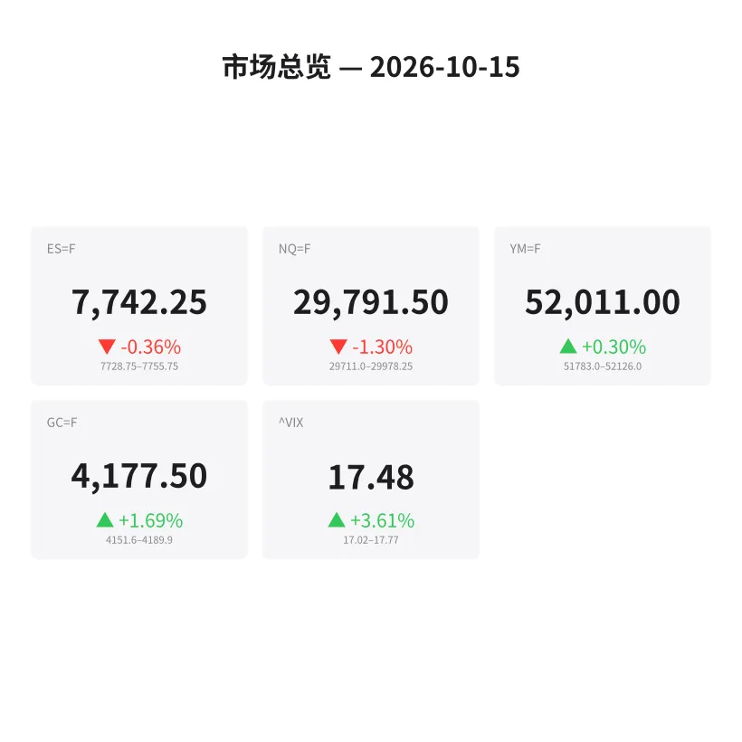
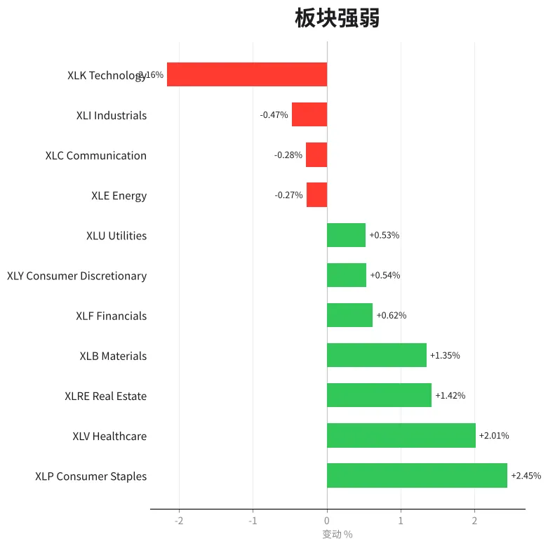
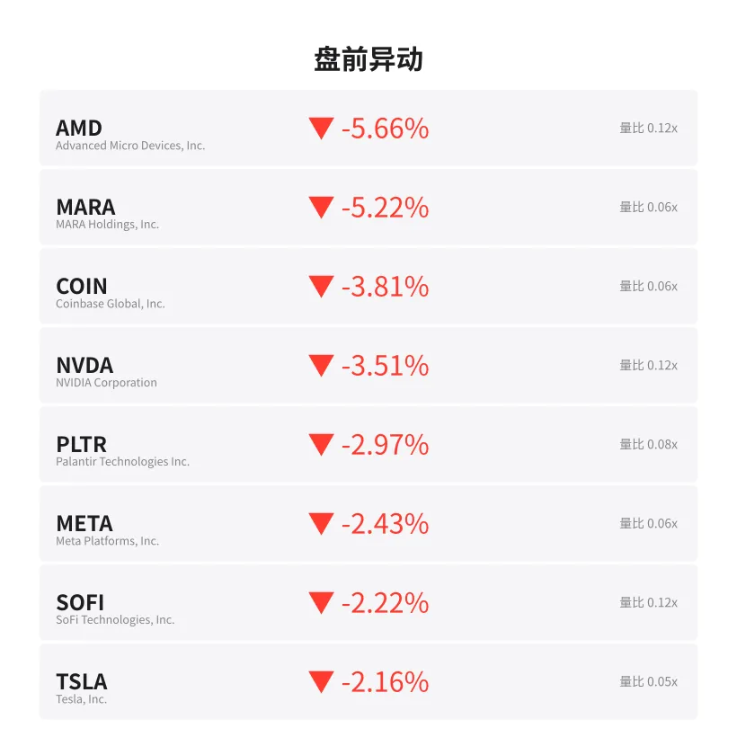
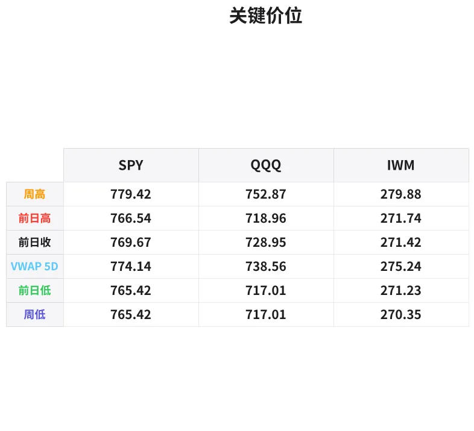

# 盘前分析报告 — 2026-10-15
*生成时间: 13:32:13 UTC*

---
## 数据速览

---
## 一、宏观环境

> [!info]- 详细数据：指数期货 & VIX
> ### 1.1 指数期货 & VIX
> | 品种 | 现价 | 涨跌幅 | 前收 | 日高 | 日低 |
> |------|------|--------|------|------|------|
> | ES=F | 7742.25 | -0.36% | 7770.25 | 7769.5 | 7728.75 |
> | NQ=F | 29791.5 | -1.30% | 30182.75 | 30158.5 | 29711.0 |
> | YM=F | 52011.0 | +0.30% | 51858.0 | 52126.0 | 51783.0 |
> | GC=F | 4177.5 | +1.69% | 4107.9 | 4189.9 | 4120.9 |
> | ^VIX | 17.48 | +3.61% | 15.27 | 17.77 | 17.02 |

> [!info]- 详细数据：隔夜走势
> ### 1.2 隔夜走势（Globex）
> | 品种 | 隔夜高 | 隔夜低 | 区间 | 亚洲高 | 亚洲低 | 欧洲高 | 欧洲低 |
> |------|--------|--------|------|--------|--------|--------|--------|
> | ES=F | 7755.75 | 7728.75 | 27.0 | 7748.5 | 7729.5 | 7755.75 | 7730.5 |
> | NQ=F | 29978.25 | 29711.0 | 267.25 | 29978.25 | 29828.25 | 29941.0 | 29748.5 |
> | YM=F | 52126.0 | 51783.0 | 343.0 | 51903.0 | 51783.0 | 52118.0 | 51861.0 |
> | GC=F | 4189.9 | 4151.6 | 38.3 | 4168.9 | 4156.9 | 4182.0 | 4152.7 |
> | ^VIX | 17.77 | 17.02 | 0.75 | — | — | 17.77 | 17.02 |

> [!info]- 详细数据：板块强弱
> ### 1.3 板块强弱
> | ETF | 板块 | 涨跌幅 |
> |-----|------|--------|
> | XLP | Consumer Staples | +2.45% |
> | XLV | Healthcare | +2.01% |
> | XLRE | Real Estate | +1.42% |
> | XLB | Materials | +1.35% |
> | XLF | Financials | +0.62% |
> | XLY | Consumer Discretionary | +0.54% |
> | XLU | Utilities | +0.53% |
> | XLE | Energy | -0.27% |
> | XLC | Communication | -0.28% |
> | XLI | Industrials | -0.47% |
> | XLK | Technology | -2.16% |

---
## 三、盘前异动

> [!info]- 详细数据：盘前异动
> | 代码 | 名称 | 现价 | 缺口 | 量比 |
> |------|------|------|------|------|
> | AMD | Advanced Micro Devices, Inc. | 538.51 | -5.66% | 0.12x |
> | MARA | MARA Holdings, Inc. | 7.8 | -5.22% | 0.06x |
> | COIN | Coinbase Global, Inc. | 166.3 | -3.81% | 0.06x |
> | NVDA | NVIDIA Corporation | 213.53 | -3.51% | 0.12x |
> | PLTR | Palantir Technologies Inc. | 195.01 | -2.97% | 0.08x |
> | META | Meta Platforms, Inc. | 719.6 | -2.43% | 0.06x |
> | SOFI | SoFi Technologies, Inc. | 13.9 | -2.22% | 0.12x |
> | TSLA | Tesla, Inc. | 359.22 | -2.16% | 0.05x |
> | AMZN | Amazon.com, Inc. | 249.3 | -1.88% | 0.07x |
> | GOOGL | Alphabet Inc. | 341.36 | -1.81% | 0.08x |

---
## 四、关键价位

> [!info]- 详细数据：SPY 关键价位
> ### SPY
> | 价位类型 | 价格 |
> |----------|------|
> | Prior Day High | 766.54 |
> | Prior Day Low | 765.42 |
> | Prior Day Close | 769.67 |
> | Approx Vwap 5D | 774.14 |
> | Weekly High | 779.42 |
> | Weekly Low | 765.42 |

> [!info]- 详细数据：QQQ 关键价位
> ### QQQ
> | 价位类型 | 价格 |
> |----------|------|
> | Prior Day High | 718.96 |
> | Prior Day Low | 717.01 |
> | Prior Day Close | 728.95 |
> | Approx Vwap 5D | 738.56 |
> | Weekly High | 752.87 |
> | Weekly Low | 717.01 |

> [!info]- 详细数据：IWM 关键价位
> ### IWM
> | 价位类型 | 价格 |
> |----------|------|
> | Prior Day High | 271.74 |
> | Prior Day Low | 271.231 |
> | Prior Day Close | 271.42 |
> | Approx Vwap 5D | 275.24 |
> | Weekly High | 279.88 |
> | Weekly Low | 270.35 |

---
## 五、AI 技术分析 & 操盘建议

## 第一部分：隔夜市场回顾

### 亚洲时段（18:00–02:00 ET）
亚洲时段整体交投清淡，ES在7729.5–7748.5窄幅区间震荡（仅19点），显示亚洲资金观望情绪浓厚。NQ表现相对活跃，在29828–29978区间运行（150点），但未能突破30000心理关口。GC黄金在亚洲盘维持在4157–4169区间，买盘稳健。YM道指偏弱，守在51783–51903低位运行。

**亚洲时段信号：** 科技板块抛压在亚洲已显现端倪，NQ在RTH收盘后持续回落，暗示隔夜空头主导。

### 欧洲时段（02:00–09:30 ET）
欧洲开盘后波动加大。ES小幅反弹至7755.75高点但随即受压回落至7730.5，整体维持窄幅。NQ在欧洲盘继续走弱，从29941滑落至29748.5，跌破亚洲低点，空头加速。GC黄金在欧洲盘突破4180关口最高触及4182，避险买盘显著。YM道指反而走强，从51861反弹至52118，显示资金从科技流向传统蓝筹。

**欧洲时段信号：** 明确的板块轮动信号——科技（NQ）被抛售，资金流入防御性板块和黄金，VIX从15.27跳涨至17.48（+14.5%），风险偏好显著下降。

### 对美盘的影响
1. **NQ领跌格局确立：** NQ隔夜跌幅-1.30%远超ES的-0.36%，科技股全线缺口下跌（AMD -5.66%, NVDA -3.51%, META -2.43%），预示RTH开盘后NQ将承压
2. **防御性轮动明确：** XLP(+2.45%), XLV(+2.01%), XLRE(+1.42%)强势 vs XLK(-2.16%)——典型risk-off格局
3. **VIX跳升需警惕：** 17.48水平虽非极端，但+3.61%的涨幅暗示期权市场在对冲下行风险
4. **黄金避险买盘活跃：** GC +1.69%至4177.5，与科技抛售形成镜像，确认避险流向

## 第二部分：期货品种分析

### ES（E-mini S&P 500）— 当前 7742.25

**多时间框架分析：**
- **日线：** 前收7770.25，今日缺口下跌约28点。周高779.42（SPY换算约7794），周低765.42（约7654），当前处于周区间中上段
- **4H：** 从7770下方开盘，隔夜未能回补缺口，空头占优
- **1H/15min：** 隔夜区间7728.75–7755.75（27点窄幅），欧洲时段高点7755.75构成即时阻力

**关键价位：**
| 类型 | 价位 | 说明 |
|------|------|------|
| 隔夜高 | 7755.75 | 即时阻力，欧盘高点 |
| 前收 | 7770.25 | 缺口回补位，强阻力 |
| 隔夜低 | 7728.75 | 即时支撑 |
| 心理位 | 7700 | 下方关键支撑 |

**方向偏见：** 偏空 — 置信度 65%
- 缺口下跌+VIX跳升+板块轮动均指向下行
- 但ES跌幅有限(-0.36%)，YM反涨+0.30%，说明蓝筹端有买盘托底，下跌空间可能有限

**交易计划：**
- **空单方案A（首选）：** 反弹至7752–7758（隔夜高附近）入场做空，止损7770上方（前收上），T1: 7730, T2: 7710
- **空单方案B：** 跌破7728隔夜低做空，止损7742，T1: 7710, T2: 7700
- **多单方案：** 仅在放量收复7770（缺口回补）后考虑做多，目标7790
- **失效条件：** 开盘30分钟内放量站上7770并持稳，空头逻辑失效

---

### NQ（E-mini Nasdaq 100）— 当前 29791.5

**多时间框架分析：**
- **日线：** 前收30182.75，今日大幅缺口下跌391点（-1.30%）。这是今天波动最大的品种
- **4H：** 从30182急跌至29711低点（隔夜低），跌幅471点，空头主导
- **1H/15min：** 隔夜区间29711–29978（267点宽幅），当前在中段29791附近

**关键价位：**
| 类型 | 价位 | 说明 |
|------|------|------|
| 隔夜高 | 29978.25 | 即时阻力 |
| 心理位 | 30000 | 强心理阻力，未能收复 |
| 前收 | 30182.75 | 缺口回补位 |
| 隔夜低 | 29711 | 关键支撑 |
| 心理位 | 29500 | 下方强支撑 |

**方向偏见：** 偏空 — 置信度 75%
- 科技股全线缺口下跌，AMD -5.66% NVDA -3.51%领跌
- XLK -2.16%，板块资金流出明确
- 30000关口失守且隔夜未能夺回，空头强势信号
- VIX +3.61%确认恐慌情绪

**交易计划：**
- **空单方案A（首选）：** 反弹至29950–30000（心理关口+隔夜高附近）做空，止损30050，T1: 29750, T2: 29600
- **空单方案B：** 跌破29711隔夜低做空，止损29800，T1: 29500, T2: 29350
- **多单方案：** 仅在放量站上30000并回踩确认后做多（反弹交易），目标30100
- **失效条件：** 放量突破30050并持稳10分钟以上，空头逻辑失效

---

### GC（黄金期货）— 当前 4177.5

**多时间框架分析：**
- **日线：** 前收4107.9，今日跳空高开+69.6点（+1.69%），强势上涨
- **4H：** 从4120.9低点一路走高至4189.9高点（69点），多头强势
- **1H/15min：** 隔夜区间4151.6–4189.9（38.3点），当前在高位4177附近整理

**关键价位：**
| 类型 | 价位 | 说明 |
|------|------|------|
| 隔夜高/日高 | 4189.9 | 即时阻力 |
| 心理位 | 4200 | 上方重要关口 |
| 当前价 | 4177.5 | 多头整理区 |
| 隔夜低 | 4151.6 | 回调支撑 |
| 前收 | 4107.9 | 缺口起点 |

**方向偏见：** 偏多 — 置信度 70%
- 避险驱动+科技抛售+VIX跳升，黄金做多逻辑清晰
- 但+1.69%的涨幅后需警惕盘中获利回吐

**交易计划：**
- **多单方案A（首选）：** 回调至4165–4170（亚洲高点附近）做多，止损4150，T1: 4190, T2: 4210
- **多单方案B：** 突破4190（隔夜/日高）做多，止损4175，T1: 4200, T2: 4220
- **空单方案：** 仅在跌破4150并放量确认后考虑（隔夜低失守），目标4130
- **失效条件：** 跌破4151.6隔夜低并持续走弱，多头逻辑失效

## 第三部分：ETF品种分析

### SPY（S&P 500 ETF）— 昨收 769.67

**关键价位：**
| 类型 | 价位 | 说明 |
|------|------|------|
| 5日VWAP | 774.14 | 上方动态阻力 |
| 前收 | 769.67 | 缺口起点 |
| 周高 | 779.42 | 本周阻力 |
| 前日高 | 766.54 | 即时支撑参考 |
| 前日低 | 765.42 | 关键支撑 |
| 周低 | 765.42 | 与前日低重合，强支撑 |

**分析要点：**
- ES期货-0.36%换算SPY预期开盘约766.9附近（769.67 × 0.9964），位于前日高766.54上方
- SPY前日低与周低重合在765.42，形成强支撑区
- 5日VWAP 774.14位于上方，做多需谨慎，VWAP向下意味着短期趋势偏空
- ES隔夜波动仅27点（约2.7 SPY点），暗示SPY今日可能走窄幅波动

**交易计划：**
- **空单方案：** 反弹至769–770（前收附近）遇阻做空，止损771上方，T1: 766.5, T2: 765
- **多单方案：** 在765–765.50（周低/前日低支撑区）企稳做多，止损764，T1: 768, T2: 770
- **突破交易：** 跌破765做空，目标762–760；站上770做多，目标772–774

---

### QQQ（Nasdaq 100 ETF）— 昨收 728.95

**关键价位：**
| 类型 | 价位 | 说明 |
|------|------|------|
| 5日VWAP | 738.56 | 远上方阻力 |
| 周高 | 752.87 | 本周阻力 |
| 前收 | 728.95 | 缺口起点 |
| 前日高 | 718.96 | 下方参考 |
| 前日低 | 717.01 | 关键支撑 |

**分析要点：**
- NQ期货-1.30%换算QQQ预期开盘约719.5附近（728.95 × 0.987），直接下探前日高718.96附近
- 5日VWAP 738.56远在上方（距当前约19点），QQQ已明显偏离均值，短期超跌
- 科技股全线大幅缺口下跌驱动QQQ领跌（AMD -5.66%, NVDA -3.51%）
- 前日低717.01是关键支撑，跌破则打开更大下跌空间

**交易计划：**
- **空单方案（首选）：** 反弹至723–725（缺口内反弹）遇阻做空，止损727，T1: 719, T2: 717
- **多单方案：** 仅在717–718（前日低附近）出现明确买盘信号时做多（反弹交易），止损715，T1: 722, T2: 725
- **突破交易：** 跌破717做空，目标713–710
- **注意：** QQQ今日是主战场，波动率最高，建议缩小仓位控制风险

## 第四部分：今日市场总览

### 整体情绪判断
**偏空（Bearish Lean）** — 科技板块主导的风险规避日。

今日市场呈现典型的"risk-off轮动"格局：
- 科技（XLK -2.16%）大幅领跌，防御板块（XLP +2.45%, XLV +2.01%）领涨
- NQ跌幅（-1.30%）远超ES（-0.36%）和YM（+0.30%），ES/NQ价差扩大
- 黄金GC +1.69%走强，经典避险信号
- 前十大盘前异动股全部为下跌缺口，且集中在科技/加密板块

### VIX 分析
VIX 17.48（+3.61%），从15.27跳涨。隔夜区间17.02–17.77。
- 17.48处于温和恐慌区间，尚未触发极端水平（>20）
- 但日内涨幅+14.5%（从15.27到17.48的绝对涨幅）值得关注
- VIX在17.77见顶后略有回落，暗示恐慌可能已被部分定价
- 需关注开盘后VIX是否继续走高突破18——若突破，则下行压力加大

### 需回避的时间窗口
1. **09:30–10:00（开盘前30分钟）：** 缺口日开盘波动剧烈，等待方向确认后再入场
2. **10:00 经济数据窗口：** 关注是否有影响市场的数据发布
3. **11:30–13:00（午盘）：** 流动性下降，假突破频发
4. **15:00–15:30（尾盘前）：** 机构调仓可能引发逆转

### 板块轮动观察
- **流出板块：** 科技（XLK -2.16%）、通信（XLC -0.28%）、工业（XLI -0.47%）、能源（XLE -0.27%）
- **流入板块：** 消费必需品（XLP +2.45%）、医疗（XLV +2.01%）、地产（XLRE +1.42%）、材料（XLB +1.35%）
- **解读：** 资金从高Beta成长股撤出，流向低Beta防御板块，暗示机构在降低组合风险敞口。这种轮动在没有明确催化剂的情况下通常持续1–2天

### 核心交易论点（一句话）

> **科技领跌、防御领涨、黄金走强、VIX跳升——今日做NQ空头是阻力最小方向，反弹至30000关口附近做空是最优风险回报比入场点。**
