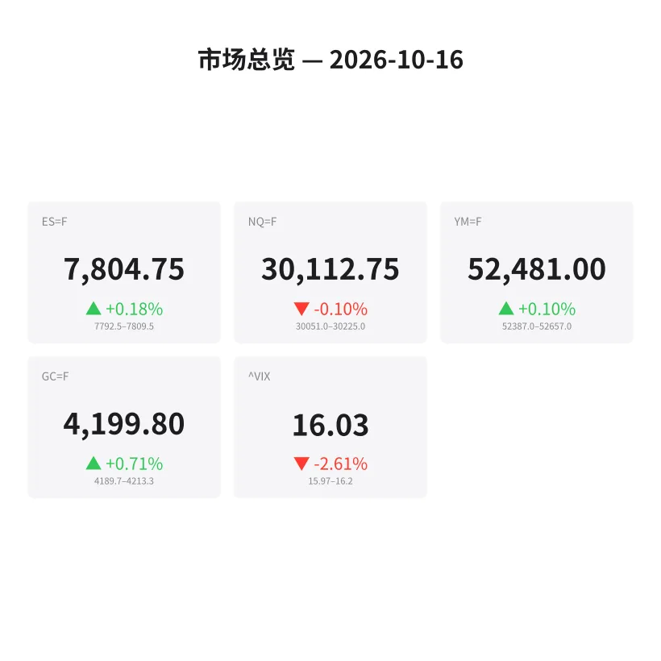
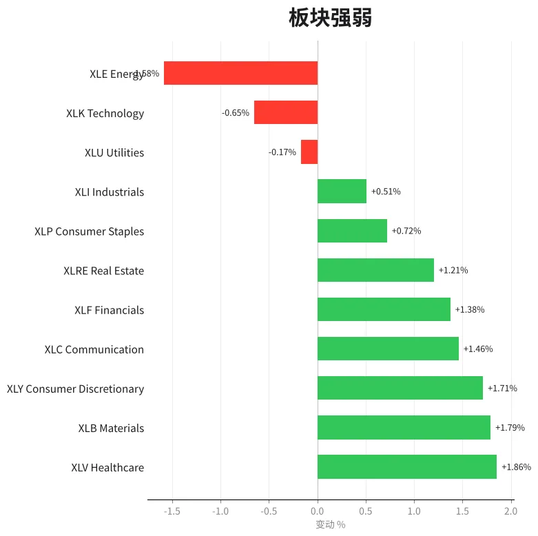
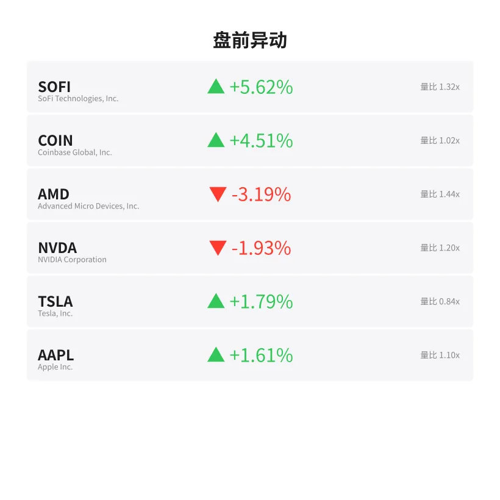
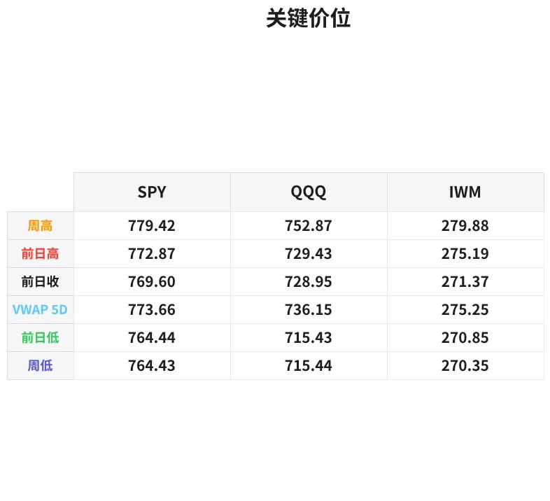

# 盘前分析报告 — 2026-10-16
*生成时间: 12:44:44 UTC*

---
## 数据速览

---
## 一、宏观环境

> [!info]- 详细数据：指数期货 & VIX
> ### 1.1 指数期货 & VIX
> | 品种 | 现价 | 涨跌幅 | 前收 | 日高 | 日低 |
> |------|------|--------|------|------|------|
> | ES=F | 7804.75 | +0.18% | 7791.0 | 7809.5 | 7774.75 |
> | NQ=F | 30112.75 | -0.10% | 30143.75 | 30224.5 | 29959.25 |
> | YM=F | 52481.0 | +0.10% | 52430.0 | 52657.0 | 52380.0 |
> | GC=F | 4199.8 | +0.71% | 4170.1 | 4213.3 | 4167.5 |
> | ^VIX | 16.03 | -2.61% | 16.46 | 16.2 | 15.97 |

> [!info]- 详细数据：隔夜走势
> ### 1.2 隔夜走势（Globex）
> | 品种 | 隔夜高 | 隔夜低 | 区间 | 亚洲高 | 亚洲低 | 欧洲高 | 欧洲低 |
> |------|--------|--------|------|--------|--------|--------|--------|
> | ES=F | 7809.5 | 7792.5 | 17.0 | 7806.0 | 7796.25 | 7809.5 | 7792.5 |
> | NQ=F | 30225.0 | 30051.0 | 174.0 | 30225.0 | 30148.75 | 30209.75 | 30051.0 |
> | YM=F | 52657.0 | 52387.0 | 270.0 | 52530.0 | 52465.0 | 52657.0 | 52394.0 |
> | GC=F | 4213.3 | 4189.7 | 23.6 | 4207.9 | 4190.7 | 4213.3 | 4189.7 |
> | ^VIX | 16.2 | 15.97 | 0.23 | — | — | 16.2 | 15.97 |

> [!info]- 详细数据：板块强弱
> ### 1.3 板块强弱
> | ETF | 板块 | 涨跌幅 |
> |-----|------|--------|
> | XLV | Healthcare | +1.86% |
> | XLB | Materials | +1.79% |
> | XLY | Consumer Discretionary | +1.71% |
> | XLC | Communication | +1.46% |
> | XLF | Financials | +1.38% |
> | XLRE | Real Estate | +1.21% |
> | XLP | Consumer Staples | +0.72% |
> | XLI | Industrials | +0.51% |
> | XLU | Utilities | -0.17% |
> | XLK | Technology | -0.65% |
> | XLE | Energy | -1.58% |

---
## 三、盘前异动

> [!info]- 详细数据：盘前异动
> | 代码 | 名称 | 现价 | 缺口 | 量比 |
> |------|------|------|------|------|
> | SOFI | SoFi Technologies, Inc. | 15.02 | +5.62% | 1.32x |
> | COIN | Coinbase Global, Inc. | 180.68 | +4.51% | 1.02x |
> | AMD | Advanced Micro Devices, Inc. | 552.63 | -3.19% | 1.44x |
> | NVDA | NVIDIA Corporation | 217.03 | -1.93% | 1.2x |
> | TSLA | Tesla, Inc. | 373.71 | +1.79% | 0.84x |
> | AAPL | Apple Inc. | 348.49 | +1.61% | 1.1x |

---
## 四、关键价位

> [!info]- 详细数据：SPY 关键价位
> ### SPY
> | 价位类型 | 价格 |
> |----------|------|
> | Prior Day High | 772.87 |
> | Prior Day Low | 764.44 |
> | Prior Day Close | 769.6 |
> | Premarket Price | 773.04 |
> | Approx Vwap 5D | 773.66 |
> | Weekly High | 779.42 |
> | Weekly Low | 764.43 |

> [!info]- 详细数据：QQQ 关键价位
> ### QQQ
> | 价位类型 | 价格 |
> |----------|------|
> | Prior Day High | 729.43 |
> | Prior Day Low | 715.435 |
> | Prior Day Close | 728.95 |
> | Premarket Price | 727.02 |
> | Approx Vwap 5D | 736.15 |
> | Weekly High | 752.87 |
> | Weekly Low | 715.44 |

> [!info]- 详细数据：IWM 关键价位
> ### IWM
> | 价位类型 | 价格 |
> |----------|------|
> | Prior Day High | 275.19 |
> | Prior Day Low | 270.85 |
> | Prior Day Close | 271.37 |
> | Premarket Price | 275.5575 |
> | Approx Vwap 5D | 275.25 |
> | Weekly High | 279.88 |
> | Weekly Low | 270.35 |

---
## 五、AI 技术分析 & 操盘建议

## 第一部分：隔夜市场回顾

### 亚洲时段（18:00–02:00 ET）

亚洲时段整体走势平稳偏强。ES在7796.25–7806.0之间窄幅震荡，区间不足10点，显示亚洲资金参与度有限，买卖双方处于观望状态。NQ表现相对活跃，在30148.75–30225.0之间运行，亚盘一度触及隔夜高点30225.0，随后回落整理。GC延续近期强势，亚洲时段在4190.7–4207.9之间运行，黄金买盘持续。VIX亚洲时段数据缺失，无法判断亚洲时段波动率变化。

**关键观察：** NQ在亚洲时段率先测试隔夜高点但未能突破，暗示多头在高位有获利了结意愿。

### 欧洲时段（02:00–09:30 ET）

欧洲时段波动加大。ES区间扩展至7792.5–7809.5（全隔夜区间），欧洲资金先拉高后回落，形成了当日首个完整的高低参考区间。NQ欧洲时段明显走弱，低点30051.0远低于亚盘低点30148.75，下跌近175点，显示科技板块在欧洲时段承压。GC欧洲时段触及隔夜高点4213.3，黄金多头在欧洲时段进一步发力，逼近4200整数关口上方。

**对美盘的启示：**
1. ES隔夜区间极窄（17点），预示美盘开盘可能出现方向性突破
2. NQ欧洲时段的抛压需要警惕——如果美盘NQ继续弱于ES，说明资金在离开科技股
3. GC突破4200后能否站稳将是今日避险情绪的晴雨表
4. VIX跌至16.03（-2.61%），低波动环境意味着今日可能出现趋势行情而非震荡

## 第二部分：期货品种分析

### ES（E-mini S&P 500）— 现价 7804.75

**多时间框架分析：**
- **日线：** 收于前高7791.0上方，隔夜延续上行。盘前7804.75位于前日高点7809.5（即隔夜高点）下方不足5点，构成明确的阻力位测试格局。日线趋势偏多但接近前高阻力。
- **4小时：** 从前日低点7774.75到隔夜高7809.5，34.75点的上行波段。当前价格处于该波段的上半段，买方控制局面。
- **隔夜：** 17点极窄区间（7792.5–7809.5），这是近期罕见的低波动隔夜走势。窄区间后的美盘开盘通常伴随单边突破。

**关键价位：**
| 类型 | 价格 | 说明 |
|------|------|------|
| 隔夜高/前日高 | 7809.5 | 核心阻力，突破则多头加速 |
| 隔夜低 | 7792.5 | 多头防守位 |
| 前日收盘 | 7791.0 | 与隔夜低接近，破位则转空 |
| 前日低 | 7774.75 | 日内极端支撑 |
| 5日VWAP（SPY换算）| ~7737 | 周线锚定位 |

**方向偏向：** 多头偏向 | 置信度 70%

隔夜持续在前收上方运行，VIX下降，板块面医疗/材料/消费领涨显示资金愿意进入风险资产。但NQ弱于ES需要警惕科技板块拖累。

**交易计划：**
- **多头入场区域：** 7792–7796（隔夜低点/亚洲低点附近）回踩不破可做多
- **止损：** 7788（隔夜低下方4点）
- **T1：** 7809.5（前日高/隔夜高）
- **T2：** 7820（前日高突破后的测量目标）
- **失效条件：** 如果开盘前30分钟跌破7788并收在其下方，多头逻辑失效，转为观望或顺势做空

---

### NQ（E-mini Nasdaq 100）— 现价 30112.75

**多时间框架分析：**
- **日线：** 收于前收30143.75下方，盘前微跌-0.10%。日线出现犹豫信号，前日高30224.5未能维持。
- **4小时：** 从前日高30224.5回落至当前30112.75，回撤超过100点。如果美盘不能收复30200上方，4H级别将确认回调形态。
- **隔夜：** 174点宽幅震荡（30051–30225），远大于ES的17点。NQ隔夜波动率远高于ES，显示科技板块资金分歧严重。亚洲时段先上后下，欧洲时段进一步杀跌至30051。

**关键价位：**
| 类型 | 价格 | 说明 |
|------|------|------|
| 隔夜高 | 30225.0 | 当日最强阻力 |
| 前日高 | 30224.5 | 与隔夜高重合，双重阻力 |
| 前日收盘 | 30143.75 | 多空分水岭 |
| 当前价 | 30112.75 | 位于前收下方 |
| 隔夜低 | 30051.0 | 空头止盈/多头抄底位 |
| 前日低 | 29959.25 | 日内极端支撑 |
| 5日VWAP（QQQ换算）| ~30175 | 周线锚定，当前在其下方 |

**方向偏向：** 中性偏空 | 置信度 60%

NQ欧洲时段大幅回落至30051后反弹至30112，但仍在前收下方运行。AMD -3.19%、NVDA -1.93%的盘前跌幅显示半导体板块承压，XLK -0.65%确认科技弱势。在NQ收复前收30143之前，维持空头偏向。

**交易计划：**
- **空头入场区域：** 30140–30175（前收/5DVWAP附近反弹受阻）
- **止损：** 30230（隔夜高上方）
- **T1：** 30050（隔夜低）
- **T2：** 29960（前日低）
- **失效条件：** 如果美盘开盘强势突破30225并回踩不破，空头逻辑失效，NQ转强

---

### GC（黄金期货）— 现价 4199.8

**多时间框架分析：**
- **日线：** 收于前收4170.1上方，涨幅+0.71%。日线连续走强，多头趋势明确。
- **4小时：** 从4167.5低点到4213.3高点，45.8点的上行波段。当前价格4199.8回落至波段的70%位置，属于正常回踩。
- **隔夜：** 23.6点区间（4189.7–4213.3），多头在亚欧时段持续买入。4200整数关口是当日焦点。

**关键价位：**
| 类型 | 价格 | 说明 |
|------|------|------|
| 隔夜高/日高 | 4213.3 | 突破目标 |
| 4200整数位 | 4200.0 | 心理关口，当前贴近 |
| 隔夜低 | 4189.7 | 回踩支撑 |
| 前日收盘 | 4170.1 | 多头防线 |
| 前日低 | 4167.5 | 极端支撑 |
| 5日VWAP | ~4185 | 周线锚定 |

**方向偏向：** 多头偏向 | 置信度 75%

VIX下降但GC走强，暗示黄金的上涨可能不仅仅是避险驱动，可能包含通胀预期或美元走弱的因素。板块面XLB材料+1.79%也验证了商品端的强势。4200整数关口的突破确认将是重要信号。

**交易计划：**
- **多头入场区域：** 4189–4195（隔夜低附近/4200下方回踩）
- **止损：** 4185（隔夜低下方5点）
- **T1：** 4213（隔夜高/日高）
- **T2：** 4225（日高突破后延伸目标）
- **失效条件：** 如果跌破4185并放量下行，多头逻辑失效，可能回补缺口至4170

## 第三部分：ETF品种分析

### SPY（SPDR S&P 500 ETF）— 盘前 773.04

**关键价位：**
| 类型 | 价格 | 说明 |
|------|------|------|
| 周高 | 779.42 | 周线阻力，突破则新高 |
| 5日VWAP | 773.66 | 当前贴近，短期锚定位 |
| 盘前价 | 773.04 | 略低于VWAP |
| 前日高 | 772.87 | 盘前已突破，转为支撑 |
| 前日收盘 | 769.60 | 多头防线 |
| 前日低 | 764.44 | 日内极端支撑 |
| 周低 | 764.43 | 与前日低重合，双重支撑 |

**交易计划：**

盘前773.04位于前日高772.87上方，显示缺口高开。开盘后关注两个关键场景：

**场景A — 继续走强（60%概率）：**
- 开盘守住772.87（前日高转支撑），回踩至772.5–773.0区域可做多
- 止损：771.80（前日高下方1点）
- T1：773.66（5DVWAP）
- T2：776.00（前日高至周高中间位）
- 如果放量突破773.66并站稳，上看779.42周高

**场景B — 回补缺口（40%概率）：**
- 如果开盘前15分钟跌破772.87回补缺口
- 等待770.00附近（前收769.60与前日高772.87的中间位）企稳信号
- 止损：769.00
- 反弹目标：773.00

**注意：** 5DVWAP 773.66是今日SPY的核心锚定位。如果日内围绕此价位反复拉锯，说明多空分歧大，适合缩小仓位做区间。

---

### QQQ（Invesco QQQ Trust）— 盘前 727.02

**关键价位：**
| 类型 | 价格 | 说明 |
|------|------|------|
| 周高 | 752.87 | 远离当前价，非今日目标 |
| 5日VWAP | 736.15 | 当前远低于此位，弱势信号 |
| 前日高 | 729.43 | 日内核心阻力 |
| 前日收盘 | 728.95 | 当前在其下方 |
| 盘前价 | 727.02 | 低于前收，缺口低开 |
| 前日低 | 715.44 | 日内极端支撑 |
| 周低 | 715.44 | 与前日低重合 |

**交易计划：**

盘前727.02位于前收728.95下方，配合NQ期货的弱势，QQQ今日开盘偏弱。AMD -3.19%和NVDA -1.93%的盘前跌幅将直接拖累QQQ表现。

**场景A — 反弹后再跌（55%概率）：**
- 开盘如果反弹至728.50–729.50（前收/前日高区域）受阻
- 在该区域做空，止损730.50
- T1：725.00（开盘低下方）
- T2：720.00（前日低和前收的中间位）

**场景B — 直接反转走强（25%概率）：**
- 开盘放量突破729.43（前日高）并站稳
- 等待回踩729.00不破后做多
- 止损：728.00
- 目标：732.00–733.00

**场景C — 持续走弱（20%概率）：**
- 开盘直接跌破726.00，不做逆势抄底
- 等待720.00附近看支撑信号

**注意：** QQQ与SPY今日大概率出现分化走势（SPY强QQQ弱）。如果做多SPY、做空QQQ的配对交易，今日可能是理想的执行窗口。5DVWAP 736.15远在头顶，QQQ日内不太可能触及。

## 第四部分：今日市场总览

### 整体情绪判断

**偏多但分化。** ES/YM温和走强（+0.18%/+0.10%），NQ微跌（-0.10%），VIX继续回落至16.03（-2.61%）。低波动率+ES隔夜窄幅整理的组合通常预示美盘出现单边行情的概率较高。但NQ与ES的分化、科技板块的弱势（XLK -0.65%）使得整体多头信心打了折扣。

### VIX 分析

VIX 16.03处于偏低水平，且继续下行。隔夜区间15.97–16.20极窄。

**含义：**
- 期权隐含波动率偏低，期权卖方占优
- 如果VIX继续下行至15.5以下，SPY可能加速上行
- 但注意VIX在极低位反弹时往往又急又猛——如果VIX盘中突然拉升至17以上，应立即减仓多头

### 需要避开的时间窗口

| 时间（ET） | 事件 | 影响 |
|------------|------|------|
| 09:30–09:45 | 开盘前15分钟 | 等待初始方向确认，不要追单 |
| 10:00 | 关注是否有经济数据发布 | 数据公布前后2分钟不开仓 |
| 11:30–13:00 | 午盘死亡区 | 流动性下降，假突破频发，减少交易 |
| 15:45–16:00 | 收盘前15分钟 | MOC订单流可能导致剧烈波动 |

### 板块轮动观察

今日板块格局明显呈现"防御+周期 > 科技"的特征：
- **领涨：** XLV 医疗+1.86%、XLB 材料+1.79%、XLY 消费+1.71%
- **中间：** XLC 通信+1.46%、XLF 金融+1.38%、XLRE 地产+1.21%
- **落后：** XLU 公用-0.17%、XLK 科技-0.65%、XLE 能源-1.58%

资金从科技和能源流出，进入医疗、材料和消费。这通常发生在市场对经济前景保持信心但认为科技估值过高的阶段。SOFI +5.62%和COIN +4.51%的强势可能与加密/金融科技特定催化剂有关，不代表整体科技板块方向。

### 盘前异动点评
- **SOFI +5.62%：** 领涨异动，量比1.32x。可能有财报或业务催化剂。开盘关注15.00整数位支撑。
- **COIN +4.51%：** 加密相关走强。BTC行情联动关注。
- **AMD -3.19%：** 半导体龙头大幅走弱，量比1.44x。对QQQ拖累最直接，也影响NQ走势。
- **NVDA -1.93%：** AI龙头下跌。AMD+NVDA双双走弱=半导体板块全面承压。

### 🎯 核心操盘论点

**"ES做多守隔夜低，NQ观望或轻仓做空前收附近，GC回踩4190做多。"**

今日市场的核心矛盾是ES/SPY的多头动能与NQ/QQQ的空头压力之间的拉锯。最安全的操作是跟随强势品种（ES做多）而非逆势抄底弱势品种（NQ做多）。GC独立于股指走出多头趋势，提供额外的交易机会。

**风控提示：** 今日ES隔夜区间仅17点，开盘后的第一波突破幅度可能远超隔夜区间，注意控制初始仓位大小，等待第一根15分钟K线收盘后再加仓。
