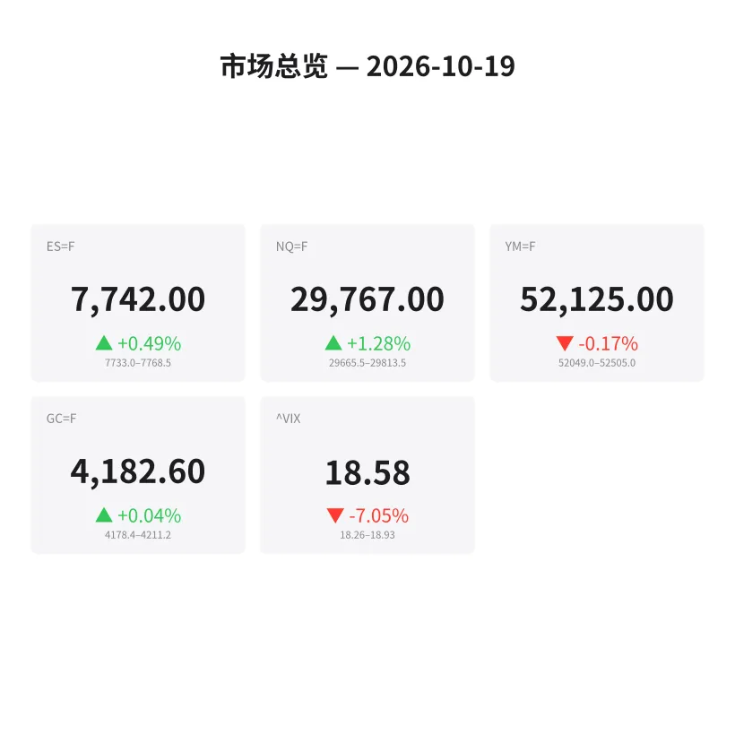
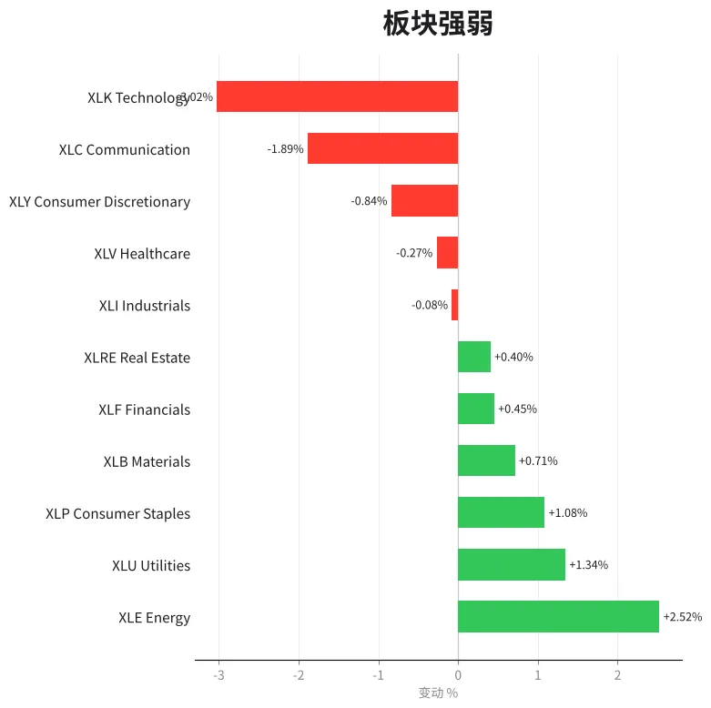
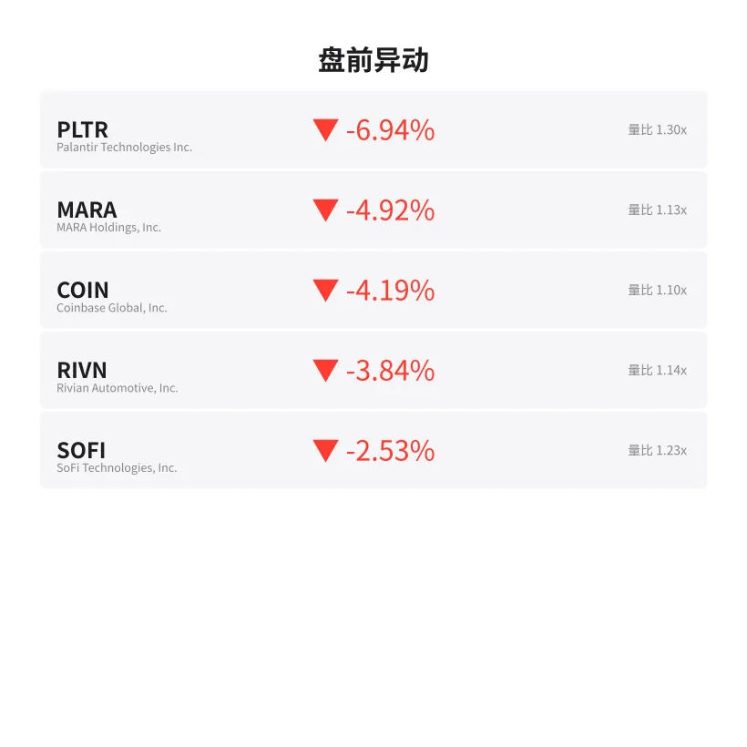
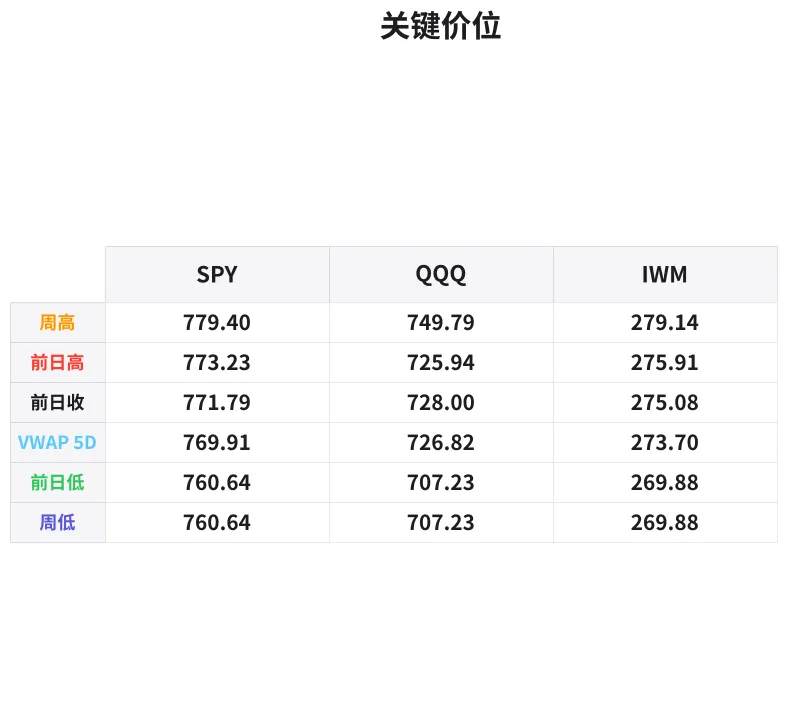

# 盘前分析报告 — 2026-10-19
*生成时间: 12:44:17 UTC*

---
## 数据速览

---
## 一、宏观环境

> [!info]- 详细数据：指数期货 & VIX
> ### 1.1 指数期货 & VIX
> | 品种 | 现价 | 涨跌幅 | 前收 | 日高 | 日低 |
> |------|------|--------|------|------|------|
> | ES=F | 7742.0 | +0.49% | 7704.25 | 7768.5 | 7677.0 |
> | NQ=F | 29767.0 | +1.28% | 29391.5 | 29813.5 | 29226.0 |
> | YM=F | 52125.0 | -0.17% | 52214.0 | 52508.0 | 52041.0 |
> | GC=F | 4182.6 | +0.04% | 4181.1 | 4211.2 | 4176.0 |
> | ^VIX | 18.58 | -7.05% | 19.99 | 18.93 | 18.26 |

> [!info]- 详细数据：隔夜走势
> ### 1.2 隔夜走势（Globex）
> | 品种 | 隔夜高 | 隔夜低 | 区间 | 亚洲高 | 亚洲低 | 欧洲高 | 欧洲低 |
> |------|--------|--------|------|--------|--------|--------|--------|
> | ES=F | 7768.5 | 7733.0 | 35.5 | 7768.5 | 7762.0 | 7766.75 | 7733.0 |
> | NQ=F | 29813.5 | 29665.5 | 148.0 | 29804.25 | 29752.0 | 29813.5 | 29665.5 |
> | YM=F | 52505.0 | 52049.0 | 456.0 | 52505.0 | 52461.0 | 52488.0 | 52070.0 |
> | GC=F | 4211.2 | 4178.4 | 32.8 | 4206.6 | 4193.2 | 4211.2 | 4181.1 |
> | ^VIX | 18.93 | 18.26 | 0.67 | — | — | 18.93 | 18.26 |

> [!info]- 详细数据：板块强弱
> ### 1.3 板块强弱
> | ETF | 板块 | 涨跌幅 |
> |-----|------|--------|
> | XLE | Energy | +2.52% |
> | XLU | Utilities | +1.34% |
> | XLP | Consumer Staples | +1.08% |
> | XLB | Materials | +0.71% |
> | XLF | Financials | +0.45% |
> | XLRE | Real Estate | +0.40% |
> | XLI | Industrials | -0.08% |
> | XLV | Healthcare | -0.27% |
> | XLY | Consumer Discretionary | -0.84% |
> | XLC | Communication | -1.89% |
> | XLK | Technology | -3.02% |

---
## 三、盘前异动

> [!info]- 详细数据：盘前异动
> | 代码 | 名称 | 现价 | 缺口 | 量比 |
> |------|------|------|------|------|
> | PLTR | Palantir Technologies Inc. | 186.59 | -6.94% | 1.3x |
> | MARA | MARA Holdings, Inc. | 7.92 | -4.92% | 1.13x |
> | COIN | Coinbase Global, Inc. | 176.1 | -4.19% | 1.1x |
> | RIVN | Rivian Automotive, Inc. | 12.52 | -3.84% | 1.14x |
> | SOFI | SoFi Technologies, Inc. | 14.71 | -2.53% | 1.23x |

---
## 四、关键价位

> [!info]- 详细数据：SPY 关键价位
> ### SPY
> | 价位类型 | 价格 |
> |----------|------|
> | Prior Day High | 773.23 |
> | Prior Day Low | 760.64 |
> | Prior Day Close | 771.79 |
> | Premarket Price | 766.99 |
> | Approx Vwap 5D | 769.91 |
> | Weekly High | 779.4 |
> | Weekly Low | 760.64 |

> [!info]- 详细数据：QQQ 关键价位
> ### QQQ
> | 价位类型 | 价格 |
> |----------|------|
> | Prior Day High | 725.94 |
> | Prior Day Low | 707.23 |
> | Prior Day Close | 728.0 |
> | Premarket Price | 719.01 |
> | Approx Vwap 5D | 726.82 |
> | Weekly High | 749.79 |
> | Weekly Low | 707.23 |

> [!info]- 详细数据：IWM 关键价位
> ### IWM
> | 价位类型 | 价格 |
> |----------|------|
> | Prior Day High | 275.91 |
> | Prior Day Low | 269.875 |
> | Prior Day Close | 275.08 |
> | Premarket Price | 271.6 |
> | Approx Vwap 5D | 273.7 |
> | Weekly High | 279.14 |
> | Weekly Low | 269.88 |

---
## 五、AI 技术分析 & 操盘建议

## 第一部分：隔夜市场回顾

### 亚洲时段（18:00–02:00 ET）
ES 在亚洲时段交投极为清淡，区间仅 6.5 点（7762.0–7768.5），始终维持在隔夜高位附近窄幅震荡。NQ 同样窄幅整理（29752–29804），未出现方向性突破。GC 在亚洲盘走出温和回落，从 4206.6 降至 4193.2，反映风险偏好短暂回暖。整体来看，亚洲时段多空胶着，未给出明确方向信号。

### 欧洲时段（02:00–09:30 ET）
欧洲开盘后波动显著放大。ES 从亚洲高位 7766.75 快速回落至隔夜低点 7733.0，跌幅约 33 点，显示欧洲资金入场后抛压增大。NQ 波动更为剧烈，从 29813.5 回落至 29665.5（约 148 点），反映科技股承压。YM 同步走弱，欧洲盘触及 52070 低点。GC 在欧洲时段先探高 4211.2 后回落至 4181.1，日内高低差达 30 点，黄金多空分歧加大。

### 对美盘的启示
1. **科技股持续承压**：NQ 隔夜区间（148点）远大于 ES（35.5点），表明科技板块是主要拖累
2. **VIX 回落至 18.58（-7.05%）**，但板块分化严重（XLK -3.02% vs XLE +2.52%），暗示市场并非全面风险偏好改善，而是资金轮动
3. **欧洲时段的抛压暗示美盘开盘可能延续弱势**，尤其在 ES 7733 区域需关注支撑力度

---
## 第二部分：期货品种分析

### ES（E-mini S&P 500）
**现价：7742.0 | 涨跌：+0.49% | 前收：7704.25**

**多时间框架分析：**
- **日线**：上周五收于 7704.25，盘前反弹至 7742，仍处于周内震荡区间中部。周高 7768.5 构成短期阻力。
- **4H**：欧洲时段从 7766.75 回落至 7733.0 后反弹，形成 V 型修复，当前回到 7742 中枢区域。
- **1H/15min**：关注 7733（欧洲低点 / 隔夜低点）和 7768.5（隔夜高点）的突破方向。

**关键价位：**
| 类型 | 价格 |
|------|------|
| 隔夜高（阻力1） | 7768.5 |
| 亚洲高（阻力2） | 7762.0 |
| 前收（枢轴） | 7704.25 |
| 隔夜低（支撑1） | 7733.0 |
| 日低（支撑2） | 7677.0 |

**方向偏向：** 中性偏多 | 置信度：55%
- 多头入场区间：7730–7738（欧洲低点附近回踩确认）
- 止损：7724（隔夜低下方 9 点）
- T1：7762（亚洲高点）| T2：7770（隔夜高上方）
- 失效条件：跌破 7720 并持续 15 分钟以上，转为空头思路，目标 7704（前收）→ 7677（日低）

### NQ（E-mini Nasdaq 100）
**现价：29767.0 | 涨跌：+1.28% | 前收：29391.5**

**多时间框架分析：**
- **日线**：虽然日涨幅达 1.28%，但 XLK -3.02% 的板块数据暗示科技个股分化严重。NQ 的涨幅可能来自少数权重股拉动。
- **4H**：欧洲时段大幅波动，高低差 148 点（29665.5–29813.5），远超 ES 的 35.5 点波动。
- **1H/15min**：当前 29767 处于欧洲区间中部偏上，需观察能否重新挑战 29813.5。

**关键价位：**
| 类型 | 价格 |
|------|------|
| 隔夜高 / 亚洲高（阻力） | 29813.5 |
| 现价 | 29767.0 |
| 欧洲低 / 隔夜低（支撑1） | 29665.5 |
| 前收（支撑2） | 29391.5 |

**方向偏向：** 中性 | 置信度：45%
- NQ 波动率远高于 ES，做空性价比优于做多
- 做多入场：29680–29710（欧洲低点上方确认反弹）
- 止损：29640
- T1：29800 | T2：29815
- 做空入场：29810–29830（隔夜高附近假突破确认）
- 止损：29870
- T1：29700 | T2：29665
- 失效条件：突破 29850 并站稳，放弃空头；跌破 29640 放弃多头

### GC（黄金期货）
**现价：4182.6 | 涨跌：+0.04% | 前收：4181.1**

**多时间框架分析：**
- **日线**：黄金维持窄幅震荡，日内仅微涨 1.5 点，但日内波幅达 35 点（4176–4211.2），表明多空激烈博弈。
- **4H**：亚洲盘缓跌（4206.6→4193.2），欧洲盘先冲高 4211.2 后大幅回落至 4181.1，尾盘勉强收回 4182.6。
- **1H/15min**：4211 构成短期强阻，4176 为日低支撑。

**关键价位：**
| 类型 | 价格 |
|------|------|
| 欧洲高 / 日高（强阻力） | 4211.2 |
| 亚洲高 | 4206.6 |
| 现价 / 前收 | 4182.6 / 4181.1 |
| 日低（支撑） | 4176.0 |

**方向偏向：** 中性偏空 | 置信度：50%
- 黄金在 VIX 回落背景下失去避险溢价支撑，4211 两次受阻
- 做空入场：4205–4212（欧洲高附近受阻回落确认）
- 止损：4218
- T1：4185 | T2：4176
- 做多入场：4174–4178（日低附近企稳放量）
- 止损：4168
- T1：4195 | T2：4206
- 失效条件：突破 4215 站稳转多；跌破 4170 加速下行

---
## 第三部分：ETF 品种分析

### SPY（SPDR S&P 500 ETF）
**盘前价：766.99 | 前收：771.79 | 缺口：-0.62%**

**关键价位：**
| 类型 | 价格 |
|------|------|
| 周高（强阻力） | 779.40 |
| 前日高 | 773.23 |
| 前收 / 5D VWAP | 771.79 / 769.91 |
| 盘前价 | 766.99 |
| 前日低（关键支撑） | 760.64 |

**交易计划：**
- SPY 盘前缺口下跌 -0.62%，开在 5 日 VWAP（769.91）下方，弱势格局
- **做空思路**（优先）：若开盘 15 分钟内无法收复 769.90（VWAP），在 768–770 反弹受阻做空
  - 止损：771.50（前收上方）
  - T1：764.00 | T2：760.64（前日低）
- **做多思路**（备选）：若快速回补缺口站上 770，回踩 769.50 不破做多
  - 止损：767.50
  - T1：773.00 | T2：775.00
- 注意：盘前异动显示 PLTR -6.94%、COIN -4.19%，科技/成长股拖累明显，SPY 反弹力度可能受限

### QQQ（Invesco QQQ Trust）
**盘前价：719.01 | 前收：728.00 | 缺口：-1.24%**

**关键价位：**
| 类型 | 价格 |
|------|------|
| 周高（远端阻力） | 749.79 |
| 前收 / 5D VWAP | 728.00 / 726.82 |
| 前日高 | 725.94 |
| 盘前价 | 719.01 |
| 前日低（关键支撑） | 707.23 |

**交易计划：**
- QQQ 缺口远大于 SPY（-1.24% vs -0.62%），验证了 NQ 弱于 ES 的格局
- XLK -3.02% 板块弱势确认科技股继续承压
- **做空思路**（主线）：开盘若反弹至 722–725 受阻（前日高下方），做空
  - 止损：727.00（前收下方）
  - T1：715.00 | T2：710.00
  - 若跌破 707.23（前日低 / 周低），可加仓空头，目标 700 整数关口
- **做多思路**（逆势）：仅在 707–710 出现明确放量止跌 + 日内底部结构时考虑
  - 止损：705.00
  - T1：719.00 | T2：725.00
- 风险提示：QQQ 波动率显著高于 SPY，建议缩小仓位或放宽止损

---
## 第四部分：今日市场总览

### 整体情绪判断
**偏空，但非单边下跌**。VIX 从 19.99 降至 18.58（-7.05%），表面看似恐慌消退，但板块极端分化（XLE +2.52% vs XLK -3.02%）暴露了资金从成长/科技向能源/防御板块的激进轮动。这不是风险偏好的改善，而是风格切换。PLTR -6.94%、COIN -4.19% 等盘前异动个股集中在高 beta 成长股，进一步确认科技股今日面临显著抛压。

### VIX 解读
- VIX 18.58，仍处于 18–20 的"温和紧张"区间
- 周五 VIX 大幅回落 7%，但若美盘科技股继续走弱，VIX 随时可能反弹
- 关注 VIX 18.26（日低），若反弹突破 19.00 则市场情绪恶化信号确认

### 需回避的时间窗口
- ⚠️ 今日为**周日**（2026-10-19），美股休市
- 若此数据为周五延续至下周一的分析参考，需注意：
  - 09:30–10:00 ET：开盘 30 分钟波动最大，不宜追涨杀跌
  - 10:00 ET：关注是否有经济数据发布（需查日历）
  - 12:00–13:30 ET：午间低流动性窗口，假突破频发
  - 15:30–16:00 ET：收盘前 30 分钟，机构 MOC 订单引发单向波动

### 板块轮动观察
- **强势板块**：能源（XLE +2.52%）、公用事业（XLU +1.34%）、消费必需品（XLP +1.08%）— 典型防御型配置
- **弱势板块**：科技（XLK -3.02%）、通信（XLC -1.89%）、可选消费（XLY -0.84%）— 成长股全线承压
- **解读**：资金流向防御板块 + VIX 回落的组合非常值得警惕，这通常意味着大资金在"悄悄减仓"成长股而非真正转向风险偏好

### 核心交易论点（一句话）
> **科技股弱势主导今日格局，ES 相对抗跌但 NQ/QQQ 面临持续抛压；优先寻找 NQ 和 QQQ 在阻力位的做空机会，ES 在隔夜低点 7733 附近可伺机做多但需严格止损。**

---
*免责声明：以上分析仅供学习交流，不构成投资建议。期货及 ETF 交易具有高风险，请根据自身风险承受能力谨慎决策。*
