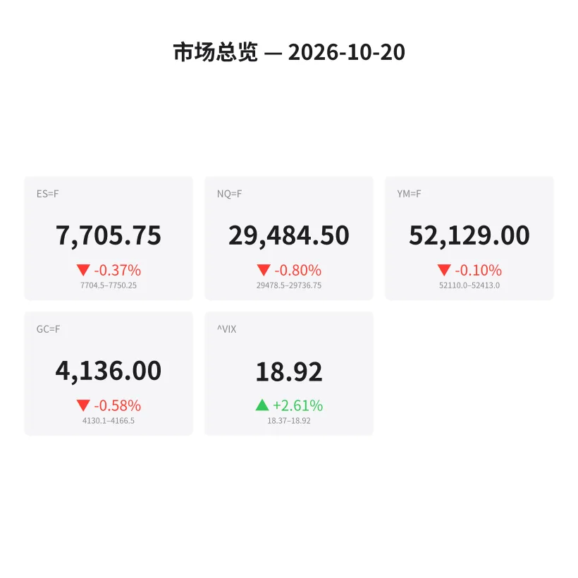
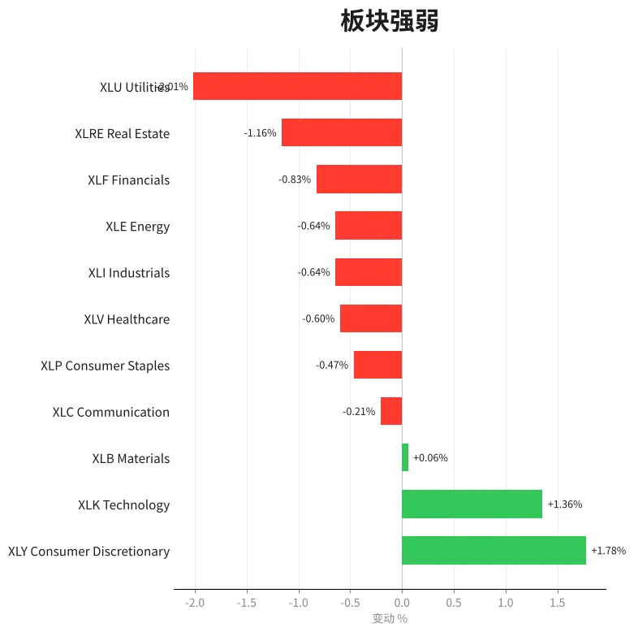
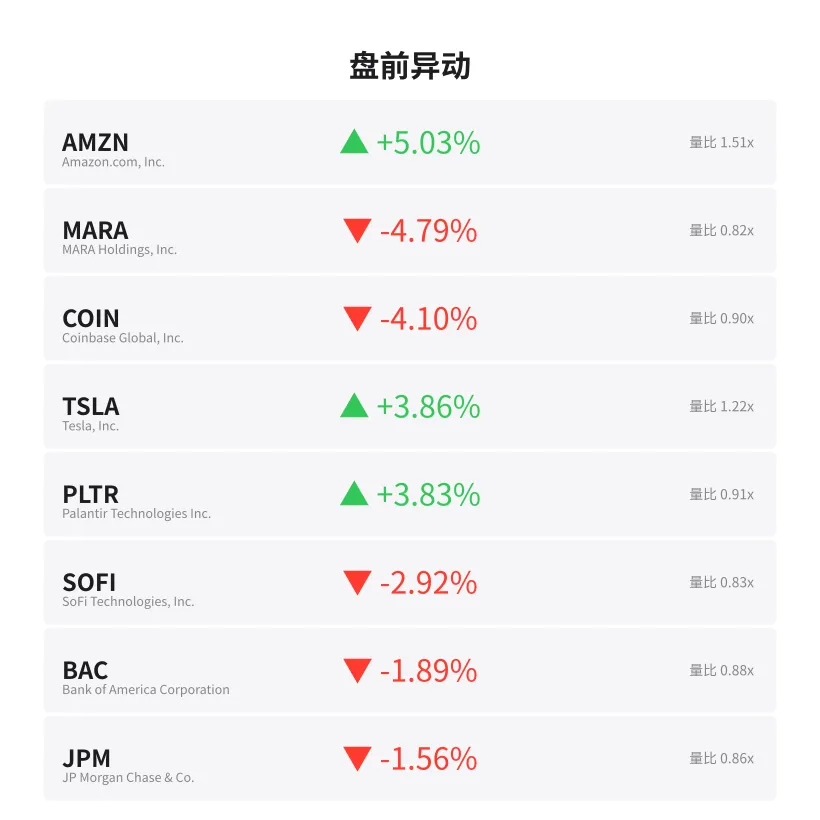
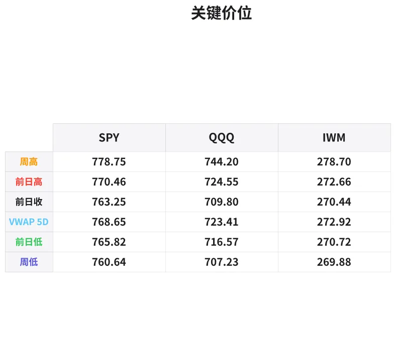

# 盘前分析报告 — 2026-10-20
*生成时间: 12:41:19 UTC*

---
## 数据速览

---
## 一、宏观环境

> [!info]- 详细数据：指数期货 & VIX
> ### 1.1 指数期货 & VIX
> | 品种 | 现价 | 涨跌幅 | 前收 | 日高 | 日低 |
> |------|------|--------|------|------|------|
> | ES=F | 7705.75 | -0.37% | 7734.5 | 7752.75 | 7704.5 |
> | NQ=F | 29484.5 | -0.80% | 29722.5 | 29803.5 | 29480.25 |
> | YM=F | 52129.0 | -0.10% | 52182.0 | 52413.0 | 52112.0 |
> | GC=F | 4136.0 | -0.58% | 4160.1 | 4166.5 | 4130.1 |
> | ^VIX | 18.92 | +2.61% | 18.44 | 18.92 | 18.37 |

> [!info]- 详细数据：隔夜走势
> ### 1.2 隔夜走势（Globex）
> | 品种 | 隔夜高 | 隔夜低 | 区间 | 亚洲高 | 亚洲低 | 欧洲高 | 欧洲低 |
> |------|--------|--------|------|--------|--------|--------|--------|
> | ES=F | 7750.25 | 7704.5 | 45.75 | 7745.5 | 7728.25 | 7750.25 | 7713.5 |
> | NQ=F | 29736.75 | 29478.5 | 258.25 | 29711.25 | 29585.75 | 29736.75 | 29510.0 |
> | YM=F | 52413.0 | 52110.0 | 303.0 | 52326.0 | 52232.0 | 52413.0 | 52175.0 |
> | GC=F | 4166.5 | 4130.1 | 36.4 | 4166.5 | 4138.0 | 4155.5 | 4130.1 |
> | ^VIX | 18.92 | 18.37 | 0.55 | — | — | 18.92 | 18.37 |

> [!info]- 详细数据：板块强弱
> ### 1.3 板块强弱
> | ETF | 板块 | 涨跌幅 |
> |-----|------|--------|
> | XLY | Consumer Discretionary | +1.78% |
> | XLK | Technology | +1.36% |
> | XLB | Materials | +0.06% |
> | XLC | Communication | -0.21% |
> | XLP | Consumer Staples | -0.47% |
> | XLV | Healthcare | -0.60% |
> | XLI | Industrials | -0.64% |
> | XLE | Energy | -0.64% |
> | XLF | Financials | -0.83% |
> | XLRE | Real Estate | -1.16% |
> | XLU | Utilities | -2.01% |

---
## 三、盘前异动

> [!info]- 详细数据：盘前异动
> | 代码 | 名称 | 现价 | 缺口 | 量比 |
> |------|------|------|------|------|
> | AMZN | Amazon.com, Inc. | 262.58 | +5.03% | 1.51x |
> | MARA | MARA Holdings, Inc. | 7.17 | -4.79% | 0.82x |
> | COIN | Coinbase Global, Inc. | 166.05 | -4.10% | 0.9x |
> | TSLA | Tesla, Inc. | 368.4 | +3.86% | 1.22x |
> | PLTR | Palantir Technologies Inc. | 193.16 | +3.83% | 0.91x |
> | SOFI | SoFi Technologies, Inc. | 14.13 | -2.92% | 0.83x |
> | BAC | Bank of America Corporation | 50.26 | -1.89% | 0.88x |
> | JPM | JP Morgan Chase & Co. | 334.43 | -1.56% | 0.86x |

---
## 四、关键价位

> [!info]- 详细数据：SPY 关键价位
> ### SPY
> | 价位类型 | 价格 |
> |----------|------|
> | Prior Day High | 770.46 |
> | Prior Day Low | 765.824 |
> | Prior Day Close | 763.25 |
> | Premarket Price | 764.82 |
> | Approx Vwap 5D | 768.65 |
> | Weekly High | 778.75 |
> | Weekly Low | 760.64 |

> [!info]- 详细数据：QQQ 关键价位
> ### QQQ
> | 价位类型 | 价格 |
> |----------|------|
> | Prior Day High | 724.55 |
> | Prior Day Low | 716.57 |
> | Prior Day Close | 709.8 |
> | Premarket Price | 714.32 |
> | Approx Vwap 5D | 723.41 |
> | Weekly High | 744.2 |
> | Weekly Low | 707.23 |

> [!info]- 详细数据：IWM 关键价位
> ### IWM
> | 价位类型 | 价格 |
> |----------|------|
> | Prior Day High | 272.66 |
> | Prior Day Low | 270.72 |
> | Prior Day Close | 270.44 |
> | Premarket Price | 270.86 |
> | Approx Vwap 5D | 272.92 |
> | Weekly High | 278.7 |
> | Weekly Low | 269.88 |

---
## 五、AI 技术分析 & 操盘建议

## 第一部分：隔夜市场回顾

**整体基调：** 周一隔夜盘偏空，ES 和 NQ 从亚洲时段高位持续走低，欧洲时段加速下行，目前均逼近隔夜低点。VIX 小幅攀升至 18.92（+2.61%），反映出市场温和的避险情绪。

**亚洲时段（18:00–02:00 ET）：**
- ES 窄幅震荡于 7728–7745 区间，交投清淡，方向不明
- NQ 表现类似，在 29585–29711 之间波动
- 黄金在亚盘维持高位（4138–4166），显示亚洲资金偏谨慎

**欧洲时段（02:00–09:30 ET）：**
- ES 冲高 7750 后快速回落，跌破亚盘低点至 7713 附近
- NQ 跌幅更大，从 29736 高点直接滑落至 29510，已跌破亚盘区间下沿
- 黄金欧盘同步走弱（4130–4155），打破避险逻辑，暗示流动性收缩而非单纯风险回避
- YM 相对抗跌，从 52413 仅回落至 52175，道指成分股表现韧性

**关键解读：**
欧洲时段的卖压主导了方向。NQ 跌幅（-0.80%）显著大于 ES（-0.37%）和 YM（-0.10%），说明科技成长股遭受抛压。但板块数据显示 XLY（+1.78%）和 XLK（+1.36%）逆势领涨，主要受 AMZN（+5.03%）和 TSLA（+3.86%）个股驱动，属于事件性拉升而非板块共振。真实风险偏好仍偏弱：金融（-0.83%）、地产（-1.16%）、公用事业（-2.01%）全面承压，利率敏感型板块集体走软，暗示市场对本周经济数据或美联储表态存在担忧。

## 第二部分：期货品种分析

### ES（标普500期货）

**多时间框架分析：**
- **日线/周线：** 上周从周高 7783（对应 SPY 778.75）回落至周低 7605（SPY 760.64），收于 7734.5。周线收出上影线较长的阴线，显示上方抛压。5日 VWAP 约 7686（SPY 768.65 对应），价格已从 VWAP 上方回落至下方。
- **4H：** 从周五尾盘 7734 开始下行通道，隔夜一路走低，当前形成 lower high（7750）/ lower low（7704）结构
- **1H/15min：** 欧盘段明显的阶梯式下跌，7750→7735→7713→7705，每次反弹高点递降

**关键价位：**
| 价位 | 描述 |
|------|------|
| 7750–7753 | 隔夜高点 / 日线高点区域，强阻力 |
| 7734–7735 | 前日收盘 / 亚盘低点，回抽阻力 |
| 7704–7705 | 隔夜低点 / 当前交易区域，关键支撑 |
| 7686 | 5日 VWAP 近似位，跌破后看 7670 |
| 7605 | 周低点，中线止跌位 |

**方向偏见：** 偏空（信心 70%）
- 隔夜结构清晰看跌，价格逼近 OVN low
- 若开盘跌破 7704，惯性目标 7686（VWAP）再看 7670
- 若开盘守住 7704 并回升过 7735，空头逻辑失效

**交易计划：**
- **空单入场区：** 7728–7735（回抽前收/亚盘低点区域做空）
- **止损：** 7753（隔夜高点上方）
- **T1：** 7704（隔夜低点重测）
- **T2：** 7686（5日 VWAP）
- **失效条件：** 突破 7753 并站稳，转为观望或反手

---

### NQ（纳斯达克100期货）

**多时间框架分析：**
- **日线/周线：** 上周周高 29803，周低 28175（对应 QQQ 707.23），收于 29722。NQ 波动率远大于 ES，上周区间超 1600 点。5日 VWAP 约 28800（QQQ 723.41 对应）
- **4H：** 从 29722 急跌至 29478，已跌破前日低点。隔夜形成宽幅下行通道（高 29736 → 低 29478，区间 258 点）
- **1H/15min：** 欧盘段抛售剧烈，从 29736 直落 29510，几乎无像样反弹。近期在 29480 附近企稳但买盘力度弱

**关键价位：**
| 价位 | 描述 |
|------|------|
| 29736–29750 | 隔夜高点，强空阻力 |
| 29585–29600 | 亚盘低点 / 心理关口，回抽阻力 |
| 29478–29484 | 隔夜低点 / 当前价，关键多空分水岭 |
| 29300 | 心理关口，跌破后看 29100 |
| 28800 | 5日 VWAP 近似，深度回调目标 |

**方向偏见：** 偏空（信心 75%）
- 隔夜跌幅 -0.80%，显著弱于 ES，科技抛压明显
- 欧盘段几乎没有反弹，卖方主导
- 但注意 XLK +1.36%、AMZN +5%——个股消息可能造成 NQ 开盘跳跃

**交易计划：**
- **空单入场区：** 29550–29600（回抽亚盘低点/心理关口做空）
- **止损：** 29750（隔夜高点上方）
- **T1：** 29480（隔夜低点重测）
- **T2：** 29300（心理关口）
- **失效条件：** 突破 29750 站稳；或开盘因 AMZN 带动大幅高开，则需等待新结构

---

### GC（黄金期货）

**多时间框架分析：**
- **日线/周线：** 黄金近期在 4100–4200 区间宽幅震荡。前收 4160，当前 4136，已跌至区间下半部分
- **4H：** 亚盘冲高 4166 后一路走低，欧盘跌至 4130。形成明确的日内下行趋势
- **1H/15min：** 4166→4155（欧盘高）→4130，阶梯式回落。区间 36.4 点，波动适中

**关键价位：**
| 价位 | 描述 |
|------|------|
| 4166–4170 | 隔夜高点 / 亚盘高点，强阻力 |
| 4155 | 欧盘高点，短线阻力 |
| 4138–4140 | 亚盘低点，支撑转阻力 |
| 4130 | 隔夜低点 / 欧盘低点，关键支撑 |
| 4100 | 心理关口 / 区间下沿 |

**方向偏见：** 偏空（信心 65%）
- 黄金与股指同步走弱，非避险买盘推动，更像是美元走强或流动性收缩
- 若跌破 4130 确认，可看 4100 心理关口
- 但金价在 4100 附近有强支撑，空间有限

**交易计划：**
- **空单入场区：** 4148–4155（回抽欧盘高点做空）
- **止损：** 4168（隔夜高点上方）
- **T1：** 4130（隔夜低点）
- **T2：** 4105（逼近心理关口）
- **失效条件：** 突破 4166 站稳，则日内转多

## 第三部分：ETF品种分析

### SPY（标普500 ETF）

**当前状态：** 盘前 764.82，前收 763.25，前日高 770.46，前日低 765.82

**关键价位：**
| 价位 | 描述 |
|------|------|
| 770.46 | 前日高点，强阻力 |
| 768.65 | 5日 VWAP，多空分水岭 |
| 765.82 | 前日低点，短线支撑 |
| 763.25 | 前日收盘 |
| 760.64 | 周低点，跌破后看 755 |

**交易计划：**
- 盘前 764.82 位于前收上方但低于前日低点，属于弱势反弹区
- **偏空场景（主）：** 开盘若未能站上 765.82（前日低点），逢反弹 766–768 做空，目标 763→760
- **偏多场景（备）：** 强势突破 768.65（VWAP）并回踩确认，做多目标 770→772
- 关注开盘前 30 分钟 AMZN 表现——若 AMZN 持续走强可能拉动 SPY 偏离期货方向

---

### QQQ（纳斯达克100 ETF）

**当前状态：** 盘前 714.32，前收 709.80，前日高 724.55，前日低 716.57

**关键价位：**
| 价位 | 描述 |
|------|------|
| 724.55 | 前日高点，强阻力 |
| 723.41 | 5日 VWAP，趋势线 |
| 716.57 | 前日低点，短线阻力 |
| 714.32 | 盘前现价 |
| 709.80 | 前日收盘 |
| 707.23 | 周低点，关键支撑 |

**交易计划：**
- QQQ 盘前 714.32 高于前收 709.80 约 +0.64%，而 NQ 期货跌 -0.80%——存在明显定价矛盾
- 这种矛盾可能来自 AMZN（+5%）和 TSLA（+3.86%）的权重效应拉高了 QQQ 盘前报价
- **核心策略：** 等待开盘 5–10 分钟的方向确认，不宜盘前就建仓
- **偏空场景：** 若 QQQ 开盘冲高 716–718 无法站稳，做空目标 712→709
- **偏多场景：** 若 AMZN 效应持续且 QQQ 站上 718 回踩不破，做多目标 722→724
- **关键风险：** AMZN 和 TSLA 的盘前涨幅若在开盘后回吐，QQQ 可能出现快速补跌

## 第四部分：今日市场总览

### 整体情绪

**综合评级：偏空（Bearish Lean）**

| 指标 | 数值 | 信号 |
|------|------|------|
| VIX | 18.92（+2.61%） | 温和恐慌，未至极端 |
| ES 隔夜 | -0.37%，逼近 OVN Low | 空方主导 |
| NQ 隔夜 | -0.80%，跌破亚盘区间 | 强烈偏空 |
| 黄金 | -0.58%，非避险逻辑 | 美元或利率驱动 |
| 板块轮动 | 防御板块领跌，消费/科技因个股撑场 | 伪强势 |

### VIX 分析

VIX 18.92 处于中性偏高区域。+2.61% 的涨幅说明期权市场已开始定价短期不确定性。若日内 VIX 升破 20，ES 和 NQ 可能加速下行。反之，VIX 若回落至 18 以下则暗示卖压衰竭。

**VIX 预期日内区间：** 18.0–20.5

### 需要回避的时间窗口

| 时间（ET） | 事件 |
|------------|------|
| 09:30–09:45 | 开盘波动期——等待方向确认，不要追单 |
| 10:00 | 关注是否有经济数据发布（如存量房销售数据等） |
| 11:30–13:00 | 午盘流动性下降，假突破增多 |
| 15:00–15:15 | MOC（市价收盘单）不平衡公布前后波动加大 |

### 板块轮动解读

今日板块分化极端：
- **科技 XLK（+1.36%）/ 消费 XLY（+1.78%）领涨** → 但完全由 AMZN、TSLA、PLTR 等个股消息驱动，非板块性资金流入
- **公用事业 XLU（-2.01%）/ 地产 XLRE（-1.16%）/ 金融 XLF（-0.83%）领跌** → 利率敏感板块集体走弱，可能反映市场对利率维持高位的预期
- **材料 XLB（+0.06%）持平** → 周期品观望
- 若 AMZN 效应消退而 XLU/XLRE 跌幅扩大，市场大概率选择向下

### 盘前异动个股影响

- **AMZN +5.03%**（可能是周末重大消息/财报预期上调）→ 对 SPY 和 QQQ 权重影响大，可能造成指数与期货的定价偏差
- **TSLA +3.86%** → 同样拉动指数，但 TSLA 开盘回吐概率较高
- **MARA -4.79% / COIN -4.10%** → 加密板块全面走弱，比特币可能周末回调
- **BAC -1.89% / JPM -1.56%** → 银行股承压，与利率敏感板块逻辑一致

---

### 🎯 今日核心交易论点

**隔夜空头结构清晰，但 AMZN 效应制造了定价噪音。等待开盘 10 分钟确认方向：若期货跌破隔夜低点（ES 7704 / NQ 29478），顺势做空追击 VWAP 和周低点；若 AMZN 带动指数高开且站稳前日低点上方，则回避空单，等待新的入场结构。不要在两种力量拉锯时强行介入。**
