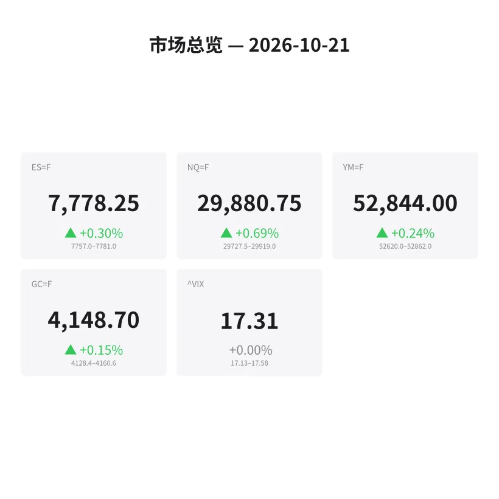
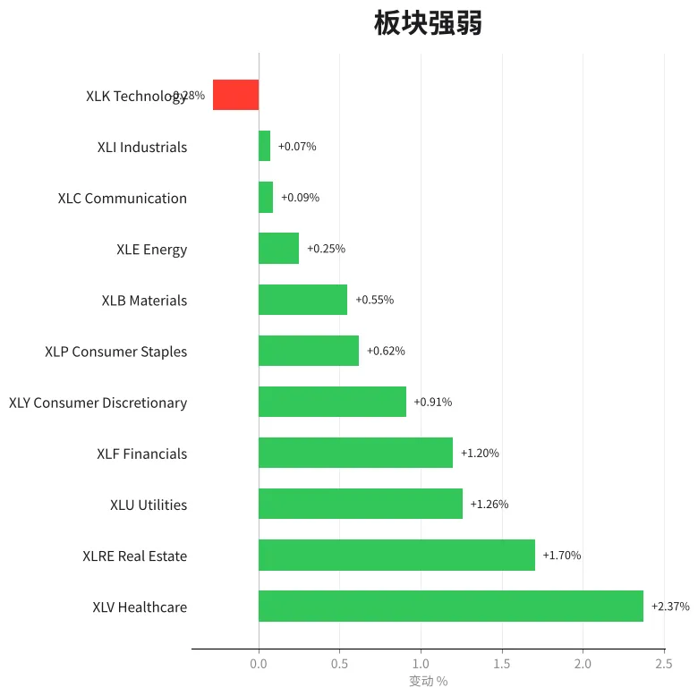
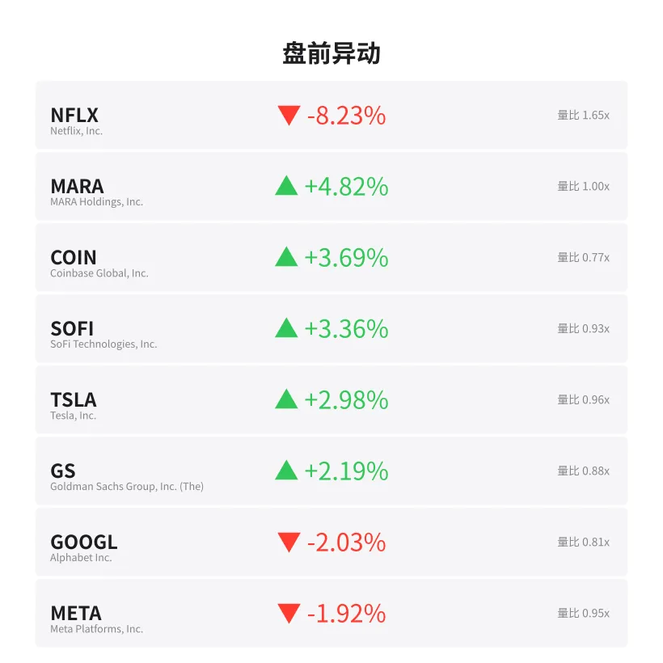
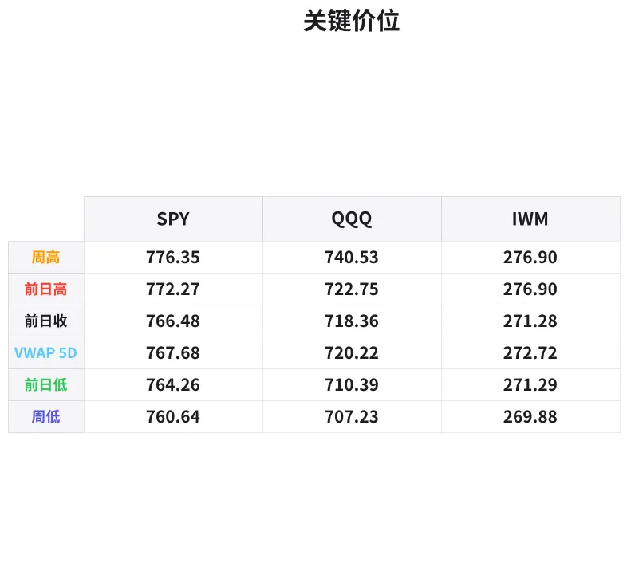

# 盘前分析报告 — 2026-10-21
*生成时间: 12:40:30 UTC*

---
## 数据速览

---
## 一、宏观环境

> [!info]- 详细数据：指数期货 & VIX
> ### 1.1 指数期货 & VIX
> | 品种 | 现价 | 涨跌幅 | 前收 | 日高 | 日低 |
> |------|------|--------|------|------|------|
> | ES=F | 7778.25 | +0.30% | 7755.25 | 7793.0 | 7757.0 |
> | NQ=F | 29880.75 | +0.69% | 29675.25 | 30010.25 | 29728.0 |
> | YM=F | 52844.0 | +0.24% | 52719.0 | 52862.0 | 52620.0 |
> | GC=F | 4148.7 | +0.15% | 4142.6 | 4160.6 | 4124.0 |
> | ^VIX | 17.31 | +0.00% | 17.31 | 17.58 | 17.13 |

> [!info]- 详细数据：隔夜走势
> ### 1.2 隔夜走势（Globex）
> | 品种 | 隔夜高 | 隔夜低 | 区间 | 亚洲高 | 亚洲低 | 欧洲高 | 欧洲低 |
> |------|--------|--------|------|--------|--------|--------|--------|
> | ES=F | 7781.0 | 7757.0 | 24.0 | 7781.0 | 7772.5 | 7779.5 | 7757.0 |
> | NQ=F | 29919.0 | 29727.5 | 191.5 | 29918.25 | 29824.0 | 29919.0 | 29727.5 |
> | YM=F | 52862.0 | 52620.0 | 242.0 | 52817.0 | 52717.0 | 52818.0 | 52620.0 |
> | GC=F | 4160.6 | 4128.4 | 32.2 | 4147.7 | 4131.6 | 4160.0 | 4128.4 |
> | ^VIX | 17.58 | 17.13 | 0.45 | — | — | 17.58 | 17.13 |

> [!info]- 详细数据：板块强弱
> ### 1.3 板块强弱
> | ETF | 板块 | 涨跌幅 |
> |-----|------|--------|
> | XLV | Healthcare | +2.37% |
> | XLRE | Real Estate | +1.70% |
> | XLU | Utilities | +1.26% |
> | XLF | Financials | +1.20% |
> | XLY | Consumer Discretionary | +0.91% |
> | XLP | Consumer Staples | +0.62% |
> | XLB | Materials | +0.55% |
> | XLE | Energy | +0.25% |
> | XLC | Communication | +0.09% |
> | XLI | Industrials | +0.07% |
> | XLK | Technology | -0.28% |

---
## 二、消息面

- **Netflix财报不及预期，盘前暴跌逾8%** — *Yahoo Finance*
  > Netflix misses Q3 guidance, shares tumble over 8% premarket
- **加密货币板块集体走强，MARA涨近5%，Coinbase涨逾3%** — *CoinDesk*
  > Crypto stocks rally as Bitcoin holds above $86K; MARA +5%, COIN +3.7%
- **医疗保健板块领涨大盘，XLV涨超2.3%，防御性轮动加剧** — *MarketWatch*
  > Healthcare sector leads market with XLV up 2.3%, defensive rotation intensifies
- **特斯拉盘前涨近3%，市场期待本周财报表现** — *Bloomberg*
  > Tesla rises nearly 3% premarket ahead of expected earnings this week
- **高盛盘前涨逾2%，金融板块延续财报季强势** — *Reuters*
  > Goldman Sachs up 2%+ premarket as financials extend earnings strength
- **谷歌、Meta盘前双双下挫约2%，大型科技股承压** — *CNBC*
  > Alphabet, Meta both slip ~2% premarket; mega-cap tech under pressure
- **VIX维持在17附近，市场波动率处于温和水平** — *Barron's*
  > VIX steady near 17, market volatility remains moderate
- **美联储10月会议临近，市场关注利率政策信号** — *Financial Times*
  > Fed October meeting approaches; markets eye rate policy signals

---
## 三、盘前异动

> [!info]- 详细数据：盘前异动
> | 代码 | 名称 | 现价 | 缺口 | 量比 |
> |------|------|------|------|------|
> | NFLX | Netflix, Inc. | 64.1 | -8.23% | 1.65x |
> | MARA | MARA Holdings, Inc. | 7.73 | +4.82% | 1.0x |
> | COIN | Coinbase Global, Inc. | 174.66 | +3.69% | 0.77x |
> | SOFI | SoFi Technologies, Inc. | 14.78 | +3.36% | 0.93x |
> | TSLA | Tesla, Inc. | 379.04 | +2.98% | 0.96x |
> | GS | Goldman Sachs Group, Inc. (The) | 895.0 | +2.19% | 0.88x |
> | GOOGL | Alphabet Inc. | 337.2 | -2.03% | 0.81x |
> | META | Meta Platforms, Inc. | 691.9 | -1.92% | 0.95x |

---
## 四、关键价位

> [!info]- 详细数据：SPY 关键价位
> ### SPY
> | 价位类型 | 价格 |
> |----------|------|
> | Prior Day High | 772.275 |
> | Prior Day Low | 764.26 |
> | Prior Day Close | 766.48 |
> | Premarket Price | 771.16 |
> | Approx Vwap 5D | 767.68 |
> | Weekly High | 776.35 |
> | Weekly Low | 760.64 |

> [!info]- 详细数据：QQQ 关键价位
> ### QQQ
> | 价位类型 | 价格 |
> |----------|------|
> | Prior Day High | 722.7465 |
> | Prior Day Low | 710.39 |
> | Prior Day Close | 718.36 |
> | Premarket Price | 722.06 |
> | Approx Vwap 5D | 720.22 |
> | Weekly High | 740.53 |
> | Weekly Low | 707.23 |

> [!info]- 详细数据：IWM 关键价位
> ### IWM
> | 价位类型 | 价格 |
> |----------|------|
> | Prior Day High | 276.8961 |
> | Prior Day Low | 271.29 |
> | Prior Day Close | 271.28 |
> | Premarket Price | 276.67 |
> | Approx Vwap 5D | 272.72 |
> | Weekly High | 276.9 |
> | Weekly Low | 269.88 |

---
## 五、AI 技术分析 & 操盘建议

## 第一部分：隔夜市场回顾

### 亚洲时段（18:00–02:00 ET）
- **ES** 亚洲时段区间 7772.5–7781.0，仅8.5点，极度窄幅震荡。价格在前收7755.25上方运行，多头控盘但缺乏推动力。
- **NQ** 亚洲时段区间 29824–29918.25，约94点，相对ES波动更大，科技板块分歧加剧。价格在前收29675.25上方明显拉升。
- **GC** 黄金亚洲时段 4131.6–4147.7，约16点区间，中性偏多。

### 欧洲时段（02:00–08:00 ET）
- **ES** 欧洲时段区间 7757.0–7779.5，低点触及隔夜低点7757.0后反弹，出现一波探底回升走势。欧洲交易员在亚洲低点下方寻求流动性后被买盘吸收。
- **NQ** 欧洲时段区间 29727.5–29919.0，跌破亚洲低点29824后快速反弹并刷新隔夜高点29919.0。这是经典的流动性猎杀（stop hunt）后反转形态，暗示日内多头有优势。
- **GC** 欧洲时段 4128.4–4160.0，先下探至隔夜低点4128.4后强势反弹至4160.0接近日高，黄金走势偏强。

### 隔夜总结
整体判断：**偏多**。三大指数隔夜均在前收上方运行，欧洲时段经典探底回升形态确认买盘支撑。NQ波动最大（191.5点隔夜区间 vs ES仅24点），暗示科技股内部分化严重但整体方向偏多。VIX隔夜区间17.13–17.58，维持低波动环境，有利于趋势延续。

**关键信号：** 防御性板块（XLV +2.37%，XLRE +1.70%，XLU +1.26%）领涨而XLK -0.28%落后，显示资金正在进行板块轮动而非单纯的Risk-On。这意味着虽然指数偏多，但上攻动力可能受限于科技股拖累。

## 第二部分：期货品种分析

### ES（E-mini S&P 500）
**现价：7778.25 | 涨跌：+0.30% | 前收：7755.25**

**多时间框架分析：**
- **日线级别：** 周五收于7755.25，本周区间7757–7793。价格在周线高点776.35（SPY对应）附近运行，上方空间有限但趋势未破。
- **4H级别：** 隔夜区间极窄（24点），典型的蓄势/压缩形态。欧洲时段下探7757后反弹，确认该位置为短期支撑。
- **1H级别：** 盘前价格在7778附近，位于隔夜区间中上部，微偏多。

**关键价位：**
| 类型 | 价格 | 说明 |
|------|------|------|
| 阻力R2 | 7793.0 | 隔夜/日高，突破则打开上行空间 |
| 阻力R1 | 7781.0 | 亚洲时段高点 |
| 枢轴 | 7778.25 | 当前价格 |
| 支撑S1 | 7757.0 | 隔夜低点/欧洲低点，关键支撑 |
| 支撑S2 | 7755.25 | 前收盘，失守则转空 |

**方向偏见：偏多 | 置信度：65%**
- 隔夜低位获支撑，欧洲时段探底回升，但区间极窄显示多头缺乏conviction
- 防御板块领涨限制了上攻弹性

**交易计划：**
- **做多入场区：** 7757–7762（隔夜低点回踩），观察是否出现Delta翻转+大单吸收
- **止损：** 7752（前收下方3点）
- **目标T1：** 7781（亚洲高点）
- **目标T2：** 7793（日高突破）
- **失效条件：** 价格持续交易在7755下方5分钟以上，或开盘后15分钟直接break down

---

### NQ（E-mini Nasdaq 100）
**现价：29880.75 | 涨跌：+0.69% | 前收：29675.25**

**多时间框架分析：**
- **日线级别：** 涨幅领先ES，但GOOGL -2.03%和META -1.92%拖累权重股。板块内部分化——NFLX -8.23%大跌 vs TSLA +2.98%走强。
- **4H级别：** 隔夜区间191.5点，远超ES的24点，波动率显著偏高。欧洲时段跌破亚洲低29824后迅速收回并刷新高29919，经典的流动性猎杀形态。
- **1H级别：** 盘前29880附近，位于隔夜区间偏上但未到高点，需要观察开盘方向选择。

**关键价位：**
| 类型 | 价格 | 说明 |
|------|------|------|
| 阻力R2 | 30010.25 | 日高/心理整数关口30000 |
| 阻力R1 | 29919.0 | 隔夜高点 |
| 枢轴 | 29880.75 | 当前价格 |
| 支撑S1 | 29824.0 | 亚洲低点 |
| 支撑S2 | 29727.5 | 隔夜低点/欧洲低点 |
| 支撑S3 | 29675.25 | 前收盘 |

**方向偏见：偏多 | 置信度：60%**
- 欧洲时段流动性猎杀后反转是强多信号，但GOOGL/META盘前走弱压制NQ权重
- 30000心理关口附近预计有较大卖压

**交易计划：**
- **做多入场区：** 29820–29850（亚洲低点附近），等待订单流确认（cumulative delta翻正，bid stack加厚）
- **止损：** 29710（隔夜低点下方）
- **目标T1：** 29920（隔夜高点）
- **目标T2：** 30010（日高/30000整数关口上方）
- **备选做空：** 如果开盘直接冲击30000–30010区域遇阻，可观察做空机会，目标回踩29880
- **失效条件：** 跌破29727.5并持续5分钟以上

---

### GC（黄金期货）
**现价：4148.7 | 涨跌：+0.15% | 前收：4142.6**

**多时间框架分析：**
- **日线级别：** 黄金延续温和上涨，但涨幅有限（+0.15%），整体处于区间震荡格局。
- **4H级别：** 隔夜区间32.2点（4128.4–4160.6），欧洲时段探底4128.4后强势反弹至4160.0，买盘结构良好。
- **1H级别：** 盘前4148.7在隔夜区间中部，方向不明确。

**关键价位：**
| 类型 | 价格 | 说明 |
|------|------|------|
| 阻力R1 | 4160.6 | 日高/隔夜高 |
| 枢轴 | 4148.7 | 当前价格 |
| 支撑S1 | 4142.6 | 前收盘 |
| 支撑S2 | 4128.4 | 隔夜低点 |

**方向偏见：中性偏多 | 置信度：55%**
- 欧洲时段探底回升显示买盘意愿，但涨幅有限
- 美联储10月会议临近，黄金可能维持观望

**交易计划：**
- **做多入场区：** 4140–4143（前收附近回踩）
- **止损：** 4126（隔夜低点下方）
- **目标T1：** 4158（接近日高）
- **目标T2：** 4165（日高突破延伸）
- **失效条件：** 跌破4128并伴随美元走强

## 第三部分：ETF品种分析

### SPY（SPDR S&P 500 ETF）
**盘前价：771.16 | 前收：766.48 | 涨幅：+0.61%**

**关键价位：**
| 类型 | 价格 | 说明 |
|------|------|------|
| 周线高点 | 776.35 | 本周上方主要阻力 |
| 前日高 | 772.28 | 盘前接近此位 |
| 盘前价 | 771.16 | 当前价格 |
| 5日VWAP | 767.68 | 机构成本线 |
| 前日收 | 766.48 | 跌破则gap fill |
| 前日低 | 764.26 | 日内关键支撑 |
| 周线低点 | 760.64 | 失守转弱 |

**分析：**
SPY盘前跳空高开至771.16，距离前日高772.28仅1点。盘前价格位于5日VWAP 767.68上方，短期偏多。但周线高点776.35是本周主要阻力，如果开盘后无法突破772.28，则可能回踩767.68（5日VWAP）进行gap fill。

**交易计划：**
- **场景A（突破做多）：** 开盘突破772.30并站稳→做多，目标774.50–776.35（周高），止损770.50
- **场景B（回踩做多）：** 开盘回踩767.50–768.00区域（5日VWAP）获支撑→做多，目标771–772，止损766.00
- **场景C（做空）：** 772.30–773.00区域明确受阻+卖盘涌入→做空，目标768–767.50，止损773.50

---

### QQQ（Invesco Nasdaq 100 ETF）
**盘前价：722.06 | 前收：718.36 | 涨幅：+0.51%**

**关键价位：**
| 类型 | 价格 | 说明 |
|------|------|------|
| 周线高点 | 740.53 | 远端阻力 |
| 前日高 | 722.75 | 盘前逼近 |
| 盘前价 | 722.06 | 当前价格 |
| 5日VWAP | 720.22 | 机构成本线 |
| 前日收 | 718.36 | gap fill位 |
| 前日低 | 710.39 | 日内关键支撑 |
| 周线低点 | 707.23 | 趋势转折点 |

**分析：**
QQQ盘前涨幅+0.51%，略逊于SPY的+0.61%，反映科技股内部分化（GOOGL/META下跌 vs TSLA上涨）。盘前价722.06紧贴前日高722.75，如果GOOGL和META开盘继续走弱，QQQ可能承压回落至5日VWAP 720.22。但若科技权重股企稳，周线高点740.53提供较大的上行空间。

**交易计划：**
- **场景A（突破做多）：** 突破并站稳722.75→做多，目标725–727，止损720.50
- **场景B（回踩做多）：** 回踩720.00–720.50区域（5日VWAP）→做多，目标722–722.75，止损718.00
- **场景C（做空）：** 722.75–723.50区域明确受阻→做空，目标720–718.50，止损724.00
- **注意：** NFLX -8.23%的gap down可能在开盘初期对QQQ造成额外卖压，建议等待前15分钟方向确认后再入场

## 第四部分：今日市场总览

### 整体情绪判断：**谨慎偏多**

市场呈现"指数涨、科技弱、防御强"的板块轮动格局：

1. **指数面：** ES +0.30%，NQ +0.69%，YM +0.24%，三大指数隔夜均收涨。IWM盘前+1.99%（276.67 vs 271.28），小盘股涨幅显著领先大盘，暗示风险偏好扩散而非集中在科技权重。

2. **板块轮动：** 防御三剑客（XLV +2.37%，XLRE +1.70%，XLU +1.26%）领涨，XLK -0.28%唯一收跌。这是典型的Late-Cycle Rotation信号——资金从高估值科技板块流出，进入低估值防御板块。对于日内交易者，这意味着做多ES/SPY的胜率可能高于做多NQ/QQQ。

3. **VIX分析：** VIX 17.31，隔夜区间仅0.45点（17.13–17.58），波动率极低。VIX在17–18区间是"温和"水平，既不支持趋势行情的大幅突破，也不预示恐慌。预计日内走势以区间震荡为主，除非有重大催化事件。

4. **异动解读：**
   - NFLX -8.23%是今日最大负面异动，大概率与财报/指引不及预期有关。需要关注是否引发科技股情绪传染。
   - MARA +4.82%，COIN +3.69%，加密相关股集体走强，暗示BTC维持强势（10月"Uptober"行情延续）。
   - TSLA +2.98%可能与本周财报预期有关，若盘后公布数据超预期，可能在下一交易日引发较大波动。

### 关键时间窗口提醒

| 时间 (ET) | 事件 | 影响 |
|-----------|------|------|
| 09:30–09:45 | 开盘15分钟 | 方向确认窗口，避免追涨杀跌 |
| 10:00 | 经济数据可能发布 | 关注是否有Leading Indicators |
| 11:30–13:00 | 午盘低波动 | 缩小仓位或观望 |
| 14:00–14:30 | 下午反转窗口 | 关注是否出现trend reversal |
| 15:45–16:00 | MOC收盘不平衡 | 可能提供收盘方向线索 |

### 板块轮动策略
- **做多偏好：** ES/SPY > NQ/QQQ（防御领涨环境下ES弹性更好）
- **做多次选：** IWM（小盘股盘前强势，若突破周线高276.9则有空间）
- **做空候选：** NQ/QQQ（若GOOGL/META开盘继续走弱+NFLX拖累）

### 核心交易论点
> **今日是"板块轮动日"而非"趋势突破日"。** 指数偏多但上攻受科技权重拖累，防御板块领涨暗示机构在重新配置仓位。最佳策略是顺势做多ES/SPY回踩支撑位，避免追高NQ/QQQ。VIX 17水平预示日内区间震荡为主，设置合理目标（T1优先），不贪心。NFLX -8%是今日最大风险事件，需密切观察是否引发科技股情绪蔓延。

*免责声明：以上分析基于盘前数据，仅供参考，不构成投资建议。市场有风险，交易需谨慎。*
