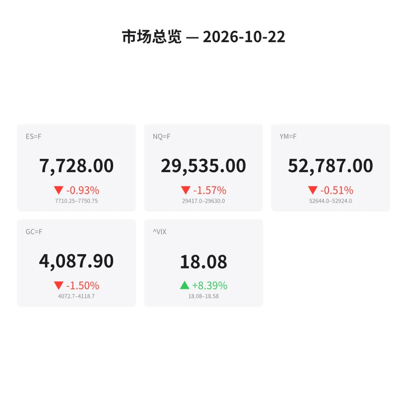
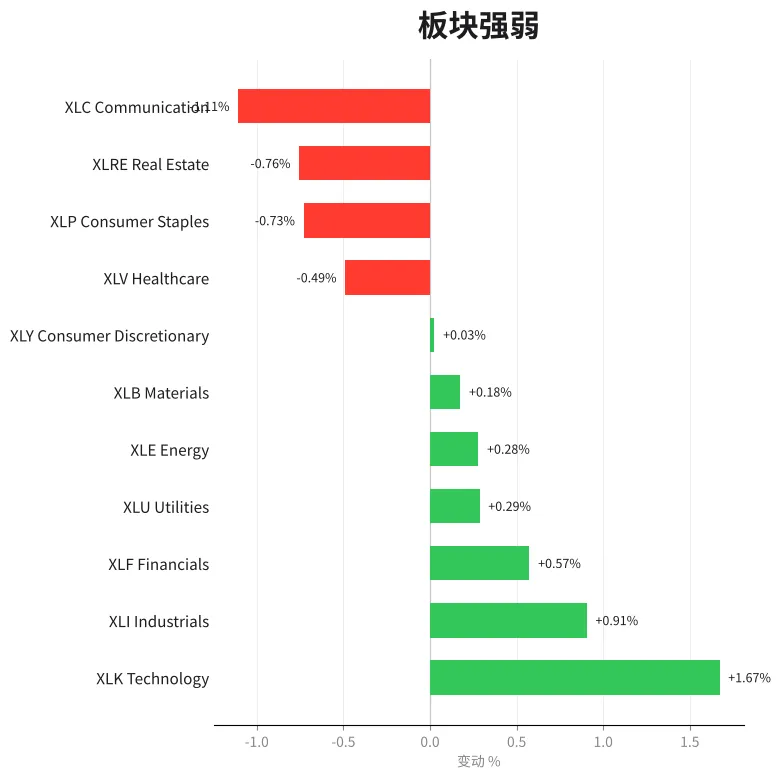
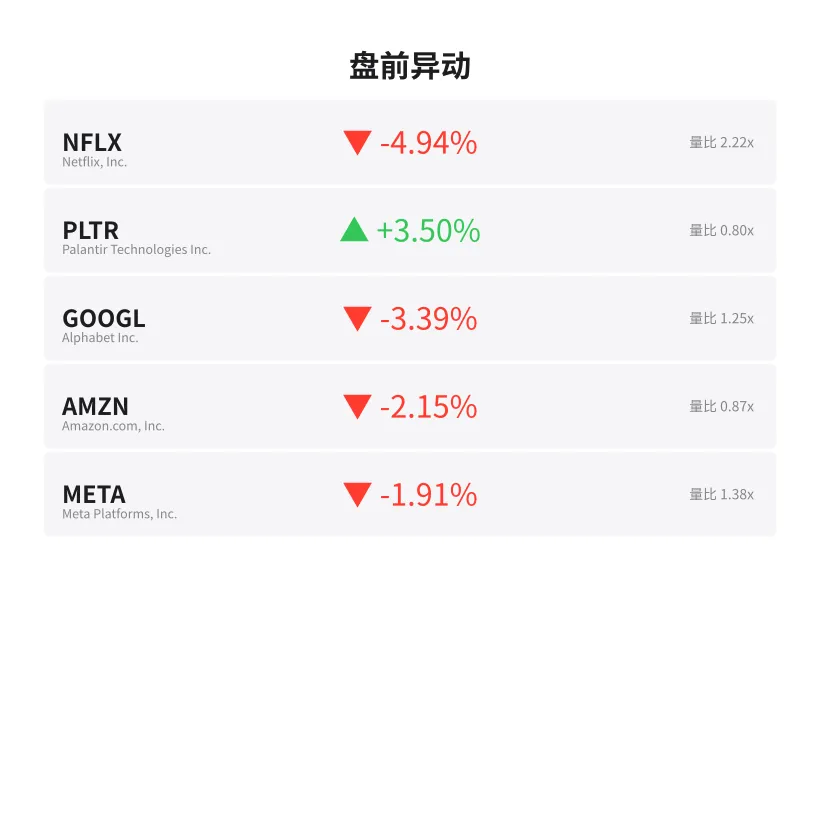
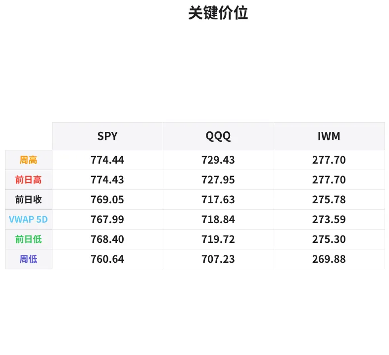

# 盘前分析报告 — 2026-10-22
*生成时间: 12:40:47 UTC*

---
## 数据速览

---
## 一、宏观环境

> [!info]- 详细数据：指数期货 & VIX
> ### 1.1 指数期货 & VIX
> | 品种 | 现价 | 涨跌幅 | 前收 | 日高 | 日低 |
> |------|------|--------|------|------|------|
> | ES=F | 7728.0 | -0.93% | 7800.25 | 7798.75 | 7710.25 |
> | NQ=F | 29535.0 | -1.57% | 30007.0 | 29993.25 | 29417.25 |
> | YM=F | 52787.0 | -0.51% | 53059.0 | 53085.0 | 52644.0 |
> | GC=F | 4087.9 | -1.50% | 4150.0 | 4164.3 | 4072.7 |
> | ^VIX | 18.08 | +8.39% | 16.68 | 18.58 | 18.08 |

> [!info]- 详细数据：隔夜走势
> ### 1.2 隔夜走势（Globex）
> | 品种 | 隔夜高 | 隔夜低 | 区间 | 亚洲高 | 亚洲低 | 欧洲高 | 欧洲低 |
> |------|--------|--------|------|--------|--------|--------|--------|
> | ES=F | 7750.75 | 7710.25 | 40.5 | 7750.75 | 7731.75 | 7742.25 | 7710.25 |
> | NQ=F | 29630.0 | 29417.0 | 213.0 | 29630.0 | 29507.25 | 29568.5 | 29417.0 |
> | YM=F | 52924.0 | 52644.0 | 280.0 | 52924.0 | 52821.0 | 52869.0 | 52644.0 |
> | GC=F | 4118.7 | 4072.7 | 46.0 | 4109.3 | 4082.4 | 4118.7 | 4072.7 |
> | ^VIX | 18.58 | 18.08 | 0.5 | — | — | 18.58 | 18.08 |

> [!info]- 详细数据：板块强弱
> ### 1.3 板块强弱
> | ETF | 板块 | 涨跌幅 |
> |-----|------|--------|
> | XLK | Technology | +1.67% |
> | XLI | Industrials | +0.91% |
> | XLF | Financials | +0.57% |
> | XLU | Utilities | +0.29% |
> | XLE | Energy | +0.28% |
> | XLB | Materials | +0.18% |
> | XLY | Consumer Discretionary | +0.03% |
> | XLV | Healthcare | -0.49% |
> | XLP | Consumer Staples | -0.73% |
> | XLRE | Real Estate | -0.76% |
> | XLC | Communication | -1.11% |

---
## 二、消息面

- **特斯拉Q3财报后盘前下跌3-5%，交付量超48.6万辆但利润率承压** — *CNBC / SEC Filing*
  > Tesla slips 3-5% premarket after Q3 earnings; deliveries top 486K but margin pressure weighs on sentiment

- **Meta营收超预期但股价下跌约2%，AI支出疑虑重新浮现** — *CNBC / Investing.com*
  > Meta revenue beats estimates but shares slide ~2% as AI spending concerns resurface

- **IBM盘前跌约5%，财报不及市场期望** — *Investing.com*
  > IBM drops ~5% premarket after earnings disappoint

- **Lam Research盘前跌8.4%，尽管营收超预期——投资者重新评估AI资本开支** — *Stocktwits*
  > Lam Research falls 8.4% despite revenue beat as investors reassess AI capex spending

- **Netflix盘前跌约5-7%，利润展望低于预期** — *CNBC*
  > Netflix drops 5-7% premarket on softer profit guidance

- **超微电脑(SMCI)盘前飙涨12%，上调营收展望** — *CNBC / Investing.com*
  > Super Micro Computer surges 12% after raising revenue outlook

- **Spotify盘前涨约5%，Q4营收指引超出预期** — *CNBC*
  > Spotify rises ~5% on Q4 revenue guidance above expectations

- **洛克希德·马丁涨3%，Q3业绩超预期** — *CNBC*
  > Lockheed Martin gains 3% on better-than-expected Q3 results

- **胡塞武装无人机袭击沙特沙伊巴油田，布伦特原油突破110美元** — *Ahram / CityAM*
  > Houthi drone strike on Saudi Aramco's Shaybah field pushes Brent crude above $110

- **美联储12月加息概率升至88-90%，油价驱动通胀预期升温** — *FXStreet / FinanceFeeds*
  > Fed December hike probability rises to 88-90% as oil-driven inflation fears intensify

- **美国10年期国债收益率攀升至5.10%附近，2年期触及周内新高** — *TradingEconomics / FXStreet*
  > US 10-year Treasury yield climbs near 5.10%; 2-year hits weekly high

- **现货黄金跌破4076美元，油价引发的加息押注施压金价** — *FX Leaders / USAGold*
  > Spot gold slips below $4,076 as oil-fueled rate hike bets weigh on prices

---
## 三、盘前异动

> [!info]- 详细数据：盘前异动
> | 代码 | 名称 | 现价 | 缺口 | 量比 |
> |------|------|------|------|------|
> | NFLX | Netflix, Inc. | 65.3 | -4.94% | 2.22x |
> | PLTR | Palantir Technologies Inc. | 199.35 | +3.50% | 0.8x |
> | GOOGL | Alphabet Inc. | 328.74 | -3.39% | 1.25x |
> | AMZN | Amazon.com, Inc. | 256.99 | -2.15% | 0.87x |
> | META | Meta Platforms, Inc. | 681.0 | -1.91% | 1.38x |

---
## 四、关键价位

> [!info]- 详细数据：SPY 关键价位
> ### SPY
> | 价位类型 | 价格 |
> |----------|------|
> | Prior Day High | 774.43 |
> | Prior Day Low | 768.4 |
> | Prior Day Close | 769.05 |
> | Premarket Price | 766.2 |
> | Approx Vwap 5D | 767.99 |
> | Weekly High | 774.44 |
> | Weekly Low | 760.64 |

> [!info]- 详细数据：QQQ 关键价位
> ### QQQ
> | 价位类型 | 价格 |
> |----------|------|
> | Prior Day High | 727.95 |
> | Prior Day Low | 719.72 |
> | Prior Day Close | 717.63 |
> | Premarket Price | 714.03 |
> | Approx Vwap 5D | 718.84 |
> | Weekly High | 729.43 |
> | Weekly Low | 707.23 |

> [!info]- 详细数据：IWM 关键价位
> ### IWM
> | 价位类型 | 价格 |
> |----------|------|
> | Prior Day High | 277.7 |
> | Prior Day Low | 275.3 |
> | Prior Day Close | 275.78 |
> | Premarket Price | 274.95 |
> | Approx Vwap 5D | 273.59 |
> | Weekly High | 277.7 |
> | Weekly Low | 269.88 |

---
## 五、AI 技术分析 & 操盘建议

## 第一部分：隔夜市场回顾

### 亚洲时段（Asia Session）

亚洲盘整体交投清淡但方向偏空。ES在亚洲时段运行区间为7731.75–7750.75，仅19点窄幅区间，显示亚洲资金观望情绪浓厚。NQ区间29507.25–29630.0，波动约123点，受特斯拉、Meta财报冲击后的避险情绪传导。GC（黄金）在4082.4–4109.3运行，胡塞武装袭击沙特沙伊巴油田的消息推升原油，但油价走高反而打压黄金，因加息预期升温。VIX跳升8.39%至18.08，隐含波动率明显扩张。

**亚洲时段定调：** 偏空，但无恐慌式抛售。资金在财报消化期保持谨慎。

### 欧洲时段（Europe Session）

欧洲盘接力下行，主要跌幅发生在此时段。ES欧洲区间7710.25–7742.25，低点直接打穿亚洲低点7731.75约21点，确认空头主导。NQ在欧洲盘更为惨烈，区间29417.0–29568.5，低点29417比亚洲低点29507低了90点，科技股抛压加速。GC欧洲时段区间4072.7–4118.7，虽然高点更高（4118.7 vs亚洲4109.3），但低点也更低（4072.7 vs 4082.4），呈宽幅震荡偏空格局。

**欧洲时段定调：** 明确空头主导，NQ领跌，流动性从科技股撤出。

### 对美盘的启示

1. **缺口风险较大：** ES前收7800.25，当前7728.0，如果开盘不能快速回补缺口上沿，空头将继续施压。
2. **NQ是风暴中心：** -1.57%跌幅远超ES的-0.93%，科技股财报季的不确定性（TSLA/META/LRCX/IBM集体走弱）正在冲击市场信心。
3. **VIX 18.08是关键分水岭：** 从16.68跳至18.08（+8.39%），如果美盘VIX继续攀升突破19，可能触发gamma对冲卖盘，加速下行。
4. **原油地缘风险持续发酵：** 布伦特突破110美元+美联储12月加息概率88-90%，宏观环境对风险资产不利。

## 第二部分：期货品种分析

### ES（E-mini S&P 500）— 现价 7728.0

**多周期分析：**
- **日线：** 昨日收7800.25，今日盘前已跌至7728，形成约72点的下跌缺口。日线级别从上周高点7800附近回落，短期趋势转空。
- **4小时：** 从日高7798.75一路下行至7710.25，已跌破近三日震荡区间下沿。当前从低点7710反弹至7728，属于超跌后的技术性修复。
- **1小时/15分钟：** 欧洲尾盘在7710-7730区间形成短期底部结构，但尚未突破7742（欧洲时段高点），反弹力度偏弱。

**关键价位：**
| 类型 | 价位 | 说明 |
|------|------|------|
| 强阻力 | 7798-7800 | 前日高点 + 昨日收盘密集区 |
| 中阻力 | 7750-7755 | 隔夜高点(7750.75) + 亚洲高点 |
| 弱阻力 | 7742 | 欧洲时段高点 |
| 当前价 | 7728 | — |
| 第一支撑 | 7710 | 隔夜低点 / 欧洲低点 |
| 关键支撑 | 7690-7700 | 心理整数关口 + 周线支撑区 |
| 极端支撑 | 7660 | 周低点延伸目标 |

**方向偏见：** 偏空 | 置信度：72%

**交易计划：**
- **首选策略（做空反弹）：** 等待价格反弹至7742-7755区间（隔夜高点/欧洲高点），观察是否出现订单流反转（delta翻负、大单卖压），入场做空。止损7760（隔夜高点上方5点），T1目标7710（隔夜低点），T2目标7690。
- **备选策略（突破做多）：** 如果价格放量突破7755并站稳，考虑做多试探7798。止损7740，T1 7780，T2 7798。概率较低（<30%）。
- **失效条件：** 如果美盘开盘后VIX回落至17以下且ES放量站上7760，空头逻辑失效，转为观望或试多。

---

### NQ（E-mini Nasdaq 100）— 现价 29535.0

**多周期分析：**
- **日线：** 从前收30007大幅下跌至29535，跌幅-1.57%，日线大阴线形态。科技股财报季冲击明显（TSLA -3-5%、META -2%、IBM -5%、LRCX -8.4%）。
- **4小时：** 从日高29993.25连续下行至29417.25，跌幅超570点。当前从低点反弹约118点至29535，反弹幅度仅约20%，非常弱势。
- **1小时：** 欧洲时段低点29417形成短期底部，但反弹被29568.5（欧洲高点）压制，多头力量不足。

**关键价位：**
| 类型 | 价位 | 说明 |
|------|------|------|
| 强阻力 | 29993-30007 | 日高 + 前收 |
| 中阻力 | 29630 | 隔夜/亚洲高点 |
| 弱阻力 | 29568 | 欧洲时段高点 |
| 当前价 | 29535 | — |
| 第一支撑 | 29417 | 隔夜低点 / 日低 |
| 关键支撑 | 29300 | 心理关口 + 延伸目标 |
| 极端支撑 | 29100 | 周线级别支撑 |

**方向偏见：** 偏空 | 置信度：78%（NQ空头信号比ES更强）

**交易计划：**
- **首选策略（做空反弹）：** 等待NQ反弹至29568-29630（欧洲高点/隔夜高点），观察NQ/ES比值是否继续走弱（确认科技股领跌），入场做空。止损29660（隔夜高点上方30点），T1目标29417（隔夜低点），T2目标29300。
- **备选策略（破位追空）：** 如果美盘开盘直接下破29417，等回踩29417-29450入场做空。止损29500，T1 29300，T2 29100。
- **失效条件：** NQ放量站上29630且科技龙头（TSLA/META）盘中翻红，空头逻辑失效。

---

### GC（黄金期货）— 现价 4087.9

**多周期分析：**
- **日线：** 从前收4150跌至4087.9（-1.50%），日线级别连续第二日回落。布伦特原油突破110美元推高通胀预期，美联储12月加息概率升至88-90%，实际利率上行压制黄金。
- **4小时：** 从日高4164.3下行至4072.7，跌幅超91美元。当前从低点反弹约15美元至4087.9，反弹力度极弱（仅16%）。
- **1小时：** 欧洲时段低点4072.7是日内关键，该位跌破后可能触发技术性止损卖盘。

**关键价位：**
| 类型 | 价位 | 说明 |
|------|------|------|
| 强阻力 | 4150 | 前收 |
| 中阻力 | 4118-4120 | 欧洲高点 / 隔夜高点 |
| 弱阻力 | 4109 | 亚洲高点 |
| 当前价 | 4087.9 | — |
| 第一支撑 | 4072-4076 | 隔夜低点 / 关键技术支撑 |
| 关键支撑 | 4050 | 心理整数关口 |
| 极端支撑 | 4020 | 周线级别支撑 |

**方向偏见：** 偏空 | 置信度：70%

**交易计划：**
- **首选策略（做空反弹）：** 等待GC反弹至4109-4120（亚洲高点/欧洲高点区间），观察美元指数是否继续走强，入场做空。止损4128（欧洲高点上方8美元），T1目标4076（隔夜低点），T2目标4050。
- **备选策略（破位追空）：** 如果美盘跌破4072并放量，等回踩4072-4080入场做空。止损4090，T1 4050，T2 4020。
- **关注变量：** 如果中东局势急剧升级（沙特停产/全面冲突），黄金避险属性可能短暂压过利率逻辑，导致暴力反弹。此为尾部风险，需设好止损。
- **失效条件：** GC放量站上4120且美元走弱，空头逻辑失效。

## 第三部分：ETF品种分析

### SPY — 盘前 766.20

**关键价位：**
| 类型 | 价位 | 说明 |
|------|------|------|
| 强阻力 | 774.43-774.44 | 前日高 + 周高 |
| 中阻力 | 769.05 | 前日收盘 |
| 5日VWAP | 767.99 | 多空分水岭 |
| 当前价 | 766.20 | 盘前价 |
| 第一支撑 | 764-765 | 盘前支撑区域 |
| 关键支撑 | 760.64 | 周低点 |
| 极端支撑 | 757-758 | 延伸目标 |

**交易计划：**
- SPY盘前766.20位于5日VWAP（767.99）下方，偏空格局。
- **做空思路：** 反弹至767.50-769.00（VWAP/前收附近）遇阻做空，止损770.00，T1 764.00，T2 760.64（周低点）。
- **做多思路（逆势）：** 仅在价格回踩760.64周低点出现明确的买盘反转信号时考虑做多，止损759.00，T1 764.00，T2 767.99。
- **注意：** SPY盘前跌幅（约-0.37%）远小于ES/NQ期货跌幅，开盘可能有补跌风险。ETF开盘前30分钟波动较大，建议等9:45后再入场。

---

### QQQ — 盘前 714.03

**关键价位：**
| 类型 | 价位 | 说明 |
|------|------|------|
| 强阻力 | 727.95-729.43 | 前日高 + 周高 |
| 中阻力 | 717.63 | 前日收盘 |
| 5日VWAP | 718.84 | 多空分水岭 |
| 当前价 | 714.03 | 盘前价 |
| 第一支撑 | 710-712 | 盘前支撑区域 |
| 关键支撑 | 707.23 | 周低点 |
| 极端支撑 | 700-703 | 心理关口 + 延伸目标 |

**交易计划：**
- QQQ盘前714.03位于前收（717.63）和5日VWAP（718.84）明显下方，空头结构清晰。
- **做空思路：** 反弹至717-719（前收/VWAP密集区）遇阻做空，止损720.50，T1 710.00，T2 707.23（周低点）。
- **做多思路（逆势）：** 仅在价格测试707.23周低点并出现缩量企稳+delta翻正时考虑。止损705.00，T1 714.00，T2 718.00。
- **注意：** QQQ跌幅领先SPY（科技股权重更大），TSLA/META/GOOGL/AMZN全线盘前走弱。如果美盘科技龙头继续下探，QQQ可能测试700心理关口。

## 第四部分：今日市场总览

### 整体情绪评估

**偏空（Bearish Lean）**

今日市场面临三重压力交汇：
1. **财报冲击波：** TSLA（-3-5%）、META（-2%）、IBM（-5%）、LRCX（-8.4%）、NFLX（-5-7%）——科技/成长板块集体承压。仅SMCI（+12%）和SPOT（+5%）逆势上涨，但权重不足以对冲。
2. **地缘-能源风险：** 胡塞武装袭击沙伊巴油田→布伦特>110美元→通胀预期升温→12月加息概率88-90%→国债收益率上行（10Y~5.10%）→风险资产估值承压。
3. **波动率扩张：** VIX从16.68跳升至18.08（+8.39%），市场定价的尾部风险显著增加。

### VIX 分析

VIX 18.08处于近期波动率区间的上沿。关键观察点：
- **18-19区间：** 如果VIX稳定在此区间，属于正常的风险调整，市场可能在消化后企稳。
- **突破19-20：** 将触发做市商的gamma对冲卖盘，可能导致ES加速下行至7690甚至更低。
- **回落至17以下：** 空头信号减弱，市场可能快速修复缺口。

### 板块轮动观察

| 强势 | 弱势 |
|------|------|
| XLK +1.67%（科技——注：此为前日涨幅，今日盘前因财报承压） | XLC -1.11%（通信） |
| XLI +0.91%（工业——防御合同LMT +3%提振） | XLRE -0.76%（房地产——利率上行打击） |
| XLF +0.57%（金融） | XLP -0.73%（消费必需品） |

**关键变化：** 昨日最强的XLK（+1.67%）今日面临巨大翻转风险，TSLA/META/GOOGL/AMZN/IBM/LRCX/NFLX全线走弱将拖累科技权重。工业（XLI）和国防子板块可能成为今日相对强势板块。

### 需要回避的时间窗口

| 时间（ET） | 事件 | 建议 |
|------------|------|------|
| 9:30-9:45 | 开盘波动窗口 | 观望，不追单 |
| 10:00 | 可能有经济数据发布 | 等数据消化后再入场 |
| 14:00-14:30 | 尾盘机构调仓 | 缩小仓位，防范反转 |

### 核心操盘主线（一句话）

> **今日以做空反弹为主，NQ/QQQ空头信号最强；科技财报集体暴雷+油价飙升+VIX跳升三重利空叠加，等待反弹至隔夜高点附近入场做空，止损严格设在隔夜高点上方，不抄底不猜底。**

---
*本分析由 AI 基于实时市场数据生成，仅供参考，不构成投资建议。请结合自身风控体系和实时订单流判断进场时机。*
