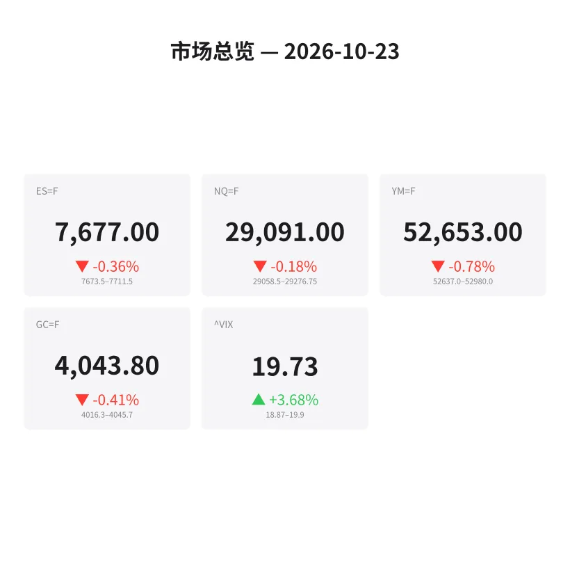
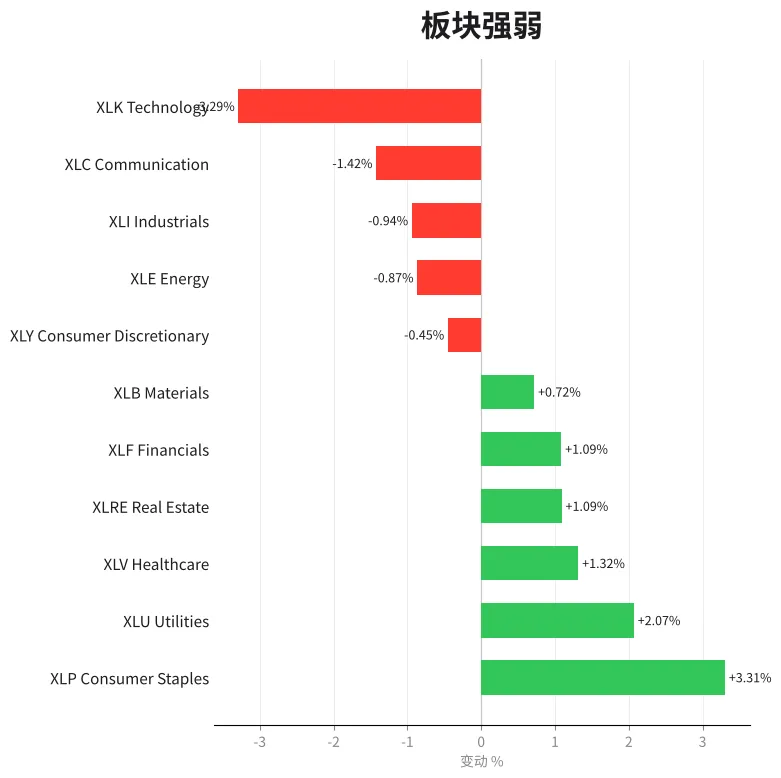
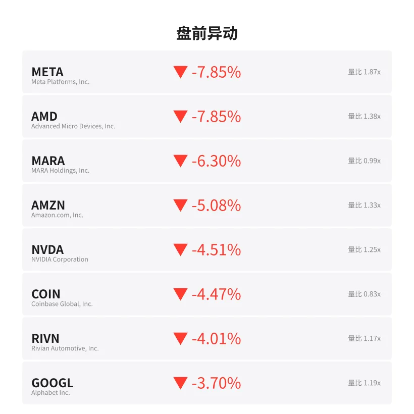
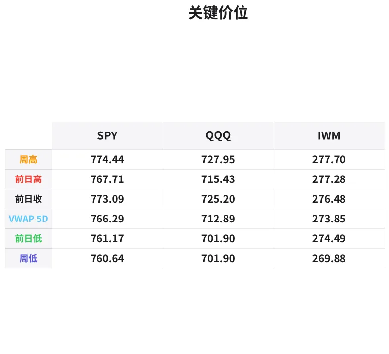

# 盘前分析报告 — 2026-10-23
*生成时间: 12:40:35 UTC*

---
## 数据速览

---
## 一、宏观环境

> [!info]- 详细数据：指数期货 & VIX
> ### 1.1 指数期货 & VIX
> | 品种 | 现价 | 涨跌幅 | 前收 | 日高 | 日低 |
> |------|------|--------|------|------|------|
> | ES=F | 7677.0 | -0.36% | 7704.5 | 7714.25 | 7673.5 |
> | NQ=F | 29091.0 | -0.18% | 29142.0 | 29274.0 | 29022.75 |
> | YM=F | 52653.0 | -0.78% | 53068.0 | 53166.0 | 52637.0 |
> | GC=F | 4043.8 | -0.41% | 4060.4 | 4047.8 | 4000.9 |
> | ^VIX | 19.73 | +3.68% | 19.03 | 19.9 | 18.87 |

> [!info]- 详细数据：隔夜走势
> ### 1.2 隔夜走势（Globex）
> | 品种 | 隔夜高 | 隔夜低 | 区间 | 亚洲高 | 亚洲低 | 欧洲高 | 欧洲低 |
> |------|--------|--------|------|--------|--------|--------|--------|
> | ES=F | 7711.5 | 7673.5 | 38.0 | 7703.25 | 7690.25 | 7711.5 | 7678.0 |
> | NQ=F | 29276.75 | 29058.5 | 218.25 | 29191.75 | 29105.5 | 29276.75 | 29076.25 |
> | YM=F | 52980.0 | 52637.0 | 343.0 | 52976.0 | 52888.0 | 52980.0 | 52694.0 |
> | GC=F | 4045.7 | 4016.3 | 29.4 | 4043.0 | 4016.3 | 4045.7 | 4023.7 |
> | ^VIX | 19.9 | 18.87 | 1.03 | — | — | 19.9 | 18.87 |

> [!info]- 详细数据：板块强弱
> ### 1.3 板块强弱
> | ETF | 板块 | 涨跌幅 |
> |-----|------|--------|
> | XLP | Consumer Staples | +3.31% |
> | XLU | Utilities | +2.07% |
> | XLV | Healthcare | +1.32% |
> | XLRE | Real Estate | +1.09% |
> | XLF | Financials | +1.09% |
> | XLB | Materials | +0.72% |
> | XLY | Consumer Discretionary | -0.45% |
> | XLE | Energy | -0.87% |
> | XLI | Industrials | -0.94% |
> | XLC | Communication | -1.42% |
> | XLK | Technology | -3.29% |

---
## 二、消息面

> ⚠️ 新闻数据源暂时不可用（yfinance API 返回空）。以下为盘前关键信息摘要：

- **大型科技股盘前大幅下挫** — META、AMD 均跌超7%，AMZN、NVDA 跌超4%
  > Major tech stocks under heavy selling pressure pre-market
- **防御板块强势轮动** — 必需消费品(XLP +3.31%)、公用事业(XLU +2.07%)领涨
  > Defensive rotation: Consumer Staples and Utilities lead
- **VIX 恐慌指数上升** — 现报19.73，涨幅+3.68%，逼近20关口
  > VIX rising toward 20 level, signaling increased hedging demand
- **道琼斯期货跌幅最深** — YM=F -0.78%，反映蓝筹股承压
  > Dow futures lead losses, reflecting pressure on large-cap value names

---
## 三、盘前异动

> [!info]- 详细数据：盘前异动
> | 代码 | 名称 | 现价 | 缺口 | 量比 |
> |------|------|------|------|------|
> | META | Meta Platforms, Inc. | 642.77 | -7.85% | 1.87x |
> | AMD | Advanced Micro Devices, Inc. | 509.34 | -7.85% | 1.38x |
> | MARA | MARA Holdings, Inc. | 7.3 | -6.30% | 0.99x |
> | AMZN | Amazon.com, Inc. | 249.03 | -5.08% | 1.33x |
> | NVDA | NVIDIA Corporation | 211.96 | -4.51% | 1.25x |
> | COIN | Coinbase Global, Inc. | 169.16 | -4.47% | 0.83x |
> | RIVN | Rivian Automotive, Inc. | 11.96 | -4.01% | 1.17x |
> | GOOGL | Alphabet Inc. | 322.36 | -3.70% | 1.19x |
> | TSLA | Tesla, Inc. | 374.14 | -3.19% | 1.4x |
> | NFLX | Netflix, Inc. | 66.8 | +2.71% | 1.26x |

---
## 四、关键价位

> [!info]- 详细数据：SPY 关键价位
> ### SPY
> | 价位类型 | 价格 |
> |----------|------|
> | Prior Day High | 767.71 |
> | Prior Day Low | 761.17 |
> | Prior Day Close | 773.09 |
> | Premarket Price | 760.97 |
> | Approx Vwap 5D | 766.29 |
> | Weekly High | 774.44 |
> | Weekly Low | 760.64 |

> [!info]- 详细数据：QQQ 关键价位
> ### QQQ
> | 价位类型 | 价格 |
> |----------|------|
> | Prior Day High | 715.43 |
> | Prior Day Low | 701.9 |
> | Prior Day Close | 725.2 |
> | Premarket Price | 703.49 |
> | Approx Vwap 5D | 712.89 |
> | Weekly High | 727.95 |
> | Weekly Low | 701.9 |

> [!info]- 详细数据：IWM 关键价位
> ### IWM
> | 价位类型 | 价格 |
> |----------|------|
> | Prior Day High | 277.28 |
> | Prior Day Low | 274.49 |
> | Prior Day Close | 276.48 |
> | Premarket Price | 275.2332 |
> | Approx Vwap 5D | 273.85 |
> | Weekly High | 277.7 |
> | Weekly Low | 269.88 |

---
## 五、AI 技术分析 & 操盘建议

## 第一部分：隔夜市场回顾

### 亚洲时段（18:00–02:00 ET）
- **ES=F** 在亚洲时段窄幅震荡，高点7703.25、低点7690.25，区间仅13点，显示亚洲资金观望情绪浓厚
- **NQ=F** 亚洲时段高7191.75 低29105.5，区间约86点，科技股卖压在亚洲盘已初显
- **GC=F** 黄金亚洲时段低至4016.3，创出隔夜低点，随后反弹——避险资金入场节奏偏迟
- 整体判断：亚洲时段偏弱但无恐慌，卖压主要来自欧洲盘前期

### 欧洲时段（02:00–09:30 ET）
- **ES=F** 欧洲盘初曾反弹至隔夜高7711.5，随后失守回落至7678，形成"假突破→下杀"格局
- **NQ=F** 欧洲高点29276.75 → 回撤至29076.25，近200点下杀，科技股抛售加速
- **YM=F** 道琼斯期货全时段最弱，欧洲盘跌破53000整数关口直奔52637
- **GC=F** 黄金从欧洲低4023.7反弹至4045.7，与股指反向运动，确认Risk-Off交易
- VIX 欧洲盘从18.87升至19.9，逼近20关口——若开盘突破20，将触发系统性对冲

### 对美盘的启示
1. **卖压从欧洲盘加速**，美盘开盘大概率延续惯性下行，至少在前15分钟
2. **ES假突破7711后回落**，说明上方卖压密集，短线多头需谨慎
3. **VIX逼近20**是关键门槛——突破则看空波动加剧，被压住则可能午盘修复
4. **板块极度分化**（科技-3.29% vs 必需消费+3.31%）→ 资金明确避险，非系统性下跌

## 第二部分：期货品种分析

### ES=F（标普500期货）
**当前价**: 7677.0 | **前收**: 7704.5 | **涨跌**: -0.36%

**多时间框架分析**:
- **日线**: 从近期高点回落，7677处于短期支撑区域。前日低7614.25（注意盘中数据日低7673.5），日线VWAP大约在7690附近
- **4H**: 欧洲时段假突破隔夜高7711.5后反转，形成空头吞没形态
- **1H**: 连续lower high（7711→7703→当前），下降趋势确认
- **15min**: 盘前在7673-7680区间盘整，寻底中

**关键价位**:
| 类型 | 价格 | 说明 |
|------|------|------|
| 强阻力 | 7711.5 | 隔夜高/假突破位 |
| 阻力1 | 7704.5 | 前收盘价 |
| 阻力2 | 7690 | 亚洲时段低/VWAP区域 |
| 枢轴 | 7680 | 当前盘整中心 |
| 支撑1 | 7673.5 | 隔夜低/今日低 |
| 支撑2 | 7650 | 心理整数位 |
| 强支撑 | 7614 | 前日日低 |

**方向偏见**: 偏空 | **信心**: 7/10
- 入场区域（做空）: 7690-7704（反弹至前收/VWAP区域做空）
- 止损: 7715（隔夜高上方）
- T1: 7660（约30-40点空间）
- T2: 7630（约60-70点空间）
- 失效条件: 强势收回7711.5上方并持稳，转为多头

**替代做多场景**: 若开盘直接下探7650附近并出现放量反弹+VIX见顶回落，可轻仓试多
- 入场: 7645-7655
- 止损: 7630
- T1: 7680
- T2: 7700

---

### NQ=F（纳斯达克100期货）
**当前价**: 29091.0 | **前收**: 29142.0 | **涨跌**: -0.18%

**多时间框架分析**:
- **日线**: 科技股领跌，META/AMD -7.85%，NQ承压明显。前日高低区间29274-29022
- **4H**: 欧洲时段从高点29276反转下杀200+点，动能强烈偏空
- **1H**: 已形成明确下降通道，高点递降
- **15min**: 盘前在29060-29100间窄幅盘整

**关键价位**:
| 类型 | 价格 | 说明 |
|------|------|------|
| 强阻力 | 29276 | 隔夜高/欧洲假突破 |
| 阻力1 | 29190 | 亚洲时段高 |
| 阻力2 | 29142 | 前收盘价 |
| 枢轴 | 29090 | 当前价 |
| 支撑1 | 29058 | 隔夜低 |
| 支撑2 | 29000 | 心理整数关口 |
| 强支撑 | 28900 | 前期支撑区 |

**方向偏见**: 偏空 | **信心**: 8/10（科技股集体暴跌增强空头信心）
- 入场区域（做空）: 29130-29190（反弹至前收/亚洲高区域）
- 止损: 29285（隔夜高上方）
- T1: 29000（~130-190点）
- T2: 28900（~230-290点）
- 失效条件: 强势收回29276上方，科技股个股止跌企稳

**NQ今日是主战场** — META/AMD -7.85%的缺口若无法回补，NQ向下空间远大于ES

---

### GC=F（黄金期货）
**当前价**: 4043.8 | **前收**: 4060.4 | **涨跌**: -0.41%

**多时间框架分析**:
- **日线**: 黄金在4000-4060区间震荡，整体处于高位盘整
- **4H**: 亚洲盘低探4016后反弹，欧洲盘回到4045附近，与股指负相关运动
- **1H**: 从4016.3低点反弹，形成V型恢复，买盘在4000上方积极
- **15min**: 测试隔夜高4045.7区域

**关键价位**:
| 类型 | 价格 | 说明 |
|------|------|------|
| 强阻力 | 4060 | 前收盘/心理位 |
| 阻力1 | 4047 | 今日高 |
| 阻力2 | 4045.7 | 隔夜高 |
| 枢轴 | 4035 | 日内中枢 |
| 支撑1 | 4023.7 | 欧洲低 |
| 支撑2 | 4016.3 | 隔夜低/亚洲低 |
| 强支撑 | 4000 | 大心理关口 |

**方向偏见**: 中性偏多 | **信心**: 6/10
- 若股市Risk-Off延续，黄金可能突破4060→做多
- 入场区域（做多）: 4025-4035（回踩欧洲低附近）
- 止损: 4012（隔夜低下方）
- T1: 4055
- T2: 4075
- 失效条件: 跌破4000，Risk-Off转为流动性危机（抛售一切换现金）

## 第三部分：ETF品种分析

### SPY（标普500 ETF）
**盘前价**: 760.97 | **前收**: 773.09 | **跌幅**: -1.57%

**关键价位**:
| 类型 | 价格 | 说明 |
|------|------|------|
| 前日高 | 767.71 | |
| 前日低 | 761.17 | |
| 前收 | 773.09 | 大缺口↓ |
| 盘前价 | 760.97 | 跌破前日低 |
| 5日VWAP | 766.29 | |
| 周高 | 774.44 | |
| 周低 | 760.64 | 本周支撑 |

**交易计划**:
- SPY缺口下跌约12点（773→761），跌破前日低761.17，盘前已触及周低760.64附近
- **做空场景**: 若开盘反弹至765-767（前日低/5日VWAP区域）遇阻，做空
  - 止损: 769
  - T1: 758
  - T2: 755
- **做多场景（逆势）**: 若快速下探758-755区域出现放量止跌+VIX转跌，试多
  - 止损: 753
  - T1: 762
  - T2: 767
- 缺口回补概率偏低——META/AMD -7.85%的权重拖累太大，除非出现重大利好催化

---

### QQQ（纳斯达克100 ETF）
**盘前价**: 703.49 | **前收**: 725.20 | **跌幅**: -3.00%

**关键价位**:
| 类型 | 价格 | 说明 |
|------|------|------|
| 前日高 | 715.43 | |
| 前日低 | 701.90 | 关键支撑 |
| 前收 | 725.20 | 巨大缺口↓ |
| 盘前价 | 703.49 | 逼近前日低 |
| 5日VWAP | 712.89 | |
| 周高 | 727.95 | |
| 周低 | 701.90 | 本周关键底 |

**交易计划**:
- QQQ今日是重灾区——缺口下跌约22点（-3%），科技权重股集体暴跌
- **做空场景（首选）**: 反弹至708-712区域（前日低上方/5日VWAP附近）做空
  - 止损: 716（前日高上方）
  - T1: 698
  - T2: 693
- **做多场景（高风险）**: 若701.90周低获得放量支撑，且VIX见顶回落
  - 入场: 700-702
  - 止损: 697
  - T1: 710
  - T2: 715
- **核心逻辑**: QQQ今日受META、AMD巨幅缺口拖累，开盘大概率测试701.90前日低/周低。此位是多空分水岭——**破则看690**，**守则看反弹至710**

## 第四部分：今日市场总览

### 整体情绪
**Risk-Off 明确** — 今日市场呈现教科书级别的避险轮动：
- 科技股集体暴跌（XLK -3.29%），META/AMD领跌-7.85%
- 防御板块全面领涨：必需消费XLP +3.31%、公用事业XLU +2.07%、医疗XLV +1.32%
- VIX 19.73 → 逼近20关口，此位是系统性对冲的触发线
- 黄金虽然小跌，但在4000上方获支撑，与股指形成负相关

### VIX 关键信号
- **当前**: 19.73（+3.68%）
- **关键阈值**: 20.00 — 突破则机构对冲盘涌入，波动加剧
- **隔夜区间**: 18.87-19.90
- **交易含义**: VIX在20下方时，跌势可能在午盘获得修复；若开盘突破20并站稳，则全天偏空，下午可能有二次下杀

### 需要规避的时间窗口
1. **09:30-09:45** — 开盘前15分钟，缺口惯性下冲+止损触发，波动极大，不宜入场
2. **10:00** — 经济数据发布（若有），可能引发二次波动
3. **11:00-11:30** — 欧洲收盘资金流变化
4. **14:00-14:30** — 机构re-balancing窗口，今日大跌后可能有对冲盘调整

### 板块轮动观察
| 板块 | 方向 | 强度 | 交易含义 |
|------|------|------|----------|
| 科技XLK | ↓↓↓ | -3.29% | 主跌板块，空头首选 |
| 通讯XLC | ↓↓ | -1.42% | META拖累，关注GOOGL -3.70% |
| 工业XLI | ↓ | -0.94% | 跟跌，非主力 |
| 能源XLE | ↓ | -0.87% | 温和下跌 |
| 可选消费XLY | ↓ | -0.45% | TSLA -3.19%拖累 |
| 材料XLB | ↑ | +0.72% | 中性 |
| 金融XLF | ↑ | +1.09% | 防御性买入 |
| 房地产XLRE | ↑ | +1.09% | 利率敏感+防御 |
| 医疗XLV | ↑ | +1.32% | 避险资金流入 |
| 公用事业XLU | ↑↑ | +2.07% | 经典避险 |
| 必需消费XLP | ↑↑↑ | +3.31% | 最强防御 |

### 🎯 核心交易论点

**今日主题：科技股缺口下杀，Risk-Off轮动主导，做空科技/做多防御是主线**

首选操作：NQ/QQQ反弹做空（信心8/10）。科技权重股META/AMD -7.85%的缺口太大，盘中回补概率极低。等待开盘冲击波结束后（约09:45-10:00），在反弹至阻力区做空NQ（29130-29190）或QQQ（708-712）。止损严格放在隔夜高上方。VIX是动态仪表盘——若突破20则加码空头持仓时间，若被压回19以下则考虑获利了结。

⚠️ **风险提示**: 缺口越大，开盘波动越剧烈。前15分钟务必观望。大型科技股如果在10:00后出现放量止跌（尤其META），可能触发空头回补反弹，需设好止损不死扛。
