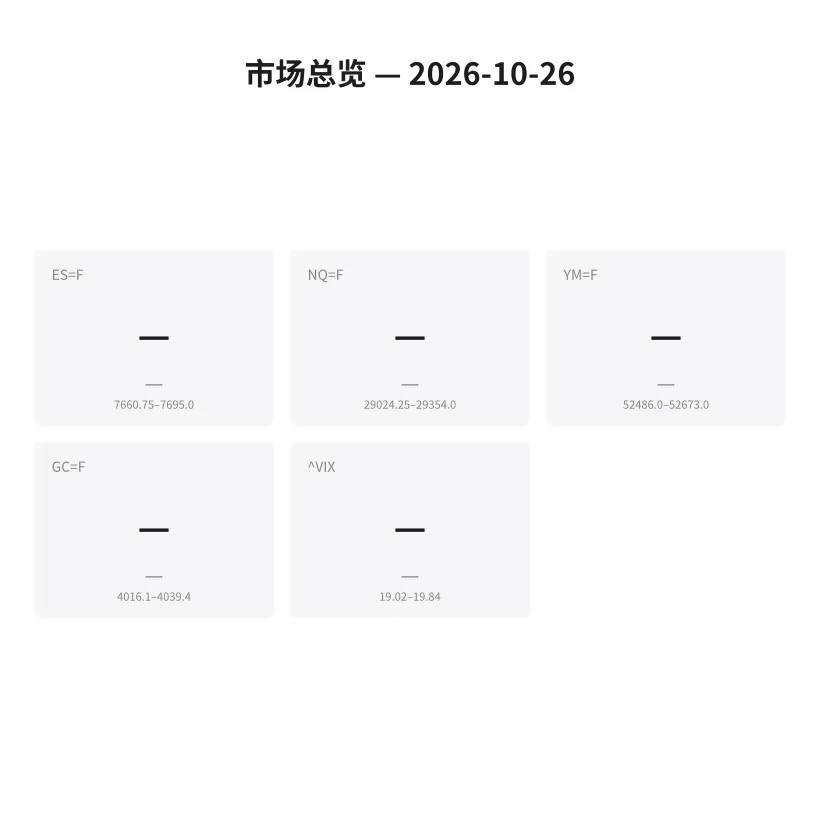
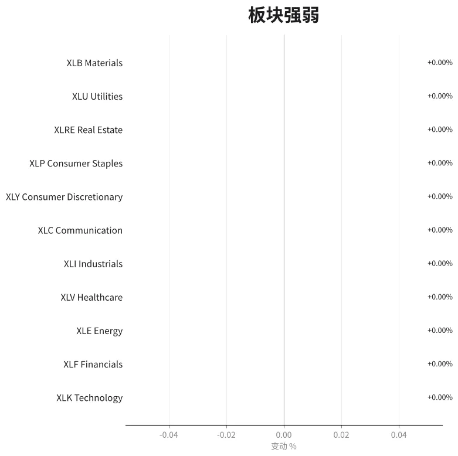
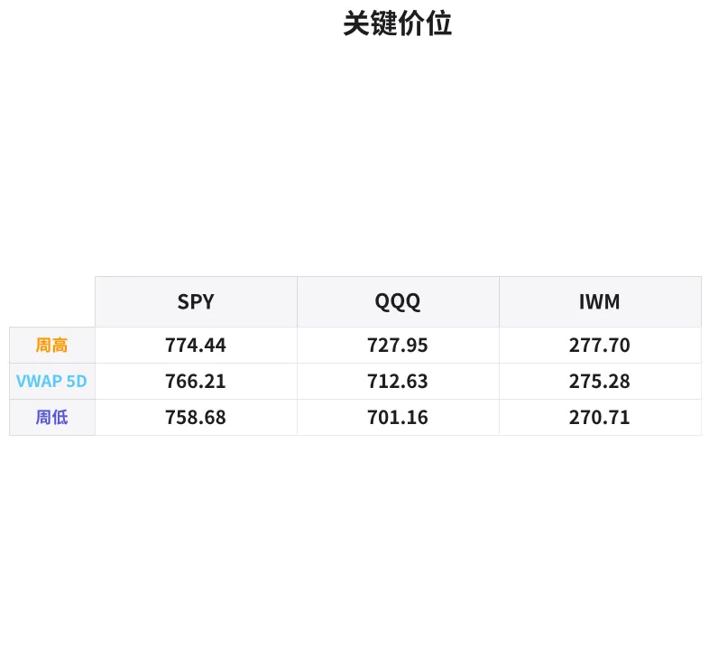

# 盘前分析报告 — 2026-10-26
*生成时间: 12:53:08 UTC*

---
## 数据速览

---
## 一、宏观环境

> [!info]- 详细数据：指数期货 & VIX
> ### 1.1 指数期货 & VIX
> | 品种 | 现价 | 涨跌幅 | 前收 | 日高 | 日低 |
> |------|------|--------|------|------|------|
> | ES=F | 7684.00 | +0.17% | 7671.00 | 7698.50 | 7651.75 |
> | NQ=F | 29293.75 | +0.63% | 29110.25 | 29354.00 | 29024.25 |
> | YM=F | 52575.00 | +0.06% | 52546.00 | 52673.00 | 52378.00 |
> | GC=F | 4033.00 | +0.28% | 4021.60 | 4039.40 | 3990.90 |
> | ^VIX | 19.28 | -0.87% | 19.45 | 19.84 | 19.02 |

> [!info]- 详细数据：隔夜走势
> ### 1.2 隔夜走势（Globex）
> | 品种 | 隔夜高 | 隔夜低 | 区间 | 亚洲高 | 亚洲低 | 欧洲高 | 欧洲低 |
> |------|--------|--------|------|--------|--------|--------|--------|
> | ES=F | 7695.0 | 7660.75 | 34.25 | 7683.5 | 7669.0 | 7689.5 | 7660.75 |
> | NQ=F | 29354.0 | 29024.25 | 329.75 | 29207.75 | 29104.75 | 29296.0 | 29024.25 |
> | YM=F | 52673.0 | 52486.0 | 187.0 | 52587.0 | 52513.0 | 52673.0 | 52486.0 |
> | GC=F | 4039.4 | 4016.1 | 23.3 | 4032.9 | 4020.1 | 4036.2 | 4016.1 |
> | ^VIX | 19.84 | 19.02 | 0.82 | — | — | 19.84 | 19.02 |

> [!info]- 详细数据：板块强弱
> ### 1.3 板块强弱
> | ETF | 板块 | 涨跌幅 |
> |-----|------|--------|
> | XLB | Materials | +0.00% |
> | XLY | Consumer Discretionary | -0.01% |
> | XLP | Consumer Staples | -0.03% |
> | XLF | Financials | -0.04% |
> | XLU | Utilities | -0.07% |
> | XLE | Energy | -0.14% |
> | XLK | Technology | -0.16% |
> | XLV | Healthcare | -0.23% |
> | XLI | Industrials | -0.23% |
> | XLC | Communication | -0.42% |
> | XLRE | Real Estate | -0.00% |

---
## 二、消息面

- **Yahoo Finance接口受限，今日新闻数据暂不可用** — 请参考Bloomberg Terminal或Briefing.com获取实时新闻

---
## 三、盘前异动

| 代码 | 名称 | 现价 | 缺口 | 量比 |
|------|------|------|------|------|
| COIN | Coinbase Global | 160.25 | -5.23% | 0.9x |
| MARA | MARA Holdings | 6.89 | -4.97% | 0.98x |
| AMD | Advanced Micro Devices | 523.15 | +3.00% | 0.75x |
| NFLX | Netflix | 65.44 | -2.40% | 0.8x |
| RIVN | Rivian Automotive | 11.81 | -2.05% | 1.08x |
| TSLA | Tesla | 381.50 | +1.85% | 0.95x |
| CVX | Chevron | 230.44 | +1.66% | 1.0x |
| META | Meta Platforms | 638.50 | -1.60% | 0.67x |

---
## 四、关键价位

> [!info]- 详细数据：SPY 关键价位
> ### SPY
> | 价位类型 | 价格 |
> |----------|------|
> | 盘前价格 | 762.23 |
> | 前日收盘 | 761.11 |
> | 前日最高 | 763.47 |
> | 前日最低 | 758.68 |
> | 5日VWAP | 766.21 |
> | 周最高 | 774.44 |
> | 周最低 | 758.68 |

> [!info]- 详细数据：QQQ 关键价位
> ### QQQ
> | 价位类型 | 价格 |
> |----------|------|
> | 盘前价格 | 708.70 |
> | 前日收盘 | 704.88 |
> | 前日最高 | 709.30 |
> | 前日最低 | 701.16 |
> | 5日VWAP | 712.63 |
> | 周最高 | 727.95 |
> | 周最低 | 701.16 |

> [!info]- 详细数据：IWM 关键价位
> ### IWM
> | 价位类型 | 价格 |
> |----------|------|
> | 盘前价格 | 275.75 |
> | 前日收盘 | 275.75 |
> | 前日最高 | 276.24 |
> | 前日最低 | 273.35 |
> | 5日VWAP | 275.28 |
> | 周最高 | 277.70 |
> | 周最低 | 270.71 |

---
## 五、AI 技术分析 & 操盘建议

## 第一部分：隔夜市场回顾

**亚洲时段（18:00-02:00 ET）：**
- ES在亚洲时段交投区间7669.0-7683.5，仅14.5点区间，波动极低，多空均未发力
- NQ亚洲时段区间29104.75-29207.75（约103点），相对ES稍活跃，科技板块隔夜有一定买盘
- GC黄金亚洲时段4020.1-4032.9，重心偏上，亚洲买盘托举

**欧洲时段（02:00-08:00 ET）：**
- ES欧洲时段7660.75-7689.5（约29点），下探隔夜低点7660.75后回升，欧盘试探下方支撑后被买回
- NQ欧洲时段29024.25-29296.0（约272点），盘中一度触及全时段低点29024.25，随后强势拉回，科技方向在欧洲时段经历了一次流动性扫荡后反弹
- YM道指欧洲时段创出隔夜高点52673.0，但也创出低点52486.0，区间最大（187点），波动较ES/NQ剧烈
- GC黄金欧洲时段4016.1-4036.2，下探隔夜低点后反弹，地缘/避险情绪依然支撑金价

**隔夜总结：**
- VIX收于19.28，较前收19.45小幅下降（-0.87%），恐慌情绪边际收敛
- 隔夜走势呈"先探底后企稳"格局，欧洲时段NQ出现明显的流动性扫荡（sweep低点29024.25后快速反弹至29293附近）
- 对美盘的启示：空头已在隔夜测试下方，失败后反弹，若美盘开盘维持在隔夜高点附近则多头占优；若跌破隔夜低点则需警惕延续下行

## 第二部分：期货品种分析

### ES（E-mini S&P 500） — 现价 7684.00

**多时间框架分析：**
- 日线：上周五收盘后ES处于整理态势，周线高点774.44（SPY换算约7740+）未能突破，有一定回调压力
- 4H：从隔夜走势看，7660.75构成了短期支撑（欧洲时段低点），7695.0为隔夜阻力（隔夜高点）
- 1H/15min：当前价格7684处于隔夜区间中上部，开盘方向偏中性偏多

**关键价位：**
| 类型 | 价位 | 说明 |
|------|------|------|
| 隔夜高点（ONH） | 7695.00 | 首要上方阻力 |
| 开盘价 | 7690.00 | 开盘参考 |
| 前日收盘 | 7671.00 | 关键中轴 |
| 隔夜低点（ONL） | 7660.75 | 首要下方支撑 |
| 日低 | 7651.75 | 关键支撑，跌破看空 |
| 日高 | 7698.50 | 上方目标/阻力 |

**方向偏见：** 中性偏多（置信度65%）
- 隔夜探底回升，多头略占优势；但板块全线微跌（XLC -0.42%领跌），开盘可能承压

**交易计划（做多）：**
- 入场区间：7665-7675（回踩前收附近/隔夜低点上方）
- 止损：7648（低于日低7651.75）
- T1：7695（隔夜高点）| T2：7710（突破后延伸目标）
- 失效条件：跌破7648并持续下行，或VIX突破20.5

**交易计划（做空）：**
- 入场区间：7695-7700（隔夜高点/日高附近遇阻）
- 止损：7715
- T1：7671（前收）| T2：7655（日低附近）
- 失效条件：放量突破7700并站稳

---

### NQ（E-mini Nasdaq 100） — 现价 29293.75

**多时间框架分析：**
- 日线：NQ较ES更强势（+0.63% vs +0.17%），科技板块领涨，但5日VWAP上方（QQQ 712.63换算NQ约29400+）仍有压力
- 4H：欧洲时段出现流动性扫荡（低至29024.25后强拉回至29293+），经典的stop hunt后反弹形态
- 1H/15min：当前价格接近隔夜高点29354，短期偏强

**关键价位：**
| 类型 | 价位 | 说明 |
|------|------|------|
| 隔夜高点（ONH） | 29354.00 | 首要阻力，突破看29500+ |
| 开盘价 | 29268.00 | 开盘参考 |
| 前日收盘 | 29110.25 | 关键中轴/支撑 |
| 欧洲低点 | 29024.25 | 流动性扫荡低点，重要支撑 |
| 亚洲低点 | 29104.75 | 亚洲时段支撑 |

**方向偏见：** 偏多（置信度70%）
- 欧洲时段经典流动性扫荡后反弹至隔夜高点附近，多头积极；AMD盘前+3%提振科技板块

**交易计划（做多）：**
- 入场区间：29150-29200（回踩开盘价/亚洲低点上方）
- 止损：29000（低于欧洲扫荡低点）
- T1：29354（隔夜高点）| T2：29500（心理关口/延伸）
- 失效条件：跌破29000并持续下行

**交易计划（做空）：**
- 入场区间：29350-29400（隔夜高点附近遇阻）
- 止损：29450
- T1：29200（开盘价附近）| T2：29100（前收）
- 失效条件：放量突破29400

---

### GC（黄金期货） — 现价 4033.00

**多时间框架分析：**
- 日线：GC从日低3990.9反弹至4033，从低位反弹约42点，日线仍处于多头格局但短期有获利回吐压力
- 4H：隔夜区间4016.1-4039.4，区间较窄（23.3点），整理蓄势
- 1H：当前价格4033接近隔夜高点4039.4，短期偏强

**关键价位：**
| 类型 | 价位 | 说明 |
|------|------|------|
| 隔夜高点 | 4039.40 | 首要阻力 |
| 日高 | 4039.40 | 与隔夜高点重合，强阻力 |
| 前日收盘 | 4021.60 | 中轴支撑 |
| 隔夜低点 | 4016.10 | 下方支撑 |
| 日低 | 3990.90 | 关键支撑 |

**方向偏见：** 中性偏多（置信度60%）
- 亚欧时段均在前收上方运行，底部逐渐抬高；但4039.4-4040区域构成短期顶部压力

**交易计划（做多）：**
- 入场区间：4018-4025（回踩前收/隔夜低点上方）
- 止损：4012（低于隔夜低点）
- T1：4039（隔夜高点）| T2：4055（突破后延伸）
- 失效条件：跌破4012，或美元指数突然走强

## 第三部分：ETF品种分析

### SPY — 盘前 762.23 | 前收 761.11

**关键价位：**
- 上方阻力：763.47（前日高）→ 766.21（5日VWAP）→ 774.44（周高点）
- 下方支撑：758.68（前日低/周低）→ 755.00（心理关口）
- 盘前微涨+0.15%，在前日收盘上方运行

**交易计划：**
- 多头场景：开盘站稳762+，回踩761（前收）不破入多，目标763.5（前日高）→ 766（5D VWAP），止损759.5
- 空头场景：开盘如果直接gap up至763.5+遇阻回落，跌破762入空，目标760 → 758.7（前日低），止损764.5
- 观察要点：SPY/ES是否能突破5D VWAP (766.21/~7700)，这是本周多空分水岭

---

### QQQ — 盘前 708.70 | 前收 704.88

**关键价位：**
- 上方阻力：709.30（前日高）→ 712.63（5日VWAP）→ 727.95（周高点）
- 下方支撑：701.16（前日低/周低）→ 700.00（心理关口）
- 盘前涨+0.54%，强于SPY，科技板块短期偏强（AMD +3%催化）

**交易计划：**
- 多头场景：开盘站稳708+，回踩707不破入多，目标709.3（前日高）→ 712.6（5D VWAP），止损705.5
- 空头场景：开盘冲击709.3遇阻回落，跌破707入空，目标705 → 702，止损710.5
- 观察要点：QQQ/NQ今日表现应强于SPY/ES，关注科技mega cap盘前动向，特别是META（-1.6%拖累）与AMD（+3%提振）的拉锯

## 第四部分：今日市场总览

**整体情绪：中性偏多**
- ES/NQ盘前小幅上涨，隔夜经历探底回升，多头短期占优
- VIX 19.28较前收19.45小幅下降，恐慌未升级；但仍在19上方运行，非低波环境，需控制仓位
- 盘前异动：加密相关股（COIN -5.23%, MARA -4.97%）大幅下跌，可能受周末加密货币波动影响；AMD +3.00%领涨科技

**VIX分析：**
- VIX 19.28，日内区间19.02-19.84
- 处于"中性区间"（18-22），非极端恐慌也非极端贪婪
- 若VIX跌破19.0，有利于多头延续；若升破20.0，警惕风险偏好转弱
- 操作建议：维持正常仓位，不宜过度杠杆

**需要规避的时间窗口：**
- 09:30-09:45 ET：开盘前15分钟的机构order flow冲击，避免在此窗口追涨杀跌
- 10:00 ET：关注是否有经济数据发布（如有，等数据消化后再入场）
- 11:30-13:00 ET：午盘低波段，流动性下降，容易被假突破陷阱捕获
- 15:30-16:00 ET：尾盘MOC flow，可能出现大幅波动

**板块轮动观察：**
- 上周五所有板块微跌（XLC -0.42%最弱，XLB/XLY基本持平），整体属于休整
- 今日重点关注：科技板块（XLK）能否在AMD催化下翻正；通信（XLC）是否继续走弱
- 加密相关（COIN/MARA大幅下跌）与能源（CVX +1.66%）呈现反向轮动，关注资金从高beta向防御切换的迹象
- 周一通常为资金重新部署日，关注开盘后30分钟的板块强弱排序变化

---

**🎯 核心交易论点：隔夜探底回升+VIX边际回落，多头短期占优。NQ/QQQ强于ES/SPY，科技股是今日主战场。关键观察5日VWAP（ES ~7700 / SPY ~766）能否突破，突破则看周高点，承压则继续区间震荡。**
