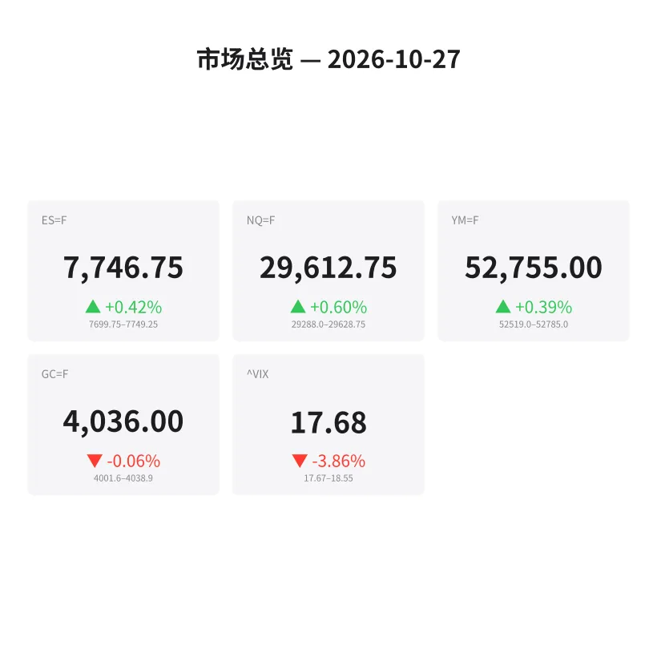
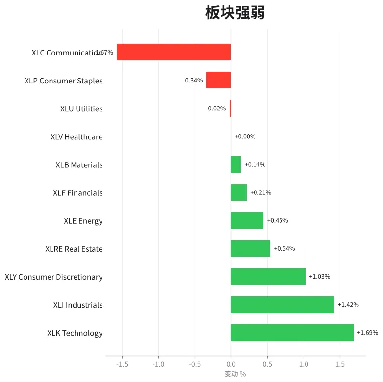
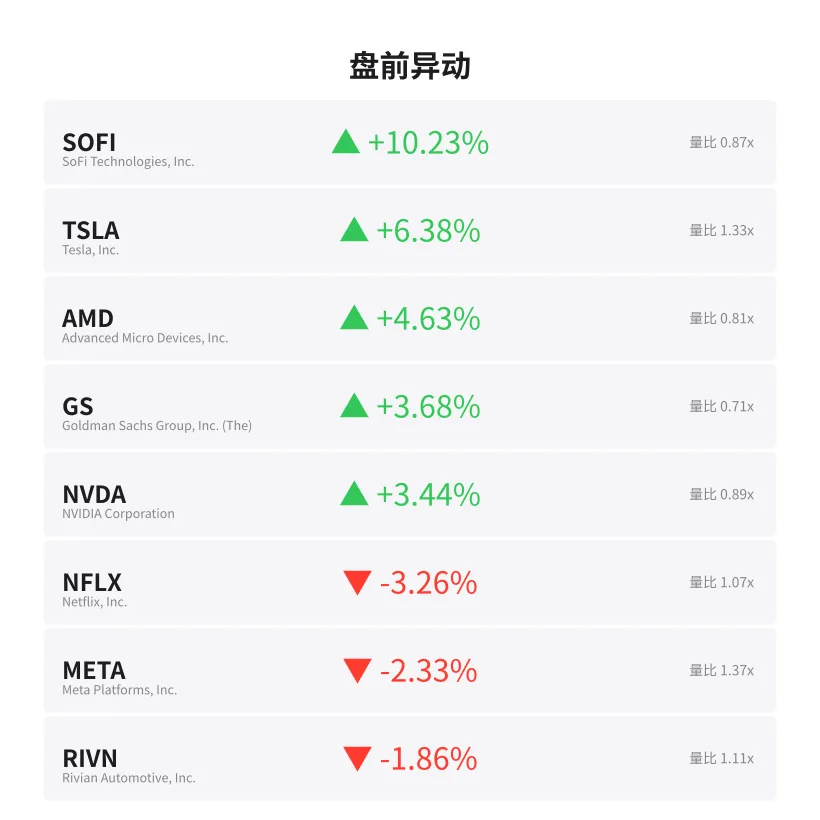
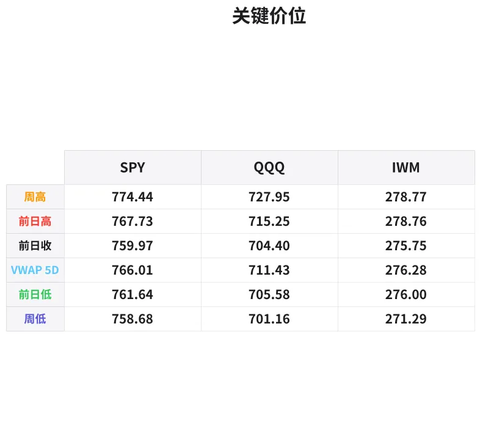

# 盘前分析报告 — 2026-10-27
*生成时间: 12:40:34 UTC*

---
## 数据速览

---
## 一、宏观环境

> [!info]- 详细数据：指数期货 & VIX
> ### 1.1 指数期货 & VIX
> | 品种 | 现价 | 涨跌幅 | 前收 | 日高 | 日低 |
> |------|------|--------|------|------|------|
> | ES=F | 7746.75 | +0.42% | 7714.5 | 7748.75 | 7699.75 |
> | NQ=F | 29612.75 | +0.60% | 29437.25 | 29627.75 | 29288.0 |
> | YM=F | 52755.0 | +0.39% | 52550.0 | 52785.0 | 52455.0 |
> | GC=F | 4036.0 | -0.06% | 4038.4 | 4038.9 | 4001.9 |
> | ^VIX | 17.68 | -3.86% | 18.39 | 18.55 | 17.67 |

> [!info]- 详细数据：隔夜走势
> ### 1.2 隔夜走势（Globex）
> | 品种 | 隔夜高 | 隔夜低 | 区间 | 亚洲高 | 亚洲低 | 欧洲高 | 欧洲低 |
> |------|--------|--------|------|--------|--------|--------|--------|
> | ES=F | 7749.25 | 7699.75 | 49.5 | 7726.0 | 7706.75 | 7743.25 | 7699.75 |
> | NQ=F | 29628.75 | 29288.0 | 340.75 | 29442.0 | 29318.0 | 29613.0 | 29288.0 |
> | YM=F | 52785.0 | 52519.0 | 266.0 | 52712.0 | 52608.0 | 52785.0 | 52519.0 |
> | GC=F | 4038.9 | 4001.6 | 37.3 | 4038.9 | 4012.4 | 4029.9 | 4001.6 |
> | ^VIX | 18.55 | 17.67 | 0.88 | — | — | 18.55 | 17.67 |

> [!info]- 详细数据：板块强弱
> ### 1.3 板块强弱
> | ETF | 板块 | 涨跌幅 |
> |-----|------|--------|
> | XLK | Technology | +1.69% |
> | XLI | Industrials | +1.42% |
> | XLY | Consumer Discretionary | +1.03% |
> | XLRE | Real Estate | +0.54% |
> | XLE | Energy | +0.45% |
> | XLF | Financials | +0.21% |
> | XLB | Materials | +0.14% |
> | XLV | Healthcare | +0.00% |
> | XLU | Utilities | -0.02% |
> | XLP | Consumer Staples | -0.34% |
> | XLC | Communication | -1.57% |

---
## 三、盘前异动

> [!info]- 详细数据：盘前异动
> | 代码 | 名称 | 现价 | 缺口 | 量比 |
> |------|------|------|------|------|
> | SOFI | SoFi Technologies, Inc. | 16.11 | +10.23% | 0.87x |
> | TSLA | Tesla, Inc. | 395.95 | +6.38% | 1.33x |
> | AMD | Advanced Micro Devices, Inc. | 540.7 | +4.63% | 0.81x |
> | GS | Goldman Sachs Group, Inc. (The) | 907.9 | +3.68% | 0.71x |
> | NVDA | NVIDIA Corporation | 218.21 | +3.44% | 0.89x |
> | NFLX | Netflix, Inc. | 63.7 | -3.26% | 1.07x |
> | META | Meta Platforms, Inc. | 627.65 | -2.33% | 1.37x |
> | RIVN | Rivian Automotive, Inc. | 11.61 | -1.86% | 1.11x |
> | COIN | Coinbase Global, Inc. | 161.56 | -1.76% | 0.87x |

---
## 四、关键价位

> [!info]- 详细数据：SPY 关键价位
> ### SPY
> | 价位类型 | 价格 |
> |----------|------|
> | Prior Day High | 767.73 |
> | Prior Day Low | 761.64 |
> | Prior Day Close | 759.97 |
> | Premarket Price | 768.12 |
> | Approx Vwap 5D | 766.01 |
> | Weekly High | 774.44 |
> | Weekly Low | 758.68 |

> [!info]- 详细数据：QQQ 关键价位
> ### QQQ
> | 价位类型 | 价格 |
> |----------|------|
> | Prior Day High | 715.25 |
> | Prior Day Low | 705.58 |
> | Prior Day Close | 704.4 |
> | Premarket Price | 716.09 |
> | Approx Vwap 5D | 711.43 |
> | Weekly High | 727.95 |
> | Weekly Low | 701.16 |

> [!info]- 详细数据：IWM 关键价位
> ### IWM
> | 价位类型 | 价格 |
> |----------|------|
> | Prior Day High | 278.76 |
> | Prior Day Low | 276.0 |
> | Prior Day Close | 275.75 |
> | Premarket Price | 278.15 |
> | Approx Vwap 5D | 276.28 |
> | Weekly High | 278.77 |
> | Weekly Low | 271.29 |

---
## 五、AI 技术分析 & 操盘建议

## 第一部分：隔夜市场回顾

**亚洲时段（18:00–02:00 ET）：**
ES 在亚洲时段构建了窄幅整理平台（7706.75–7726.0，仅19点区间），围绕前收7714.5上方震荡蓄势。NQ 同样在29318–29442区间内窄幅波动，买盘节奏温和。GC 亚洲时段表现最强，触及隔夜高点4038.9后维持高位运行（4012.4–4038.9），显示亚洲买盘支撑黄金。整体来看，亚洲时段为典型的蓄势阶段，未出现恐慌抛售，多头底部逐步抬高。

**欧洲时段（02:00–08:00 ET）：**
欧洲开盘后波动明显放大。ES 区间扩展至7699.75–7743.25，一度回踩隔夜低点7699.75（与Globex低点重合），随后V型反弹至7743上方，展现极强买盘意愿。NQ 波动更为剧烈，欧洲低点29288.0较亚洲低点29318下破约30点后迅速反弹至29613，340点的巨大区间反映出机构资金在低位大举扫货。GC 欧洲时段走弱至4001.6（接近4000整数关口），随后反弹至4029.9，暗示黄金端避险需求下降，资金从避险资产流向风险资产。

**对美盘的启示：**
- 隔夜回踩Globex低点后强力反弹，构成经典的"sweep and rally"结构——机构扫完止损后拉升
- VIX 从18.55回落至17.68（-3.86%），恐慌情绪持续消退
- 板块结构高度risk-on：XLK +1.69%领涨，XLC -1.57%独弱（META -2.33%拖累）
- 半导体强势（AMD +4.63%, NVDA +3.44%）叠加TSLA +6.38%，指向科技成长板块资金集中流入
- 防御板块（XLP -0.34%, XLU -0.02%）被抛弃，确认风险偏好全面回升

## 第二部分：期货品种分析

### ES（E-mini S&P 500 期货）— 当前 7746.75

**多时间框架分析：**
- **日线：** 上周五收于7714.5，今日跳空高开至7746.75，突破前日高点7748.75附近。整体趋势偏多，价格运行于周线VWAP上方。
- **4H：** 欧洲时段V型反转确认Globex低点7699.75为短期支撑枢纽。当前处于隔夜区间上沿，多头控盘。
- **1H/15min：** 自欧洲低点以来呈单边上行结构，高低点逐步抬升，接近ONH 7749.25。

**关键价位：**
| 价位 | 含义 |
|------|------|
| 7749.25 | 隔夜高点（ONH），突破后空间打开 |
| 7748.75 | 前日高点（PDH），当前测试中 |
| 7726.0 | 亚洲高点，回撤支撑 |
| 7714.5 | 前日收盘（缺口下沿） |
| 7706.75 | 亚洲低点 |
| 7699.75 | 隔夜低点（ONL）= Globex关键支撑 |

**方向偏多 | 置信度：75%**

- **入场区域：** 7725–7730（回踩亚洲高点+前收上方守稳后做多）
- **止损：** 7695（隔夜低点下方5点）
- **T1：** 7765（隔夜区间等幅扩展）
- **T2：** 7785（若突破ONH后趋势延续）
- **失效条件：** 跌破7699.75并持续在下方运行，则隔夜多头结构被破坏，转为观望

---

### NQ（E-mini Nasdaq 100 期货）— 当前 29612.75

**多时间框架分析：**
- **日线：** 跳空+0.60%，强于ES（+0.42%），科技板块领涨（XLK +1.69%）。半导体巨头AMD +4.63%、NVDA +3.44%提供上行动力。
- **4H：** 欧洲时段从29288到29613的325点反弹极为暴力，显示机构在NQ低位有大量买盘。
- **1H/15min：** 自欧洲低点29288以来趋势完整，当前逼近ONH 29628.75，短线存在突破动能。

**关键价位：**
| 价位 | 含义 |
|------|------|
| 29628.75 | 隔夜高点（ONH），突破后新高空间 |
| 29613.0 | 欧洲高点 |
| 29442.0 | 亚洲高点，回踩支撑 |
| 29437.25 | 前日收盘（缺口下沿） |
| 29318.0 | 亚洲低点 |
| 29288.0 | 隔夜低点（ONL）= 欧洲低点 |

**方向偏多 | 置信度：80%**（NQ 趋势结构更清晰，半导体催化剂明确）

- **入场区域：** 29440–29480（回踩亚洲高点/前收位置做多）
- **止损：** 29280（ONL下方）
- **T1：** 29750（ONH突破后等幅扩展）
- **T2：** 29900（周内高点延伸目标）
- **失效条件：** 跌破29288并且META/NFLX跌幅扩大拖累权重，则XLC的抛压可能蔓延至NQ

---

### GC（黄金期货）— 当前 4036.0

**多时间框架分析：**
- **日线：** 微跌-0.06%，基本平收。黄金在4000–4040区间内震荡，缺乏方向性突破。risk-on环境下黄金缺乏避险买盘。
- **4H：** 亚洲时段在高位4038.9见顶后，欧洲时段急跌至4001.6（跌幅近37点），随后反弹至4036。呈现"亚洲冲高、欧洲回落、美盘修复"的典型节奏。
- **1H/15min：** 自欧洲低点4001.6反弹，当前处于区间中枢偏上位置。

**关键价位：**
| 价位 | 含义 |
|------|------|
| 4038.9 | 隔夜高点（ONH）= 亚洲高点 |
| 4038.4 | 前日收盘 |
| 4029.9 | 欧洲高点 |
| 4012.4 | 亚洲低点 |
| 4001.6 | 隔夜低点（ONL），4000整数关口 |

**方向中性偏空 | 置信度：60%**

- **入场区域（空单）：** 4038–4042（测试ONH/前收失败后做空）
- **止损：** 4048（ONH上方10点）
- **T1：** 4015（亚洲低点附近）
- **T2：** 4000（整数关口+ONL测试）
- **入场区域（多单）：** 4002–4006（ONL附近守稳后做多），止损3995
- **失效条件：** 若美盘VIX大幅反弹或地缘事件触发避险，黄金可能突破4040阻力，此时空头逻辑失效

## 第三部分：ETF品种分析

### SPY — 盘前 768.12（缺口 +1.07%）

**关键价位：**
| 价位 | 含义 |
|------|------|
| 774.44 | 周高点，上方强阻力 |
| 768.12 | 当前盘前价 |
| 767.73 | 前日高点（PDH）——已突破 |
| 766.01 | 5日VWAP |
| 761.64 | 前日低点（PDL） |
| 759.97 | 前日收盘（缺口下沿） |
| 758.68 | 周低点 |

**分析：**
SPY 跳空+1.07%高开至768.12，直接突破前日高点767.73，形成真缺口（true gap above PDH）。5日VWAP在766.01，盘前价格已运行于VWAP之上，多头结构确立。

**交易计划：**
1. **缺口回补做多（首选）：** 若开盘后回踩767.0–767.73区域（PDH变支撑），守稳后入场做多，目标770.0 → 774.44（周高）。止损766.0下方。
2. **突破追多：** 若直接放量突破770整数关口，可追多至774附近。注意774.44为本周高点，到达后获利了结。
3. **缺口回补做空（低概率）：** 仅在VIX反弹+板块全面翻绿的情况下考虑。跌破766（5D VWAP）做空目标761.64（PDL）。

**风险提示：** 周一开盘+1%以上的真缺口，60%概率在上午10:30前先回踩PDH区域再继续。不要追高在开盘第一根K线。

---

### QQQ — 盘前 716.09（缺口 +1.66%）

**关键价位：**
| 价位 | 含义 |
|------|------|
| 727.95 | 周高点，强阻力 |
| 716.09 | 当前盘前价 |
| 715.25 | 前日高点（PDH）——已突破 |
| 711.43 | 5日VWAP |
| 705.58 | 前日低点（PDL） |
| 704.40 | 前日收盘（缺口下沿） |
| 701.16 | 周低点 |

**分析：**
QQQ 缺口+1.66%，显著强于SPY的+1.07%，反映科技成长资金流入加速。盘前716.09已突破PDH 715.25，且AMD +4.63%、NVDA +3.44%的半导体权重股大涨提供实质性支撑。但注意META -2.33%和NFLX -3.26%的拖累，XLC板块-1.57%是唯一的显著空头板块。

**交易计划：**
1. **缺口回补做多（首选）：** 回踩715.0–715.25（PDH变支撑）守稳后做多，目标720.0 → 725.0。止损711.0（5D VWAP下方）。
2. **强势追多：** NQ若突破ONH 29628.75，QQQ对应可追多至720+。AMD/NVDA持续走强为确认信号。
3. **注意META风险：** 若META盘中跌幅扩大至-3%以上，QQQ可能出现权重股拖累的假破位，回踩目标711.43（5D VWAP）。

**风险提示：** QQQ大缺口+半导体催化剂组合下，日内波动预计较大。建议前15分钟观察，等待方向确认后入场。

## 第四部分：今日市场总览

### 整体情绪判断：偏多（Risk-On）

| 指标 | 数值 | 信号 |
|------|------|------|
| VIX | 17.68（-3.86%） | 恐慌消退，利多 |
| ES 跳空 | +0.42% | 温和看涨 |
| NQ 跳空 | +0.60%（跑赢ES） | 科技领涨，强势信号 |
| XLK | +1.69% | 科技板块领涨全场 |
| XLC | -1.57% | META/NFLX拖累，局部风险 |
| 黄金 | -0.06% | 避险需求低迷，确认risk-on |

### VIX 分析
VIX 从18.39跌至17.68，降幅-3.86%。隔夜区间17.67–18.55，当前接近隔夜低点。VIX 低于18且持续走低，意味着期权市场不预期今日出现大幅波动。对于做多方来说是有利环境。**关注18.0整数关口**——若VIX反弹站上18.0以上，需要提高警惕。

### 需要规避的时间窗口
1. **09:30–09:45（开盘前15分钟）：** 周一大缺口开盘，通常伴随极大的双向波动和假突破。等待第一根15min K线收盘确认方向。
2. **10:00（经济数据窗口）：** 检查今日是否有重要经济数据发布。若有，提前减仓或观望。
3. **11:30–13:00（午间低波动期）：** 成交量下降，容易出现无序震荡和假信号。

### 板块轮动观察
- **主线板块：** 科技（XLK +1.69%）和工业（XLI +1.42%），叠加消费周期（XLY +1.03%），三大进攻性板块齐涨，构成强势risk-on格局
- **半导体子板块：** AMD +4.63%、NVDA +3.44%领涨，可能受到AI/数据中心需求相关消息驱动
- **金融板块：** GS +3.68%异动，XLF +0.21%整体温和，需观察盘中是否加速
- **防御板块全面走弱：** XLP -0.34%、XLU -0.02%、XLV 0.00%——资金明确从防御转向进攻
- **警惕XLC：** META -2.33%和NFLX -3.26%使通信板块成为唯一显著下跌板块。若盘中META跌幅收窄，可能成为盘中做多机会；若跌幅扩大，会拖累QQQ权重

### 今日核心交易论点

**一句话总结：周一risk-on大缺口高开，VIX破位下行，科技/半导体领涨——回踩前日高点（PDH）做多是最优策略，追缺口高点需等确认。**

> ⚠️ 免责声明：以上分析仅供参考，不构成投资建议。期货和ETF交易具有高风险，请根据自身风险承受能力谨慎决策。
