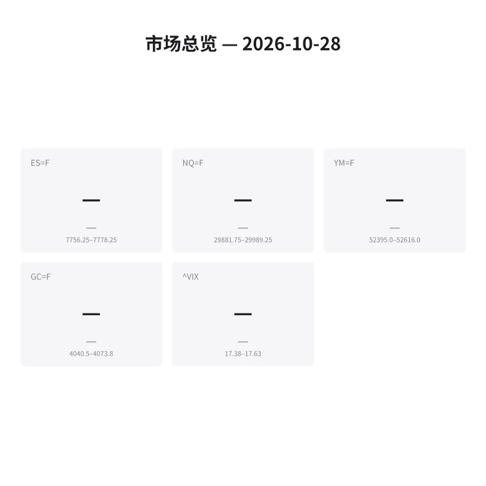
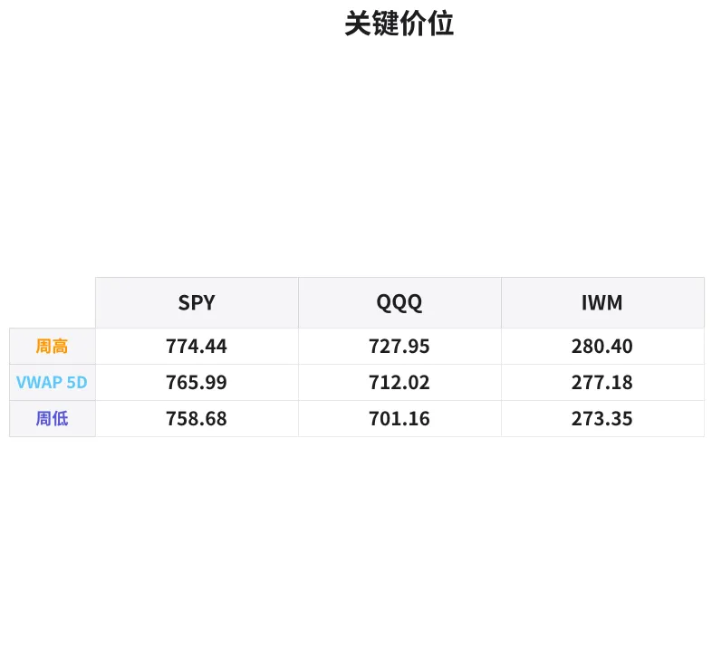

# 盘前分析报告 — 2026-10-28
*生成时间: 12:58:01 UTC*

---
## 数据速览

---
## 一、宏观环境

> [!info]- 详细数据：指数期货 & VIX
> ### 1.1 指数期货 & VIX
> | 品种 | 现价 | 涨跌幅 | 前收 | 日高 | 日低 |
> |------|------|--------|------|------|------|
> | ES=F | None | — | None | None | None |
> | NQ=F | None | — | None | None | None |
> | YM=F | None | — | None | None | None |
> | GC=F | None | — | None | None | None |
> | ^VIX | None | — | None | None | None |

> [!info]- 详细数据：隔夜走势
> ### 1.2 隔夜走势（Globex）
> | 品种 | 隔夜高 | 隔夜低 | 区间 | 亚洲高 | 亚洲低 | 欧洲高 | 欧洲低 |
> |------|--------|--------|------|--------|--------|--------|--------|
> | ES=F | 7778.25 | 7756.25 | 22.0 | 7763.25 | 7757.25 | 7774.0 | 7756.25 |
> | NQ=F | 29989.25 | 29881.75 | 107.5 | 29936.0 | 29881.75 | 29989.25 | 29890.75 |
> | YM=F | 52616.0 | 52395.0 | 221.0 | 52497.0 | 52449.0 | 52515.0 | 52395.0 |
> | GC=F | 4073.8 | 4040.5 | 33.3 | 4057.2 | 4043.2 | 4071.5 | 4040.5 |
> | ^VIX | 17.63 | 17.38 | 0.25 | — | — | 17.63 | 17.38 |

> [!info]- 详细数据：板块强弱
> ### 1.3 板块强弱
> | ETF | 板块 | 涨跌幅 |
> |-----|------|--------|
> | XLK | Technology | — |
> | XLF | Financials | — |
> | XLE | Energy | — |
> | XLV | Healthcare | — |
> | XLI | Industrials | — |
> | XLC | Communication | — |
> | XLY | Consumer Discretionary | — |
> | XLP | Consumer Staples | — |
> | XLRE | Real Estate | — |
> | XLU | Utilities | — |
> | XLB | Materials | — |

---
## 二、消息面

> [!warning] Yahoo Finance API 限流，今日新闻数据不可用。

**盘前异动个股相关：**
- **SOFI (+13.42%)** — 盘前大涨，成交量为均量2.6倍，可能与财报或重大业务消息有关
- **MARA (+5.29%)** — 加密货币矿企跟涨，BTC或有利好驱动
- **RIVN (+2.97%)** — 电动车板块走强
- **GS (+2.77%)** — 高盛盘前上涨，金融板块偏强
- **XOM (-1.98%)** — 能源板块承压，原油可能走弱

---
## 三、盘前异动

| 代码 | 名称 | 现价 | 前收 | 缺口% | 成交量 | 量比 |
|------|------|------|------|--------|--------|------|
| SOFI | SoFi Technologies | $16.40 | $14.46 | +13.42% | 160.5M | 2.60x |
| MARA | MARA Holdings | $7.20 | $6.84 | +5.29% | 37.2M | 1.03x |
| RIVN | Rivian Automotive | $11.77 | $11.43 | +2.97% | 35.0M | 1.45x |
| GS | Goldman Sachs | $918.00 | $893.28 | +2.77% | 1.9M | 0.80x |
| XOM | ExxonMobil | $180.88 | $184.54 | -1.98% | 14.0M | 1.15x |

---
## 四、关键价位

> [!info]- 详细数据：SPY 关键价位
> ### SPY
> | 价位类型 | 价格 |
> |----------|------|
> | Approx Vwap 5D | 765.99 |
> | Weekly High | 774.44 |
> | Weekly Low | 758.68 |

> [!info]- 详细数据：QQQ 关键价位
> ### QQQ
> | 价位类型 | 价格 |
> |----------|------|
> | Approx Vwap 5D | 712.02 |
> | Weekly High | 727.95 |
> | Weekly Low | 701.16 |

> [!info]- 详细数据：IWM 关键价位
> ### IWM
> | 价位类型 | 价格 |
> |----------|------|
> | Approx Vwap 5D | 277.18 |
> | Weekly High | 280.4 |
> | Weekly Low | 273.35 |

---
## 五、AI 技术分析 & 操盘建议

> *基于 2026-10-28 盘前 Globex 数据，生成时间 ~12:58 UTC (08:58 ET)*

---
### 第一部分：隔夜市场回顾

**亚洲时段 (18:00–02:00 ET)**

亚洲时段整体窄幅震荡，交投清淡：
- **ES**：仅6点区间 (7757.25–7763.25)，市场在上周五收盘价附近横盘整理，无明显方向
- **NQ**：54点区间 (29881.75–29936.0)，同样窄幅，但略偏弱势运行在隔夜区间下半部分
- **GC**：14点区间 (4043.2–4057.2)，金价在4050附近徘徊，亚洲买盘温和
- **VIX**：隔夜在17.38–17.63之间，波动率处于低位，市场情绪偏向自满

**欧洲时段 (02:00–08:00 ET)**

欧洲开盘后波动明显扩大，方向偏多：
- **ES**：区间扩大至17.75点 (7756.25–7774.0)，欧洲盘尝试向上突破但未能有效站稳7775以上
- **NQ**：区间扩大至98.5点 (29890.75–29989.25)，强势测试隔夜高点29989，距30000关口仅11点
- **GC**：区间31点 (4040.5–4071.5)，金价先探低后反弹，形成隔夜低点4040.5后回升
- **VIX**：维持在17.38–17.63窄幅区间内

**隔夜小结：**
隔夜整体格局为"亚洲蓄势、欧洲试探"。ES/NQ在欧洲时段尝试向上扩展，但力度有限。GC走出探底回升态势。VIX低位运行（<18）暗示市场短期无恐慌情绪，但也要警惕低波动率环境下的突然波动。周一开盘需关注隔夜高低点的突破/防守情况。

---
### 第二部分：期货品种分析

#### ES (E-mini S&P 500)

**隔夜关键数据：**
- 隔夜区间：7756.25–7778.25（仅22点，非常紧凑）
- 亚洲高/低：7763.25 / 7757.25
- 欧洲高/低：7774.0 / 7756.25

**多时间框架分析：**
- **日线级别**：周线区间 SPY 758.68–774.44 对应ES约 7587–7745 附近（ETF与期货有基差），ES隔夜运行在上周区间上沿附近，偏强格局
- **4H级别**：隔夜窄幅盘整，形成明确的Balance区域 7756–7778，等待方向选择
- **1H/15min**：欧洲时段形成higher lows (7756.25→7756.25)，高点在7774–7778区域受阻

**方向偏向：** 中性偏多 | **置信度：** 60%

隔夜区间极窄（22点），暗示今日开盘大概率出现区间扩展。欧洲时段买方多次测试上沿但未有效突破，如果开盘维持在7770以上则偏向多头试探7778+。但周一开盘流动性可能不足，需等待初始平衡区 (IB) 确立。

| 参数 | 做多方案 | 做空方案 |
|------|----------|----------|
| 入场区域 | 7756–7760 (隔夜低点回踩) | 7778–7782 (隔夜高点突破失败) |
| 止损 | 7750 (隔夜低点下方6点) | 7788 (隔夜高点上方10点) |
| 目标1 | 7778 (隔夜高点) | 7760 (隔夜中轨) |
| 目标2 | 7795–7800 (心理整数位) | 7745–7750 (上周VWAP区域) |
| 失效条件 | 开盘直接跌破7750并持续 | 开盘放量突破7785并回踩不破 |

---

#### NQ (E-mini Nasdaq 100)

**隔夜关键数据：**
- 隔夜区间：29881.75–29989.25（107.5点）
- 亚洲高/低：29936.0 / 29881.75
- 欧洲高/低：29989.25 / 29890.75

**多时间框架分析：**
- **日线级别**：QQQ周线区间701.16–727.95，NQ运行在周区间上半段，多头格局
- **4H级别**：隔夜高点29989直逼30000大关，形成明显的心理压力位
- **1H/15min**：欧洲时段形成ascending pattern，低点从29881→29890抬升，但29989–30000区域形成硬顶

**方向偏向：** 中性偏多 | **置信度：** 55%

30000是极强的心理关口。欧洲时段买方将价格推至29989但未能突破，说明卖方在该位置有防守。如果美盘开盘放量突破30000则可能触发空头回补加速上行；反之若30000反复测试不过则可能回落。

| 参数 | 做多方案 | 做空方案 |
|------|----------|----------|
| 入场区域 | 29890–29920 (欧洲低点回踩) | 29985–30010 (30000假突破) |
| 止损 | 29860 (隔夜低点下方) | 30050 (30000上方50点) |
| 目标1 | 29989 (隔夜高点) | 29900 (隔夜中轨) |
| 目标2 | 30050–30100 (突破后量度) | 29800–29850 (上周高点支撑) |
| 失效条件 | 跌破29860并无快速回收 | 站稳30050以上持续放量 |

---

#### GC (COMEX 黄金)

**隔夜关键数据：**
- 隔夜区间：4040.5–4073.8（33.3点）
- 亚洲高/低：4057.2 / 4043.2
- 欧洲高/低：4071.5 / 4040.5

**多时间框架分析：**
- **日线级别**：GC近期从高位回落，当前在4040–4075区间整理，短期方向不明
- **4H级别**：欧洲时段先探低至4040.5后反弹至4071.5，形成V型反转态势
- **1H/15min**：4040是隔夜关键支撑，亚洲和欧洲时段均在此附近获得支撑。4073.8为隔夜高点阻力

**方向偏向：** 中性偏多 | **置信度：** 55%

欧洲时段探底回升的走势偏向多头，但4073–4075区域阻力较强。VIX低位 + 美元若偏弱则利好黄金。关注今日美国经济数据（如有）对美元和黄金的影响。

| 参数 | 做多方案 | 做空方案 |
|------|----------|----------|
| 入场区域 | 4043–4048 (亚洲低点附近) | 4070–4075 (隔夜高点阻力) |
| 止损 | 4035 (隔夜低点下方5点) | 4082 (隔夜高点上方8点) |
| 目标1 | 4065–4070 (隔夜上轨) | 4050 (隔夜中轨) |
| 目标2 | 4080–4090 (突破后延伸) | 4035–4040 (隔夜低点) |
| 失效条件 | 跌破4035并放量下行 | 突破4080并持续走强 |

---
### 第三部分：ETF品种分析

#### SPY (SPDR S&P 500 ETF)

**关键价位：**
- 5日VWAP：$765.99 — 核心磁吸位
- 周高/低：$774.44 / $758.68
- 盘前价：数据暂不可用（常规盘前未开始）

**分析：**

SPY当前处于周线区间 $758.68–$774.44 的上半段。5日VWAP $765.99 是今日最重要的参考位，价格在VWAP以上运行则日内偏多，以下则偏空。

隔夜ES期货运行在7756–7778区间（对应SPY约 $775–$778 区域，含基差），说明盘前价格在上周高点附近。如果开盘能站稳 $770 以上，则有望挑战 $774–$775 区域（周高）；若开盘走弱跌向 $766 (VWAP)，则需观察该位置的支撑反应。

| 参数 | 方案 |
|------|------|
| 多头入场 | $766–$767 (5日VWAP回踩) |
| 止损 | $764 (VWAP下方2点) |
| 目标1 | $770 |
| 目标2 | $774–$775 (周高) |
| 空头入场 | $774–$775 (周高假突破) |
| 止损 | $777 |
| 目标 | $768–$766 (VWAP) |

---

#### QQQ (Invesco Nasdaq 100 ETF)

**关键价位：**
- 5日VWAP：$712.02 — 核心磁吸位
- 周高/低：$727.95 / $701.16
- 盘前价：数据暂不可用

**分析：**

QQQ周线区间很宽（$701–$728，27点），当前5日VWAP $712 位于区间中部偏下。NQ隔夜运行在29882–29989（对应QQQ约 $716–$720 区域），在VWAP上方运行，偏多格局。

关键观察：NQ隔夜高点29989距30000仅11点，如果美盘突破30000大关，QQQ可能快速冲向 $720+。反之若30000形成硬顶，QQQ可能回落至 $712–$714 (VWAP区域)。

| 参数 | 方案 |
|------|------|
| 多头入场 | $712–$714 (VWAP回踩) |
| 止损 | $710 (VWAP下方2点) |
| 目标1 | $718 |
| 目标2 | $722–$725 |
| 空头入场 | $720–$722 (NQ 30000对应区域假突破) |
| 止损 | $725 |
| 目标 | $714–$712 (VWAP) |

---
### 第四部分：今日市场总览

**整体情绪：中性偏多**

VIX隔夜运行在17.38–17.63，处于较低水平（<18），市场短期情绪偏乐观/自满。低VIX环境下通常有两种演绎：(1) 延续低波动缓慢上涨；(2) 突然出现事件驱动的波动率飙升。周一需留意。

**板块轮动信号：**
- 盘前异动显示**金融 (GS +2.77%)** 和 **科技/金融科技 (SOFI +13.42%)** 偏强
- **能源 (XOM -1.98%)** 承压，可能反映原油弱势预期
- **加密概念 (MARA +5.29%)** 走强，BTC周末可能有利好消息
- **EV (RIVN +2.97%)** 延续反弹

板块ETF变动数据因API限制暂不可用，开盘后需实时监控。

**需要回避的时间窗口：**
- **09:30–09:45 ET**：周一开盘前15分钟，流动性极薄，false breakout概率高，不宜追单
- **10:00 ET**：关注是否有经济数据发布（如Pending Home Sales等），数据公布前后5分钟避免持仓
- **12:00–13:00 ET**：午间流动性低谷，order flow信号可靠性下降

**风险提示：**
- 周一开盘通常gap较大但方向不明确，建议等IB (Initial Balance, 09:30–10:30) 确立后再入场
- VIX低位自满，警惕黑天鹅事件
- Yahoo Finance API今日部分限流，开盘后建议用备用数据源确认价位

---

> **核心交易论点：** 隔夜窄幅盘整 + VIX低位 = 今日RTH大概率区间扩展。NQ 30000是全天最关键的水位——突破则做多，受阻则做空。ES/SPY跟随NQ方向操作，GC独立看4040–4075区间突破方向。耐心等IB确立再出手。
