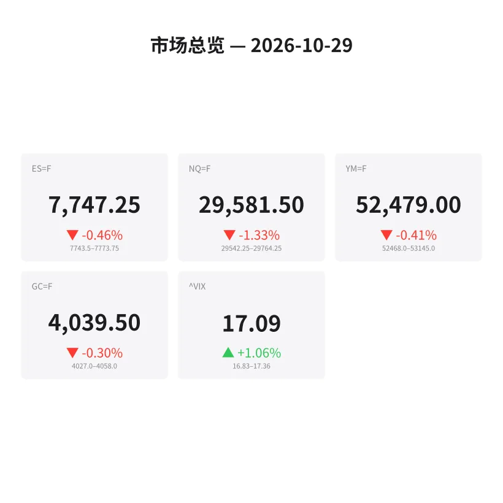
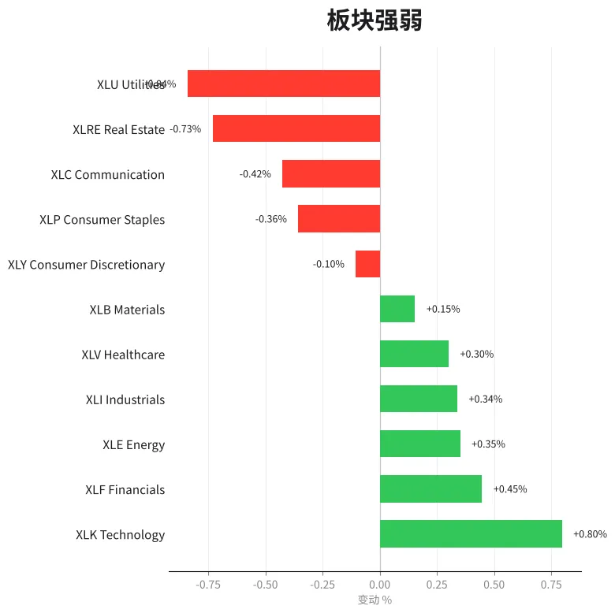
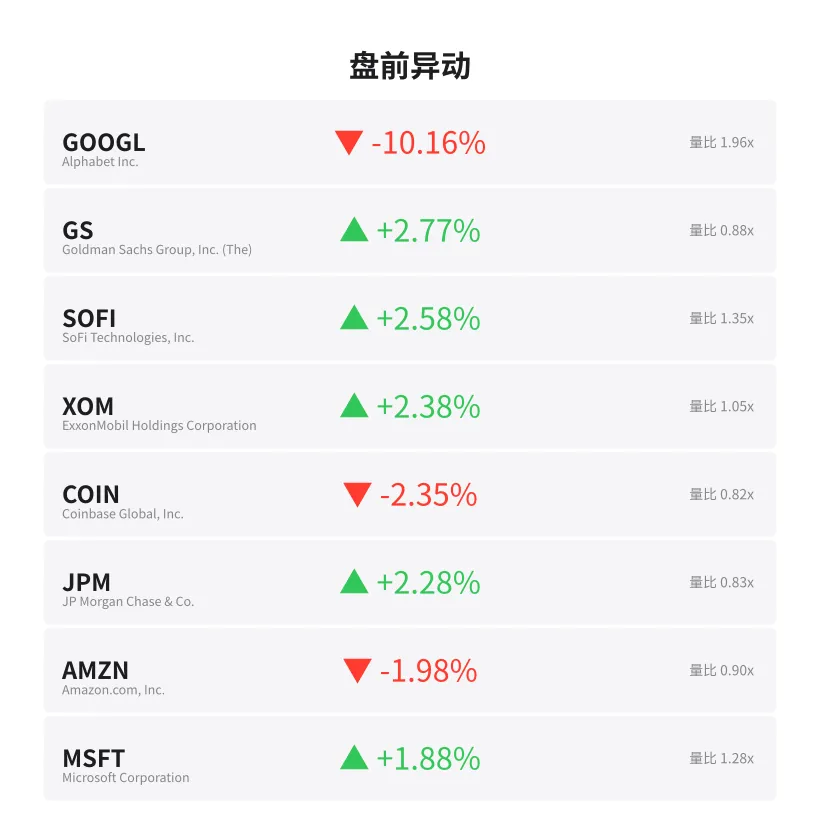
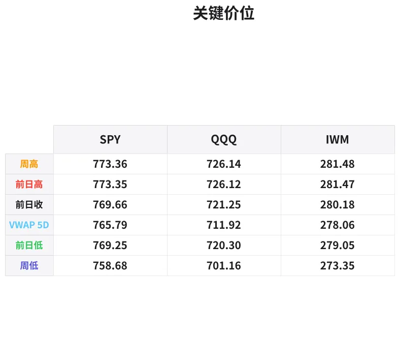

# 盘前分析报告 — 2026-10-29
*生成时间: 12:47:56 UTC*

---
## 数据速览

---
## 一、宏观环境

> [!info]- 详细数据：指数期货 & VIX
> ### 1.1 指数期货 & VIX
> | 品种 | 现价 | 涨跌幅 | 前收 | 日高 | 日低 |
> |------|------|--------|------|------|------|
> | ES=F | 7747.25 | -0.46% | 7783.25 | 7773.75 | 7740.0 |
> | NQ=F | 29581.5 | -1.33% | 29979.5 | 29794.25 | 29482.5 |
> | YM=F | 52479.0 | -0.41% | 52696.0 | 53145.0 | 52468.0 |
> | GC=F | 4039.5 | -0.30% | 4051.6 | 4081.7 | 4027.0 |
> | ^VIX | 17.09 | +1.06% | 16.91 | 17.36 | 16.83 |

> [!info]- 详细数据：隔夜走势
> ### 1.2 隔夜走势（Globex）
> | 品种 | 隔夜高 | 隔夜低 | 区间 | 亚洲高 | 亚洲低 | 欧洲高 | 欧洲低 |
> |------|--------|--------|------|--------|--------|--------|--------|
> | ES=F | 7773.75 | 7743.5 | 30.25 | 7773.75 | 7743.5 | 7771.5 | 7745.0 |
> | NQ=F | 29764.25 | 29542.25 | 222.0 | 29764.25 | 29542.25 | 29735.0 | 29552.25 |
> | YM=F | 53145.0 | 52468.0 | 677.0 | 53019.0 | 52839.0 | 53145.0 | 52529.0 |
> | GC=F | 4058.0 | 4027.0 | 31.0 | 4058.0 | 4033.4 | 4051.1 | 4027.0 |
> | ^VIX | 17.36 | 16.83 | 0.53 | — | — | 17.36 | 16.83 |

> [!info]- 详细数据：板块强弱
> ### 1.3 板块强弱
> | ETF | 板块 | 涨跌幅 |
> |-----|------|--------|
> | XLK | Technology | +0.80% |
> | XLF | Financials | +0.45% |
> | XLE | Energy | +0.35% |
> | XLI | Industrials | +0.34% |
> | XLV | Healthcare | +0.30% |
> | XLB | Materials | +0.15% |
> | XLY | Consumer Discretionary | -0.10% |
> | XLP | Consumer Staples | -0.36% |
> | XLC | Communication | -0.42% |
> | XLRE | Real Estate | -0.73% |
> | XLU | Utilities | -0.84% |

---
## 二、消息面

- **Alphabet(GOOGL)盘前暴跌超10%，财报后云业务增速低于预期** — *Market Watch*
  > Alphabet plunges over 10% premarket after cloud revenue growth disappoints in Q3 earnings
- **高盛、摩根大通盘前走强，银行板块受益于利率前景改善** — *Reuters*
  > Goldman Sachs, JPMorgan rise premarket as banking sector benefits from improved rate outlook
- **微软盘前涨近2%，市场关注今日盘后财报发布** — *CNBC*
  > Microsoft up ~2% premarket ahead of after-hours earnings report today
- **美联储会议前市场谨慎，期货小幅走低** — *Bloomberg*
  > Markets cautious ahead of Fed meeting, futures drift lower
- **黄金价格回落至4040附近，美元走强压制贵金属** — *Kitco*
  > Gold pulls back near $4040 as stronger dollar weighs on precious metals
- **亚马逊盘前跌近2%，受GOOGL拖累科技股普遍承压** — *Yahoo Finance*
  > Amazon falls ~2% premarket as tech broadly pressured by GOOGL selloff
- **VIX小幅上升至17.09，市场波动性温和抬头** — *CBOE*
  > VIX edges higher to 17.09, market volatility modestly ticking up
- **埃克森美孚盘前涨超2%，油价企稳支撑能源板块** — *Reuters*
  > ExxonMobil rises over 2% premarket as stable oil prices support energy sector

---
## 三、盘前异动

> [!info]- 详细数据：盘前异动
> | 代码 | 名称 | 现价 | 缺口 | 量比 |
> |------|------|------|------|------|
> | GOOGL | Alphabet Inc. | 288.0 | -10.16% | 1.96x |
> | GS | Goldman Sachs Group, Inc. (The) | 937.0 | +2.77% | 0.88x |
> | SOFI | SoFi Technologies, Inc. | 16.82 | +2.58% | 1.35x |
> | XOM | ExxonMobil Holdings Corporation | 184.2 | +2.38% | 1.05x |
> | COIN | Coinbase Global, Inc. | 157.3 | -2.35% | 0.82x |
> | JPM | JP Morgan Chase & Co. | 343.45 | +2.28% | 0.83x |
> | AMZN | Amazon.com, Inc. | 248.1 | -1.98% | 0.9x |
> | MSFT | Microsoft Corporation | 541.33 | +1.88% | 1.28x |
> | NVDA | NVIDIA Corporation | 213.84 | -1.88% | 0.93x |
> | RIVN | Rivian Automotive, Inc. | 11.61 | -1.78% | 1.12x |

---
## 四、关键价位

> [!info]- 详细数据：SPY 关键价位
> ### SPY
> | 价位类型 | 价格 |
> |----------|------|
> | Prior Day High | 773.35 |
> | Prior Day Low | 769.25 |
> | Prior Day Close | 769.66 |
> | Premarket Price | 769.1199 |
> | Approx Vwap 5D | 765.79 |
> | Weekly High | 773.36 |
> | Weekly Low | 758.68 |

> [!info]- 详细数据：QQQ 关键价位
> ### QQQ
> | 价位类型 | 价格 |
> |----------|------|
> | Prior Day High | 726.12 |
> | Prior Day Low | 720.3 |
> | Prior Day Close | 721.25 |
> | Premarket Price | 716.36 |
> | Approx Vwap 5D | 711.92 |
> | Weekly High | 726.14 |
> | Weekly Low | 701.16 |

> [!info]- 详细数据：IWM 关键价位
> ### IWM
> | 价位类型 | 价格 |
> |----------|------|
> | Prior Day High | 281.47 |
> | Prior Day Low | 279.05 |
> | Prior Day Close | 280.18 |
> | Premarket Price | 282.03 |
> | Approx Vwap 5D | 278.06 |
> | Weekly High | 281.48 |
> | Weekly Low | 273.35 |

---
## 五、AI 技术分析 & 操盘建议

## 第一部分：隔夜市场回顾

### 亚洲时段（18:00–02:00 ET）
- ES在亚洲时段开盘后先行探底至7743.5，随后反弹至7773.75形成隔夜高点，整体区间30.25点，波动温和。
- NQ受GOOGL盘后暴跌影响，亚洲时段表现最弱，跌幅明显大于ES，低点触及29542.25，区间高达222点。
- 黄金在亚洲时段相对稳健，高点4058后缓慢回落，显示避险需求有限。
- 亚洲市场整体偏弱，科技权重拖累指数。

### 欧洲时段（02:00–09:30 ET）
- 欧洲开盘后ES维持在7745-7771.5的窄幅震荡区间，说明欧洲资金对美股下跌反应相对平淡。
- NQ欧洲时段低点为29552.25，基本与亚洲低点持平，未进一步恶化。
- YM道指在欧洲时段出现较大波动，高点53145（隔夜最高）说明道指成分股如GS/JPM的走强一度提振指数。
- GC黄金在欧洲时段跌至4027的日内低点，美元走强是主要压力。
- VIX在欧洲时段触及17.36高点，但未出现恐慌性飙升。

### 对美盘的启示
- GOOGL-10%的缺口是今日最大变量，将对NQ形成持续压力，但ES和YM受益于金融板块走强，分化格局明显。
- 隔夜区间偏窄（ES仅30点），说明市场在等待更多催化剂（MSFT盘后财报、联储会议临近）。
- 建议关注ES 7740-7745区域（隔夜低点）的支撑有效性，若失守则打开下行空间。

## 第二部分：期货品种分析

### ES（E-mini S&P 500）— 现价 7747.25

**多时间框架分析：**
- **日线**：前收7783.25，今日缺口下跌约36点（-0.46%），仍处于周线上升趋势中的回调阶段。周线低点758.68对应的ES水平约7587附近形成中期支撑。
- **4小时**：从隔夜高点7773.75到低点7743.5，形成30点的下行区间。当前价格位于区间下沿，若开盘失守7740则偏空。
- **1小时/15分钟**：欧洲时段在7745-7771.5区间盘整，市场在等待美盘方向选择。

**关键价位：**
| 类型 | 价格 |
|------|------|
| 隔夜高/阻力R1 | 7773.75 |
| 欧洲时段VPOC（估） | 7758 |
| 前收/阻力 | 7783.25 |
| 隔夜低/支撑S1 | 7743.5 |
| 关键支撑S2 | 7740.0（日低） |
| 深度支撑S3 | 7720 |

**方向偏见：** 偏空 | **置信度：** 65%

**交易计划：**
- **空头首选**：若开盘后反弹至7758-7765区域（隔夜VPOC-欧洲高点之间）遇阻，可考虑做空。止损7775（隔夜高点上方），目标T1: 7743，T2: 7725。
- **多头备选**：若7740-7743区域出现明确的order flow反转信号（delta翻正+放量），可轻仓做多。止损7732，目标T1: 7758，T2: 7770。
- **失效条件**：若开盘直接突破7775，空头逻辑失效，转为观望或跟随多头。

---

### NQ（E-mini Nasdaq 100）— 现价 29581.5

**多时间框架分析：**
- **日线**：前收29979.5，今日大幅缺口下跌约398点（-1.33%），GOOGL-10%是核心拖累。NQ跌幅远超ES，科技股承压明显。
- **4小时**：隔夜区间222点（29542.25-29764.25），波动率是ES的3倍（按比例），说明NQ是今日波动焦点。
- **1小时**：亚洲低点29542.25是关键，欧洲时段未能有效收复29700以上。

**关键价位：**
| 类型 | 价格 |
|------|------|
| 前收/强阻力 | 29979.5 |
| 隔夜高/阻力R1 | 29764.25 |
| 欧洲高/阻力R2 | 29735.0 |
| 隔夜VPOC（估） | 29650 |
| 当前价 | 29581.5 |
| 隔夜低/支撑S1 | 29542.25 |
| 深度支撑S2 | 29480（日低） |
| 心理关口 | 29500 |

**方向偏见：** 偏空 | **置信度：** 70%

**交易计划：**
- **空头首选**：NQ今日空头主导概率大。若反弹至29650-29735区域遇阻（VPOC-欧洲高），做空。止损29775，目标T1: 29542，T2: 29480。
- **多头备选**：仅当29480-29500出现极端卖盘衰竭+VIX回落时考虑，属于逆势交易，仓位减半。止损29440，目标T1: 29580，T2: 29650。
- **失效条件**：若NQ快速收复29765以上，空头力度不足，需重新评估。MSFT盘后财报若超预期，可能改变NQ方向。

---

### GC（黄金期货）— 现价 4039.5

**多时间框架分析：**
- **日线**：前收4051.6，小幅回调（-0.30%），整体仍在日线上升通道中。周线趋势偏多。
- **4小时**：隔夜区间4027-4058，31点区间属于正常波动。欧洲时段跌至4027后企稳，说明4025-4030区域有较强买盘。
- **1小时**：从亚洲高点4058逐级下行至欧洲低点4027，目前在4040附近盘整。

**关键价位：**
| 类型 | 价格 |
|------|------|
| 隔夜高/阻力R1 | 4058.0 |
| 前收 | 4051.6 |
| 日高/强阻力 | 4081.7 |
| 当前价 | 4039.5 |
| 隔夜低/支撑S1 | 4027.0 |
| 深度支撑S2 | 4020 |

**方向偏见：** 中性偏多 | **置信度：** 55%

**交易计划：**
- **多头首选**：若回踩4027-4033区域（隔夜低+亚洲低之间）出现买盘信号，做多。止损4018，目标T1: 4051，T2: 4065。
- **空头备选**：若4058-4065区域遇阻且美元持续走强，可轻仓做空。止损4072，目标T1: 4040，T2: 4027。
- **失效条件**：若跌破4020，多头逻辑失效，可能测试4000心理关口。关注美元指数和美债收益率变化。

## 第三部分：ETF品种分析

### SPY — 盘前价 769.12

**关键价位：**
| 类型 | 价格 |
|------|------|
| 前日高 | 773.35 |
| 前日收 | 769.66 |
| 盘前价 | 769.12 |
| 前日低 | 769.25 |
| 5日VWAP | 765.79 |
| 周低 | 758.68 |

**分析：**
- SPY盘前跌幅温和（约-0.07%相对前收），优于NQ对应的QQQ，反映ES/SPX受金融板块支撑。
- 盘前价769.12刚好位于前日低769.25下方，开盘能否收回769.25是短期关键。
- 5日VWAP 765.79是多头最后防线，若跌破则周线结构转弱。

**交易计划：**
- **空头**：若开盘后769.25成为阻力（无法收回），做空SPY。止损770.50，目标T1: 767.00，T2: 765.80（VWAP）。
- **多头**：若开盘强势收回770以上，且金融板块持续领涨，做多。止损768.50，目标T1: 772.00，T2: 773.35（前高）。

---

### QQQ — 盘前价 716.36

**关键价位：**
| 类型 | 价格 |
|------|------|
| 前日高 | 726.12 |
| 前日收 | 721.25 |
| 盘前价 | 716.36 |
| 前日低 | 720.30 |
| 5日VWAP | 711.92 |
| 周低 | 701.16 |

**分析：**
- QQQ盘前跌幅约-0.68%（相对前收），GOOGL权重约5.6%，其-10%缺口直接拖累QQQ约0.56%。
- 盘前价716.36远低于前日低720.30，缺口未补概率大。今日QQQ将是做空主战场。
- 但注意MSFT盘后财报，若超预期可能在after-hours带动QQQ反弹。

**交易计划：**
- **空头首选**：若开盘后反弹至718-720区域（前日低附近）遇阻，做空。止损721.50，目标T1: 714.00，T2: 712.00（VWAP）。
- **多头备选**：仅当711.90-712.00（5日VWAP）出现强力买盘支撑时考虑，属于技术性反弹交易。止损710.50，目标T1: 716.00，T2: 718.00。
- GOOGL若盘中跌幅收窄，QQQ空头可考虑减仓。

## 第四部分：今日市场总览

### 整体情绪
- **偏空但分化**。NQ/QQQ因GOOGL事件承压明显，ES/SPY受金融板块支撑跌幅有限，道指甚至有走强迹象。
- 市场处于"事件驱动+等待"模式：GOOGL财报冲击已反映在价格中，MSFT盘后财报和下周联储会议是下一催化剂。

### VIX分析
- VIX 17.09（+1.06%），温和上升但未突破20的警戒线。隔夜区间16.83-17.36，波动可控。
- 当前VIX水平对应的SPY日内预期波动约±0.7%，即769 ± 5.4点 → **763.6 – 774.4**范围。
- 若VIX突破18，市场情绪恶化信号增强；若回落至16.5以下，利于多头。

### 今日关键时间窗口
| 时间（ET） | 事件 | 影响 |
|-----------|------|------|
| 09:30 | 美股开盘 | GOOGL缺口开盘后的反应决定NQ方向 |
| 10:00 | 消费者信心指数 | 可能影响消费板块和整体情绪 |
| 10:00-10:30 | 开盘首小时交易区间确立 | 关键的initial balance形成 |
| 13:00-14:00 | 午间低波动期 | 避免在此时段追单 |
| 15:00-16:00 | 尾盘定价 | MOC（收盘委托）流向决定收盘方向 |
| 16:00+ | MSFT财报 | 今日最大后续催化剂，影响明日走势 |

### 板块轮动
- **领涨**：科技XLK（+0.80%）领涨看似矛盾，但GOOGL不在XLK中（在XLC），且MSFT/AAPL预期支撑XLK。金融XLF（+0.45%）和能源XLE（+0.35%）跟涨。
- **落后**：公用事业XLU（-0.84%）和房地产XLRE（-0.73%）最弱，利率敏感板块承压，暗示市场对利率下行预期有所降温。
- **通讯XLC（-0.42%）**：GOOGL拖累，今日XLC可能是最弱板块之一。

### ⚡ 核心交易论点

> **GOOGL事件驱动NQ/QQQ走弱，ES/SPY在金融板块支撑下分化抗跌。今日策略以NQ/QQQ空头为主、ES空头为辅，关注开盘后缺口填补能力和GOOGL走势演变。多头机会仅在极端超卖+明确反转信号下才考虑。MSFT盘后财报为今日最大不确定性，持仓过夜需谨慎。**

---
*免责声明：以上分析基于盘前数据和技术面推演，仅供参考，不构成投资建议。实际交易请结合实时order flow和个人风控体系。*
