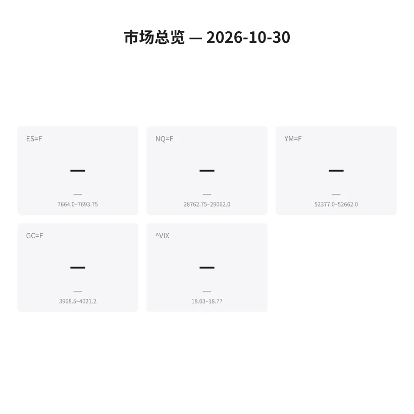
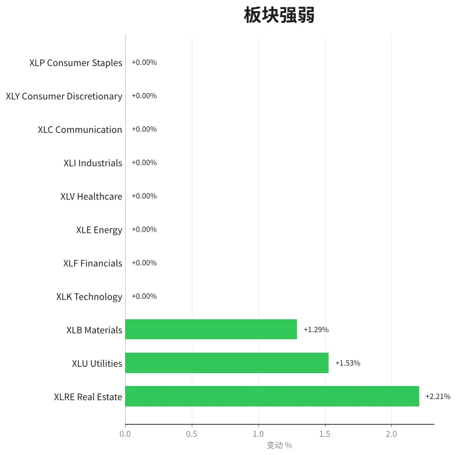
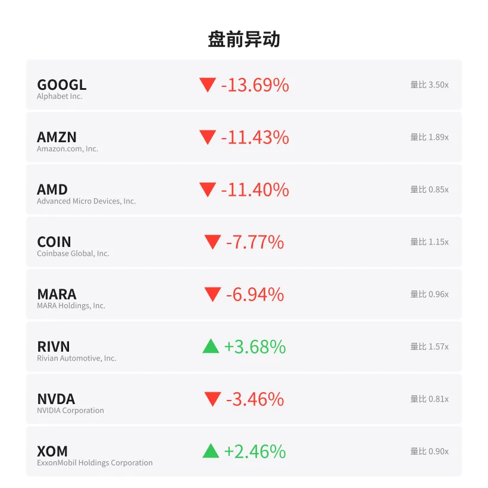
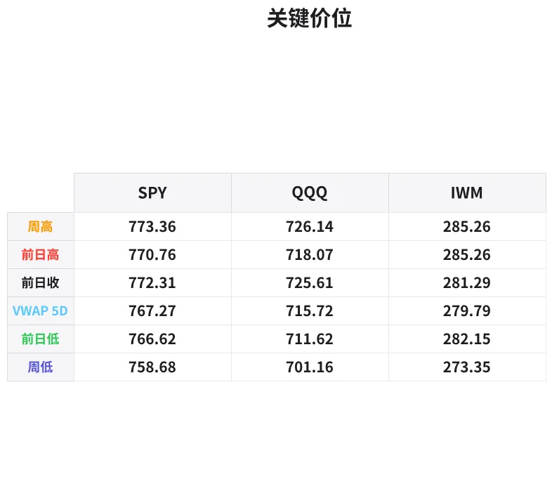

# 盘前分析报告 — 2026-10-30
*生成时间: 12:41:05 UTC*

---
## 数据速览






---
## 一、宏观环境

> [!info]- 详细数据：指数期货 & VIX
> ### 1.1 指数期货 & VIX
> | 品种 | 现价 | 涨跌幅 | 前收 | 日高 | 日低 |
> |------|------|--------|------|------|------|
> | ES=F | None | — | None | None | None |
> | NQ=F | None | — | None | None | None |
> | YM=F | None | — | None | None | None |
> | GC=F | None | — | None | None | None |
> | ^VIX | None | — | None | None | None |

> [!info]- 详细数据：隔夜走势
> ### 1.2 隔夜走势（Globex）
> | 品种 | 隔夜高 | 隔夜低 | 区间 | 亚洲高 | 亚洲低 | 欧洲高 | 欧洲低 |
> |------|--------|--------|------|--------|--------|--------|--------|
> | ES=F | 7693.75 | 7664.0 | 29.75 | 7688.25 | 7677.5 | 7693.75 | 7664.0 |
> | NQ=F | 29062.0 | 28762.75 | 299.25 | 29042.0 | 28931.75 | 29062.0 | 28762.75 |
> | YM=F | 52662.0 | 52377.0 | 285.0 | 52446.0 | 52377.0 | 52662.0 | 52437.0 |
> | GC=F | 4021.2 | 3968.5 | 52.7 | 4021.2 | 3997.0 | 4009.2 | 3973.7 |
> | ^VIX | 18.77 | 18.03 | 0.74 | — | — | 18.77 | 18.03 |

> [!info]- 详细数据：板块强弱
> ### 1.3 板块强弱
> | ETF | 板块 | 涨跌幅 |
> |-----|------|--------|
> | XLRE | Real Estate | +2.21% |
> | XLU | Utilities | +1.53% |
> | XLB | Materials | +1.29% |
> | XLK | Technology | — |
> | XLF | Financials | — |
> | XLE | Energy | — |
> | XLV | Healthcare | — |
> | XLI | Industrials | — |
> | XLC | Communication | — |
> | XLY | Consumer Discretionary | — |
> | XLP | Consumer Staples | — |

---
## 二、消息面

*（注：新闻源因API限流暂不可用，以下基于盘前异动数据推断）*

- **谷歌母公司Alphabet盘前暴跌近14%，或因Q3财报不及预期** — *盘前异动*
  > GOOGL -13.69%, volume 3.5x normal
- **亚马逊盘前重挫逾11%，云业务或增长放缓引发抛售** — *盘前异动*
  > AMZN -11.43%, volume 1.89x normal
- **AMD盘前大跌超11%，AI芯片竞争加剧或拖累前景** — *盘前异动*
  > AMD -11.40%
- **英伟达盘前下跌3.5%，受科技股集体抛售波及** — *盘前异动*
  > NVDA -3.46%
- **特斯拉盘前小幅下跌2.1%，整体市场风险偏好下降** — *盘前异动*
  > TSLA -2.12%
- **能源股逆势走强：埃克森美孚+2.5%、雪佛龙+2.2%** — *盘前异动*
  > XOM +2.46%, CVX +2.18%
- **Rivian盘前上涨3.7%，或受利好消息推动** — *盘前异动*
  > RIVN +3.68%, volume 1.57x normal
- **VIX恐慌指数温和上升至18-19区间，市场避险情绪升温** — *盘前数据*
  > VIX range: 18.03 - 18.77

---
## 三、盘前异动

> [!info]- 详细数据：盘前异动
> | 代码 | 名称 | 现价 | 缺口 | 量比 |
> |------|------|------|------|------|
> | GOOGL | Alphabet Inc. | 280.41 | -13.69% | 3.5x |
> | AMZN | Amazon.com, Inc. | 225.5 | -11.43% | 1.89x |
> | AMD | Advanced Micro Devices, Inc. | 512.5 | -11.40% | 0.85x |
> | COIN | Coinbase Global, Inc. | 149.71 | -7.77% | 1.15x |
> | MARA | MARA Holdings, Inc. | 6.84 | -6.94% | 0.96x |
> | RIVN | Rivian Automotive, Inc. | 12.1 | +3.68% | 1.57x |
> | NVDA | NVIDIA Corporation | 207.92 | -3.46% | 0.81x |
> | XOM | ExxonMobil Holdings Corporation | 186.5 | +2.46% | 0.9x |
> | CVX | Chevron Corporation | 234.2 | +2.18% | 0.76x |
> | TSLA | Tesla, Inc. | 395.64 | -2.12% | 0.53x |

---
## 四、关键价位

> [!info]- 详细数据：SPY 关键价位
> ### SPY
> | 价位类型 | 价格 |
> |----------|------|
> | Prior Day High | 770.76 |
> | Prior Day Low | 766.62 |
> | Prior Day Close | 772.31 |
> | Premarket Price | 761.72 |
> | Approx Vwap 5D | 767.27 |
> | Weekly High | 773.36 |
> | Weekly Low | 758.68 |

> [!info]- 详细数据：QQQ 关键价位
> ### QQQ
> | 价位类型 | 价格 |
> |----------|------|
> | Prior Day High | 718.07 |
> | Prior Day Low | 711.62 |
> | Prior Day Close | 725.61 |
> | Premarket Price | 697.18 |
> | Approx Vwap 5D | 715.72 |
> | Weekly High | 726.14 |
> | Weekly Low | 701.16 |

> [!info]- 详细数据：IWM 关键价位
> ### IWM
> | 价位类型 | 价格 |
> |----------|------|
> | Prior Day High | 285.26 |
> | Prior Day Low | 282.15 |
> | Prior Day Close | 281.29 |
> | Premarket Price | 282.55 |
> | Approx Vwap 5D | 279.79 |
> | Weekly High | 285.26 |
> | Weekly Low | 273.35 |

---
## 五、AI 技术分析 & 操盘建议

## 第一部分：隔夜市场回顾

### 亚洲时段（18:00 - 02:00 ET）

亚洲时段整体窄幅震荡，市场在等待美国科技巨头财报：

| 品种 | 亚洲高 | 亚洲低 | 区间 | 走势特征 |
|------|--------|--------|------|----------|
| ES | 7688.25 | 7677.50 | 10.75 | 窄幅盘整，多空均衡 |
| NQ | 29042.00 | 28931.75 | 110.25 | 小幅承压，卖方略占优 |
| YM | 52446.00 | 52377.00 | 69.00 | 极窄区间，最为平静 |
| GC | 4021.20 | 3997.00 | 24.20 | 亚盘高位运行，避险需求支撑 |

**要点**：亚洲时段NQ已经开始走弱，暗示市场提前消化科技股财报不确定性。GC在4000上方运行表明避险资金在流入黄金。

### 欧洲时段（02:00 - 09:30 ET）

欧洲时段波动显著放大，尤其是NQ在盘前财报数据公布后出现大幅杀跌：

| 品种 | 欧洲高 | 欧洲低 | 区间 | 走势特征 |
|------|--------|--------|------|----------|
| ES | 7693.75 | 7664.00 | 29.75 | 区间扩大，但受非科技板块支撑 |
| NQ | 29062.00 | 28762.75 | 299.25 | 暴跌近300点，卖压汹涌 |
| YM | 52662.00 | 52437.00 | 225.00 | 相对稳定，价值股提供缓冲 |
| GC | 4009.20 | 3973.70 | 35.50 | 冲高回落，避险买盘被获利了结 |

**要点**：

1. **NQ领跌**：欧洲时段NQ区间高达299点，远超ES的30点，显示科技股抛售力度极强。GOOGL(-14%)、AMZN(-11%)、AMD(-11%)的盘前暴跌是主要推手。
2. **ES抗跌**：ES仅下跌约30点，ES/NQ比值严重分化。非科技权重股（能源XOM+2.5%、地产XLRE+2.2%、公用事业XLU+1.5%）提供有力支撑。
3. **GC冲高回落**：黄金从亚盘高点4021回落至3974，说明避险情绪并非持续升温，市场更多是在定价科技股估值调整而非系统性风险。
4. **VIX温和**：VIX维持在18-19区间，未出现恐慌性飙升，暗示机构对此次回调的定性是"业绩驱动的板块轮动"而非"系统性崩盘"。

### 对美盘的影响

- 开盘预计：**SPY缺口低开约1.4%至761.72，QQQ缺口低开约3.9%至697.18**
- IWM逆势上涨0.4%至282.55，小盘股资金流入明显
- 这种"科技跌、非科技涨"的格局意味着指数层面下跌幅度会被对冲，但NQ/QQQ将承受最大压力
- 开盘后30分钟预计波动最大，等待真实成交量确认方向

## 第二部分：期货品种分析

### ES（E-mini S&P 500）

**多时间框架分析：**
- **日线**：昨收约7700区域，今日缺口低开至7660-7680区间。日线仍处于上升趋势中，本次回调暂定性为回撤而非反转。
- **4小时**：7664是Globex低点，也是短期关键支撑。若收复7694（Globex高点），则4H结构未破。
- **1小时/15分钟**：开盘后关注7664-7670区域的买卖力量对比。

**关键价位：**

| 价位 | 类型 | 说明 |
|------|------|------|
| 7694 | 阻力R1 | Globex隔夜高点 |
| 7688 | 阻力R2 | 亚洲时段高点 |
| 7679 | 中轴POC | Globex区间中点 |
| 7670 | 支撑S1 | 隔夜成交密集区 |
| 7664 | 关键支撑S2 | Globex低点 / 欧洲低点 |
| 7650 | 强支撑S3 | 心理整数关口下方 |

**方向偏见**：📉 偏空 — 置信度 60%

科技股拖累使得ES承压，但非科技板块的支撑限制了下行空间。ES处于"受限下跌"格局。

**交易计划：**
- **首选策略**：空头反弹 — 等待反弹至7685-7694区域（Globex高点附近），出现明确卖压信号后做空
- **入场区域**：7685 - 7694
- **止损**：7702（Globex高点上方8点）
- **目标T1**：7670（+15-24点）
- **目标T2**：7664（Globex低点）
- **失效条件**：开盘后30分钟内站稳7700上方且放量，则转为多头思路

**备选策略**：若开盘直接下探7664并出现明确反转（delta翻正、大单买入），可轻仓做多目标7679-7688。

---

### NQ（E-mini Nasdaq 100）

**多时间框架分析：**
- **日线**：巨幅缺口低开，日线可能形成跳空缺口。GOOGL/AMZN/AMD合计权重约15%，这三只股票盘前平均跌幅超12%，对NQ造成约180-200点的直接拖累。
- **4小时**：Globex低点28763是关键测试位，若失守则打开更大下行空间。
- **1小时/15分钟**：欧洲时段尾声NQ在28763附近企稳，开盘后该位的攻防是重点。

**关键价位：**

| 价位 | 类型 | 说明 |
|------|------|------|
| 29062 | 强阻力R1 | Globex隔夜高点 |
| 29042 | 阻力R2 | 亚洲时段高点 |
| 29000 | 心理关口 | 整数位阻力 |
| 28912 | 中轴POC | Globex区间中点 |
| 28800 | 支撑S1 | 心理整数位 |
| 28763 | 关键支撑S2 | Globex低点 / 欧洲低点 |
| 28700 | 强支撑S3 | 下方整数位支撑 |

**方向偏见**：📉 偏空 — 置信度 75%

今日NQ是最弱的主要期货品种。三大科技巨头集体暴跌，机构大概率会在反弹中减仓。缺口回补概率低。

**交易计划：**
- **首选策略**：空头反弹 — 等待反弹至28900-29000区域，出现卖压信号后做空
- **入场区域**：28900 - 29000
- **止损**：29075（Globex高点上方13点）
- **目标T1**：28800（+100-200点）
- **目标T2**：28700（支撑位）
- **失效条件**：开盘后放量突破29062（Globex高点），则科技股可能被抄底资金买入

**备选策略**：若NQ开盘后快速下探至28700以下出现恐慌性抛售后反转（VIX开始回落、delta大幅转正），可轻仓做多scalp目标28800-28900。但注意今日NQ做多风险极大，仓位务必减半。

---

### GC（黄金期货）

**多时间框架分析：**
- **日线**：黄金处于近期高位整理区间，4000是关键心理关口。日线趋势仍偏多。
- **4小时**：从亚盘高点4021回落至3974，4H出现一根中阴线，短期需要企稳。
- **1小时/15分钟**：3970-3975是隔夜低点区域，是短期多空分界线。

**关键价位：**

| 价位 | 类型 | 说明 |
|------|------|------|
| 4021 | 强阻力R1 | 隔夜高点 / 亚洲高点 |
| 4009 | 阻力R2 | 欧洲时段高点 |
| 4000 | 心理关口 | 整数位阻力 |
| 3997 | 支撑S1 | 亚洲时段低点 |
| 3974 | 关键支撑S2 | 欧洲低点 |
| 3969 | 强支撑S3 | Globex隔夜低点 |

**方向偏见**：📊 中性偏空 — 置信度 55%

科技股暴跌理论上应该推动避险资金流入黄金，但GC在欧洲时段反而冲高回落。这说明机构可能在减持黄金多头来补充保证金或减少整体风险敞口（risk-off de-leveraging）。

**交易计划：**
- **首选策略**：区间交易 — 3970-4010区间高抛低吸
- **做多入场**：3970 - 3975（Globex低点附近）
- **止损**：3960（Globex低点下方9点）
- **目标T1**：3997（亚洲低点回收）
- **目标T2**：4009（欧洲高点）
- **失效条件**：跌破3960则放弃多头，转为观望或轻仓做空

**备选策略**：若VIX在美盘开盘后飙升至20以上，黄金可能迎来避险买盘。此时可在4000上方加仓做多，目标4020+。

## 第三部分：ETF品种分析

### SPY（SPDR S&P 500 ETF）

**核心数据：**

| 指标 | 数值 |
|------|------|
| 昨收 | 772.31 |
| 盘前价 | 761.72 |
| 缺口幅度 | -10.59 (-1.37%) |
| 昨日高 | 770.76 |
| 昨日低 | 766.62 |
| 5日VWAP | 767.27 |
| 周高 | 773.36 |
| 周低 | 758.68 |

**关键价位地图：**

```
773.36 ─── 周高（强阻力）
772.31 ─── 昨收（缺口上沿）
770.76 ─── 昨日高
767.27 ─── 5日VWAP（关键中轴）
766.62 ─── 昨日低
~~~~~~~~~~ 缺口区域 ~~~~~~~~~~
761.72 ─── 盘前价（开盘预估）
758.68 ─── 周低（关键支撑）
```

**交易计划：**

**场景A：缺口支撑反弹（概率55%）**
- SPY在761-762区域获得买盘支撑，形成日内底部
- 做多入场：761.50 - 762.00，出现15分钟K线反转确认
- 止损：758.50（周低下方）
- T1：766.00（昨日低点附近，+4.00）
- T2：767.27（5日VWAP，+5.27）

**场景B：跌破周低（概率30%）**
- SPY开盘后继续下行击穿758.68
- 做空入场：跌破758.50确认后
- 止损：761.00
- T1：756.00（-2.50）
- T2：753.00（-5.50）

**场景C：快速缺口回补（概率15%）**
- 开盘后强力买盘推动SPY回补缺口至766+
- 此场景需要科技股盘前跌幅收窄为前提
- 不追多，等回踩766-767做多更安全

---

### QQQ（Invesco Nasdaq 100 ETF）

**核心数据：**

| 指标 | 数值 |
|------|------|
| 昨收 | 725.61 |
| 盘前价 | 697.18 |
| 缺口幅度 | -28.43 (-3.92%) |
| 昨日高 | 718.07 |
| 昨日低 | 711.62 |
| 5日VWAP | 715.72 |
| 周高 | 726.14 |
| 周低 | 701.16 |

**关键价位地图：**

```
726.14 ─── 周高
725.61 ─── 昨收（缺口上沿）
718.07 ─── 昨日高
715.72 ─── 5日VWAP
711.62 ─── 昨日低
~~~~~~~~~~ 巨大缺口区域（-28.43点）~~~~~~~~~~
701.16 ─── 周低（关键阻力/支撑翻转）
697.18 ─── 盘前价（开盘预估）
695.00 ─── 心理整数位
```

**交易计划：**

**场景A：在697附近震荡筑底（概率40%）**
- QQQ在695-700区间反复测试后企稳
- 做多入场：697-698确认双底或早盘第一个15分钟收阳
- 止损：694.00（盘前价下方3点）
- T1：701.16（周低回收，+4.00）
- T2：706.00（+9.00）
- 注意：今日QQQ做多为逆势交易，仓位减半

**场景B：继续下行至690以下（概率40%）**
- GOOGL/AMZN盘中继续走弱，QQQ失守695
- 做空入场：跌破695确认后
- 止损：699.00
- T1：692.00（-3.00）
- T2：688.00（-7.00）

**场景C：快速反弹至701+（概率20%）**
- 科技股被抄底资金大量买入
- 不建议在开盘时追多，等回踩确认后再入场

**重要提醒**：QQQ今日预计波动极大，缺口近4%。建议将正常仓位减少至50-60%，使用更宽的止损（常规止损的1.5倍），以应对开盘后的剧烈波动。

## 第四部分：今日市场总览

### 整体市场情绪

**风险偏好：🔴 Risk-Off（避险模式）**

今日市场定性为"科技股财报驱动的板块性抛售"，而非系统性崩盘。核心证据：

1. **VIX温和**：隔夜区间18.03-18.77，未飙升至20+。如果市场认为这是系统性风险，VIX应该在25+。
2. **小盘股逆势**：IWM盘前+0.45%，资金从大盘科技股流向小盘价值股。
3. **防御板块走强**：XLRE(+2.21%)、XLU(+1.53%)、XLB(+1.29%)，典型的避险轮动。
4. **能源独立走强**：XOM(+2.46%)、CVX(+2.18%)，与科技股形成鲜明对比。

### VIX分析

| 指标 | 数值 | 含义 |
|------|------|------|
| 隔夜高 | 18.77 | 温和恐慌 |
| 隔夜低 | 18.03 | 底部有支撑 |
| 预期开盘 | 19-20 | 可能温和跳升 |
| 关注阈值 | 20.0 | 若突破20则避险加速 |

VIX若维持在20以下 → 回调定性为"健康调整"，逢低买入者会出现。
VIX若突破20且加速 → 抛售可能扩散至非科技板块，全面防守。

### 需要回避的时间窗口

| 时间(ET) | 事件 | 风险等级 |
|----------|------|----------|
| 09:30-09:45 | 开盘波动期 | ⚠️ 高 — 缺口日开盘极度混乱，等待方向明确 |
| 09:45-10:00 | 第一波方向确认 | 可观望或轻仓试探 |
| 10:00 | 经济数据窗口 | ⚠️ 中 — 关注是否有宏观数据发布 |
| 12:00-13:00 | 午间低量区 | ⚠️ 中 — 流动性下降，假突破增多 |
| 14:00-14:30 | Fed讲话/债券拍卖 | ⚠️ 中 — 留意是否有官员发言 |
| 15:45-16:00 | 尾盘MOC | 可关注尾盘方向性流量 |

### 板块轮动分析

```
强势板块（做多候选）          弱势板块（做空候选）
━━━━━━━━━━━━━━━━━━          ━━━━━━━━━━━━━━━━━━
XLRE 地产    +2.21%          科技权重股（GOOGL/AMZN/AMD）
XLU  公用事业 +1.53%          XLK 科技板块（预期大跌）
XLB  材料    +1.29%          半导体（AMD拖累）
能源（XOM/CVX）              加密相关（COIN/MARA）
IWM  小盘股  +0.45%
```

**轮动主题**：经典的"Growth → Value"轮动。资金从高估值科技股流向低估值防御性板块。这种轮动通常持续1-3个交易日。

### ⚡ 核心操盘论点（一句话）

> **科技巨头财报暴雷引发NQ/QQQ大幅跳空低开近4%，ES因非科技板块支撑仅跌1.4%。主线策略：空头反弹为主，重点做空NQ反弹至29000附近；辅助策略：ES/SPY在Globex低点区域寻找多头scalp机会。仓位缩减至正常的50-60%，等待开盘15分钟确认方向后再下手。**

### 风险管理提示

1. **缩减仓位**：今日预期波动远超常规，建议所有品种仓位减半
2. **放宽止损**：使用平时止损的1.5倍宽度，避免被噪音扫出
3. **控制频率**：大缺口日容易过度交易，建议全天不超过3-4笔交易
4. **NQ为主战场**：今日NQ波动最大、方向最清晰（偏空），适合作为主要交易品种
5. **关注板块间配对**：如果找到机会，可考虑"做多IWM/做空QQQ"的板块轮动配对交易

---
*报告生成时间：2026-10-30 UTC | 数据来源：yfinance | AI分析仅供参考，不构成投资建议*
