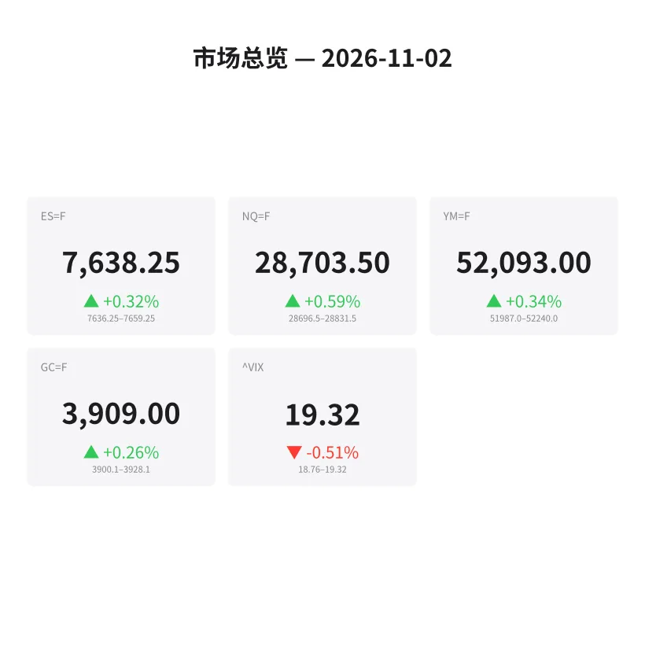
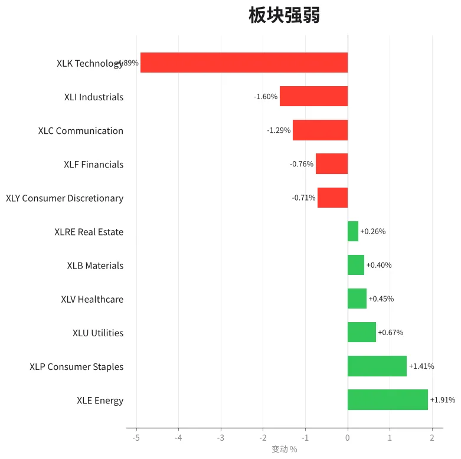
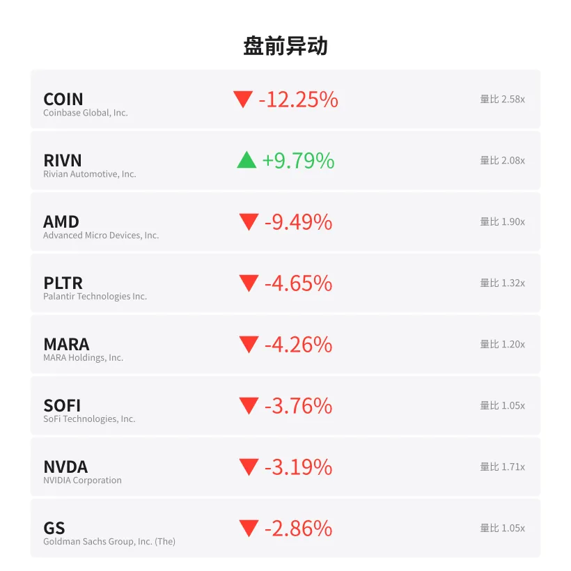
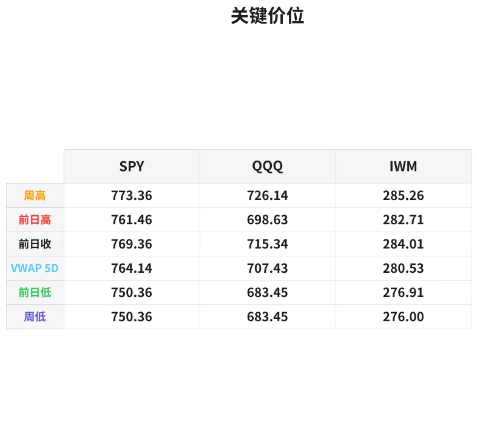

# 盘前分析报告 — 2026-11-02
*生成时间: 12:48:37 UTC*

---
## 数据速览

---
## 一、宏观环境

> [!info]- 详细数据：指数期货 & VIX
> ### 1.1 指数期货 & VIX
> | 品种 | 现价 | 涨跌幅 | 前收 | 日高 | 日低 |
> |------|------|--------|------|------|------|
> | ES=F | 7638.25 | +0.32% | 7614.0 | 7659.25 | 7625.25 |
> | NQ=F | 28703.5 | +0.59% | 28534.0 | 28831.5 | 28587.0 |
> | YM=F | 52093.0 | +0.34% | 51918.0 | 52240.0 | 51970.0 |
> | GC=F | 3909.0 | +0.26% | 3898.9 | 3928.1 | 3889.0 |
> | ^VIX | 19.32 | -0.51% | 19.42 | 19.32 | 18.76 |

> [!info]- 详细数据：隔夜走势
> ### 1.2 隔夜走势（Globex）
> | 品种 | 隔夜高 | 隔夜低 | 区间 | 亚洲高 | 亚洲低 | 欧洲高 | 欧洲低 |
> |------|--------|--------|------|--------|--------|--------|--------|
> | ES=F | 7659.25 | 7636.25 | 23.0 | 7656.25 | 7645.25 | 7659.25 | 7636.25 |
> | NQ=F | 28831.5 | 28696.5 | 135.0 | 28831.5 | 28760.0 | 28805.0 | 28696.5 |
> | YM=F | 52240.0 | 51987.0 | 253.0 | 52141.0 | 52059.0 | 52240.0 | 51987.0 |
> | GC=F | 3928.1 | 3900.1 | 28.0 | 3928.1 | 3910.1 | 3919.3 | 3900.1 |
> | ^VIX | 19.32 | 18.76 | 0.56 | — | — | 19.32 | 18.76 |

> [!info]- 详细数据：板块强弱
> ### 1.3 板块强弱
> | ETF | 板块 | 涨跌幅 |
> |-----|------|--------|
> | XLE | Energy | +1.91% |
> | XLP | Consumer Staples | +1.41% |
> | XLU | Utilities | +0.67% |
> | XLV | Healthcare | +0.45% |
> | XLB | Materials | +0.40% |
> | XLRE | Real Estate | +0.26% |
> | XLY | Consumer Discretionary | -0.71% |
> | XLF | Financials | -0.76% |
> | XLC | Communication | -1.29% |
> | XLI | Industrials | -1.60% |
> | XLK | Technology | -4.89% |

---
## 三、盘前异动

> [!info]- 详细数据：盘前异动
> | 代码 | 名称 | 现价 | 缺口 | 量比 |
> |------|------|------|------|------|
> | COIN | Coinbase Global, Inc. | 140.91 | -12.25% | 2.58x |
> | RIVN | Rivian Automotive, Inc. | 12.57 | +9.79% | 2.08x |
> | AMD | Advanced Micro Devices, Inc. | 512.65 | -9.49% | 1.9x |
> | PLTR | Palantir Technologies Inc. | 187.28 | -4.65% | 1.32x |
> | MARA | MARA Holdings, Inc. | 6.86 | -4.26% | 1.2x |
> | SOFI | SoFi Technologies, Inc. | 16.95 | -3.76% | 1.05x |
> | NVDA | NVIDIA Corporation | 206.84 | -3.19% | 1.71x |
> | GS | Goldman Sachs Group, Inc. (The) | 901.23 | -2.86% | 1.05x |
> | META | Meta Platforms, Inc. | 611.0 | -2.16% | 0.87x |
> | BAC | Bank of America Corporation | 50.24 | -1.76% | 1.23x |

---
## 四、关键价位

> [!info]- 详细数据：SPY 关键价位
> ### SPY
> | 价位类型 | 价格 |
> |----------|------|
> | Prior Day High | 761.46 |
> | Prior Day Low | 750.36 |
> | Prior Day Close | 769.36 |
> | Premarket Price | 758.58 |
> | Approx Vwap 5D | 764.14 |
> | Weekly High | 773.36 |
> | Weekly Low | 750.36 |

> [!info]- 详细数据：QQQ 关键价位
> ### QQQ
> | 价位类型 | 价格 |
> |----------|------|
> | Prior Day High | 698.63 |
> | Prior Day Low | 683.45 |
> | Prior Day Close | 715.34 |
> | Premarket Price | 695.28 |
> | Approx Vwap 5D | 707.43 |
> | Weekly High | 726.14 |
> | Weekly Low | 683.45 |

> [!info]- 详细数据：IWM 关键价位
> ### IWM
> | 价位类型 | 价格 |
> |----------|------|
> | Prior Day High | 282.71 |
> | Prior Day Low | 276.91 |
> | Prior Day Close | 284.01 |
> | Premarket Price | 280.94 |
> | Approx Vwap 5D | 280.53 |
> | Weekly High | 285.26 |
> | Weekly Low | 276.0 |

---
## 五、AI 技术分析 & 操盘建议

## 第一部分：隔夜市场回顾

### 亚洲时段 (18:00–02:00 ET)
亚洲时段整体表现偏强，ES 在 7645–7656 区间内窄幅震荡，NQ 领涨至 28831 后小幅回落。黄金在亚洲盘初段冲高至 3928 后承压。亚洲盘的偏多基调主要由科技股盘后财报驱动——AMD 和部分半导体个股的财报落地引发大幅波动，但这些反应尚未完全反映到指数期货中。

### 欧洲时段 (02:00–08:00 ET)
欧洲时段出现明显的获利回吐。ES 回落至隔夜低点 7636，NQ 更是下探至 28696，跌幅较亚洲时段高点超过 135 点。这一回撤伴随着科技板块 XLK -4.89% 的大幅走弱，说明欧洲交易员对美股科技股估值产生分歧。黄金受避险需求推动从 3900 回升至 3919 区域。

### 对美盘的影响
1. **科技股承压是今日主题**：XLK -4.89% 是所有板块中跌幅最大的，AMD -9.49%、NVDA -3.19%、META -2.16% 等权重股集体走弱，将对 NQ 和 QQQ 形成持续压力
2. **防御板块轮动明显**：XLE +1.91%、XLP +1.41%、XLU +0.67% 领涨，资金从成长转向价值/防御
3. **VIX 19.32 处于中性偏高区间**：虽然小幅下降，但仍在 19 上方，暗示市场对波动性的定价并未放松
4. **隔夜区间已经被测试**：ES 的 23 点区间和 NQ 的 135 点区间在美盘开盘后大概率会被突破

---
## 第二部分：期货品种分析

### ES（E-mini S&P 500）— 现价 7638.25

**多时间框架分析：**
- **日线**：上周五收于 7614（前收），今日跳空高开至 7638 区域。周线结构仍在上升通道内，但 7660 附近存在前高阻力
- **4H**：从上周低点 7580 区域反弹，当前处于反弹的第二腿。7650–7660 是关键供给区
- **1H**：隔夜在 7636–7659 区间震荡，欧洲时段回落至区间下沿

**关键价位：**
| 类型 | 价位 |
|------|------|
| 隔夜高点（ONH） | 7659.25 |
| 隔夜低点（ONL） | 7636.25 |
| 前日收盘 | 7614.00 |
| 前日高点 | 7659.25 |
| 亚洲高点 | 7656.25 |
| 欧洲低点 | 7636.25 |
| 上方阻力 | 7660 / 7680 / 7700 |
| 下方支撑 | 7636 / 7614 / 7600 / 7580 |

**方向偏见：** 中性偏空 | **置信度：** 65%

科技板块大幅走弱将拖累 SPX。虽然 ES 跳空高开，但隔夜未能突破 7660 阻力，且欧洲时段明显回落。如果开盘后无法站上 7660，则可能回补缺口至 7614。

**交易计划：**
- **做空场景 A**：7655–7660 区域（ONH/前高阻力）放空，止损 7670，T1 7636，T2 7614
- **做空场景 B**：如果跌破 7636（ONL），回踩 7636 不过做空，止损 7645，T1 7614，T2 7600
- **做多场景**：回踩 7614（前收/缺口回补位）有明显买盘承接，止损 7600，T1 7636，T2 7656
- **失效条件**：放量站上 7670 则空头逻辑失效，转为观望或追多

---
### NQ（E-mini Nasdaq 100）— 现价 28703.5

**多时间框架分析：**
- **日线**：前收 28534，跳空高开 170 点，但科技股财报利空（AMD -9.49%）对 NQ 压力更大
- **4H**：隔夜冲高 28831 后大幅回落 135 点至 28696，形成明显的上影线结构
- **1H**：欧洲时段主导了回落，当前交投于隔夜区间下半部

**关键价位：**
| 类型 | 价位 |
|------|------|
| 隔夜高点（ONH） | 28831.50 |
| 隔夜低点（ONL） | 28696.50 |
| 前日收盘 | 28534.00 |
| 亚洲高点 | 28831.50 |
| 欧洲低点 | 28696.50 |
| 上方阻力 | 28830 / 28900 / 29000 |
| 下方支撑 | 28700 / 28534 / 28400 |

**方向偏见：** 偏空 | **置信度：** 72%

NQ 面临的压力显著大于 ES。AMD -9.49%、NVDA -3.19%、PLTR -4.65% 等半导体/AI 权重股集体下行，XLK -4.89% 是所有板块最弱。隔夜冲高 28831 后快速回落，典型的"买消息 卖事实"形态。

**交易计划：**
- **做空场景 A**：28780–28830 区域（ONH 附近）放空，止损 28870，T1 28700，T2 28534
- **做空场景 B**：跌破 28696（ONL），回踩不过做空，止损 28740，T1 28534，T2 28400
- **做多场景**：仅限 28534 附近（缺口回补）出现强势反转信号，止损 28450，T1 28700，T2 28800
- **失效条件**：放量突破 28870 则空头失效；科技股开盘后逆转走强需立即止损

---
### GC（黄金期货）— 现价 3909.0

**多时间框架分析：**
- **日线**：黄金处于大级别上升趋势中，3900 是关键心理关口和前收附近
- **4H**：从 3889 低点反弹，隔夜在 3900–3928 区间运行
- **1H**：亚洲时段冲高 3928 后回落，欧洲时段在 3900–3919 区间整理

**关键价位：**
| 类型 | 价位 |
|------|------|
| 隔夜高点 | 3928.10 |
| 隔夜低点 | 3900.10 |
| 前日收盘 | 3898.90 |
| 日低 | 3889.00 |
| 上方阻力 | 3928 / 3940 / 3960 |
| 下方支撑 | 3900 / 3889 / 3870 |

**方向偏见：** 中性偏多 | **置信度：** 60%

科技股走弱+VIX 维持 19+ 对黄金构成避险支撑。但 3928 是隔夜明确的卖压位，需要明确突破才能看更高。

**交易计划：**
- **做多场景 A**：回踩 3900–3905 区域（整数关口+前收支撑），止损 3889，T1 3920，T2 3940
- **做多场景 B**：放量突破 3928，回踩确认后做多，止损 3915，T1 3940，T2 3960
- **做空场景**：仅限 3928–3930 区域明确受阻+放量回落，止损 3940，T1 3910，T2 3900
- **失效条件**：跌破 3889 则多头逻辑失效，可能测试 3870

---
## 第三部分：ETF品种分析

### SPY — 盘前价 758.58

**关键数据：**
| 类型 | 价位 |
|------|------|
| 前日高点 | 761.46 |
| 前日低点 | 750.36 |
| 前日收盘 | 769.36 |
| 盘前价 | 758.58 |
| 5日近似VWAP | 764.14 |
| 周高 | 773.36 |
| 周低 | 750.36 |

**分析：** SPY 盘前 758.58 较前收 769.36 大幅低开约 -1.4%，这是一个显著的向下缺口。缺口跳空下方，764.14（5日VWAP）已经被跌破，说明短期均值回归的力量偏空。

**交易计划：**
- **做空场景**：如果开盘后反弹至 761–764 区域（前日高点/5日VWAP 阻力区）受阻，做空，止损 766，T1 755，T2 750
- **做多场景**：仅限 750–751 区域（前日低点/周低支撑）出现强势反转，止损 748，T1 758，T2 762
- **缺口交易**：如果开盘 30 分钟内尝试回补缺口（向 764+），关注是否有量价配合。无量回补大概率失败

---
### QQQ — 盘前价 695.28

**关键数据：**
| 类型 | 价位 |
|------|------|
| 前日高点 | 698.63 |
| 前日低点 | 683.45 |
| 前日收盘 | 715.34 |
| 盘前价 | 695.28 |
| 5日近似VWAP | 707.43 |
| 周高 | 726.14 |
| 周低 | 683.45 |

**分析：** QQQ 盘前 695.28 较前收 715.34 大幅低开约 -2.8%，缺口幅度是 SPY 的两倍，反映了科技股集中的抛压。AMD -9.49%、NVDA -3.19% 等核心持仓的拖累非常明显。5日VWAP 707.43 已被远远甩开，短期趋势明确偏空。

**交易计划：**
- **做空场景 A**：开盘反弹至 698–700 区域（前日高点/整数关口阻力）做空，止损 704，T1 690，T2 683
- **做空场景 B**：跌破 690，回踩做空，止损 695，T1 683，T2 675
- **做多场景**：仅限 683–685 区域（前日低点/周低支撑）出现明确反转信号，止损 680，T1 693，T2 700
- **注意**：QQQ 今日波动率极高，建议缩小仓位。开盘前 15 分钟观察，不急于入场

---
## 第四部分：今日市场总览

### 整体情绪判断
**偏空，科技主导下行。** 今日市场呈现典型的"科技股财报利空→板块轮动至防御"格局。XLK -4.89% 远远跑输其他板块，AMD、NVDA、META、PLTR 等 AI/半导体龙头集体走弱。资金明显流向 XLE（+1.91%）、XLP（+1.41%）等防御性板块。

### VIX 解读
VIX 19.32 处于中性偏高区间，虽然日内小幅回落（-0.51%），但仍然高于 18 的舒适区。隔夜区间 18.76–19.32 显示波动率定价并未放松。**今日预计 VIX 有进一步上行风险**，如果科技股开盘后抛压延续，VIX 可能冲击 20+。

### 需要回避的时间窗口
1. **09:30–09:45 ET（开盘前15分钟）**：等待开盘流动性稳定，观察 order flow 方向
2. **10:00 ET**：关注 ISM 制造业数据（如有）等经济数据发布时段
3. **11:30–12:00 ET**：午盘波动率通常降低，不适合趋势交易
4. **15:00–15:30 ET**：尾盘前机构调仓可能引发反向波动

### 板块轮动信号
- **避险模式开启**：XLE > XLP > XLU >> XLY > XLF > XLC > XLK
- 能源和必需消费品领涨，科技和通信服务领跌，这是经典的 risk-off 轮动
- COIN -12.25% 暗示加密货币板块也在承压，与科技股共振下行
- RIVN +9.79% 是少数逆市异动，可能有个股催化剂（财报/合作消息），需单独关注

### 核心操盘论点（一句话）

> **今日做空科技（NQ/QQQ）为主线，ES 跟跌但幅度可控；关注 7636/28700 的隔夜低点能否守住，跌破则加速下行至缺口回补位（ES 7614 / NQ 28534）。黄金作为避险配置可轻仓做多回调。**

---
*免责声明：以上分析仅供参考，不构成投资建议。期货和ETF交易存在重大风险，请根据自身风险承受能力审慎决策。*
