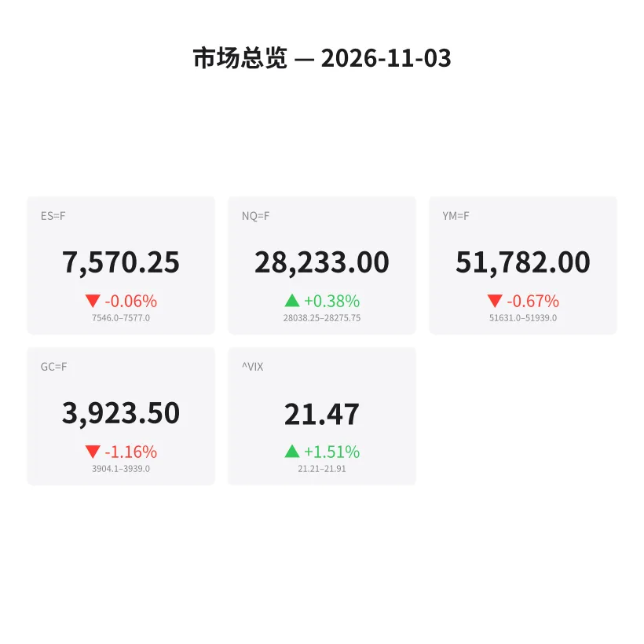
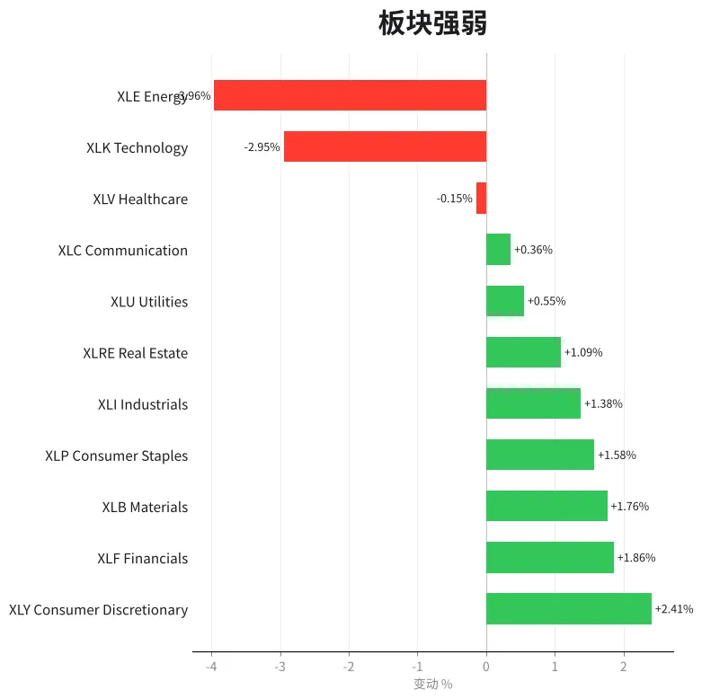
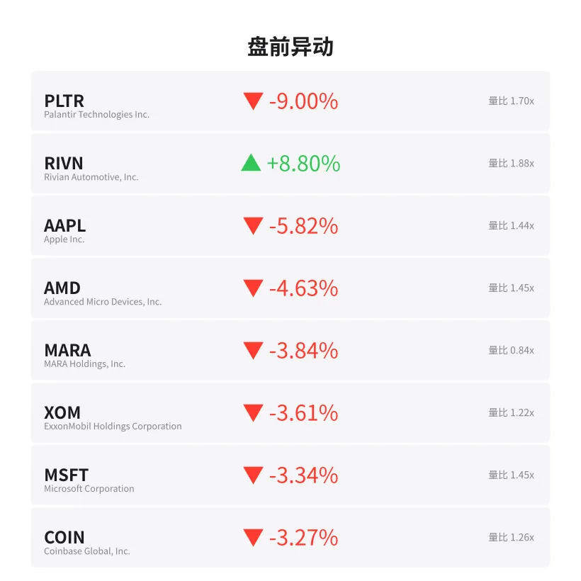
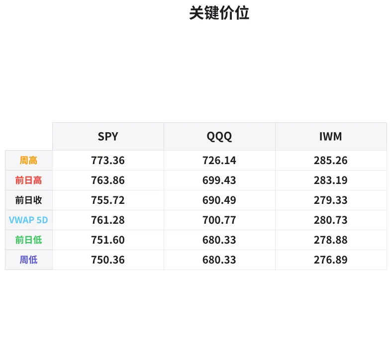

# 盘前分析报告 — 2026-11-03
*生成时间: 12:39:29 UTC*

---
## 数据速览

---
## 一、宏观环境

> [!info]- 详细数据：指数期货 & VIX
> ### 1.1 指数期货 & VIX
> | 品种 | 现价 | 涨跌幅 | 前收 | 日高 | 日低 |
> |------|------|--------|------|------|------|
> | ES=F | 7570.25 | -0.06% | 7574.5 | 7591.5 | 7546.0 |
> | NQ=F | 28233.0 | +0.38% | 28127.5 | 28284.5 | 28038.25 |
> | YM=F | 51782.0 | -0.67% | 52133.0 | 52186.0 | 51631.0 |
> | GC=F | 3923.5 | -1.16% | 3969.6 | 3974.5 | 3904.1 |
> | ^VIX | 21.47 | +1.51% | 21.15 | 21.91 | 21.21 |

> [!info]- 详细数据：隔夜走势
> ### 1.2 隔夜走势（Globex）
> | 品种 | 隔夜高 | 隔夜低 | 区间 | 亚洲高 | 亚洲低 | 欧洲高 | 欧洲低 |
> |------|--------|--------|------|--------|--------|--------|--------|
> | ES=F | 7577.0 | 7546.0 | 31.0 | 7566.0 | 7552.0 | 7577.0 | 7546.0 |
> | NQ=F | 28275.75 | 28038.25 | 237.5 | 28148.25 | 28061.75 | 28275.75 | 28038.25 |
> | YM=F | 51939.0 | 51631.0 | 308.0 | 51939.0 | 51832.0 | 51914.0 | 51631.0 |
> | GC=F | 3939.0 | 3904.1 | 34.9 | 3939.0 | 3920.8 | 3926.0 | 3904.1 |
> | ^VIX | 21.91 | 21.21 | 0.7 | — | — | 21.91 | 21.21 |

> [!info]- 详细数据：板块强弱
> ### 1.3 板块强弱
> | ETF | 板块 | 涨跌幅 |
> |-----|------|--------|
> | XLY | Consumer Discretionary | +2.41% |
> | XLF | Financials | +1.86% |
> | XLB | Materials | +1.76% |
> | XLP | Consumer Staples | +1.58% |
> | XLI | Industrials | +1.38% |
> | XLRE | Real Estate | +1.09% |
> | XLU | Utilities | +0.55% |
> | XLC | Communication | +0.36% |
> | XLV | Healthcare | -0.15% |
> | XLK | Technology | -2.95% |
> | XLE | Energy | -3.96% |

---
## 三、盘前异动

> [!info]- 详细数据：盘前异动
> | 代码 | 名称 | 现价 | 缺口 | 量比 |
> |------|------|------|------|------|
> | PLTR | Palantir Technologies Inc. | 167.54 | -9.00% | 1.7x |
> | RIVN | Rivian Automotive, Inc. | 13.23 | +8.80% | 1.88x |
> | AAPL | Apple Inc. | 324.58 | -5.82% | 1.44x |
> | AMD | Advanced Micro Devices, Inc. | 481.44 | -4.63% | 1.45x |
> | MARA | MARA Holdings, Inc. | 6.51 | -3.84% | 0.84x |
> | XOM | ExxonMobil Holdings Corporation | 180.49 | -3.61% | 1.22x |
> | MSFT | Microsoft Corporation | 504.5 | -3.34% | 1.45x |
> | COIN | Coinbase Global, Inc. | 138.85 | -3.27% | 1.26x |
> | CVX | Chevron Corporation | 228.26 | -3.08% | 1.2x |
> | AMZN | Amazon.com, Inc. | 246.61 | +2.60% | 1.19x |

---
## 四、关键价位

> [!info]- 详细数据：SPY 关键价位
> ### SPY
> | 价位类型 | 价格 |
> |----------|------|
> | Prior Day High | 763.855 |
> | Prior Day Low | 751.6 |
> | Prior Day Close | 755.72 |
> | Premarket Price | 752.16 |
> | Approx Vwap 5D | 761.28 |
> | Weekly High | 773.36 |
> | Weekly Low | 750.36 |

> [!info]- 详细数据：QQQ 关键价位
> ### QQQ
> | 价位类型 | 价格 |
> |----------|------|
> | Prior Day High | 699.43 |
> | Prior Day Low | 680.33 |
> | Prior Day Close | 690.49 |
> | Premarket Price | 683.85 |
> | Approx Vwap 5D | 700.77 |
> | Weekly High | 726.14 |
> | Weekly Low | 680.33 |

> [!info]- 详细数据：IWM 关键价位
> ### IWM
> | 价位类型 | 价格 |
> |----------|------|
> | Prior Day High | 283.19 |
> | Prior Day Low | 278.88 |
> | Prior Day Close | 279.33 |
> | Premarket Price | 279.57 |
> | Approx Vwap 5D | 280.73 |
> | Weekly High | 285.26 |
> | Weekly Low | 276.89 |

---
## 五、AI 技术分析 & 操盘建议

### 第一部分：隔夜市场回顾

**亚洲时段（18:00–02:00 ET）：**
ES 在 7552–7566 之间窄幅震荡，仅 14 点区间，显示亚洲资金观望情绪浓厚。NQ 同样在 28061–28148 间横盘，但整体重心略偏上方。GC 在亚洲时段维持 3920–3939 区间，相对稳健。亚盘整体特征：低波动、无方向性突破，资金在等待欧洲开盘后的进一步指引。

**欧洲时段（02:00–09:30 ET）：**
进入欧盘后波动明显放大。ES 测试了 7546 低点（隔夜低），随后反弹至 7577（隔夜高），形成了完整的 31 点区间。NQ 波动更为剧烈，区间达到 237.5 点（28038–28275），欧盘初期一度下探 28038 创出隔夜低点后强力反弹，显示多头在关键支撑位积极入场。

GC 在欧盘遭遇较大抛压，跌破亚盘低点 3920.8，最低触及 3904.1，反映美元走强或避险需求减弱的信号。

**隔夜走势核心解读：**
1. **NQ 领涨但分化严重** — NQ +0.38% vs ES -0.06%，但 AAPL -5.82%、MSFT -3.34%、AMD -4.63% 均大幅低开，说明指数涨幅靠少数权重股（如 AMZN +2.60%）支撑，内部结构脆弱
2. **板块轮动明显** — 资金从科技（XLK -2.95%）和能源（XLE -3.96%）流出，涌入可选消费（XLY +2.41%）和金融（XLF +1.86%），属于典型的"风格切换"而非全面风险偏好上升
3. **VIX 持续高位** — 21.47 且上涨 1.51%，反映市场对不确定性定价偏高，盘中可能出现较大幅度的双向波动
4. **黄金走弱** — GC -1.16%，与避险逻辑背离，可能是美元走强压制或期货保证金追缴导致的被动减仓

### 第二部分：期货品种分析

#### ES（E-mini S&P 500）— 现价 7570.25

**多周期分析：**
- **日线级别：** 前收 7574.5，今日微幅低开。上周区间参考 SPY 周高 773.36 / 周低 750.36 换算 ES 约 7733–7503，当前处于区间中部偏下。日线级别尚未脱离震荡格局。
- **4H 级别：** 欧盘形成的 7546–7577 区间构成短期多空分界。7577 上方看多延续，7546 下方确认空头主导。
- **1H 级别：** 隔夜在 7546 获得支撑后反弹，目前在 7570 附近横盘，等待美盘方向选择。

**关键价位：**
| 类型 | 价位 | 说明 |
|------|------|------|
| 强阻力 | 7591.5 | 日内高点，突破后看 7600 整数关口 |
| 阻力 | 7577.0 | 隔夜高/欧盘高，盘前关键压力 |
| 枢轴 | 7574.5 | 前收盘价，多空分界参考 |
| 支撑 | 7546.0 | 隔夜低/欧盘低，首要防守位 |
| 强支撑 | 7530–7535 | 下方真空区，失守后加速下行 |

**方向偏见：** 中性偏空（信心 55%）
- ES 基本平开但大型科技股集体低开拖累市场情绪，VIX 走高进一步限制上行空间
- 若开盘后快速收回 7574.5（前收），转为偏多

**交易计划：**
- **做空方案：** 7574–7577 区域（前收 + 隔夜高）放空，止损 7592，T1 = 7555，T2 = 7546
- **做多方案：** 7546 附近止跌企稳后做多，止损 7535，T1 = 7565，T2 = 7577
- **失效条件：** 开盘 30 分钟内直接突破 7591.5 且不回踩 → 放弃空头思路追多

---

#### NQ（E-mini Nasdaq 100）— 现价 28233.0

**多周期分析：**
- **日线级别：** 前收 28127.5，今日高开 +0.38%。但指数内部严重分化：AAPL -5.82%、MSFT -3.34%、AMD -4.63%，而 AMZN +2.60% 独力支撑指数。这种"虚涨"结构极不健康，需警惕日内回补缺口。
- **4H 级别：** 欧盘大幅波动后收于高位，28275 为短期阻力，28038 为关键支撑。
- **1H 级别：** 欧盘回升势头较好，但 28200 以上堆积了较多空头止损单，可能触发短暂逼空。

**关键价位：**
| 类型 | 价位 | 说明 |
|------|------|------|
| 强阻力 | 28284.5 | 日内高点，突破后看 28350 |
| 阻力 | 28275.75 | 隔夜高/欧盘高 |
| 枢轴 | 28233.0 | 当前价格 |
| 支撑 | 28127.5 | 前收盘价/缺口上沿 |
| 强支撑 | 28038.25 | 隔夜低，跌破则缺口回补 |

**方向偏见：** 中性偏多但极度谨慎（信心 50%）
- 表面涨幅由少数权重股推动，内部广度极差
- AAPL、MSFT 大幅低开可能在开盘后触发恐慌性抛售，拖累指数

**交易计划：**
- **做多方案（首选）：** 回踩 28127–28150（前收附近）止跌后做多，止损 28030，T1 = 28230，T2 = 28275
- **做空方案：** 28270–28285 受阻做空，止损 28310，T1 = 28180，T2 = 28130
- **失效条件：** 若 AAPL、MSFT 在开盘后迅速收窄跌幅至 -2% 以内 → NQ 可能持续走强，放弃空头

---

#### GC（黄金期货）— 现价 3923.5

**多周期分析：**
- **日线级别：** 前收 3969.6，今日大幅低开 -1.16%，跌幅在主要品种中最大。日线级别跌破 3940 支撑后加速下行，短期趋势明确偏空。
- **4H 级别：** 欧盘跌破亚盘低点 3920.8 后一度触及 3904.1，随后小幅反弹至 3923。4H 级别处于下跌趋势中的弱势反弹阶段。
- **1H 级别：** 3904–3926 构成短期震荡区间，3926 上方有卖压，3904 下方有买盘托底。

**关键价位：**
| 类型 | 价位 | 说明 |
|------|------|------|
| 强阻力 | 3969.6 | 前收盘价，回补需要极强买盘 |
| 阻力 | 3939.0 | 隔夜高/亚盘高 |
| 阻力 | 3926.0 | 欧盘高 |
| 枢轴 | 3923.5 | 当前价格 |
| 支撑 | 3904.1 | 隔夜低/欧盘低 |
| 强支撑 | 3890–3895 | 心理关口及前期结构支撑 |

**方向偏见：** 偏空（信心 65%）
- 日内下跌趋势明确，空头主导
- 美元走强压制黄金，避险资金并未涌入贵金属

**交易计划：**
- **做空方案（首选）：** 3926–3939 反弹放空，止损 3945，T1 = 3910，T2 = 3904
- **做多方案：** 仅在 3904 附近出现明确止跌信号（如 15 分钟级别看涨吞没）后轻仓做多，止损 3893，T1 = 3920，T2 = 3935
- **失效条件：** GC 快速突破 3940 且站稳 → 空头减仓或离场，转入观望

### 第三部分：ETF 品种分析

#### SPY — 盘前 752.16

**关键价位：**
| 类型 | 价位 | 说明 |
|------|------|------|
| 周高 | 773.36 | 上周高点，中期强阻力 |
| 5日VWAP | 761.28 | 机构成本线，中线多空分界 |
| PDH | 763.855 | 前日高点 |
| PDC | 755.72 | 前收盘 |
| 盘前价 | 752.16 | 低于前收约 -0.47% |
| PDL | 751.60 | 前日低点，首要支撑 |
| 周低 | 750.36 | 上周低点，关键防守位 |

**分析：**
SPY 盘前 752.16 低于前收 755.72，正在测试前日低点 751.60。当前价格远低于 5 日 VWAP（761.28），说明短期持仓者普遍处于亏损状态，抛压偏重。

板块层面，科技（XLK -2.95%）和能源（XLE -3.96%）作为 SPY 两大权重板块同步走弱，对指数形成显著拖累。可选消费（XLY +2.41%）和金融（XLF +1.86%）虽然上涨，但权重不足以完全对冲。

**交易计划：**
- **做空方案：** 反弹至 755–756（前收附近）受阻放空，止损 758，T1 = 751.60，T2 = 750.36
- **做多方案：** 750.36（周低）附近止跌做多，止损 748.50，T1 = 753，T2 = 755.70
- **注意事项：** 若跌破 750.36 周低，下方支撑真空，需严格止损

---

#### QQQ — 盘前 683.85

**关键价位：**
| 类型 | 价位 | 说明 |
|------|------|------|
| 周高 | 726.14 | 上周高点 |
| 5日VWAP | 700.77 | 机构成本线 |
| PDH | 699.43 | 前日高点 |
| PDC | 690.49 | 前收盘 |
| 盘前价 | 683.85 | 低于前收约 -0.96% |
| PDL/周低 | 680.33 | 前日低点 = 周低，关键双重支撑 |

**分析：**
QQQ 盘前 683.85 大幅低于前收 690.49（-0.96%），正在逼近 680.33 这一前日低点 + 上周低点的双重支撑位。与 NQ 期货微涨 +0.38% 形成背离，这可能是因为 QQQ 持仓中 AAPL（-5.82%）和 MSFT（-3.34%）权重更高，而 NQ 期货在盘前由其他成分股支撑。

这种期现背离在开盘后往往会收敛 — 要么 NQ 跟随 QQQ 下行，要么 QQQ 受 NQ 支撑反弹。考虑到大型科技股的负面缺口集中出现，开盘后 NQ 向下收敛的概率略高。

**交易计划：**
- **做空方案：** 反弹至 688–690（前收区域）受阻放空，止损 693，T1 = 684，T2 = 680.33
- **做多方案：** 680–681 区域（前日低 + 周低双重支撑）止跌做多，止损 677，T1 = 686，T2 = 690
- **注意事项：** 密切关注 AAPL、MSFT 开盘后表现，它们的走势将直接决定 QQQ 方向

### 第四部分：今日市场总览

**整体情绪判断：谨慎偏空**

今日市场呈现"指数撑面子、个股露底裤"的典型分化格局。ES 近乎平开掩盖了严重的内部裂缝：科技（XLK -2.95%）和能源（XLE -3.96%）两大权重板块同步重挫，而消费和金融板块的上涨更多是防御性轮动而非进攻性加仓。NQ 表面上涨 +0.38%，实际上 AAPL、MSFT、AMD 三大巨头全部大幅低开，指数靠少数个股硬撑，这种结构极易在开盘后崩塌。

**VIX 分析：**
VIX 21.47（+1.51%）处于偏高水平，隔夜区间 21.21–21.91。20 以上的 VIX 意味着市场对每日 ±1.3% 的波动有定价，盘中双向甩尾的概率较高。建议相应放宽止损距离，避免被噪音扫出。

**需回避的时间窗口：**
- **09:30–10:00（开盘前 30 分钟）：** 大型科技股集中低开，开盘后可能出现剧烈的止损链反应和缺口填补，波动极端，建议观望为主
- **10:00（ISM 数据/经济数据窗口）：** 注意是否有重要经济数据发布，可能引发方向性行情
- **11:30–13:00（午间低流动性区间）：** 波动可能减弱但假突破增多，不适合高杠杆操作

**板块轮动信号：**
资金流向清晰：科技 → 消费/金融。XLY +2.41% 领涨说明消费股（AMZN +2.60%、RIVN +8.80%）获得追捧，但这种轮动在没有基本面支持的情况下持续性存疑。如果科技股在开盘后止跌企稳，轮动资金可能迅速回流，导致消费板块回吐涨幅。

**今日核心交易论点：**

> 大型科技股集体低开 + VIX 高位 + 板块极端分化 = 高波动、低确定性环境。顺势而为，严控仓位，重点交易 ES/SPY 在前日低点（ES 7546 / SPY 751.60）的攻防战。破位做空，守住做多，不预判方向。
