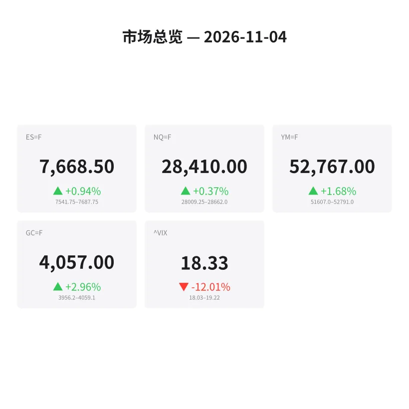
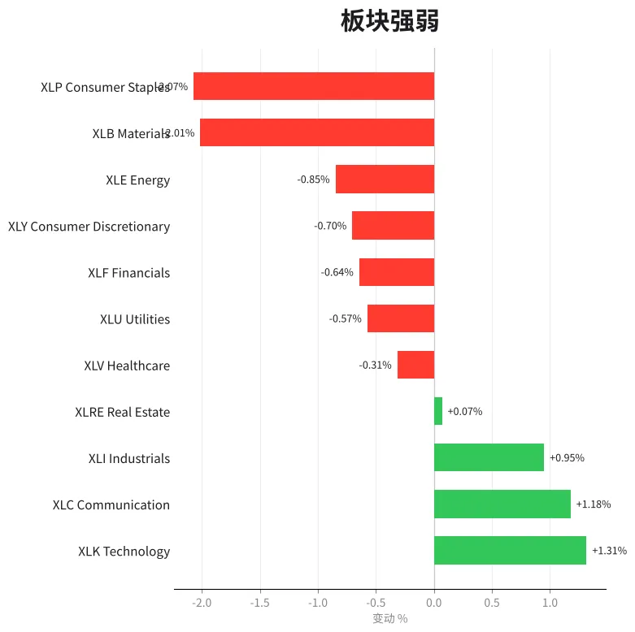
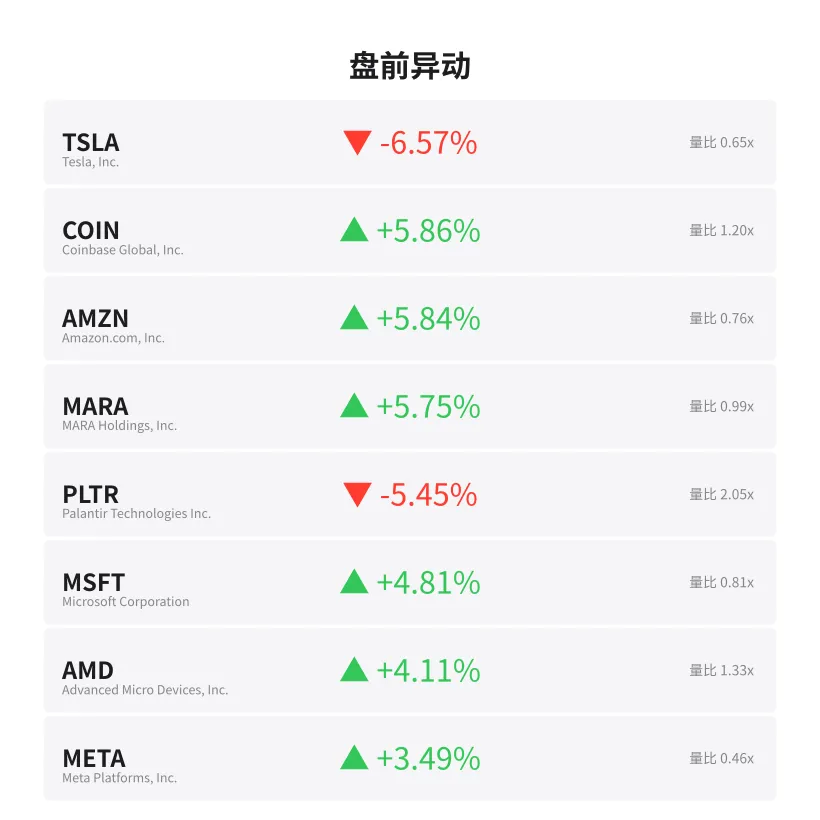
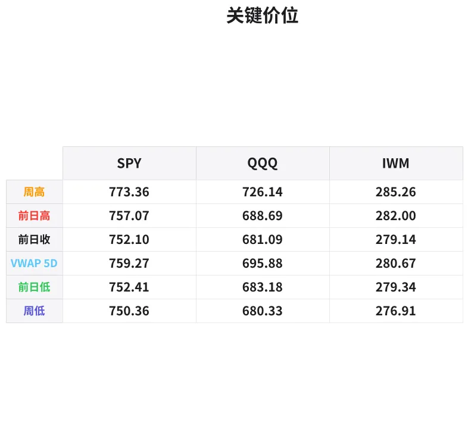

# 盘前分析报告 — 2026-11-04
*生成时间: 12:40:33 UTC*

---
## 数据速览

---
## 一、宏观环境

> [!info]- 详细数据：指数期货 & VIX
> ### 1.1 指数期货 & VIX
> | 品种 | 现价 | 涨跌幅 | 前收 | 日高 | 日低 |
> |------|------|--------|------|------|------|
> | ES=F | 7668.5 | +0.94% | 7596.75 | 7687.75 | 7490.0 |
> | NQ=F | 28410.0 | +0.37% | 28305.75 | 28661.25 | 27615.75 |
> | YM=F | 52767.0 | +1.68% | 51895.0 | 52791.0 | 51416.0 |
> | GC=F | 4057.0 | +2.96% | 3940.4 | 4058.7 | 3928.2 |
> | ^VIX | 18.33 | -12.01% | 20.83 | 19.22 | 18.03 |

> [!info]- 详细数据：隔夜走势
> ### 1.2 隔夜走势（Globex）
> | 品种 | 隔夜高 | 隔夜低 | 区间 | 亚洲高 | 亚洲低 | 欧洲高 | 欧洲低 |
> |------|--------|--------|------|--------|--------|--------|--------|
> | ES=F | 7687.75 | 7541.75 | 146.0 | 7583.25 | 7541.75 | 7687.75 | 7572.5 |
> | NQ=F | 28662.0 | 28009.25 | 652.75 | 28238.25 | 28009.25 | 28662.0 | 28179.0 |
> | YM=F | 52791.0 | 51607.0 | 1184.0 | 51938.0 | 51607.0 | 52791.0 | 51895.0 |
> | GC=F | 4059.1 | 3956.2 | 102.9 | 4038.1 | 3956.2 | 4059.1 | 4024.6 |
> | ^VIX | 19.22 | 18.03 | 1.19 | — | — | 19.22 | 18.03 |

> [!info]- 详细数据：板块强弱
> ### 1.3 板块强弱
> | ETF | 板块 | 涨跌幅 |
> |-----|------|--------|
> | XLK | Technology | +1.31% |
> | XLC | Communication | +1.18% |
> | XLI | Industrials | +0.95% |
> | XLRE | Real Estate | +0.07% |
> | XLV | Healthcare | -0.31% |
> | XLU | Utilities | -0.57% |
> | XLF | Financials | -0.64% |
> | XLY | Consumer Discretionary | -0.70% |
> | XLE | Energy | -0.85% |
> | XLB | Materials | -2.01% |
> | XLP | Consumer Staples | -2.07% |

---
## 三、盘前异动

> [!info]- 详细数据：盘前异动
> | 代码 | 名称 | 现价 | 缺口 | 量比 |
> |------|------|------|------|------|
> | TSLA | Tesla, Inc. | 377.28 | -6.57% | 0.65x |
> | COIN | Coinbase Global, Inc. | 145.9 | +5.86% | 1.2x |
> | AMZN | Amazon.com, Inc. | 259.97 | +5.84% | 0.76x |
> | MARA | MARA Holdings, Inc. | 6.8 | +5.75% | 0.99x |
> | PLTR | Palantir Technologies Inc. | 168.61 | -5.45% | 2.05x |
> | MSFT | Microsoft Corporation | 531.5 | +4.81% | 0.81x |
> | AMD | Advanced Micro Devices, Inc. | 486.02 | +4.11% | 1.33x |
> | META | Meta Platforms, Inc. | 627.89 | +3.49% | 0.46x |
> | NFLX | Netflix, Inc. | 64.36 | +3.24% | 0.68x |
> | NVDA | NVIDIA Corporation | 207.0 | +2.44% | 0.89x |

---
## 四、关键价位

> [!info]- 详细数据：SPY 关键价位
> ### SPY
> | 价位类型 | 价格 |
> |----------|------|
> | Prior Day High | 757.07 |
> | Prior Day Low | 752.41 |
> | Prior Day Close | 752.1 |
> | Premarket Price | 761.4193 |
> | Approx Vwap 5D | 759.27 |
> | Weekly High | 773.36 |
> | Weekly Low | 750.36 |

> [!info]- 详细数据：QQQ 关键价位
> ### QQQ
> | 价位类型 | 价格 |
> |----------|------|
> | Prior Day High | 688.69 |
> | Prior Day Low | 683.18 |
> | Prior Day Close | 681.09 |
> | Premarket Price | 688.46 |
> | Approx Vwap 5D | 695.88 |
> | Weekly High | 726.14 |
> | Weekly Low | 680.33 |

> [!info]- 详细数据：IWM 关键价位
> ### IWM
> | 价位类型 | 价格 |
> |----------|------|
> | Prior Day High | 281.995 |
> | Prior Day Low | 279.34 |
> | Prior Day Close | 279.14 |
> | Premarket Price | 283.83 |
> | Approx Vwap 5D | 280.67 |
> | Weekly High | 285.26 |
> | Weekly Low | 276.91 |

---
## 五、AI 技术分析 & 操盘建议

## 第一部分：隔夜市场回顾

### 亚洲时段 (18:00–02:00 ET)
- ES 在亚洲时段交投于 7541.75–7583.25 区间，相对窄幅整理，低点 7541.75 构成隔夜关键支撑。NQ 亚洲段 28009.25–28238.25 波动区间偏大（约230点），显示科技板块隔夜有一定分歧。
- GC 黄金亚洲段 3956.2–4038.1，跳空高开后震荡上行，多头主导。
- 整体看亚洲段偏弱整理为主，多空未明确表态。

### 欧洲时段 (02:00–08:00 ET)
- 欧洲开盘后多头发力明显：ES 从 7572.5 拉升至 7687.75（隔夜高点），区间超过 115 点。NQ 欧洲段 28179.0–28662.0 同样强势拉升，突破亚洲段高点。
- YM 道琼斯期货欧洲段表现最为强势，52791 创隔夜新高，涨幅 +1.68%，反映资金偏好从科技流向传统蓝筹/工业板块。
- GC 黄金在欧洲段继续走高至 4059.1，接近日高 4058.7 区域，避险情绪与美元走弱共振。
- VIX 从 19.22 回落至 18.03，大幅收窄 -12%，恐慌情绪快速消退，利好多头开盘。

### 对美盘的含义
- 欧洲段强势拉升+VIX 大幅回落 = 美盘开盘大概率延续偏多格局
- 但需注意：ES 已接近隔夜高点 7687.75，开盘若无法有效突破可能出现 OR（Opening Range）回踩
- 板块分化显著（XLK +1.31% vs XLP -2.07%），不是普涨格局，选品种需注意板块方向
- TSLA -6.57% 的大幅缺口下跌可能拖累消费可选（XLY -0.70%），需关注是否在日内企稳

## 第二部分：期货品种分析

### ES (E-mini S&P 500) — 现价 7668.5

**多周期分析：**
- **日线**：前收 7596.75，今日跳空高开约 72 点（+0.94%）。日线级别处于上升趋势中，7490.0 日低构成关键日线支撑。
- **4H**：欧洲段连续阳线突破亚洲段盘整区间，动能偏多。隔夜高点 7687.75 是当前关键阻力。
- **1H/15min**：盘前运行在 7660–7670 区间，略低于隔夜高点，属于突破前的蓄势整理。

**关键价位：**
| 类型 | 价格 |
|------|------|
| 隔夜高 (ONH) | 7687.75 |
| 隔夜低 (ONL) | 7541.75 |
| 前日收盘 (PDC) | 7596.75 |
| 亚洲高 | 7583.25 |
| 欧洲低 | 7572.5 |
| 日低 | 7490.0 |

**方向偏多** — 置信度：70%

**做多方案（首选）：**
- 入场区间：7645–7655（OR 回踩欧洲段支撑区域）
- 止损：7630（低于欧洲段结构低点）
- T1：7688（隔夜高点测试）
- T2：7720（上方整数关口 + 潜在扩展目标）
- 失效条件：跌破 7620 说明开盘多头无力，需重新评估

**做空方案（备选，仅限 ONH 假突破）：**
- 入场：7690–7695（ONH 上方假突破后快速回落确认）
- 止损：7710
- T1：7660
- 失效条件：放量站稳 7700 以上

---

### NQ (E-mini Nasdaq 100) — 现价 28410.0

**多周期分析：**
- **日线**：前收 28305.75，小幅高开 +0.37%。涨幅远逊于 ES（+0.94%）和 YM（+1.68%），科技权重股表现分化（AMZN +5.84%, MSFT +4.81% vs TSLA -6.57%, PLTR -5.45%）。
- **4H**：隔夜波动剧烈，区间达 652.75 点。欧洲段虽反弹至 28662 但当前回落至 28410，距离隔夜高点仍有约 250 点。
- **1H**：欧洲段高点 28662 未能守住，盘前出现回落，短线动能转弱。

**关键价位：**
| 类型 | 价格 |
|------|------|
| 隔夜高 (ONH) | 28662.0 |
| 隔夜低 (ONL) | 28009.25 |
| 前日收盘 (PDC) | 28305.75 |
| 亚洲高 | 28238.25 |
| 欧洲低 | 28179.0 |

**方向中性偏多** — 置信度：55%

**做多方案：**
- 入场区间：28300–28350（回踩 PDC 区域 + 亚洲高点之上确认）
- 止损：28200（低于亚洲高和欧洲低之间）
- T1：28550
- T2：28660（ONH 测试）
- 失效条件：跌破 28200 说明多头结构破坏，转向观望

**做空方案（如果开盘弱势直接跌破 PDC）：**
- 入场：28280–28300（PDC 下方回抽确认失败）
- 止损：28380
- T1：28100
- 失效条件：快速收回 28350 以上

---

### GC (黄金期货) — 现价 4057.0

**多周期分析：**
- **日线**：前收 3940.4，今日大幅跳空高开 +2.96%（约 117 点），为近期最大涨幅之一。强势突破 4000 整数关口。
- **4H**：从亚洲低点 3956.2 一路攀升至 4059.1，几乎无回调，单边多头趋势极其明显。
- **1H**：现价 4057 紧贴隔夜高点 4059.1 和日高 4058.7，多头蓄势突破。

**关键价位：**
| 类型 | 价格 |
|------|------|
| 隔夜高/日高 | 4058.7–4059.1 |
| 隔夜低 | 3956.2 |
| 前日收盘 | 3940.4 |
| 4000 整数关口 | 4000.0 |
| 亚洲高 | 4038.1 |

**方向强多** — 置信度：75%

**做多方案（首选）：**
- 入场区间：4040–4048（回踩亚洲高点区域）
- 止损：4028（低于 4030 结构支撑）
- T1：4065（突破隔夜高点）
- T2：4085–4090（上方扩展目标）
- 失效条件：跌破 4025 说明回调加深，暂时观望

**追多方案（突破入场）：**
- 入场：4062–4065（放量突破 ONH 后回踩确认）
- 止损：4050
- T1：4080
- T2：4100
- 失效条件：突破后无跟随量，快速回落至 4055 以下

## 第三部分：ETF品种分析

### SPY — 盘前 761.42 | 前收 752.10

**关键价位：**
| 类型 | 价格 |
|------|------|
| 前日高 (PDH) | 757.07 |
| 前日低 (PDL) | 752.41 |
| 前日收盘 (PDC) | 752.10 |
| 盘前价 | 761.42 |
| 5日 VWAP | 759.27 |
| 周高 | 773.36 |
| 周低 | 750.36 |

**分析：**
- 盘前 761.42 跳空高开约 +1.24%（9.3 点），已突破 PDH 757.07 和 5日 VWAP 759.27
- 缺口完全位于 PDH 之上，属于强势跳空
- 上方关注 765–766 区域（PDH 到盘前价之间的 1:1 扩展）和 773.36 周高
- 下方支撑：759.27（5日 VWAP）> 757.07（PDH，回补缺口第一支撑）> 752.41（PDL）

**交易计划：**
- **多头方案**：开盘后回踩 758.5–759.5（5日 VWAP 区域）不破则做多，目标 764–765，止损 757.0
- **空头方案**：仅限开盘 30 分钟如果快速回落跌破 757.07（PDH），做空目标 754–752.5（缺口回补），止损 758.5
- **回避区间**：761–762（开盘区间上沿，易受双向扫荡）

---

### QQQ — 盘前 688.46 | 前收 681.09

**关键价位：**
| 类型 | 价格 |
|------|------|
| 前日高 (PDH) | 688.69 |
| 前日低 (PDL) | 683.18 |
| 前日收盘 (PDC) | 681.09 |
| 盘前价 | 688.46 |
| 5日 VWAP | 695.88 |
| 周高 | 726.14 |
| 周低 | 680.33 |

**分析：**
- 盘前 688.46 高开约 +1.08%（7.4 点），紧贴 PDH 688.69 下方，尚未突破
- 与 SPY 相比明显偏弱：SPY 已越过 PDH+VWAP，QQQ 仍卡在 PDH 门口
- 5日 VWAP 695.88 在上方较远（约 +1%），构成中期阻力
- 科技板块分化严重：AMZN/MSFT/AMD 大涨，但 TSLA/PLTR 大跌，NQ 被拉扯

**交易计划：**
- **多头方案**：突破 688.70（PDH）并站稳 689+ 后做多，目标 692–694，止损 687.0
- **空头方案**：如果 PDH 688.69 压制明显，开盘后二次试探 PDH 失败做空，目标 685–683，止损 690.0
- **关键观察**：QQQ 能否突破 PDH 是今日多空分水岭。如果 SPY 新高而 QQQ 未过 PDH，留意大盘可能出现假突破回落

## 第四部分：今日市场总览

### 整体情绪判断
**偏多，但有分化风险。**

核心逻辑：
1. VIX 大幅下跌 -12% 至 18.33，跌破 19 关口 → 恐慌情绪快速消退，短线偏多
2. ES +0.94%、YM +1.68% 领涨 → 资金偏好蓝筹/工业（XLI +0.95%），非纯科技主导
3. NQ 仅 +0.37%，明显滞后 → TSLA -6.57%、PLTR -5.45% 拖累，科技内部分化显著
4. GC 黄金 +2.96% 暴涨 → 避险需求仍存在，可能与地缘或美元走弱相关，留意盘中是否出现股金同涨后的反转信号

### VIX 解读
- 18.33（-12%）大幅收窄，处于低波动区间
- VIX < 19 通常支持日内趋势延续，不容易出现大级别反转
- 但要注意：VIX 从 20.83 急跌到 18.33 可能意味着恐慌过度释放，如果盘中出现意外催化剂可能快速反弹

### 需要回避的时间窗口
| 时间 (ET) | 事件 | 建议 |
|-----------|------|------|
| 09:30–09:45 | 开盘前15分钟（OR 形成期） | 观望，不要追涨杀跌 |
| 09:45–10:00 | Opening Range 确认 | 等待 OR 突破方向 |
| 10:00 | 可能有经济数据发布 | 提前查日历，避免持仓穿越数据 |
| 11:30–13:00 | 午间低量区间 | 减少交易频率，防止假突破 |

### 板块轮动解读
- **强势板块**：XLK（科技 +1.31%）、XLC（通信 +1.18%）、XLI（工业 +0.95%）— 成长+周期并进
- **弱势板块**：XLP（必需消费 -2.07%）、XLB（材料 -2.01%）、XLE（能源 -0.85%）— 防御板块被抛售
- **解读**：典型的 "Risk-On" 格局，但资金并非无脑涌入科技，而是选择性买入（大市值科技 > 高成长投机股）
- **关注**：如果午后 XLK 涨幅收窄而 XLP 止跌回升，说明资金开始获利了结，注意多头减仓

### 今日核心交易论点

**"欧洲段强势拉升 + VIX 跳水 = 美盘开盘偏多，但科技分化意味着做多要选对品种。首选 ES 回踩做多，次选 GC 突破追多。NQ/QQQ 需要突破 PDH 确认后再跟。"**

*⚠️ 风控提示：今日为周三（周中），注意资金可能在下午开始提前为周五结算做调整。所有仓位建议在 15:00 ET 前完成。*
