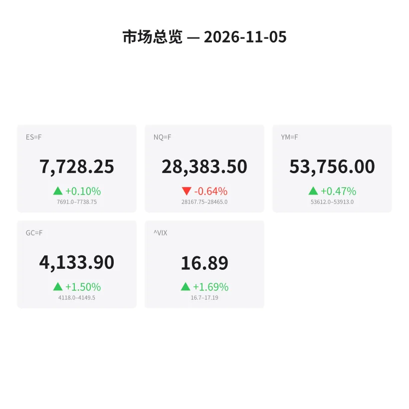
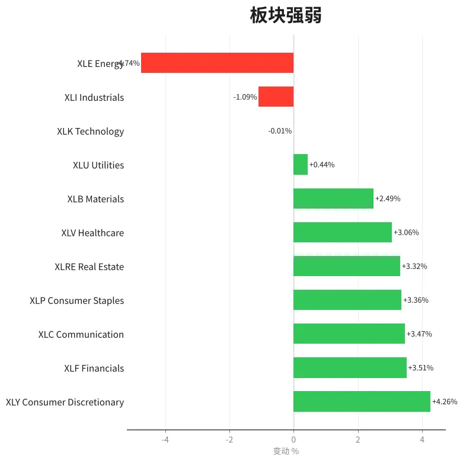
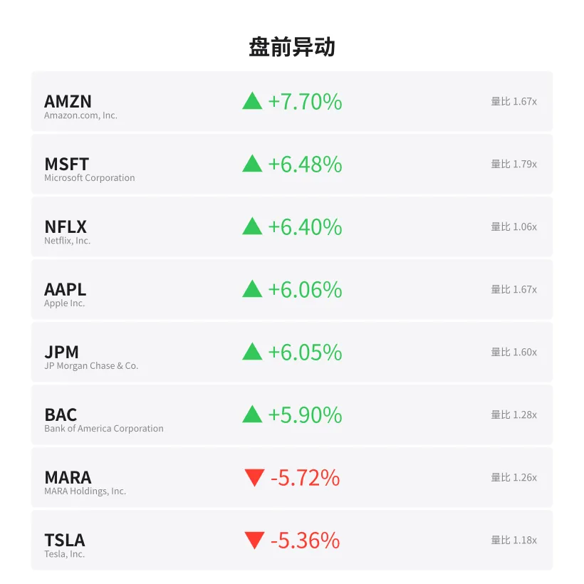
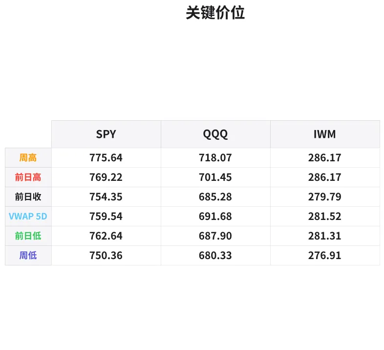

# 盘前分析报告 — 2026-11-05
*生成时间: 12:40:40 UTC*

---
## 数据速览

---
## 一、宏观环境

> [!info]- 详细数据：指数期货 & VIX
> ### 1.1 指数期货 & VIX
> | 品种 | 现价 | 涨跌幅 | 前收 | 日高 | 日低 |
> |------|------|--------|------|------|------|
> | ES=F | 7728.25 | +0.10% | 7720.5 | 7738.75 | 7691.0 |
> | NQ=F | 28383.5 | -0.64% | 28566.75 | 28668.5 | 28167.75 |
> | YM=F | 53756.0 | +0.47% | 53503.0 | 53913.0 | 53518.0 |
> | GC=F | 4133.9 | +1.50% | 4073.0 | 4155.8 | 4067.0 |
> | ^VIX | 16.89 | +1.69% | 16.61 | 17.19 | 16.7 |

> [!info]- 详细数据：隔夜走势
> ### 1.2 隔夜走势（Globex）
> | 品种 | 隔夜高 | 隔夜低 | 区间 | 亚洲高 | 亚洲低 | 欧洲高 | 欧洲低 |
> |------|--------|--------|------|--------|--------|--------|--------|
> | ES=F | 7738.75 | 7691.0 | 47.75 | 7710.0 | 7691.0 | 7738.75 | 7704.75 |
> | NQ=F | 28465.0 | 28167.75 | 297.25 | 28283.25 | 28167.75 | 28465.0 | 28246.75 |
> | YM=F | 53913.0 | 53612.0 | 301.0 | 53771.0 | 53612.0 | 53913.0 | 53646.0 |
> | GC=F | 4149.5 | 4118.0 | 31.5 | 4149.5 | 4118.0 | 4147.7 | 4124.4 |
> | ^VIX | 17.19 | 16.7 | 0.49 | — | — | 17.19 | 16.7 |

> [!info]- 详细数据：板块强弱
> ### 1.3 板块强弱
> | ETF | 板块 | 涨跌幅 |
> |-----|------|--------|
> | XLY | Consumer Discretionary | +4.26% |
> | XLF | Financials | +3.51% |
> | XLC | Communication | +3.47% |
> | XLP | Consumer Staples | +3.36% |
> | XLRE | Real Estate | +3.32% |
> | XLV | Healthcare | +3.06% |
> | XLB | Materials | +2.49% |
> | XLU | Utilities | +0.44% |
> | XLK | Technology | -0.01% |
> | XLI | Industrials | -1.09% |
> | XLE | Energy | -4.74% |

---
## 三、盘前异动

> [!info]- 详细数据：盘前异动
> | 代码 | 名称 | 现价 | 缺口 | 量比 |
> |------|------|------|------|------|
> | AMZN | Amazon.com, Inc. | 269.99 | +7.70% | 1.67x |
> | MSFT | Microsoft Corporation | 554.75 | +6.48% | 1.79x |
> | NFLX | Netflix, Inc. | 67.48 | +6.40% | 1.06x |
> | AAPL | Apple Inc. | 352.0 | +6.06% | 1.67x |
> | JPM | JP Morgan Chase & Co. | 358.43 | +6.05% | 1.6x |
> | BAC | Bank of America Corporation | 52.59 | +5.90% | 1.28x |
> | MARA | MARA Holdings, Inc. | 6.75 | -5.72% | 1.26x |
> | TSLA | Tesla, Inc. | 377.16 | -5.36% | 1.18x |
> | RIVN | Rivian Automotive, Inc. | 13.95 | +4.97% | 1.1x |
> | NVDA | NVIDIA Corporation | 197.24 | -4.57% | 1.37x |

---
## 四、关键价位

> [!info]- 详细数据：SPY 关键价位
> ### SPY
> | 价位类型 | 价格 |
> |----------|------|
> | Prior Day High | 769.22 |
> | Prior Day Low | 762.64 |
> | Prior Day Close | 754.35 |
> | Premarket Price | 767.06 |
> | Approx Vwap 5D | 759.54 |
> | Weekly High | 775.64 |
> | Weekly Low | 750.36 |

> [!info]- 详细数据：QQQ 关键价位
> ### QQQ
> | 价位类型 | 价格 |
> |----------|------|
> | Prior Day High | 701.45 |
> | Prior Day Low | 687.9 |
> | Prior Day Close | 685.28 |
> | Premarket Price | 686.16 |
> | Approx Vwap 5D | 691.68 |
> | Weekly High | 718.07 |
> | Weekly Low | 680.33 |

> [!info]- 详细数据：IWM 关键价位
> ### IWM
> | 价位类型 | 价格 |
> |----------|------|
> | Prior Day High | 286.17 |
> | Prior Day Low | 281.305 |
> | Prior Day Close | 279.79 |
> | Premarket Price | 284.57 |
> | Approx Vwap 5D | 281.52 |
> | Weekly High | 286.17 |
> | Weekly Low | 276.91 |

---
## 五、AI 技术分析 & 操盘建议

## 第一部分：隔夜市场回顾

**今日背景：11月5日 — 美国大选日，市场波动率预计显著放大。**

### 亚洲时段（18:00–02:00 ET）
- ES在亚洲时段表现沉闷，仅在7691–7710之间窄幅震荡（19点区间），成交清淡，多空博弈不明显。
- NQ亚盘同样疲软，区间28167.75–28283.25，隔夜低点28167.75正是在亚洲时段打出，显示科技股抛压集中在亚洲资金活跃时段。
- GC（黄金）亚盘走出避险买盘，4118–4149.5区间，高点即为隔夜高点，亚洲买盘主导。
- **解读**：亚洲时段资金明显避险——买黄金、抛NQ，大选不确定性驱动。

### 欧洲时段（02:00–09:30 ET）
- ES欧洲时段放量突破亚洲高点7710，一路推升至隔夜高点7738.75，区间扩展至7704.75–7738.75（34点），买盘主导。
- NQ欧洲时段同步反弹至28465（隔夜高点），但相对ES修复力度偏弱，ES/NQ分化加剧。
- YM（道指）表现最强，欧洲时段区间53646–53913，收在高位附近。
- **解读**：欧洲资金明确加仓价值/蓝筹（YM）和防御（GC），回避纯科技权重。这与板块数据吻合——XLY +4.26%、XLF +3.51%领涨，而XLK几乎持平、XLE -4.74%暴跌。

### 对美盘的意义
1. **ES/NQ严重分化**：ES仅-0.10%附近，NQ -0.64%，YM +0.47%。市场在做"Risk Rotation"而非"Risk Off"——资金从科技转向价值/周期。
2. **大选日波动窗口**：历史上大选日盘中波动通常偏低（观望），但收盘后至次日凌晨波动爆发。关注16:00后尾盘异动和隔夜期货。
3. **VIX 16.89小幅上升**：绝对水平不高，但当日+1.69%的涨幅暗示尾部风险定价在增加。Put skew可能在日内加速。
4. **黄金+1.50%强势**：避险情绪明确，但4149.5是短期阻力（隔夜高点），若突破将打开4180–4200空间。

## 第二部分：期货品种分析

### ES（E-mini S&P 500）— 现价 7728.25

**多时间框架分析**：
- **日线**：前收7720.5，今日小幅高开于7728.25，日线连续第二日在7700上方企稳，多头结构未破。
- **4H**：隔夜形成低点7691→高点7738.75的上升结构，目前价格处于该区间上半部，偏多。
- **1H/15M**：欧洲时段买盘推动从7704.75一路上行至7738.75，当前7728小幅回落，正在测试7725附近的VWAP。

**关键价位**：
| 级别 | 价位 | 说明 |
|------|------|------|
| R3 | 7750 | 心理整数位+延伸目标 |
| R2 | 7738.75 | 隔夜高点（强阻力） |
| R1 | 7728–7732 | 当前区间高点/微型阻力 |
| 枢轴 | 7720.5 | 前收盘价（关键多空分界线） |
| S1 | 7710 | 亚洲时段高点/欧洲开盘低附近 |
| S2 | 7691 | 隔夜低点（强支撑） |
| S3 | 7675 | 下方空白区，失守7691后的目标 |

**方向偏见**：偏多（信心60%）
- 大选日通常上午窄幅震荡，午后可能出现方向选择。ES目前结构偏多但量能不足，需等待RTH开盘确认。

**交易计划**：
- **多单入场区**：7710–7720（回踩前收/亚洲高点区域），止损7688（隔夜低点下方），T1: 7738（隔夜高点），T2: 7750
- **空单入场区**：7738–7742（隔夜高点假突破区），止损7755，T1: 7720，T2: 7700
- **失效条件**：若RTH开盘直接放量突破7740并站稳，空头方案作废，转追多至7750–7760

---

### NQ（E-mini Nasdaq 100）— 现价 28383.5

**多时间框架分析**：
- **日线**：前收28566.75，今日缺口低开183点（-0.64%），日线已跌破前日低点，空头占优。
- **4H**：隔夜形成28167.75–28465的宽幅区间（297点），目前价格在区间中部，方向不明。
- **1H/15M**：欧洲时段从28246.75反弹至28465后回落至28383，形成小双顶结构。

**关键价位**：
| 级别 | 价位 | 说明 |
|------|------|------|
| R3 | 28566.75 | 前收盘（缺口回补线） |
| R2 | 28465 | 隔夜高点/欧洲高点 |
| R1 | 28400–28420 | 短期微型阻力区 |
| 枢轴 | 28350 | 隔夜区间中位 |
| S1 | 28246.75 | 欧洲时段低点 |
| S2 | 28167.75 | 隔夜低点（关键支撑） |
| S3 | 28000 | 心理整数位 |

**方向偏见**：偏空（信心65%）
- NQ缺口低开+板块数据XLK持平+NVDA -4.57%，科技股抛压明确。ES/NQ divergence持续扩大支持NQ偏空。

**交易计划**：
- **空单入场区**：28420–28465（隔夜高点附近反弹做空），止损28510，T1: 28250，T2: 28170（隔夜低点）
- **多单入场区**：28170–28200（隔夜低点双底确认后），止损28120，T1: 28350，T2: 28465
- **失效条件**：若NQ放量突破28465并站稳10分钟，空头方案作废。注意NVDA开盘后的order flow——它是NQ方向的领头羊。

---

### GC（黄金期货）— 现价 4133.9

**多时间框架分析**：
- **日线**：前收4073.0，今日大幅跳空高开+60.9点（+1.50%），日线强势突破，多头主导。
- **4H**：隔夜区间4118–4149.5，目前价格4133.9在区间中上部。
- **1H/15M**：亚盘打出隔夜高点4149.5后小幅回落，欧洲时段在4124–4148区间整理，价格在均线上方。

**关键价位**：
| 级别 | 价位 | 说明 |
|------|------|------|
| R3 | 4180–4200 | 上方延伸目标（选举恐慌溢价） |
| R2 | 4155.8 | 日内高点 |
| R1 | 4149.5 | 隔夜高点 |
| 枢轴 | 4133 | 当前价格附近 |
| S1 | 4118 | 隔夜低点 |
| S2 | 4073 | 前收盘价（缺口下沿） |
| S3 | 4067 | 日低 |

**方向偏见**：偏多（信心70%）
- 大选日+地缘风险=黄金天然买盘。缺口高开未回补，多头结构清晰。但注意4149.5–4155区间是短期阻力密集区。

**交易计划**：
- **多单入场区**：4118–4125（回踩隔夜低点区域），止损4108，T1: 4149（隔夜高点），T2: 4180
- **空单入场区**：仅在4155–4160形成明确rejection后考虑短空，止损4170，T1: 4133，T2: 4118。不建议逆势重仓做空。
- **失效条件**：若GC跌破4108（隔夜低点下方），多头方案暂停，可能回补缺口至4073

## 第三部分：ETF品种分析

### SPY（SPDR S&P 500 ETF）— 盘前价 767.06

**关键价位**：
| 级别 | 价位 | 说明 |
|------|------|------|
| R2 | 775.64 | 本周高点（强阻力） |
| R1 | 769.22 | 前日高点 |
| 枢轴 | 767.06 | 当前盘前价 |
| S1 | 762.64 | 前日低点 |
| 5D VWAP | 759.54 | 五日VWAP（机构成本线） |
| S2 | 754.35 | 前收盘价 |
| S3 | 750.36 | 本周低点 |

**分析**：
- SPY盘前跳空高开至767.06，距前收754.35高开+1.68%，缺口较大。
- 盘前价格已接近前日高点769.22，该水平将是开盘后第一道卖压区。
- 5D VWAP在759.54，若日内回调至此区域将是多头入场的理想位置。
- 本周高低区间750.36–775.64，SPY目前处于区间偏上位置（约66%）。

**交易计划**：
- **做多**：回踩762–764（前日低点附近+缺口中位），目标769→775
- **做空**：769–770（前日高点+整数位阻力），目标764→760
- **核心关注**：开盘后缺口是否回补。若前30分钟守住764不破，缺口大概率不回补，看涨至769+

---

### QQQ（Invesco QQQ Trust）— 盘前价 686.16

**关键价位**：
| 级别 | 价位 | 说明 |
|------|------|------|
| R3 | 718.07 | 本周高点 |
| R2 | 701.45 | 前日高点 |
| R1 | 691.68 | 5D VWAP（关键阻力/机构成本线） |
| 枢轴 | 687.9 | 前日低点 |
| 当前 | 686.16 | 盘前价（低于前日低点） |
| S1 | 685.28 | 前收盘价 |
| S2 | 680.33 | 本周低点 |
| S3 | 675 | 心理支撑位 |

**分析**：
- QQQ盘前686.16，仅微幅高于前收685.28（+0.13%），与SPY +1.68%的跳空形成鲜明对比。
- **SPY/QQQ严重分化**是今日最核心的市场特征——资金明确从科技向价值/周期轮动。
- QQQ盘前低于前日低点687.9，5D VWAP 691.68变成上方压力。
- NVDA -4.57%、TSLA -5.36%拖累明显，但MSFT +6.48%、AMZN +7.70%部分对冲。
- 本周区间680.33–718.07，QQQ处于极度偏低位置（约16%），暗示弱势。

**交易计划**：
- **做多**：仅在680–682（本周低点区域）出现明确买盘信号后入场，目标687→691
- **做空**：反弹至691–693（5D VWAP附近），目标686→682→680
- **核心关注**：QQQ今日走势取决于NVDA能否在RTH止跌。若NVDA开盘继续下杀，QQQ 680将面临考验。反之若NVDA翻红，QQQ可能快速修复至691+

## 第四部分：今日市场总览

### 整体情绪评估
**偏多但分化严重 — Risk Rotation而非Risk On/Off**

市场并非全面上涨或下跌，而是在做剧烈的板块轮动：
- **资金流入**：消费（XLY +4.26%）、金融（XLF +3.51%）、通信（XLC +3.47%）、必选消费（XLP +3.36%）、房地产（XLRE +3.32%）
- **资金流出**：能源（XLE -4.74%）、工业（XLI -1.09%）、科技（XLK -0.01%）
- 这是典型的"大选交易"——资金押注内需/消费复苏概念，回避能源/出口敞口。

### VIX 分析
- VIX 16.89（+1.69%），绝对水平温和但方向向上。
- 大选日VIX通常在盘中压缩（观望），收盘后事件驱动爆发。
- **关键阈值**：若VIX突破18，暗示market maker开始对冲尾部风险，波动率可能非线性放大。
- 当前VIX水平支持日内窄幅震荡→尾盘方向选择的剧本。

### 需要回避的时间窗口
1. **09:30–10:00 ET**（开盘30分钟）：大选日开盘可能出现假突破+流动性真空，大缺口日+事件日叠加，前30分钟最好观望。
2. **12:00–14:00 ET**（午盘）：流动性低谷，容易被算法操控出假信号。
3. **15:30–16:00 ET**（收盘30分钟）：机构可能在收盘前大幅调仓对冲选举风险，波动不可预测。

### 最佳交易窗口
- **10:00–11:30 ET**：开盘情绪消化后，真正的日内趋势通常在此时段确立。
- **14:00–15:00 ET**：午盘后资金回流，方向信号较清晰。

### 板块轮动策略
- **做多价差**：Long XLF vs Short XLE（金融vs能源对冲）
- **观察NVDA**：它是今日科技板块的风向标，开盘后的前15分钟order flow决定NQ/QQQ命运。
- **IWM值得关注**：盘前284.57（+1.71%），小盘股跑赢大盘，若持续走强确认"风险偏好+轮动"叙事。

### ⚡ 核心交易论点（One-Line Thesis）

**大选日Risk Rotation行情——做多ES/SPY回踩，做空NQ/QQQ反弹，黄金（GC）逢低做多；开盘前30分钟观望，10:00后寻找方向，15:30前必须减仓。**
