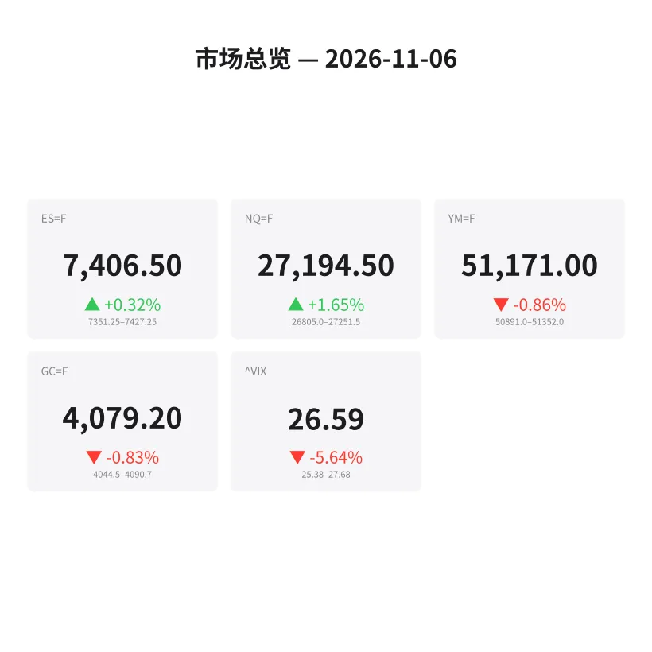
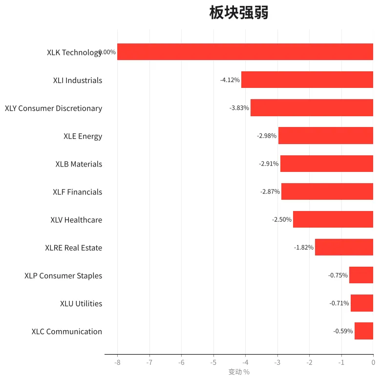
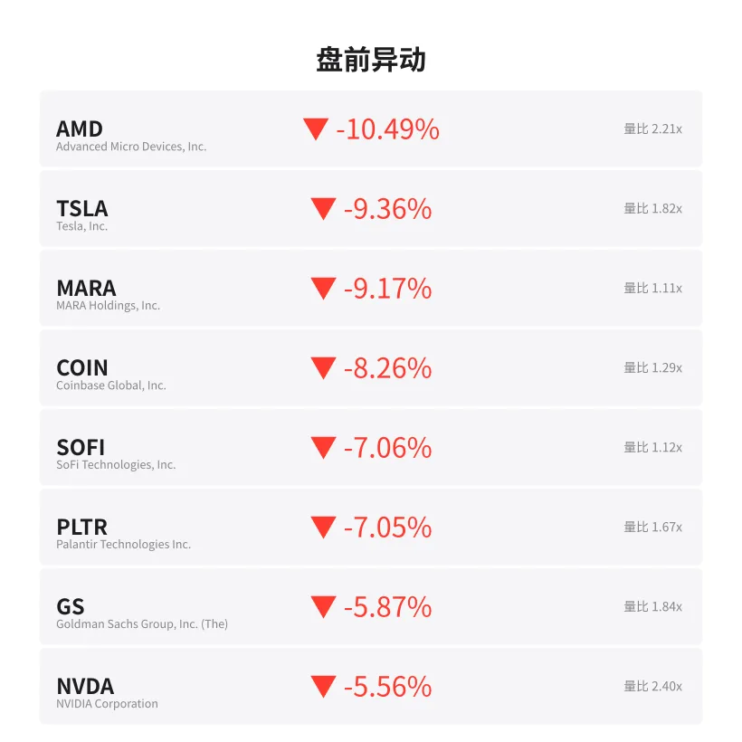
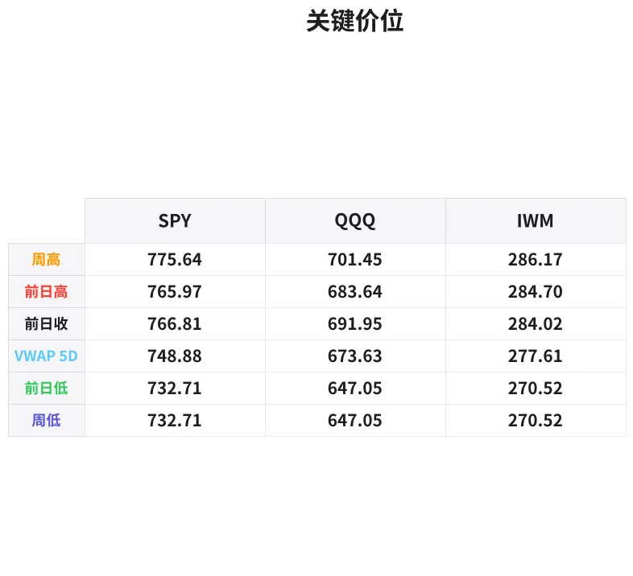

# 盘前分析报告 — 2026-11-06
*生成时间: 12:39:46 UTC*

---
## 数据速览

---
## 一、宏观环境

> [!info]- 详细数据：指数期货 & VIX
> ### 1.1 指数期货 & VIX
> | 品种 | 现价 | 涨跌幅 | 前收 | 日高 | 日低 |
> |------|------|--------|------|------|------|
> | ES=F | 7406.5 | +0.32% | 7383.0 | 7427.0 | 7322.25 |
> | NQ=F | 27194.5 | +1.65% | 26752.0 | 27251.25 | 26366.5 |
> | YM=F | 51171.0 | -0.86% | 51615.0 | 51569.0 | 50891.0 |
> | GC=F | 4079.2 | -0.83% | 4113.5 | 4116.2 | 4044.5 |
> | ^VIX | 26.59 | -5.64% | 28.18 | 27.68 | 25.38 |

> [!info]- 详细数据：隔夜走势
> ### 1.2 隔夜走势（Globex）
> | 品种 | 隔夜高 | 隔夜低 | 区间 | 亚洲高 | 亚洲低 | 欧洲高 | 欧洲低 |
> |------|--------|--------|------|--------|--------|--------|--------|
> | ES=F | 7427.25 | 7351.25 | 76.0 | 7392.25 | 7371.25 | 7427.25 | 7351.25 |
> | NQ=F | 27251.5 | 26805.0 | 446.5 | 27030.0 | 26903.0 | 27251.5 | 26805.0 |
> | YM=F | 51352.0 | 50891.0 | 461.0 | 51200.0 | 51057.0 | 51352.0 | 50891.0 |
> | GC=F | 4090.7 | 4044.5 | 46.2 | 4061.5 | 4044.5 | 4090.7 | 4051.0 |
> | ^VIX | 27.68 | 25.38 | 2.3 | — | — | 27.68 | 25.38 |

> [!info]- 详细数据：板块强弱
> ### 1.3 板块强弱
> | ETF | 板块 | 涨跌幅 |
> |-----|------|--------|
> | XLC | Communication | -0.59% |
> | XLU | Utilities | -0.71% |
> | XLP | Consumer Staples | -0.75% |
> | XLRE | Real Estate | -1.82% |
> | XLV | Healthcare | -2.50% |
> | XLF | Financials | -2.87% |
> | XLB | Materials | -2.91% |
> | XLE | Energy | -2.98% |
> | XLY | Consumer Discretionary | -3.83% |
> | XLI | Industrials | -4.12% |
> | XLK | Technology | -8.00% |

---
## 二、消息面

> ⚠️ 今日新闻数据获取失败，以下为盘面观察总结：
> - 全板块普跌，科技板块领跌（XLK -8.00%），市场风险偏好急剧下降
> - AMD、TSLA、NVDA 等科技/成长龙头均出现大幅跳空低开，跌幅 5%-10%+
> - 金融（XLF -2.87%）、工业（XLI -4.12%）同步走弱，非单一板块事件
> - VIX 从 28.18 回落至 26.59（-5.64%），但仍处高位，恐慌未完全消退
> - 整体盘面特征符合系统性风险事件后的延续性抛售或重大政策/地缘冲击

---
## 三、盘前异动

> [!info]- 详细数据：盘前异动
> | 代码 | 名称 | 现价 | 缺口 | 量比 |
> |------|------|------|------|------|
> | AMD | Advanced Micro Devices, Inc. | 437.5 | -10.49% | 2.21x |
> | TSLA | Tesla, Inc. | 349.14 | -9.36% | 1.82x |
> | MARA | MARA Holdings, Inc. | 6.24 | -9.17% | 1.11x |
> | COIN | Coinbase Global, Inc. | 138.99 | -8.26% | 1.29x |
> | SOFI | SoFi Technologies, Inc. | 16.15 | -7.06% | 1.12x |
> | PLTR | Palantir Technologies Inc. | 159.6 | -7.05% | 1.67x |
> | GS | Goldman Sachs Group, Inc. (The) | 873.53 | -5.87% | 1.84x |
> | NVDA | NVIDIA Corporation | 189.0 | -5.56% | 2.4x |
> | RIVN | Rivian Automotive, Inc. | 13.37 | -4.91% | 1.11x |
> | JPM | JP Morgan Chase & Co. | 335.0 | -4.86% | 1.83x |

---
## 四、关键价位

> [!info]- 详细数据：SPY 关键价位
> ### SPY
> | 价位类型 | 价格 |
> |----------|------|
> | Prior Day High | 765.97 |
> | Prior Day Low | 732.71 |
> | Prior Day Close | 766.81 |
> | Premarket Price | 735.05 |
> | Approx Vwap 5D | 748.88 |
> | Weekly High | 775.64 |
> | Weekly Low | 732.71 |

> [!info]- 详细数据：QQQ 关键价位
> ### QQQ
> | 价位类型 | 价格 |
> |----------|------|
> | Prior Day High | 683.64 |
> | Prior Day Low | 647.05 |
> | Prior Day Close | 691.95 |
> | Premarket Price | 658.27 |
> | Approx Vwap 5D | 673.63 |
> | Weekly High | 701.45 |
> | Weekly Low | 647.05 |

> [!info]- 详细数据：IWM 关键价位
> ### IWM
> | 价位类型 | 价格 |
> |----------|------|
> | Prior Day High | 284.7 |
> | Prior Day Low | 270.52 |
> | Prior Day Close | 284.02 |
> | Premarket Price | 271.8564 |
> | Approx Vwap 5D | 277.61 |
> | Weekly High | 286.17 |
> | Weekly Low | 270.52 |

---
## 五、AI 技术分析 & 操盘建议

### 第一部分：隔夜市场回顾

**亚洲时段（亚盘）：**
- ES 在 7371–7392 区间窄幅震荡，振幅仅 21 点，显示亚洲资金观望情绪浓厚
- NQ 亚盘区间 26903–27030，相对稳定，未出现恐慌性抛售
- GC（黄金）亚盘测试低点 4044.5，随后小幅反弹至 4061.5，避险买盘有限
- 整体亚盘交投清淡，定价权留给欧洲和美国时段

**欧洲时段（欧盘）：**
- ES 欧盘区间扩大至 7351.25–7427.25（76 点），波动加剧
- NQ 欧盘区间 26805–27251.5（446 点），为全天最大波动来源
- 欧盘出现明显的先下探后反抽走势：NQ 从 26805 反弹至 27251.5，反弹幅度超 400 点
- YM（道指）欧盘 50891–51352，走势相对疲软，蓝筹承压明显
- GC 欧盘从 4051 反弹至 4090.7，避险情绪小幅回升但力度不强

**对美盘的含义：**
- 隔夜走势确认：市场处于"大跳空+宽幅震荡"模式，不是单边下跌
- NQ 领涨反弹（+1.65%），ES 跟涨（+0.32%），YM 落后（-0.86%），说明**科技反弹是核心驱动**
- VIX 从高点 27.68 回落至 25.38 低点，收在 26.59，恐慌有所缓解但远未平息
- **关键信号**：欧盘的反弹力度决定了美盘开盘后的初始方向——如果 gap fill 力量延续，开盘可能先上探；如果开盘即跌破欧盘低点，则进入二次探底

### 第二部分：期货品种分析

#### ES（E-mini S&P 500） — 现价 7406.5

**多时间框架分析：**
- **日线**：前收 7383.0，当前 7406.5（+0.32%），日内区间 7322.25–7427.0。大阴线后的小阳反弹，属于下跌中继或超跌修复的第一根K线，方向不明确
- **4H**：从 7322.25 低点反弹至 7427 区域，形成 V 型反弹结构，但尚未突破前日低点区域的压力（前日低点 732.71 对应 ES ~7330 已经跌破后收复）
- **1H/15min**：欧盘推动从 7351 到 7427，当前维持在 7400 上方，短线多头占优

**关键价位：**
| 类型 | 价位 | 说明 |
|------|------|------|
| 隔夜高（ONH） | 7427.25 | 多头突破目标，上方首个阻力 |
| 隔夜低（ONL） | 7351.25 | 空头防守位，跌破确认二次下探 |
| 前日高 | 7427.0 | 与 ONH 重合，强阻力 |
| 前日低 | 7322.25 | 极端支撑，跌破开启恐慌模式 |
| VWAP 区域 | ~7375–7385 | 日内多空分界线 |
| 心理关口 | 7400 | 整数位支撑 |

**方向偏多 | 置信度 60%**
- 理由：VIX 回落、NQ 领涨反弹、欧盘强势收高，盘前维持 7400+ 有多头延续信号
- 但大背景仍是系统性抛售后的首日反弹，不宜追多

**交易计划：**
- **做多方案（首选）**：回踩 7370–7385（VWAP 附近）企稳做多
  - 止损：7350（隔夜低下方）
  - T1：7425（ONH 测试）
  - T2：7450（gap fill 方向延伸）
  - 盈亏比约 2:1
- **做空方案（备选）**：若开盘失守 7370 + delta 翻负
  - 入场：跌破 7365 回抽不过
  - 止损：7390
  - T1：7330（前日低）
  - T2：7300（心理关口）
- **失效条件**：开盘直接突破 7430 并站稳 → 放弃做空思路，等回踩做多；开盘直接跌破 7340 → 单边空头日，只做空

---

#### NQ（E-mini Nasdaq 100） — 现价 27194.5

**多时间框架分析：**
- **日线**：前收 26752，当前 27194.5（+1.65%），日内区间 26366.5–27251.25。跳空低开后强势反弹 885 点，收复大部分失地。这是昨日大跌后最强的反弹品种
- **4H**：从 26366.5 到 27251.5，接近 900 点的 V 型反弹，结构上形成潜在的"锤子线"底部信号
- **1H/15min**：欧盘推动明确，27000 以上持续买盘，当前收敛在 27150–27250 窄幅区间

**关键价位：**
| 类型 | 价位 | 说明 |
|------|------|------|
| 隔夜高（ONH） | 27251.5 | 核心突破位 |
| 隔夜低（ONL） | 26805.0 | 空头触发位 |
| 日低 | 26366.5 | 极端支撑 |
| 前收 | 26752.0 | 回踩参考 |
| 亚盘高 | 27030.0 | 中间支撑 |
| 心理关口 | 27000 | 整数位多空分界 |

**方向偏多 | 置信度 65%**
- 理由：反弹力度最强（+1.65%），科技股虽然跳空最猛但抄底资金也最活跃
- AMD/NVDA 等龙头虽大幅低开，但高量比（>2x）暗示有机构换手

**交易计划：**
- **做多方案（首选）**：回踩 27000–27050 区域做多
  - 止损：26900（ONL 上方缓冲）
  - T1：27250（ONH 测试）
  - T2：27400（进一步 gap fill）
  - 盈亏比约 2:1
- **做空方案（备选）**：跌破 26950 + NQ 领跌 ES
  - 入场：26930 回抽失败
  - 止损：27080
  - T1：26750（前收）
  - T2：26500
- **失效条件**：直接突破 27300 → 等回踩再做多；直接跌破 26800 → 纯空头行情

---

#### GC（黄金期货） — 现价 4079.2

**多时间框架分析：**
- **日线**：前收 4113.5，当前 4079.2（-0.83%），日内区间 4044.5–4116.2。黄金逆市下跌，说明这不是传统的"避险驱动"抛售——更像流动性冲击（margin call 卖出一切）
- **4H**：从日高 4116.2 下跌至 4044.5 后反弹至 4079，形成区间震荡格局
- **1H**：欧盘反弹从 4051 至 4090.7，当前回落至 4079，走势犹豫

**关键价位：**
| 类型 | 价位 | 说明 |
|------|------|------|
| 隔夜高 | 4090.7 | 短线阻力 |
| 隔夜低 | 4044.5 | 关键支撑 |
| 前收 | 4113.5 | 多头目标 |
| 心理关口 | 4100 | 整数位阻力 |
| 强支撑 | 4040–4045 | 跌破看 4000 |

**方向中性偏空 | 置信度 50%**
- 理由：股市大跌+黄金同跌=流动性紧缩特征；反弹无力，买盘犹豫
- 但 4040–4045 支撑区已经两次测试未破，短期下方空间也有限

**交易计划：**
- **做空方案（首选）**：反弹 4088–4095 遇阻做空
  - 止损：4105
  - T1：4055
  - T2：4040（隔夜低再测试）
  - 盈亏比约 2.5:1
- **做多方案（备选）**：二次测试 4040–4045 不破 + stock market 企稳
  - 入场：4045–4050 区域
  - 止损：4032
  - T1：4080
  - T2：4100
- **失效条件**：突破 4100 站稳 → 避险买盘回归，转多；跌破 4040 → 看 4000 整数关口

### 第三部分：ETF 品种分析

#### SPY — 盘前价 735.05

**关键价位一览：**
| 类型 | 价位 | 说明 |
|------|------|------|
| 前日收盘 | 766.81 | Gap 起点 |
| 前日高 | 765.97 | Gap 上沿 |
| 盘前价 | 735.05 | 当前参考 |
| 前日低 | 732.71 | 极端支撑 / 盘前价附近 |
| 5日 VWAP | 748.88 | 中期多空分界 |
| 周高 | 775.64 | 上方阻力 |
| 周低 | 732.71 | 等于前日低 |

**核心判断：**
- SPY 盘前 735.05 仅高于前日低点 732.71 约 2.3 点，开盘后能否守住 732.71 是今日关键
- 如果守住 → 形成双底结构（前日低 + 今日开盘低），可能展开技术性反弹至 745–750 区域
- 如果失守 → 新低确认，下方看 725（心理关口）甚至 720

**交易计划：**
- **做多**：开盘测试 732–734 区域，出现明显买盘承接（大单吸收、delta 转正）
  - 止损：730.50
  - T1：742（日内阻力）
  - T2：748（接近 5 日 VWAP）
- **做空**：跌破 732 且 5min 收盘确认
  - 止损：735.50
  - T1：727
  - T2：722

---

#### QQQ — 盘前价 658.27

**关键价位一览：**
| 类型 | 价位 | 说明 |
|------|------|------|
| 前日收盘 | 691.95 | Gap 起点 |
| 前日高 | 683.64 | Gap 上沿参考 |
| 盘前价 | 658.27 | 当前参考 |
| 前日低 | 647.05 | 极端支撑 |
| 5日 VWAP | 673.63 | 中期多空分界 |
| 周高 | 701.45 | 远端阻力 |
| 周低 | 647.05 | 等于前日低 |

**核心判断：**
- QQQ gap down 约 33.7 点（-4.87%），规模巨大，但盘前价 658 远高于前日低 647，说明有买盘托底
- NQ 期货 +1.65% 已经领涨反弹，QQQ 开盘大概率跟随
- 关注 660 整数关口作为日内多空分界线

**交易计划：**
- **做多**：开盘守住 655–658 区域 + 观察 NVDA/AMD 是否企稳
  - 止损：652
  - T1：668（日内阻力）
  - T2：673（5 日 VWAP）
- **做空**：跌破 653 且科技权重继续抛售
  - 止损：660
  - T1：648（前日低附近）
  - T2：640

### 第四部分：今日市场总览

**整体情绪：极度恐慌后的首次修复，但信心脆弱**

- 昨日全线暴跌后，今日盘前呈现**分化修复**格局：NQ 领涨反弹（+1.65%），ES 温和回升（+0.32%），YM 仍在下跌（-0.86%），黄金同步走弱（-0.83%）
- 板块全线飘绿，无一幸免：科技 XLK -8.00% 领跌，工业 XLI -4.12%，可选消费 XLY -3.83%，防御板块（XLU/XLP）跌幅最小但也在 -0.7% 左右
- **这不是典型的避险轮动（黄金没涨、国防板块没强），更像是流动性冲击导致的无差别抛售**

**VIX 分析：**
- VIX 26.59，从前收 28.18 回落 5.64%，但仍处于"高波动"区间（>25）
- VIX 结构：日内高 27.68 → 低 25.38，说明恐慌情绪在日内已有缓解
- VIX > 25 意味着：宽止损、小仓位、不要抱侥幸心理
- 如果 VIX 跌破 25 → 市场信心恢复信号，多头可加仓
- 如果 VIX 回升 > 28 → 恐慌二次升温，准备防守

**今日关键时间窗口（避开 / 关注）：**
| 时间（ET） | 事件 | 策略 |
|-----------|------|------|
| 9:30–9:45 | 开盘 15 分钟 | ⚠️ 观望为主，等方向确认。大 gap 开盘头 15 分钟假突破概率极高 |
| 9:45–10:15 | 初始方向确立 | ✅ 首笔交易窗口，观察 VWAP 关系和 delta |
| 10:30 | 原油库存数据 | ⚠️ 可能引发能源板块波动 |
| 11:30–13:00 | 午间死区 | ⚠️ 大 gap 日午间容易出现虚假反转，避免追单 |
| 14:00–14:30 | 机构时段 | ✅ 关注是否有 MOC（收盘不平衡）方向性买卖 |
| 15:30–16:00 | 收盘前 30 分钟 | ✅ 如果全天维持反弹，收盘前可能加速；如果走弱，收盘前抛压集中 |

**板块轮动观察：**
- 今日科技（XLK -8%）跌幅远超其他板块，但 NQ 期货反弹最强 → 科技是"核心战场"
- 防御板块（XLU -0.71%、XLP -0.75%）相对抗跌 → 如果今日反弹乏力，资金可能继续流入防御
- 金融（XLF -2.87%）和工业（XLI -4.12%）同步走弱 → 非仅科技问题，经济增长预期也在下修
- 如果开盘后科技企稳且 XLF 跟涨 → 确认反弹有效性；如果仅科技反弹而金融继续走弱 → 反弹质量存疑

---

> **🎯 核心操盘论点：今日是大 gap 后的首个修复日，NQ 领涨反弹但基础不牢。策略上以"回踩支撑做多"为主、"突破失败做空"为辅，仓位控制在平时的 50%-60%，严格止损，不隔夜。重点关注 SPY 732.71 和 NQ 27000 两个多空分界线——守住则反弹延续，失守则二次探底。**
