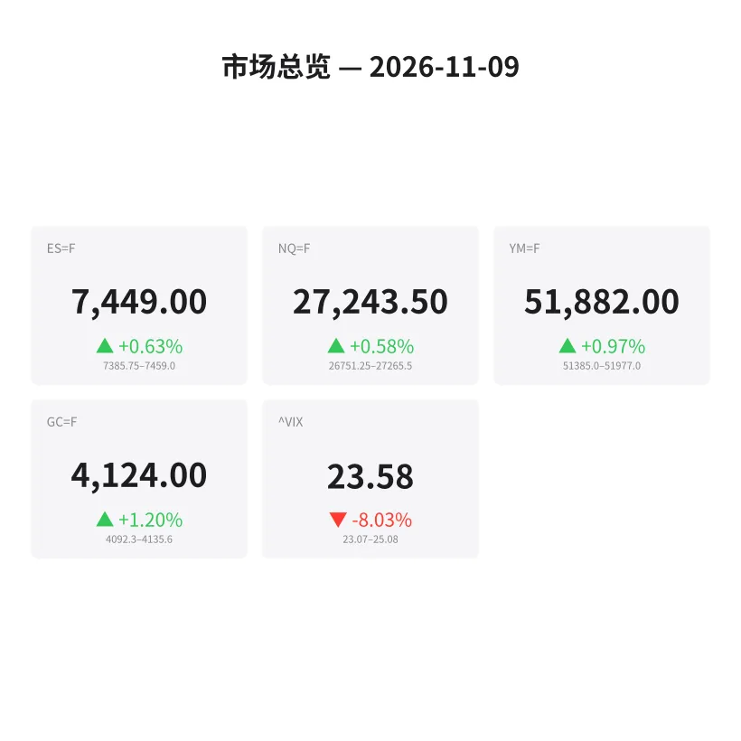
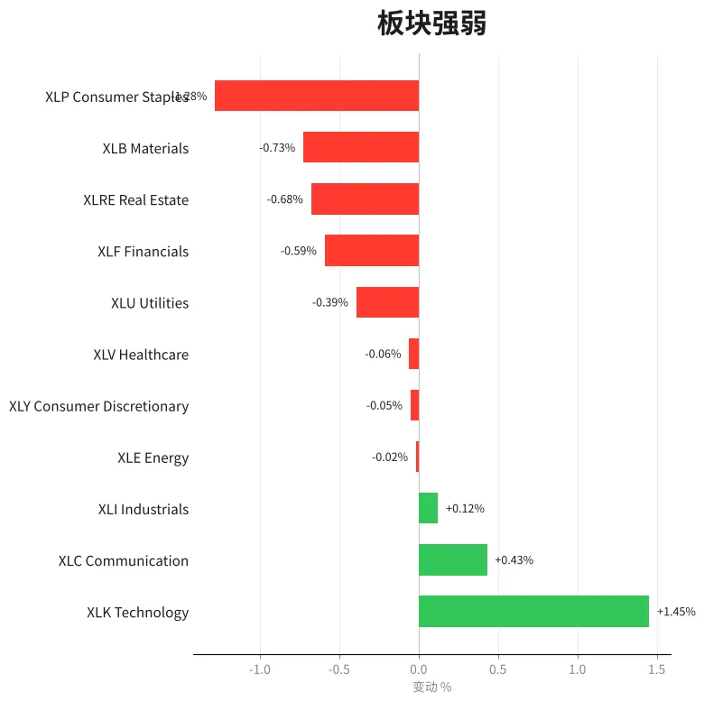
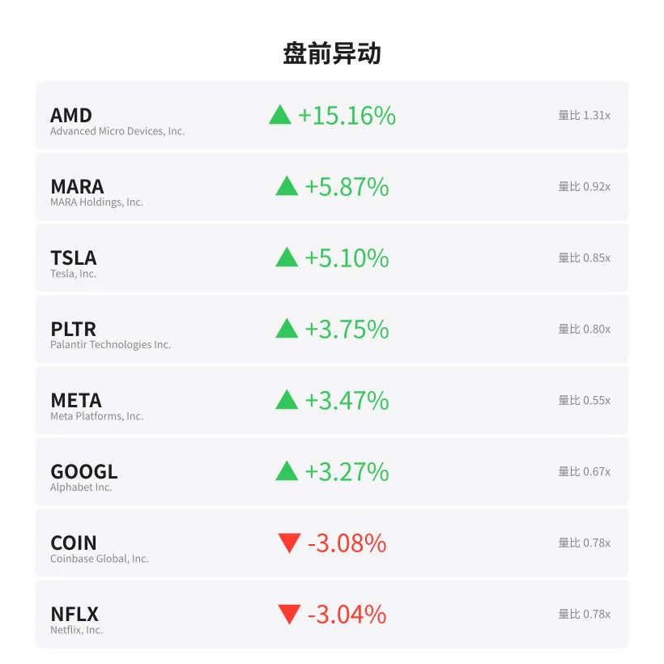
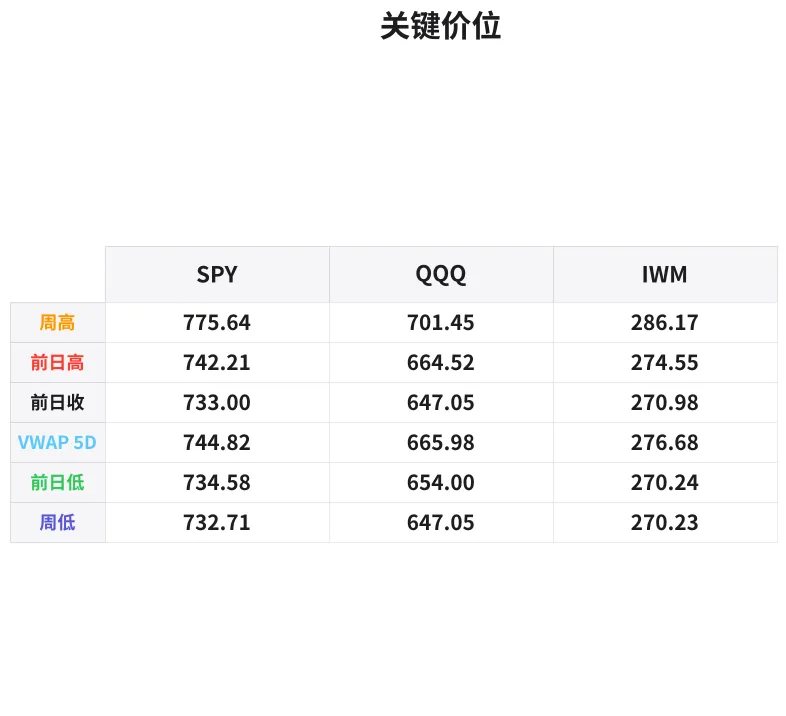

# 盘前分析报告 — 2026-11-09
*生成时间: 12:41:34 UTC*

---
## 数据速览

---
## 一、宏观环境

> [!info]- 详细数据：指数期货 & VIX
> ### 1.1 指数期货 & VIX
> | 品种 | 现价 | 涨跌幅 | 前收 | 日高 | 日低 |
> |------|------|--------|------|------|------|
> | ES=F | 7449.0 | +0.63% | 7402.0 | 7459.0 | 7363.75 |
> | NQ=F | 27243.5 | +0.58% | 27085.25 | 27319.0 | 26751.25 |
> | YM=F | 51882.0 | +0.97% | 51385.0 | 51977.0 | 51206.0 |
> | GC=F | 4124.0 | +1.20% | 4074.9 | 4143.3 | 4062.5 |
> | ^VIX | 23.58 | -8.03% | 25.64 | 25.08 | 23.07 |

> [!info]- 详细数据：隔夜走势
> ### 1.2 隔夜走势（Globex）
> | 品种 | 隔夜高 | 隔夜低 | 区间 | 亚洲高 | 亚洲低 | 欧洲高 | 欧洲低 |
> |------|--------|--------|------|--------|--------|--------|--------|
> | ES=F | 7459.0 | 7385.75 | 73.25 | 7447.0 | 7422.5 | 7459.0 | 7385.75 |
> | NQ=F | 27265.5 | 26751.25 | 514.25 | 27226.75 | 27047.75 | 27265.5 | 26751.25 |
> | YM=F | 51977.0 | 51385.0 | 592.0 | 51781.0 | 51668.0 | 51977.0 | 51385.0 |
> | GC=F | 4135.6 | 4092.3 | 43.3 | 4135.6 | 4115.5 | 4124.3 | 4092.3 |
> | ^VIX | 25.08 | 23.07 | 2.01 | — | — | 25.08 | 23.07 |

> [!info]- 详细数据：板块强弱
> ### 1.3 板块强弱
> | ETF | 板块 | 涨跌幅 |
> |-----|------|--------|
> | XLK | Technology | +1.45% |
> | XLC | Communication | +0.43% |
> | XLI | Industrials | +0.12% |
> | XLE | Energy | -0.02% |
> | XLY | Consumer Discretionary | -0.05% |
> | XLV | Healthcare | -0.06% |
> | XLU | Utilities | -0.39% |
> | XLF | Financials | -0.59% |
> | XLRE | Real Estate | -0.68% |
> | XLB | Materials | -0.73% |
> | XLP | Consumer Staples | -1.28% |

---
## 二、消息面

- **AMD第三季度营收创纪录达134亿美元，数据中心业务同比暴增97%** — *Pulse2 / Barchart*
  > AMD Q3 2026 Revenue Hits Record $13.4B as Data Center Sales Surge 97% on AI Demand
- **AMD调整后每股收益2.09美元超预期，Q4指引上调至170亿美元** — *VestedFinance / StockHub*
  > AMD Beats Q3 Estimates with $2.09 Adjusted EPS; Guides Q4 Revenue to $17B on MI450 and Helion AI Ramp
- **美联储10月会议维持利率3.75%-4%不变，市场预计年内或再加息25基点** — *AdvisorPerspectives / AdmiralMarkets*
  > Fed Holds Rates Steady at 3.75%-4% in October; Markets Price in One More 25bp Hike in 2026
- **美国政府停摆有望结束，股指期货大幅高开** — *Barchart*
  > Stocks Set to Open Sharply Higher as End to U.S. Government Shutdown Nears
- **半导体板块领涨，AMD盘前飙升逾15%带动科技股走强** — *Market Data*
  > Semiconductor Sector Leads as AMD Surges 15%+ Premarket, Lifting Broader Tech Sentiment
- **VIX恐慌指数骤降8%至23.58，市场风险偏好显著回升** — *Market Data*
  > VIX Drops 8% to 23.58 as Risk Appetite Improves Ahead of New Trading Week

---
## 三、盘前异动

> [!info]- 详细数据：盘前异动
> | 代码 | 名称 | 现价 | 缺口 | 量比 |
> |------|------|------|------|------|
> | AMD | Advanced Micro Devices, Inc. | 465.69 | +15.16% | 1.31x |
> | MARA | MARA Holdings, Inc. | 6.22 | +5.87% | 0.92x |
> | TSLA | Tesla, Inc. | 361.23 | +5.10% | 0.85x |
> | PLTR | Palantir Technologies Inc. | 160.8 | +3.75% | 0.8x |
> | META | Meta Platforms, Inc. | 626.08 | +3.47% | 0.55x |
> | GOOGL | Alphabet Inc. | 291.8 | +3.27% | 0.67x |
> | COIN | Coinbase Global, Inc. | 132.6 | -3.08% | 0.78x |
> | NFLX | Netflix, Inc. | 63.57 | -3.04% | 0.78x |
> | RIVN | Rivian Automotive, Inc. | 13.68 | +2.91% | 0.51x |
> | NVDA | NVIDIA Corporation | 176.66 | -2.72% | 1.32x |

---
## 四、关键价位

> [!info]- 详细数据：SPY 关键价位
> ### SPY
> | 价位类型 | 价格 |
> |----------|------|
> | Prior Day High | 742.2104 |
> | Prior Day Low | 734.58 |
> | Prior Day Close | 733.0 |
> | Premarket Price | 740.72 |
> | Approx Vwap 5D | 744.82 |
> | Weekly High | 775.64 |
> | Weekly Low | 732.71 |

> [!info]- 详细数据：QQQ 关键价位
> ### QQQ
> | 价位类型 | 价格 |
> |----------|------|
> | Prior Day High | 664.52 |
> | Prior Day Low | 654.0 |
> | Prior Day Close | 647.05 |
> | Premarket Price | 660.48 |
> | Approx Vwap 5D | 665.98 |
> | Weekly High | 701.45 |
> | Weekly Low | 647.05 |

> [!info]- 详细数据：IWM 关键价位
> ### IWM
> | 价位类型 | 价格 |
> |----------|------|
> | Prior Day High | 274.55 |
> | Prior Day Low | 270.24 |
> | Prior Day Close | 270.98 |
> | Premarket Price | 276.98 |
> | Approx Vwap 5D | 276.68 |
> | Weekly High | 286.17 |
> | Weekly Low | 270.23 |

---
## 五、AI 技术分析 & 操盘建议

### 第一部分：隔夜市场回顾

**亚洲时段（18:00-02:00 ET）：**
- ES在亚洲时段交投清淡，窄幅整理于7422.5-7447.0区间（仅24.5点），显示多空双方在周末消息面消化后暂时达成平衡。NQ在亚洲时段同样窄幅震荡（27047.75-27226.75），但下沿测试更深，反映科技股对AMD财报的预期分歧。
- GC（黄金）在亚洲时段偏强运行（4115.5-4135.6），触及隔夜高点4135.6，显示避险需求尚未完全消退。

**欧洲时段（02:00-09:30 ET）：**
- 欧洲开盘后波动显著放大。ES欧洲时段区间扩展至7385.75-7459.0（73.25点），先下探7385.75后强势反弹至7459.0创隔夜新高，形成"先杀后拉"的V型结构——这是机构资金在低位吸筹的典型特征。
- NQ欧洲时段更为剧烈，下探26751.25后反弹至27265.5，区间达514.25点。AMD财报消息在欧洲时段扩散后引发半导体板块强烈买盘。
- GC在欧洲时段出现回落（4092.3-4124.3），从亚洲高点回撤，反映Risk-on情绪升温后资金从避险资产流出。
- VIX欧洲时段从25.08回落至23.07，跌幅达8%，确认市场恐慌情绪快速消退。

**对美盘的影响研判：**
- 隔夜"V型反转"结构看涨。欧洲时段的低点扫停后反弹至新高，暗示机构在低位完成建仓，美盘大概率延续上行动能。
- VIX大幅回落+科技板块领涨+AMD催化剂 = 典型的Risk-on环境。但需警惕开盘后获利回吐，特别是NQ在27300上方面临阻力。
- 政府停摆即将结束的利好消息已部分计入价格，美盘开盘后关注"买预期、卖事实"的可能性。

### 第二部分：期货品种分析

#### ES（E-mini S&P 500 期货）— 现价 7449.0

**多时间框架分析：**
- **日线：** 上周五收于7402.0，本周缺口高开至7449.0（+47点）。前一交易日区间7363.75-7459.0，形成阳线实体。日线级别仍在上升趋势通道内运行，7400为上周五收盘关键支撑。
- **4H：** 隔夜V型反转后，当前处于区间上沿。7459.0为隔夜高点/阻力，7385.75为欧洲时段低点/支撑。4H结构偏多。
- **1H/15M：** 盘前运行在7440-7459之间，成交量中性。注意开盘瞬间的流动性真空期。

**关键价位：**
| 级别 | 价格 | 含义 |
|------|------|------|
| R3 | 7500.0 | 心理整数关口 |
| R2 | 7475.0 | 上方延伸目标 |
| R1 | 7459.0 | 隔夜高点（首要阻力） |
| **现价** | **7449.0** | |
| S1 | 7422.5 | 亚洲时段低点 |
| S2 | 7402.0 | 前收盘（缺口位） |
| S3 | 7385.75 | 欧洲时段低点（关键支撑） |
| S4 | 7363.75 | 日低（极端支撑） |

**方向偏多 | 信心：70%**

**做多方案：**
- 入场区间：7420-7430（回踩亚洲低点区域）
- 止损：7398（前收盘下方）
- T1：7459（隔夜高点突破确认）
- T2：7480-7500（心理关口延伸）
- 失效条件：跌破7385.75（欧洲低点），则转为区间震荡格局

**备选做空方案（若开盘冲高回落）：**
- 触发条件：7459-7465区域放量受阻，出现明显order flow翻转
- 入场：7458-7462
- 止损：7478
- T1：7435
- T2：7415

---

#### NQ（E-mini Nasdaq 100 期货）— 现价 27243.5

**多时间框架分析：**
- **日线：** 上周五收于27085.25，本周缺口高开（+158.25点/+0.58%）。AMD财报催化下半导体权重股领涨，NQ日线级别在上升趋势中。但注意27300上方进入前高密集区。
- **4H：** 隔夜极端波动——欧洲时段下探26751.25后暴力反弹500+点至27265.5。这种"深V"结构通常意味着短线多头占优，但26751的低点扫停可能留下大量止损单。
- **1H/15M：** 当前在27200-27265之间整理，关注开盘后能否突破27265.5。

**关键价位：**
| 级别 | 价格 | 含义 |
|------|------|------|
| R3 | 27500.0 | 上方延伸目标 |
| R2 | 27319.0 | 日高 |
| R1 | 27265.5 | 隔夜高点（首要阻力） |
| **现价** | **27243.5** | |
| S1 | 27085.25 | 前收盘（缺口位） |
| S2 | 27047.75 | 亚洲时段低点 |
| S3 | 26751.25 | 欧洲时段低点/日低（极端支撑） |

**方向偏多 | 信心：65%**（较ES略低，因NQ波动更大、利好已部分计价）

**做多方案：**
- 入场区间：27100-27150（回踩缺口上沿）
- 止损：27040（亚洲低点下方）
- T1：27265（隔夜高点）
- T2：27400-27500（延伸目标）
- 失效条件：跌破27040，则缺口有可能回补至27085

**激进做多（突破交易）：**
- 触发：27265上方放量突破+回踩确认
- 入场：27270-27285
- 止损：27220
- T1：27400
- T2：27500

---

#### GC（COMEX 黄金期货）— 现价 4124.0

**多时间框架分析：**
- **日线：** 上周五收于4074.9，本周缺口高开至4124.0（+49.1/+1.20%）。日线级别从4062.5低点反弹，但仍处于近期下降趋势中（从5200+高点持续回落）。当前反弹可能只是技术性超跌修复。
- **4H：** 亚洲时段触及4135.6后在欧洲时段回落至4092.3，随后反弹至4124.0。4H结构呈现"冲高-回落-再反弹"的震荡格局，方向不明确。
- **1H/15M：** 在4110-4135之间窄幅波动，成交量偏低。

**关键价位：**
| 级别 | 价格 | 含义 |
|------|------|------|
| R2 | 4143.3 | 日高 |
| R1 | 4135.6 | 隔夜高点（亚洲） |
| **现价** | **4124.0** | |
| S1 | 4110.0 | 盘中支撑 |
| S2 | 4092.3 | 欧洲时段低点 |
| S3 | 4074.9 | 前收盘 |
| S4 | 4062.5 | 日低（极端支撑） |

**方向中性偏多 | 信心：55%**

**做多方案（若回踩支撑）：**
- 入场区间：4095-4105（欧洲低点上方）
- 止损：4088（欧洲低点下方）
- T1：4135（隔夜高点）
- T2：4143-4150（日高延伸）
- 失效条件：跌破4062.5（日低），则下行趋势延续

**做空方案（若Risk-on加剧）：**
- 触发条件：4135-4143区域放量受阻，ES同步走强
- 入场：4138-4143
- 止损：4155
- T1：4110
- T2：4092

### 第三部分：ETF品种分析

#### SPY（SPDR S&P 500 ETF）— 盘前 740.72

**关键价位：**
| 级别 | 价格 | 含义 |
|------|------|------|
| R3 | 750.00 | 心理整数关口 |
| R2 | 744.82 | 5日VWAP近似值 |
| R1 | 742.21 | 前日高点 |
| **盘前** | **740.72** | |
| S1 | 734.58 | 前日低点 |
| S2 | 733.00 | 前收盘（缺口位） |
| S3 | 732.71 | 周低点 |

**交易计划：**

SPY缺口高开+7.72点（+1.05%），开盘价在前日高点742.21下方2点处。5日VWAP在744.82，构成短期上方磁吸点。

- **首选方案（Gap and Go做多）：** 若开盘首5分钟站稳740上方，量能配合，顺势做多。入场740-741，止损738.5，T1: 742.21（前高），T2: 744.82（VWAP）。
- **备选方案（缺口回补做空）：** 若开盘跌破740且量能放大，关注缺口回补至735-733区域。入场739.5，止损741.5，T1: 735.0，T2: 733.0。
- **周度背景：** 本周区间732.71-775.64。当前在区间中下部，上方空间充足。若突破744.82（5D VWAP），则本周有望测试750心理关口。

**注意事项：** 周一开盘流动性通常较差，前15分钟避免重仓追高。等待9:45后的方向确认再加仓。

---

#### QQQ（Invesco QQQ ETF）— 盘前 660.48

**关键价位：**
| 级别 | 价格 | 含义 |
|------|------|------|
| R3 | 680.00 | 心理关口 |
| R2 | 665.98 | 5日VWAP近似值 |
| R1 | 664.52 | 前日高点 |
| **盘前** | **660.48** | |
| S1 | 654.00 | 前日低点 |
| S2 | 647.05 | 前收盘/周低（缺口位） |

**交易计划：**

QQQ缺口高开+13.43点（+2.08%），缺口幅度显著大于SPY，反映AMD财报对纳斯达克权重的强力拉动。盘前价位在前日高点664.52下方约4点。

- **首选方案（Gap and Go做多）：** AMD催化效应+半导体板块带动，QQQ多头动能强劲。入场660-661，止损657.5，T1: 664.52（前高），T2: 665.98（5D VWAP），延伸目标670.0。
- **备选方案（冲高回落）：** 若快速冲至664-666区域后量能萎缩、出现卖压，关注回踩至658-660支撑。做空入场664.0-665.0，止损667.0，T1: 660.0，T2: 656.0。
- **周度背景：** 本周区间647.05-701.45。从周低647.05起步，上方空间广阔。若突破666（5D VWAP），下一目标680.0。

**QQQ vs SPY相对强弱：** QQQ缺口幅度（+2.08%）明显大于SPY（+1.05%），科技股今日相对更强。若做配对，可考虑Long QQQ / Short SPY以捕捉科技溢价。但需注意AMD单日异动可能在盘中回吐部分涨幅，QQQ的波动风险更高。

### 第四部分：今日市场总览

#### 整体情绪判断：**偏多（Bullish Bias）**

多重利好叠加形成较强的看多格局：
1. **AMD财报催化：** Q3营收134亿创纪录，数据中心同比+97%，Q4指引170亿超预期。这不仅是AMD单股利好，更是AI/半导体整个板块的信心注入。AMD盘前+15.16%的跳空幅度在近期极为罕见。
2. **政府停摆即将结束：** 消除一个政策不确定性因素，利好风险资产。
3. **VIX大幅回落：** 从25.64降至23.58（-8.03%），恐慌情绪快速消退。VIX跌破24是短线多头的强力确认信号。
4. **隔夜V型结构：** 欧洲时段先杀后拉，机构资金在低位完成吸筹，美盘继承多头动能概率大。

#### VIX分析

VIX当前23.58，日内区间23.07-25.08。
- 23.58仍处于偏高水平（长期均值约18-20），说明市场虽然情绪好转但仍有谨慎情绪。
- VIX快速下行通常对应股指快速上行阶段，但需注意VIX在22-23区域可能形成短期底部。
- **若VIX跌破22，确认进入低波环境，可增加仓位。若VIX反弹至25以上，减仓或对冲。**

#### 需要规避的时间窗口

| 时间（ET） | 事件 | 影响 |
|------------|------|------|
| 09:30-09:45 | 开盘流动性真空 | 周一开盘价差扩大，避免追高追低 |
| 10:00 | 关注是否有经济数据发布 | 可能引发短线波动 |
| 11:30-13:00 | 午盘低流动性区间 | 价格容易被操纵，假突破概率高 |
| 15:00-15:30 | 尾盘机构调仓 | 方向可能突变 |

#### 板块轮动分析

今日板块分化极为明显：
- **强势板块：** XLK（科技+1.45%）独占鳌头，AMD/NVDA/半导体为核心驱动。XLC（通信+0.43%）受META/GOOGL拉动小幅走强。
- **中性板块：** XLI（工业+0.12%）、XLE（能源-0.02%）、XLY（可选消费-0.05%），基本持平。
- **弱势板块：** XLP（必选消费-1.28%）、XLB（材料-0.73%）、XLRE（房地产-0.68%）、XLF（金融-0.59%），防御性板块全线走弱。

**解读：** 这是典型的Risk-on轮动格局——资金从防御性板块流出，涌入高Beta科技成长股。当XLK领涨且XLP/XLU领跌时，市场处于"追逐增长"模式。这种格局下，做多科技ETF（QQQ）或半导体（SOXX/SMH）的胜率更高。

#### 异动个股解读

- **AMD +15.16%：** 今日绝对主角。财报全面超预期+Q4指引炸裂。注意开盘后可能有获利回吐，但整体趋势偏强。不建议追高做多，等回踩再介入。
- **TSLA +5.10%：** 跟随科技大盘走强+政府停摆结束利好（政策预期改善）。
- **NVDA -2.72%：** 唯一走弱的大型科技股，可能受AMD抢占AI市场份额担忧拖累。关注NVDA vs AMD的相对强弱。
- **COIN -3.08% / MARA +5.87%：** 加密相关股票分化，信号不一致，暂时回避。

---

> **🎯 今日核心交易论点：AMD财报引爆AI半导体板块，VIX暴跌确认Risk-on格局。策略以顺势做多ES/NQ/QQQ为主，回踩关键支撑区域分批入场，避免开盘前15分钟追高。GC反向操作，在Risk-on环境下逢高做空为辅。**
