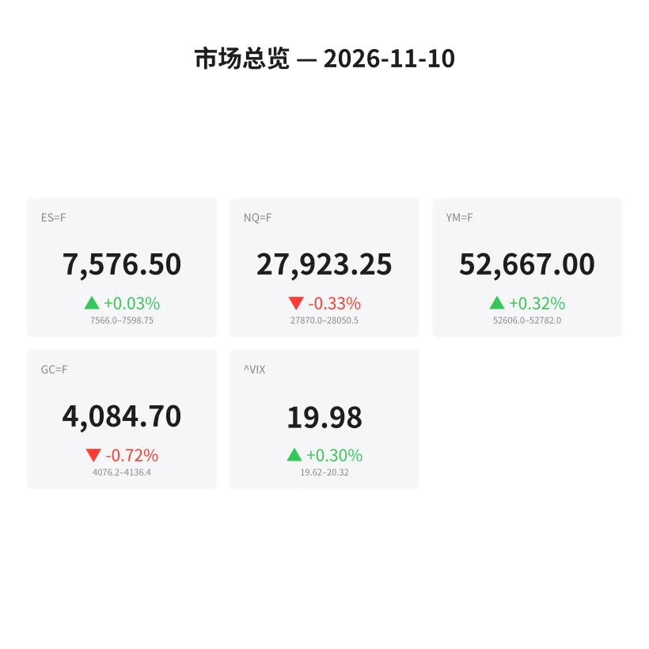
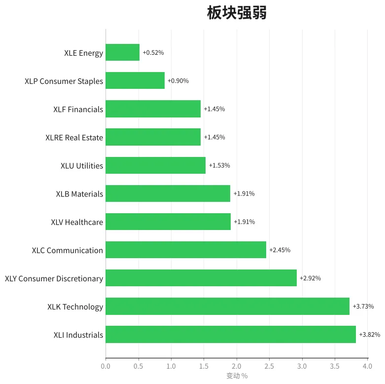
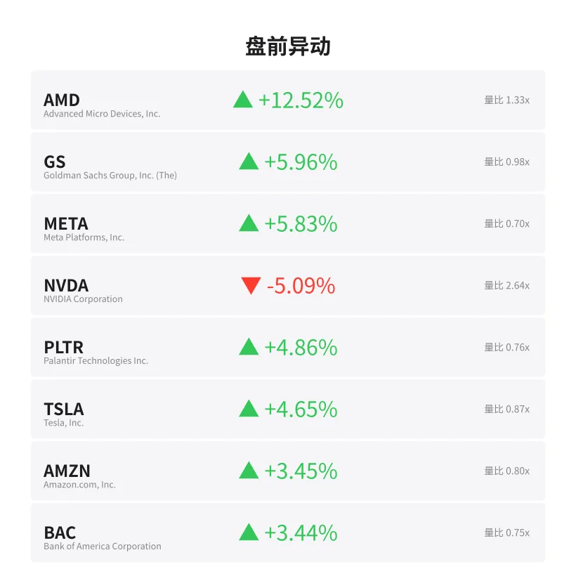
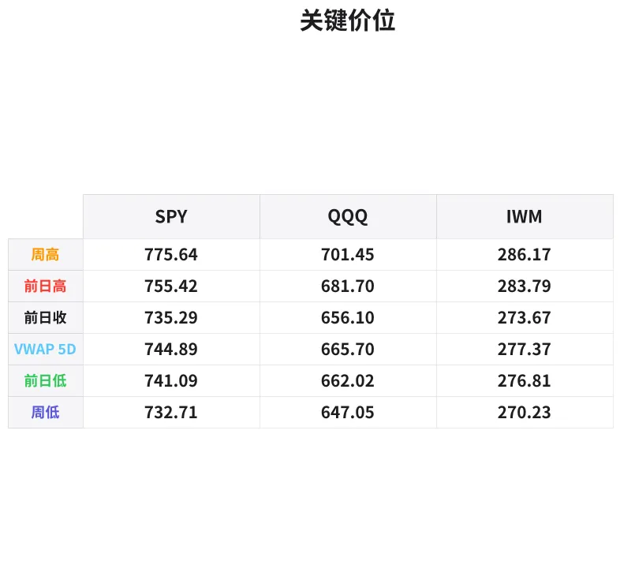

# 盘前分析报告 — 2026-11-10
*生成时间: 12:39:54 UTC*

---
## 数据速览

---
## 一、宏观环境

> [!info]- 详细数据：指数期货 & VIX
> ### 1.1 指数期货 & VIX
> | 品种 | 现价 | 涨跌幅 | 前收 | 日高 | 日低 |
> |------|------|--------|------|------|------|
> | ES=F | 7576.5 | +0.03% | 7574.25 | 7598.75 | 7566.0 |
> | NQ=F | 27923.25 | -0.33% | 28014.5 | 28109.0 | 27869.0 |
> | YM=F | 52667.0 | +0.32% | 52498.0 | 52782.0 | 52482.0 |
> | GC=F | 4084.7 | -0.72% | 4114.5 | 4156.2 | 4076.2 |
> | ^VIX | 19.98 | +0.30% | 19.92 | 20.32 | 19.62 |

> [!info]- 详细数据：隔夜走势
> ### 1.2 隔夜走势（Globex）
> | 品种 | 隔夜高 | 隔夜低 | 区间 | 亚洲高 | 亚洲低 | 欧洲高 | 欧洲低 |
> |------|--------|--------|------|--------|--------|--------|--------|
> | ES=F | 7598.75 | 7566.0 | 32.75 | 7598.75 | 7581.75 | 7594.25 | 7566.0 |
> | NQ=F | 28050.5 | 27870.0 | 180.5 | 28050.5 | 27965.0 | 28044.25 | 27870.0 |
> | YM=F | 52782.0 | 52606.0 | 176.0 | 52780.0 | 52652.0 | 52782.0 | 52606.0 |
> | GC=F | 4136.4 | 4076.2 | 60.2 | 4136.4 | 4119.4 | 4135.1 | 4076.2 |
> | ^VIX | 20.32 | 19.62 | 0.7 | — | — | 20.32 | 19.62 |

> [!info]- 详细数据：板块强弱
> ### 1.3 板块强弱
> | ETF | 板块 | 涨跌幅 |
> |-----|------|--------|
> | XLI | Industrials | +3.82% |
> | XLK | Technology | +3.73% |
> | XLY | Consumer Discretionary | +2.92% |
> | XLC | Communication | +2.45% |
> | XLV | Healthcare | +1.91% |
> | XLB | Materials | +1.91% |
> | XLU | Utilities | +1.53% |
> | XLRE | Real Estate | +1.45% |
> | XLF | Financials | +1.45% |
> | XLP | Consumer Staples | +0.90% |
> | XLE | Energy | +0.52% |

---
## 二、消息面

- **博彩市场认为黄仁勋在2029年前卸任英伟达CEO的概率达55%** — *24/7 Wall St.*
  > Bettors See a 55% Chance Jensen Huang Is Out as Nvidia CEO Before 2029
- **SPDR标普500 ETF (SPY) 11月6日减持苹果和英伟达** — *GuruFocus.com*
  > SPDR S&P 500 ETF (SPY) Sells Apple and Nvidia on Nov. 6
- **ETF基金11月6日净卖出泰瑞达(TER)** — *GuruFocus.com*
  > ETFs Are Net Sellers of Teradyne (TER) on Nov. 6
- **ETF基金11月6日净卖出迈威尔科技(MRVL)** — *GuruFocus.com*
  > ETFs Are Net Sellers of Marvell Technology (MRVL) on Nov. 6
- **ETF基金11月6日净卖出泛林集团(LRCX)** — *GuruFocus.com*
  > ETFs Are Net Sellers of Lam Research (LRCX) on Nov. 6
- **纳斯达克100指数在没有英伟达助力下创3月以来最佳单日表现** — *24/7 Wall St.*
  > The Nasdaq-100 Just Had Its Best Day Since March Without Nvidia’s Help
- **景顺QQQ信托基金(QQQ)11月6日加仓：苹果领先** — *GuruFocus.com*
  > What INVESCO QQQ Trust (QQQ) Bought: Apple Leads on Nov. 6
- **ETF基金11月6日买入5940万美元Palo Alto Networks(PANW)** — *GuruFocus.com*
  > ETFs Bought $59.4 Million of Palo Alto Networks (PANW) on Nov. 6
- **Shopify(SHOP)周五获ETF净买入6120万美元** — *GuruFocus.com*
  > Shopify (SHOP) Sees $61.2 Million in Net ETF Buying on Friday
- **ETF基金周五买入6950万美元好市多(COST)** — *GuruFocus.com*
  > ETFs Bought $69.5 Million of Costco (COST) on Friday
- **Tom Lee表示VIX信号预示股市已触底** — *BeInCrypto*
  > Tom Lee Says a VIX Signal Points to a Stock Market Bottom
- **美国股指收复选后跌幅，成长板块强劲反弹，原油下跌** — *MT Newswires*
  > Update: US Equity Indexes Recover Post-Election Losses as Growth Sectors Rally Hard While Crude Oil Sinks
- **股市正在暴跌，历史表明最聪明的投资者正在做这一个简单操作** — *Motley Fool*
  > The Stock Market Is Crashing. History Says the Smartest Investors Are Making This 1 Simple Move.
- **美国股指跳涨，成长板块强势反弹，原油下跌** — *MT Newswires*
  > Update: US Equity Indexes Jump as Growth Sectors Rally Hard While Crude Oil Sinks
- **美国股指跳涨，成长板块发起反弹，原油持续下滑** — *MT Newswires*
  > Update: US Equity Indexes Jump as Growth Sectors Stage Rally Amid Sliding Crude Oil
- **今日金价（11月10日周二）：金价三周来首次开盘站上4100美元** — *Yahoo Personal Finance*
  > Gold price today, Tuesday, November 10, 2026: Gold opens above $4,100 for the first time in three weeks
- **金罗斯黄金(TSX:K)尽管近期市场谨慎但股价仍低于公允价值** — *Simply Wall St.*
  > Kinross Gold (TSX:K) Stock Looks Below Fair Value Despite Recent Caution
- **Orezone Gold股东做对了什么** — *Simply Wall St.*
  > What Orezone Gold Shareholders Got Right
- **巴菲特曾说如果可以他会买"几十万套"房子——2026年如何大举投资房地产** — *Moneywise*
  > Warren Buffett once said he’d buy a ‘couple hundred thousand’ homes if he could. How to ‘load up’ on real estate in 2026
- **金罗斯黄金(TSX:K)面临新诉讼，但被低估论仍成立** — *Simply Wall St.*
  > Kinross Gold (TSX:K) Faces A Fresh Lawsuit As Its Undervalued Case Holds

---
## 三、盘前异动

> [!info]- 详细数据：盘前异动
> | 代码 | 名称 | 现价 | 缺口 | 量比 |
> |------|------|------|------|------|
> | AMD | Advanced Micro Devices, Inc. | 505.25 | +12.52% | 1.33x |
> | GS | Goldman Sachs Group, Inc. (The) | 917.41 | +5.96% | 0.98x |
> | META | Meta Platforms, Inc. | 645.75 | +5.83% | 0.7x |
> | NVDA | NVIDIA Corporation | 177.13 | -5.09% | 2.64x |
> | PLTR | Palantir Technologies Inc. | 168.18 | +4.86% | 0.76x |
> | TSLA | Tesla, Inc. | 374.88 | +4.65% | 0.87x |
> | AMZN | Amazon.com, Inc. | 268.25 | +3.45% | 0.8x |
> | BAC | Bank of America Corporation | 51.12 | +3.44% | 0.75x |
> | JPM | JP Morgan Chase & Co. | 345.2 | +3.20% | 0.95x |
> | AAPL | Apple Inc. | 352.57 | +2.98% | 0.83x |

---
## 四、关键价位

> [!info]- 详细数据：SPY 关键价位
> ### SPY
> | 价位类型 | 价格 |
> |----------|------|
> | Prior Day High | 755.42 |
> | Prior Day Low | 741.09 |
> | Prior Day Close | 735.29 |
> | Premarket Price | 753.27 |
> | Approx Vwap 5D | 744.89 |
> | Weekly High | 775.64 |
> | Weekly Low | 732.71 |

> [!info]- 详细数据：QQQ 关键价位
> ### QQQ
> | 价位类型 | 价格 |
> |----------|------|
> | Prior Day High | 681.695 |
> | Prior Day Low | 662.02 |
> | Prior Day Close | 656.1 |
> | Premarket Price | 676.6409 |
> | Approx Vwap 5D | 665.7 |
> | Weekly High | 701.45 |
> | Weekly Low | 647.05 |

> [!info]- 详细数据：IWM 关键价位
> ### IWM
> | 价位类型 | 价格 |
> |----------|------|
> | Prior Day High | 283.79 |
> | Prior Day Low | 276.81 |
> | Prior Day Close | 273.67 |
> | Premarket Price | 282.64 |
> | Approx Vwap 5D | 277.37 |
> | Weekly High | 286.17 |
> | Weekly Low | 270.23 |

---
## 五、AI 技术分析 & 操盘建议

### 第一部分：隔夜市场回顾

**亚洲时段：**
- ES在亚洲时段窄幅震荡（7581.75–7598.75，仅17点区间），买方在7580附近持续接盘，表明亚洲资金对美股周五大涨后的获利回吐意愿不强。NQ同样在窄幅85点区间内运行（27965–28050.5），整体偏强。
- GC黄金亚洲时段相对坚挺（4119.4–4136.4），但已显示卖压迹象，空头在4136一线持续压制。

**欧洲时段：**
- 关键转折出现在欧洲时段。ES在欧洲时段测试亚洲低点后失败，一度跌至7566.0（隔夜低点），较亚洲高点回撤约33点。NQ表现更弱，跌至27870.0，较亚洲高点回落180点，显示科技股在欧洲时段遭遇集中抛售。
- GC黄金在欧洲时段大幅下跌，从4135.1直线跌至4076.2，跌幅约60美元/盎司，这是今日最大的隔夜波动。美元走强和获利了结是主要推手。
- 值得注意的是，YM道指在欧洲时段创出隔夜新高52782.0，表明资金从科技股向价值股的轮动在隔夜加速。

**隔夜走势对今日美盘的含义：**
1. ES/NQ在欧洲时段的回撤已经消化了部分获利盘，有利于美盘开盘后的稳定
2. NQ明显弱于ES和YM，科技板块面临分化压力（NVDA -5.09% vs AMD +12.52%说明芯片板块内部严重分化）
3. VIX维持在19.98附近，隔夜区间仅0.7点（19.62-20.32），暗示市场目前处于一个波动率收缩阶段，20关口成为枢纽
4. 黄金的隔夜暴跌（-60美元）释放了避险头寸，侧面印证风险偏好回升

### 第二部分：期货品种分析

#### ES（E-mini S&P 500）— 现价 7576.5

**多时间框架分析：**
- **日线**：周五大阳线收复选后全部跌幅（XLI +3.82%、XLK +3.73%领涨），成交量确认。日线收于5日均线上方，短期趋势转多。但距离周高775.64（SPY换算约ES 7750+）仍有距离，上方存在套牢盘。
- **4小时**：自隔夜高点7598.75回落后，价格在7566-7598区间形成收敛三角。欧洲时段低点7566.0构成短线关键支撑。
- **1小时/15分钟**：盘前价格在7575附近窄幅波动，距离隔夜VPOC（成交量集中区）不远。

**关键价位：**
| 类型 | 价位 | 说明 |
|------|------|------|
| 隔夜高 (ONH) | 7598.75 | 多头突破目标，上破后看7620-7640 |
| 隔夜低 (ONL) | 7566.0 | 关键支撑，失守则看7540-7550 |
| 周五收盘价 (PDC) | 7574.25 | 开盘参考锚点 |
| 5日VWAP区域 | ~7530-7540 | 大级别均衡区，强支撑 |
| 上方阻力区 | 7620-7650 | 前期成交密集区 |

**方向偏见：** 偏多 | **置信度：** 中高（70%）

**交易计划：**
- **做多方案A（首选）：** 回踩ONL 7566附近观察反转信号做多。入场7568-7572，止损7558（ONL下方8点），T1: 7598（ONH），T2: 7625。盈亏比约1:3。
- **做多方案B：** 开盘突破ONH 7598.75后回踩确认做多。入场7600-7605，止损7588，T1: 7625，T2: 7650。
- **做空方案（逆势）：** 仅在失守7566且成交量放大确认后考虑。入场7562，止损7575，T1: 7540，T2: 7520。
- **失效条件：** 若开盘直接跳空至7600上方且VIX同步下行，则放弃回踩做多等待回调；若跌破7550且板块全面翻绿，则多头观点失效。

---

#### NQ（E-mini Nasdaq 100）— 现价 27923.25

**多时间框架分析：**
- **日线**：周五虽然纳指大涨，但今日盘前NQ -0.33%明显弱于ES +0.03%和YM +0.32%，科技股面临轮动抛压。NVDA -5.09%（2.64倍量比）形成巨大拖累，而AMD +12.52%的跷跷板效应仅部分对冲。
- **4小时**：NQ隔夜区间180.5点远大于ES的32.75点（标准化后），波动率显著更高。价格从28050.5跌至27870.0后小幅反弹，目前处于隔夜区间中段。
- **1小时/15分钟**：欧洲时段低点27870.0是今日的关键枢纽。

**关键价位：**
| 类型 | 价位 | 说明 |
|------|------|------|
| 隔夜高 (ONH) | 28050.5 | 强阻力，突破需催化剂 |
| 隔夜低 (ONL) | 27870.0 | 关键支撑，下破看27750 |
| 前收盘 (PDC) | 28014.5 | 盘前已跌破，空头占优 |
| 日低参考 | 27750-27800 | 前期支撑区域 |
| 上方目标 | 28100-28200 | 周五高点附近 |

**方向偏见：** 中性偏空 | **置信度：** 中（60%）

**交易计划：**
- **做空方案A（首选）：** 反弹至PDC 28010-28050区间遇阻做空。入场28010-28030，止损28065（ONH上方），T1: 27870（ONL），T2: 27750。盈亏比约1:3。
- **做多方案（逆势）：** 仅在ONL 27870.0获得强支撑反弹且AMD/AAPL领涨确认时。入场27880-27900，止损27850，T1: 28000，T2: 28050。
- **失效条件：** 若NVDA盘前转正或VIX跌破19.5，则空头观点失效；若NQ突破28050并站稳，则转为偏多。

---

#### GC（COMEX黄金）— 现价 4084.7

**多时间框架分析：**
- **日线**：金价在三周来首次站上4100后今日回落（-0.72%），但新闻面确认金价近期趋势仍偏强（三周来首次站上4100）。日线仍处于中期上升通道内，但短线面临获利了结压力。
- **4小时**：隔夜60.2美元的大区间（4076.2-4136.4）显示剧烈波动。欧洲时段的抛售从4135.1直接打到4076.2，几乎无反弹，属于流动性扫荡式下跌。
- **1小时/15分钟**：价格在4084附近企稳，但距离隔夜低点4076.2仅8美元，下行风险仍在。

**关键价位：**
| 类型 | 价位 | 说明 |
|------|------|------|
| 隔夜高 (ONH) | 4136.4 | 短期内难以触及 |
| 欧洲时段高 | 4135.1 | 供给区上沿 |
| 心理关口 | 4100.0 | 多空分水岭 |
| 隔夜低 (ONL) | 4076.2 | 关键支撑，失守看4050 |
| 强支撑区 | 4050-4060 | 前期成交密集区 |

**方向偏见：** 偏空 | **置信度：** 中高（65%）

**交易计划：**
- **做空方案A（首选）：** 反弹至4100心理关口附近做空。入场4098-4105，止损4115，T1: 4076（ONL），T2: 4055。盈亏比约1:2.5。
- **做空方案B：** 跌破ONL 4076.2后回踩做空。入场4075-4078，止损4088，T1: 4055，T2: 4035。
- **做多方案（逆势）：** 仅在4050-4060强支撑区出现明确反转信号时考虑。入场4055-4060，止损4042，T1: 4085，T2: 4100。
- **失效条件：** 若美元指数突然走弱或地缘风险事件爆发，空头观点立即失效；若金价重新站上4110并放量，则转为偏多。

### 第三部分：ETF品种分析

#### SPY — 盘前价 753.27（较前收735.29 +2.44%）

**关键价位汇总：**
| 价位 | 类型 | 交易意义 |
|------|------|----------|
| 775.64 | 周高 | 大级别多头目标 |
| 755.42 | 前日高（PDH）| 今日首要阻力 |
| 753.27 | 盘前价 | 开盘参考 |
| 744.89 | 5日VWAP | 中线均衡锚点 |
| 741.09 | 前日低（PDL）| 多头防线 |
| 735.29 | 前收盘（PDC）| 缺口底部 |
| 732.71 | 周低 | 极端支撑 |

**今日交易计划：**

SPY盘前跳空+2.44%，大缺口开盘。当前盘前价753.27紧贴PDH 755.42，这是今日最关键的多空决战位。

- **情景一：缺口填不了（概率60%）：** 若开盘后SPY在750-753获得支撑并突破755.42（PDH），则确认缺口有效，多头可追。目标760-765区域，止损748以下。板块轮动数据支持此情景（XLI/XLK领涨，广度良好）。
- **情景二：部分回补缺口（概率30%）：** 开盘后获利盘涌出，SPY回踩至744-748区间（5日VWAP附近）。此处是绝佳的多头接盘位。入场745-747，止损741（PDL下方），T1: 753，T2: 758。
- **情景三：完全回补缺口（概率10%）：** 极端情况下SPY回到735-737区间。仅在VIX飙升至22+且板块全面翻绿时出现。此情景下观望为主。

**注意事项：**
- 开盘前30分钟不宜追涨，等首次回踩确认
- 关注NVDA（-5.09%）对QQQ的拖累是否传导至SPY
- 金融股（GS +5.96%、JPM +3.20%、BAC +3.44%）是今日SPY的重要支撑力量

---

#### QQQ — 盘前价 676.64（较前收656.1 +3.13%）

**关键价位汇总：**
| 价位 | 类型 | 交易意义 |
|------|------|----------|
| 701.45 | 周高 | 大级别多头目标 |
| 681.695 | 前日高（PDH）| 今日首要阻力 |
| 676.64 | 盘前价 | 开盘参考 |
| 665.70 | 5日VWAP | 中线均衡锚点 |
| 662.02 | 前日低（PDL）| 多头防线 |
| 656.10 | 前收盘（PDC）| 缺口底部 |
| 647.05 | 周低 | 极端支撑 |

**今日交易计划：**

QQQ盘前缺口+3.13%，比SPY更大。但NQ期货盘前已转负（-0.33%），暗示开盘后QQQ面临的抛压可能更大。核心矛盾在于：NVDA -5.09%（权重约8%）与AMD +12.52%、META +5.83%、AAPL +2.98%之间的角力。

- **首选策略：观望后做多。** QQQ大缺口开盘+NQ盘前偏弱=开盘大概率先回调。等待QQQ回踩668-672区间（PDH与5日VWAP之间），观察买盘介入力度后做多。入场669-672，止损664（5日VWAP下方），T1: 680，T2: 690。
- **激进做空（仅限高频）：** 若开盘冲高至680-682（PDH附近）后放量回落，可短线做空。入场680-681，止损684，T1: 674，T2: 670。快进快出，不恋战。
- **不建议追涨QQQ缺口**，NVDA的巨大负面拖累（2.64倍量比大阴线）使得QQQ上方套牢盘极重。

**NQ/QQQ vs ES/SPY 价差交易思路：**
今日明确的跨品种信号是"空NQ多ES"（或"空QQQ多SPY"）。逻辑：
1. 科技股内部严重分化（NVDA vs AMD）
2. 资金从科技向金融/工业轮动（XLI +3.82% vs XLK +3.73%但NQ盘前已负）
3. 隔夜NQ波动率远大于ES，均值回归概率高

### 第四部分：今日市场总览

#### 整体情绪评估

**多头信号：**
- 周五全线大涨后盘前跳空高开，SPY +2.44%、QQQ +3.13%、IWM +3.28%，广度极佳
- 11个板块全部上涨，XLI（+3.82%）和XLK（+3.73%）领涨，进攻型板块主导
- Tom Lee指出VIX信号预示触底，市场情绪从恐慌转向贪婪
- 金融股集体强势（GS +5.96%、BAC +3.44%、JPM +3.20%），宏观预期改善
- 美股指收复选后全部跌幅，趋势线修复

**空头信号/风险：**
- NVDA -5.09%且量比2.64倍，芯片龙头破位可能引发链式反应
- 黄仁勋离任博彩概率升至55%，若消息持续发酵将打压半导体板块信心
- GC黄金隔夜暴跌60美元但风险偏好并未完全体现在权益市场（NQ盘前已负）
- VIX 19.98仍在20关口附近徘徊，并未出现恐慌指数急速下行的"all clear"信号
- 大缺口开盘后的获利了结压力不可忽视

#### VIX分析

VIX 19.98，隔夜区间19.62-20.32，波动极小（仅0.7点）。

- **20关口是今日VIX枢纽**：若开盘后VIX跌破19.5，确认风险偏好回升，利好股指多头；若VIX反弹至20.5以上，暗示市场对大缺口开盘并不买账，需谨慎
- VIX处于收缩三角末端，今日大概率出方向选择。Tom Lee的VIX触底信号若得到验证（VIX持续下行至18以下），则指数仍有上行空间
- **期限结构**：关注VIX现货与VX1近月期货的价差，若现货持续低于近月（正向结构），确认市场处于风险偏好回升通道

#### 今日关键时间窗口

| 时间（ET）| 事件 | 影响 |
|-----------|------|------|
| 9:30-10:00 | 开盘头30分钟 | 缺口方向确认，不宜下单 |
| 10:00-10:30 | 首次回踩/突破 | 最佳入场窗口 |
| 11:30-13:00 | 午间低波动期 | 减仓或观望 |
| 14:00-14:30 | 债券拍卖/美联储官员讲话 | 关注突发波动 |
| 15:30-16:00 | 尾盘定价 | MOC流向决定收盘方向 |

**今日避开时段：** 9:30-10:00（大缺口开盘震荡剧烈）、11:30-13:00（午间流动性差）

#### 板块轮动解读

今日最核心的板块信号是**"价值追赶成长"**：
- XLI工业（+3.82%）首次超越XLK科技（+3.73%），在大涨日中极为罕见
- XLF金融（+1.45%）表面涨幅一般，但GS/JPM/BAC个股盘前涨幅3-6%，权重股拉动明显
- XLE能源（+0.52%）明显落后，原油下跌压制。若原油继续走弱，能源可能成为今日最弱板块
- NVDA-5%但AMD+12%，芯片板块出现极端分化，资金从龙头向二线转移，通常出现在板块见顶初期

#### 🎯 核心交易论点（一句话）

**今日是"大缺口+板块轮动"日：ES/SPY偏多操作、NQ/QQQ谨慎对待，首选等开盘30分钟回踩后在ES/SPY关键支撑位做多，同时关注NVDA走势对NQ的拖累程度作为全天方向的领先指标。**

---
*⚠️ 以上分析仅供参考，不构成投资建议。期货/ETF交易具有高风险，请严格执行止损纪律。*
