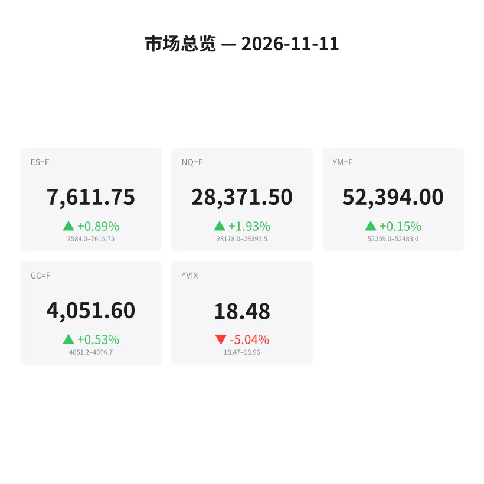
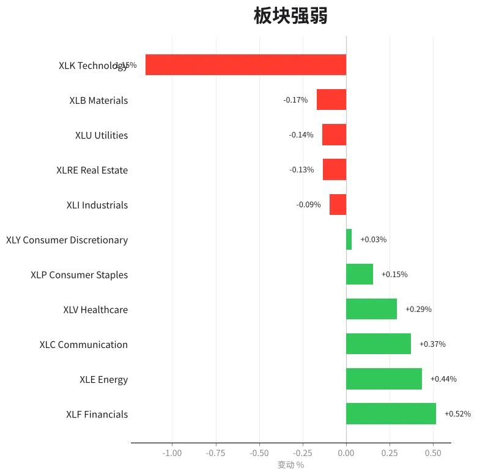
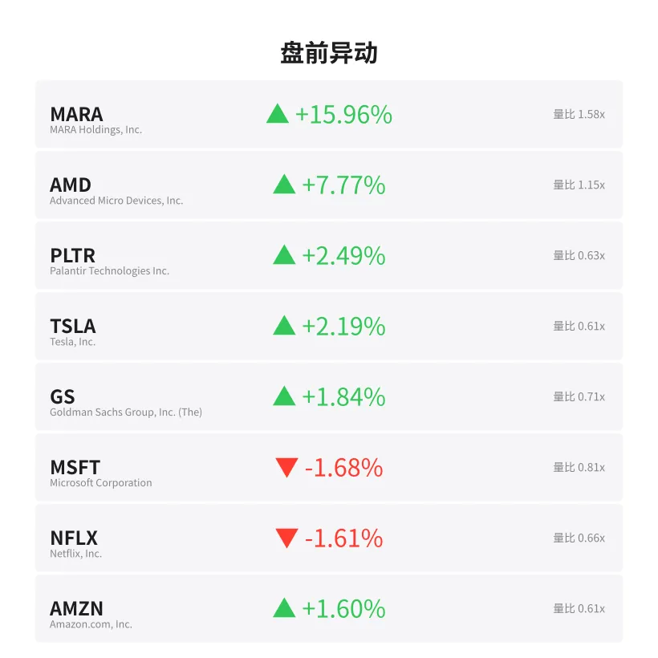
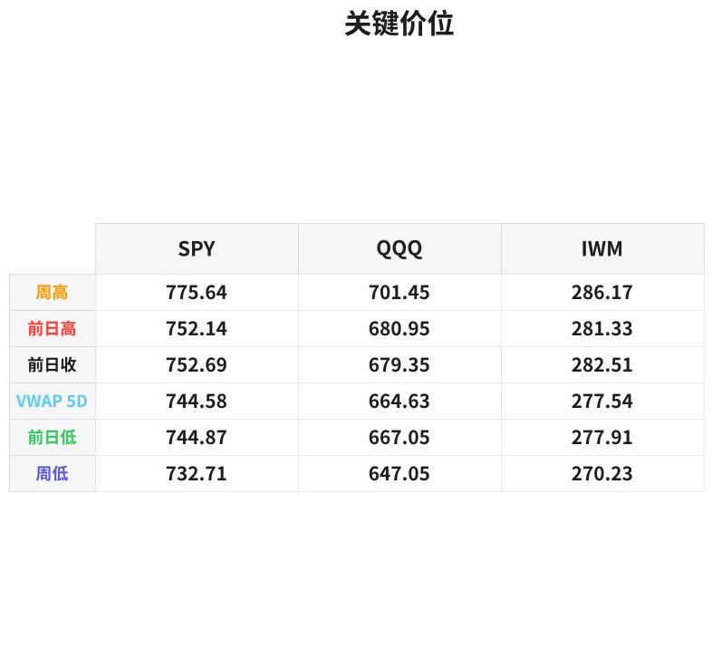

# 盘前分析报告 — 2026-11-11
*生成时间: 12:40:55 UTC*

---
## 数据速览

---
## 一、宏观环境

> [!info]- 详细数据：指数期货 & VIX
> ### 1.1 指数期货 & VIX
> | 品种 | 现价 | 涨跌幅 | 前收 | 日高 | 日低 |
> |------|------|--------|------|------|------|
> | ES=F | 7611.75 | +0.89% | 7544.25 | 7615.75 | 7547.5 |
> | NQ=F | 28371.5 | +1.93% | 27835.25 | 28393.0 | 27847.75 |
> | YM=F | 52394.0 | +0.15% | 52315.0 | 52483.0 | 52259.0 |
> | GC=F | 4051.6 | +0.53% | 4030.2 | 4074.7 | 4034.1 |
> | ^VIX | 18.48 | -5.04% | 19.46 | 18.96 | 18.47 |

> [!info]- 详细数据：隔夜走势
> ### 1.2 隔夜走势（Globex）
> | 品种 | 隔夜高 | 隔夜低 | 区间 | 亚洲高 | 亚洲低 | 欧洲高 | 欧洲低 |
> |------|--------|--------|------|--------|--------|--------|--------|
> | ES=F | 7615.75 | 7584.0 | 31.75 | 7597.5 | 7586.25 | 7615.75 | 7584.0 |
> | NQ=F | 28393.5 | 28178.0 | 215.5 | 28280.0 | 28197.75 | 28393.5 | 28178.0 |
> | YM=F | 52483.0 | 52259.0 | 224.0 | 52483.0 | 52374.0 | 52461.0 | 52259.0 |
> | GC=F | 4074.7 | 4051.2 | 23.5 | 4073.7 | 4053.0 | 4074.7 | 4051.2 |
> | ^VIX | 18.96 | 18.47 | 0.49 | — | — | 18.96 | 18.47 |

> [!info]- 详细数据：板块强弱
> ### 1.3 板块强弱
> | ETF | 板块 | 涨跌幅 |
> |-----|------|--------|
> | XLF | Financials | +0.52% |
> | XLE | Energy | +0.44% |
> | XLC | Communication | +0.37% |
> | XLV | Healthcare | +0.29% |
> | XLP | Consumer Staples | +0.15% |
> | XLY | Consumer Discretionary | +0.03% |
> | XLI | Industrials | -0.09% |
> | XLRE | Real Estate | -0.13% |
> | XLU | Utilities | -0.14% |
> | XLB | Materials | -0.17% |
> | XLK | Technology | -1.15% |

---
## 二、消息面

- **AMD获7.09亿美元资金逆转，主要ETF大举买入** — *GuruFocus.com*
  > AMD sees $709 million reversal as major ETFs pile in
- **美光大幅抛售后吸引5.54亿美元ETF买入** — *GuruFocus.com*
  > Micron draws $554 million in ETF buying after steep selloff
- **67岁退休、单身、无子女可依？投资组合是唯一后盾，这3只ETF专为此而生** — *24/7 Wall St.*
  > Retired at 67, Single, With No Kids to Call if the Money Runs Short? The Portfolio Is the Only Backup. These 3 ETFs Are Built to Be It
- **SPDR标普500 ETF (SPY) 周一增持苹果和英伟达** — *GuruFocus.com*
  > SPDR S&P 500 ETF (SPY) Adds Apple and Nvidia on Monday
- **ETF周一买入2.314亿美元泛林集团(LRCX)** — *GuruFocus.com*
  > ETFs Bought $231.4 Million of Lam Research (LRCX) on Monday
- **Invesco QQQ信托(QQQ) 11月9日再度买入2.067亿美元苹果** — *GuruFocus.com*
  > Invesco QQQ Trust (QQQ) Buys $206.7 Million More Apple on Nov. 9
- **Marvell (MRVL) 周一获2.226亿美元ETF净买入** — *GuruFocus.com*
  > Marvell (MRVL) Sees $222.6 Million in Net ETF Buying on Monday
- **Tom Lee称VIX信号指向股市底部** — *BeInCrypto*
  > Tom Lee Says a VIX Signal Points to a Stock Market Bottom
- **美股指数收复大选后跌幅，成长板块强劲反弹，原油下跌** — *MT Newswires*
  > Update: US Equity Indexes Recover Post-Election Losses as Growth Sectors Rally Hard While Crude Oil Sinks
- **股市正在崩盘？历史表明最聪明的投资者正在做这一简单操作** — *Motley Fool*
  > The Stock Market Is Crashing. History Says the Smartest Investors Are Making This 1 Simple Move.
- **美股指数大涨，成长板块强劲反弹，原油下跌** — *MT Newswires*
  > Update: US Equity Indexes Jump as Growth Sectors Rally Hard While Crude Oil Sinks
- **美股指数跳涨，成长板块发力反弹，原油走低** — *MT Newswires*
  > Update: US Equity Indexes Jump as Growth Sectors Stage Rally Amid Sliding Crude Oil
- **今日金价（2026年11月11日）：通胀担忧扩大，金价回落** — *Yahoo Personal Finance*
  > Gold price today, Wednesday, November 11, 2026: Gold prices fall back as inflation concerns broaden
- **Ariana Resources董事总经理谈VFEX上市及Dendere支持的Dokwe融资推进** — *Proactive*
  > Ariana Resources MD on VFEX listing and Dendere-backed funding push for Dokwe
- **投资者评估美联储加息预期，金价回升至4040美元上方** — *InvestorsHub*
  > Gold Prices Recover Above $4,040 as Investors Assess Federal Reserve Rate Hike Expectations
- **黄金长期前景依然看好** — *The Wall Street Journal*
  > Gold’s Outlook Remains Compelling in Long Term
- **重稀土为何对美国至关重要？** — *Simply Wall St.*
  > What Makes Heavy Rare Earths A Critical Element For America?
- **今日股市：AI恐慌消退，道指大涨，标普500、纳斯达克上涨** — *Yahoo Finance*
  > Stock market today: Dow jumps, S&P 500, Nasdaq gain as AI jitters fade
- **今日股市：油价上涨，道指、标普500、纳斯达克下滑，Alphabet和特斯拉财报受关注** — *Yahoo Finance*
  > Stock market today: Dow, S&P 500, Nasdaq slip as oil prices rise, Alphabet and Tesla earnings in focus
- **今日股市：AI乐观情绪重燃，道指创新高，标普500和纳斯达克大涨** — *Yahoo Finance*
  > Stock market today: Dow posts record, S&P 500 and Nasdaq rally on revived AI optimism

---
## 三、盘前异动

> [!info]- 详细数据：盘前异动
> | 代码 | 名称 | 现价 | 缺口 | 量比 |
> |------|------|------|------|------|
> | MARA | MARA Holdings, Inc. | 7.7 | +15.96% | 1.58x |
> | AMD | Advanced Micro Devices, Inc. | 548.1 | +7.77% | 1.15x |
> | PLTR | Palantir Technologies Inc. | 173.42 | +2.49% | 0.63x |
> | TSLA | Tesla, Inc. | 386.32 | +2.19% | 0.61x |
> | GS | Goldman Sachs Group, Inc. (The) | 922.85 | +1.84% | 0.71x |
> | MSFT | Microsoft Corporation | 536.0 | -1.68% | 0.81x |
> | NFLX | Netflix, Inc. | 62.92 | -1.61% | 0.66x |
> | AMZN | Amazon.com, Inc. | 271.2 | +1.60% | 0.61x |
> | NVDA | NVIDIA Corporation | 176.05 | -1.47% | 2.06x |

---
## 四、关键价位

> [!info]- 详细数据：SPY 关键价位
> ### SPY
> | 价位类型 | 价格 |
> |----------|------|
> | Prior Day High | 752.139 |
> | Prior Day Low | 744.87 |
> | Prior Day Close | 752.69 |
> | Premarket Price | 756.89 |
> | Approx Vwap 5D | 744.58 |
> | Weekly High | 775.64 |
> | Weekly Low | 732.71 |

> [!info]- 详细数据：QQQ 关键价位
> ### QQQ
> | 价位类型 | 价格 |
> |----------|------|
> | Prior Day High | 680.9499 |
> | Prior Day Low | 667.0501 |
> | Prior Day Close | 679.35 |
> | Premarket Price | 688.1618 |
> | Approx Vwap 5D | 664.63 |
> | Weekly High | 701.45 |
> | Weekly Low | 647.05 |

> [!info]- 详细数据：IWM 关键价位
> ### IWM
> | 价位类型 | 价格 |
> |----------|------|
> | Prior Day High | 281.33 |
> | Prior Day Low | 277.91 |
> | Prior Day Close | 282.51 |
> | Premarket Price | 282.8697 |
> | Approx Vwap 5D | 277.54 |
> | Weekly High | 286.17 |
> | Weekly Low | 270.23 |

---
## 五、AI 技术分析 & 操盘建议

## 第一部分：隔夜市场回顾

### 亚洲时段（18:00–02:00 ET）

亚洲时段整体窄幅震荡偏强。ES在7586.25–7597.5之间运行，区间仅11.25点，买方在前收盘7544.25上方牢牢守住阵地。NQ相对活跃，在28197.75–28280之间波动约82点，科技股隔夜卖压有限。YM表现最强，亚洲高点52483即为隔夜最高点，显示价值股在亚洲盘受到追捧。GC（黄金）在4053–4073.7之间运行，多空博弈较为激烈。

**关键信号**: 亚洲时段ES和NQ未回测前收价位，买方底部支撑扎实，暗示美盘开盘多头占优。

### 欧洲时段（02:00–09:30 ET）

欧洲时段波动明显放大。ES区间扩展至7584–7615.75（31.75点），且最终收在区间高位附近，显示欧洲资金入场后买盘积极。NQ在欧洲时段创下隔夜新高28393.5，区间达215.5点，科技权重领涨态势明确。YM反而在欧洲时段回落至52259低点（即隔夜最低），道指成份中存在一定获利回吐。GC在欧洲时段也触及隔夜高点4074.7，但随后回落至4051.2附近，避险情绪有所降温。

**关键信号**: NQ欧洲时段强势突破创新高，ES紧随其后，但YM相对疲软形成分化——这意味着科技/成长权重是本轮反弹的核心驱动力。

### 对美盘的启示

1. **VIX大幅回落至18.48（-5.04%）**：恐慌指数显著下降，市场风险偏好明显回升，有利于日内趋势行情的展开
2. **NQ领涨格局确立**: NQ涨幅+1.93%远超ES的+0.89%和YM的+0.15%，科技股是当前主线
3. **板块分化显著**: XLK反而跌-1.15%（与NQ涨幅矛盾，可能是个股权重调仓效应），XLF(+0.52%)和XLE(+0.44%)领涨，传统板块补涨迹象明显
4. **ETF资金流极为活跃**: AMD获7.09亿美元逆转买入，美光5.54亿，Marvell 2.226亿——半导体板块资金大幅回流
5. **金价回落至4051附近**: 通胀预期升温但避险需求降温，股市risk-on环境确认

## 第二部分：期货品种分析

### ES（E-mini S&P 500）— 现价 7611.75

**多时间框架分析:**
- **日线**: 前收7544.25，今日跳空高开+67.5点（+0.89%），已突破上周五高点区域。日线级别形成明确的gap-up突破结构，若收盘站稳7580以上则确认日线多头延续。
- **4H**: 从上周低点7325区域（假设周低附近）强势反弹，连续多根阳线，动能强劲。当前价位接近隔夜高点7615.75，处于短期超买但趋势极强的状态。
- **1H/15min**: 欧洲时段在7584触底后单边拉升至7615.75，15分钟级别形成陡峭的上升通道。

**关键价位:**
| 类型 | 价位 | 说明 |
|------|------|------|
| 隔夜高点 (ONH) | 7615.75 | 首要阻力，突破则开启新空间 |
| 开盘缺口上沿 | 7611.75 | 当前价位，缺口若不回补则极强 |
| 欧洲低点 | 7584.0 | 日内关键支撑，破位则缺口可能回补 |
| 亚洲低点 | 7586.25 | 与欧洲低点形成支撑区间 |
| 前收盘 (PDC) | 7544.25 | 缺口完全回补位，极端支撑 |
| 前日高 (PDH) | 7544+ | 缺口下沿参考 |

**方向偏多 | 置信度: 75%**

**交易计划:**
- **主策略（做多回踩）**: 等待开盘后回踩7590–7600区域（隔夜VWAP附近），确认支撑后做多
  - 入场区间: 7590–7600
  - 止损: 7580（欧洲低点下方）
  - T1: 7625（隔夜高点突破）
  - T2: 7650（心理整数位+延伸目标）
- **备选策略（突破追多）**: 若直接突破7616且放量确认，可在回踩7616时做多
  - 止损: 7605
  - T1: 7640
  - T2: 7660
- **失效条件**: 若开盘30分钟内跌破7580并放量，则转为观望或轻仓试空至7550

### NQ（E-mini Nasdaq 100）— 现价 28371.5

**多时间框架分析:**
- **日线**: 前收27835.25，跳空高开+536.25点（+1.93%），这是一个显著的gap-up。日线上形成强势突破缺口，若持续走高则有望测试28500–28600区域。
- **4H**: NQ的反弹幅度远超ES，显示科技权重驱动力极强。AMD(+7.77%)、MARA(+15.96%)等个股大幅跳空，拉动指数。
- **1H/15min**: 欧洲时段从28178拉升至28393.5，涨幅超215点，走势极其陡峭。短期有回踩需求，但趋势方向明确看多。

**关键价位:**
| 类型 | 价位 | 说明 |
|------|------|------|
| 隔夜高点 (ONH) | 28393.5 | 首要阻力 |
| 当前价位 | 28371.5 | 略低于ONH |
| 亚洲高点 | 28280.0 | 日内回踩第一支撑 |
| 欧洲低点 | 28178.0 | 关键支撑，破位则缺口承压 |
| 前收盘 (PDC) | 27835.25 | 缺口回补位，极端支撑 |

**方向偏多 | 置信度: 70%**

（置信度略低于ES，因为NQ涨幅过大，短期回踩风险更高）

**交易计划:**
- **主策略（做多回踩）**: 等待回踩28250–28300区域（亚洲高点附近+隔夜VWAP）
  - 入场区间: 28250–28300
  - 止损: 28160（欧洲低点下方）
  - T1: 28400（隔夜高点突破）
  - T2: 28550（延伸目标）
- **备选策略**: 若直接突破28400且量价配合，回踩28400做多
  - 止损: 28320
  - T1: 28550
  - T2: 28700
- **失效条件**: 若开盘后跌破28160并伴随NVDA、AMD等权重股翻绿，则NQ多头逻辑失效，转为观望

### GC（黄金期货）— 现价 4051.6

**多时间框架分析:**
- **日线**: 前收4030.2，今日高开+21.4点（+0.53%）。金价从近期高点回落后企稳反弹，但幅度有限。新闻面提到"通胀担忧扩大金价回落"及"美联储加息预期"，宏观逆风仍在。
- **4H**: 隔夜在4051.2–4074.7之间宽幅震荡（23.5点区间），多空分歧较大。当前价位4051.6恰好在隔夜区间低位，空方暂时占优。
- **1H/15min**: 欧洲时段冲高4074.7后快速回落至4051附近，形成"冲高回落"的弱势结构。

**关键价位:**
| 类型 | 价位 | 说明 |
|------|------|------|
| 隔夜高点 (ONH) | 4074.7 | 强阻力 |
| 亚洲高点 | 4073.7 | 与ONH形成双重阻力 |
| 当前价位 | 4051.6 | 隔夜区间低位 |
| 隔夜低点 (ONL) | 4051.2 | 临界支撑，跌破则看4030 |
| 前收盘 (PDC) | 4030.2 | 缺口回补位 |

**方向中性偏空 | 置信度: 60%**

**交易计划:**
- **主策略（做空反弹）**: 若反弹至4065–4072区域受阻（隔夜VWAP+亚洲高点附近），可轻仓做空
  - 入场区间: 4065–4072
  - 止损: 4078（隔夜高点上方）
  - T1: 4045
  - T2: 4032（前收盘附近）
- **备选策略（突破追多）**: 若强势突破4075并站稳，则跟多至4090–4100
- **失效条件**: 若股市突然大幅回落（ES跌破7570），黄金可能因避险重新走强，需放弃空头思路

## 第三部分：ETF品种分析

### SPY — 盘前 756.89

**关键价位:**
| 类型 | 价位 | 说明 |
|------|------|------|
| 周高 | 775.64 | 上方强阻力区 |
| 盘前价 | 756.89 | 跳空高开+4.2点（+0.56%） |
| 前日高 (PDH) | 752.14 | 缺口上沿，开盘后回踩支撑 |
| 前收盘 (PDC) | 752.69 | 与PDH形成支撑簇 |
| 5日VWAP | 744.58 | 中期均衡价位 |
| 前日低 (PDL) | 744.87 | 与5D VWAP重合，强支撑 |
| 周低 | 732.71 | 极端支撑 |

**交易计划:**
- **做多回踩**: 开盘后若回踩753–754区域（PDH/PDC附近），确认企稳后做多
  - 入场: 753.0–754.0
  - 止损: 751.5
  - T1: 758.0
  - T2: 762.0
- **突破追多**: 若直接突破757.5放量，回踩757做多
  - 止损: 755.5
  - T1: 762.0
  - T2: 768.0
- **注意**: SPY盘前涨幅低于QQQ，与ES走势一致。若NQ/QQQ领涨持续，SPY可能跟随但弹性不如QQQ

### QQQ — 盘前 688.16

**关键价位:**
| 类型 | 价位 | 说明 |
|------|------|------|
| 周高 | 701.45 | 上方强阻力 |
| 盘前价 | 688.16 | 跳空高开+8.81点（+1.30%） |
| 前日高 (PDH) | 680.95 | 缺口上沿 |
| 前收盘 (PDC) | 679.35 | 关键支撑 |
| 5日VWAP | 664.63 | 中期均衡 |
| 前日低 (PDL) | 667.05 | 深度回调支撑 |
| 周低 | 647.05 | 极端支撑 |

**交易计划:**
- **做多回踩**: 开盘后回踩682–684区域（PDH上方+缺口内），确认支撑后做多
  - 入场: 682.0–684.0
  - 止损: 679.0（PDC下方）
  - T1: 690.0
  - T2: 695.0
- **突破追多**: 若站稳690上方放量，回踩690做多
  - 止损: 686.0
  - T1: 697.0
  - T2: 701.0（周高）
- **风险提示**: QQQ缺口+8.81点，日内缺口部分回补的概率约60%。若NVDA（盘前-1.47%）和MSFT（盘前-1.68%）在正式开盘后继续走弱，QQQ可能面临回补缺口至680附近的压力

## 第四部分：今日市场总览

### 整体情绪评估

**情绪: 偏乐观 (Risk-On)**

多重信号共同指向市场风险偏好回升：
1. VIX从19.46大幅回落至18.48（-5.04%），恐慌显著消退
2. 三大股指期货全线高开，NQ领涨+1.93%
3. ETF资金流显示机构在大幅买入半导体板块（AMD 7.09亿、美光5.54亿）
4. Tom Lee提到VIX信号指向市场底部，与价格走势互相验证
5. 新闻面"AI恐慌消退"、"成长板块强劲反弹"的叙事基调一致

### VIX分析

VIX 18.48处于正常波动区间（15–20），跌幅-5.04%意味着期权市场隐含波动率快速下降。这对日内操盘的影响：
- **正面**: VIX下降利于趋势延续，日内走出单边行情的概率增大
- **注意**: VIX仍在18以上（非极低水平），若午盘后VIX反弹至19以上，需警惕尾盘反转风险
- **建议**: 今日可适当放大仓位，但在VIX跌破17之前不宜过度激进

### 需回避的时间窗口

| 时间 (ET) | 事件/原因 | 建议 |
|-----------|----------|------|
| 09:30–09:45 | 开盘波动期，缺口方向确认 | 观察不操作 |
| 10:00 | 可能有经济数据发布 | 提前平仓或缩小仓位 |
| 11:30–12:00 | 午间流动性下降 | 减少交易频率 |
| 15:00–15:15 | MOC imbalance 公布 | 注意尾盘方向变化 |

### 板块轮动观察

今日板块分化格局值得关注：
- **领涨**: XLF(+0.52%)、XLE(+0.44%)、XLC(+0.37%) — 金融、能源、通信三大传统板块领涨，显示资金从科技板块向价值板块轮动
- **落后**: XLK(-1.15%) — 科技板块ETF反而下跌，这与NQ(+1.93%)的强势形成反差。原因可能是权重股调仓（苹果/微软/英伟达盘前均有不同程度回调），而中小盘科技股（AMD+7.77%等）强势拉升
- **机会**: 关注金融板块(XLF)内的个股机会，GS盘前+1.84%；能源板块若原油企稳也有交易机会

### 盘前异动解读

- **MARA +15.96%**: 加密货币相关股暴涨，需关注比特币价格走势作为验证
- **AMD +7.77%**: 半导体板块资金大幅回流，7.09亿ETF买入推动。AMD可能成为今日热门日内交易标的
- **NVDA -1.47%**: 英伟达盘前小幅回调，量比2.06x表明交投活跃。若开盘后企稳可关注反弹机会
- **MSFT -1.68%**: 微软回调，与科技ETF(XLK)走弱一致。短期避开

---

### 核心交易论点

**今日核心逻辑: 科技成长股gap-up后的趋势延续交易**

> 在VIX大幅回落(-5.04%)、半导体资金流显著回暖、NQ领涨(+1.93%)的背景下，今日首选做多NQ/QQQ的回踩入场机会。ES/SPY作为辅助品种，弹性不如NQ但胜在稳健。GC偏弱，可作为对冲工具轻仓做空。关键观察: 开盘前15分钟确认缺口方向——若NQ守住28250则多头延续，若跌破28160则全面转为防守。

**风控提醒**: 今日缺口较大，严格遵守止损纪律。单笔亏损不超过账户1%，总敞口不超过3%。若连续两笔止损出局，当日停止交易。
