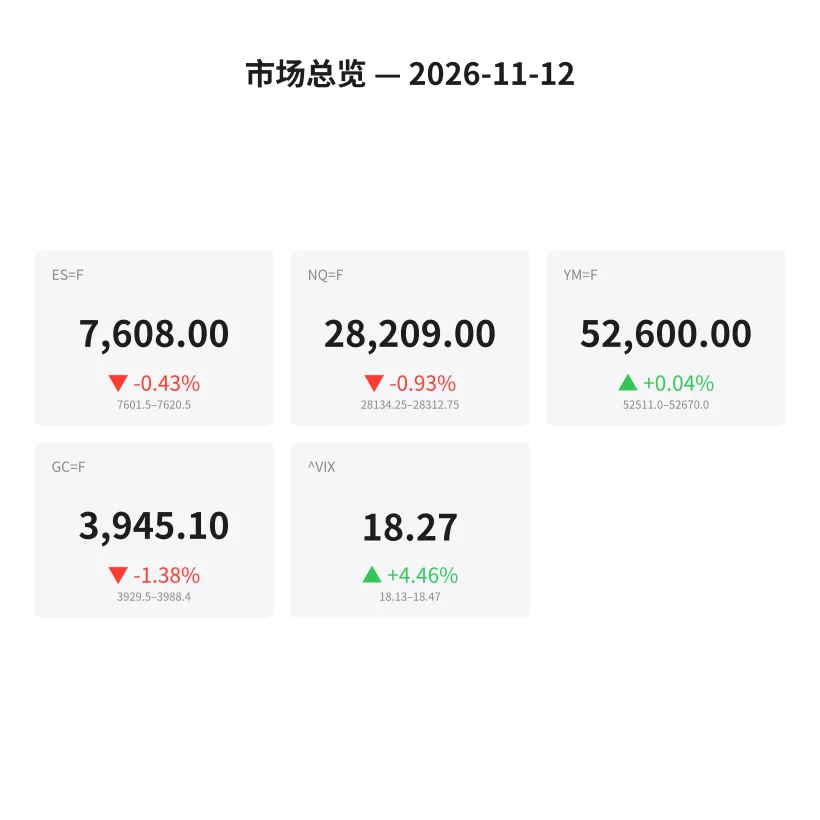
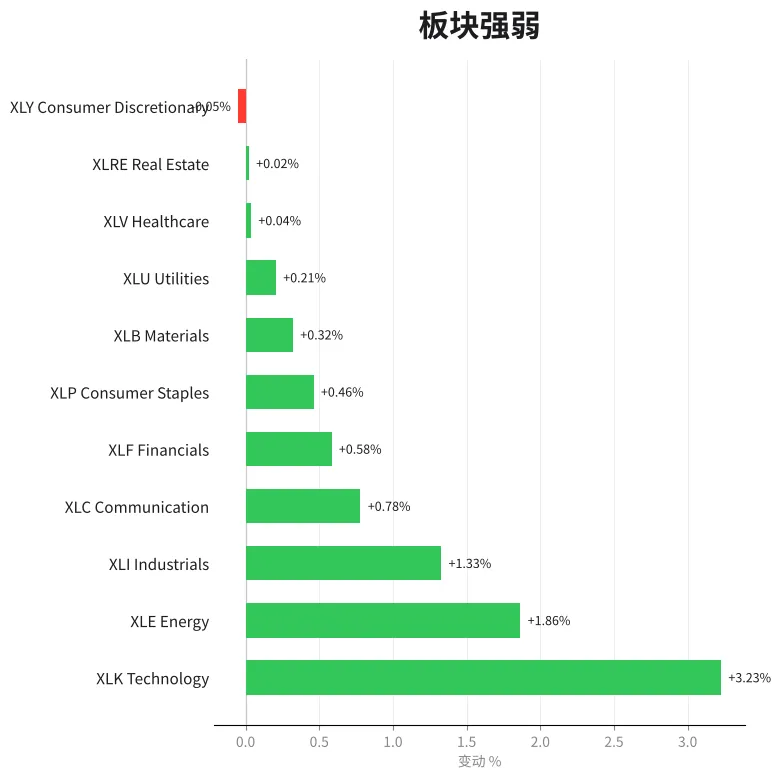
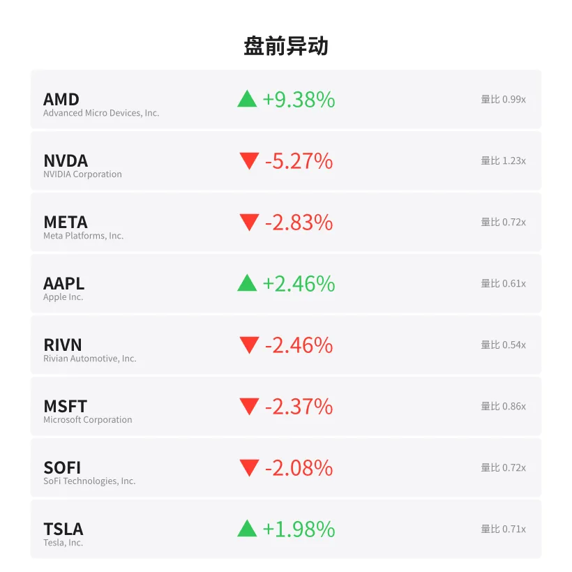
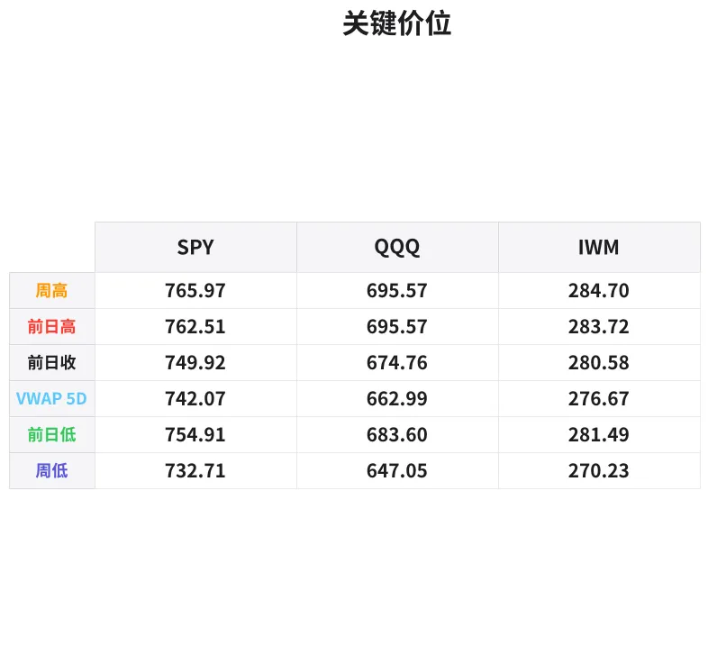

# 盘前分析报告 — 2026-11-12
*生成时间: 12:41:03 UTC*

---
## 数据速览

---
## 一、宏观环境

> [!info]- 详细数据：指数期货 & VIX
> ### 1.1 指数期货 & VIX
> | 品种 | 现价 | 涨跌幅 | 前收 | 日高 | 日低 |
> |------|------|--------|------|------|------|
> | ES=F | 7608.0 | -0.43% | 7640.5 | 7628.0 | 7600.5 |
> | NQ=F | 28209.0 | -0.93% | 28473.25 | 28368.5 | 28131.75 |
> | YM=F | 52600.0 | +0.04% | 52578.0 | 52696.0 | 52513.0 |
> | GC=F | 3945.1 | -1.38% | 4000.5 | 4005.9 | 3929.5 |
> | ^VIX | 18.27 | +4.46% | 17.49 | 18.47 | 18.13 |

> [!info]- 详细数据：隔夜走势
> ### 1.2 隔夜走势（Globex）
> | 品种 | 隔夜高 | 隔夜低 | 区间 | 亚洲高 | 亚洲低 | 欧洲高 | 欧洲低 |
> |------|--------|--------|------|--------|--------|--------|--------|
> | ES=F | 7620.5 | 7601.5 | 19.0 | 7613.25 | 7601.5 | 7620.5 | 7601.5 |
> | NQ=F | 28312.75 | 28134.25 | 178.5 | 28231.0 | 28134.25 | 28312.75 | 28168.0 |
> | YM=F | 52670.0 | 52511.0 | 159.0 | 52666.0 | 52566.0 | 52670.0 | 52511.0 |
> | GC=F | 3988.4 | 3929.5 | 58.9 | 3988.4 | 3967.7 | 3978.0 | 3929.5 |
> | ^VIX | 18.47 | 18.13 | 0.34 | — | — | 18.47 | 18.13 |

> [!info]- 详细数据：板块强弱
> ### 1.3 板块强弱
> | ETF | 板块 | 涨跌幅 |
> |-----|------|--------|
> | XLK | Technology | +3.23% |
> | XLE | Energy | +1.86% |
> | XLI | Industrials | +1.33% |
> | XLC | Communication | +0.78% |
> | XLF | Financials | +0.58% |
> | XLP | Consumer Staples | +0.46% |
> | XLB | Materials | +0.32% |
> | XLU | Utilities | +0.21% |
> | XLV | Healthcare | +0.04% |
> | XLRE | Real Estate | +0.02% |
> | XLY | Consumer Discretionary | -0.05% |

---
## 二、消息面

- **希捷作为AI硬件需求标的的合理性即将迎来考验** — *24/7 Wall St.*
  > Seagate’s Legitimacy as a Play on AI Hardware Demand is About To Be Tested
- **SPDR S&P 500 ETF (SPY) 11月10日买入标的：苹果领涨** — *GuruFocus.com*
  > What SPDR S&P 500 ETF (SPY) Bought: Apple Leads on Nov. 10
- **ETF在11月10日净卖出Dominion Energy (D)** — *GuruFocus.com*
  > ETFs Are Net Sellers of Dominion (D) on Nov. 10
- **45只ETF在周二增持安进 (AMGN)** — *GuruFocus.com*
  > 45 ETFs Add to Amgen (AMGN) Holdings on Tuesday
- **48只ETF在11月10日增持思科 (CSCO)** — *GuruFocus.com*
  > 48 ETFs Add to Cisco (CSCO) Holdings on Nov. 10
- **Invesco QQQ (QQQ) 周二增持苹果和英伟达** — *GuruFocus.com*
  > INVESCO QQQ (QQQ) Adds Apple and NVIDIA on Tuesday
- **ETF在11月10日买入8380万美元Alphabet (GOOG)** — *GuruFocus.com*
  > ETFs Bought $83.8 Million of Alphabet (GOOG) on Nov. 10
- **ETF在11月10日买入8890万美元Costco (COST)** — *GuruFocus.com*
  > ETFs Bought $88.9 Million of Costco (COST) on Nov. 10
- **Tom Lee称VIX信号暗示股市已触底** — *BeInCrypto*
  > Tom Lee Says a VIX Signal Points to a Stock Market Bottom
- **美股指数收复选后跌幅，成长板块强势反弹，原油下跌** — *MT Newswires*
  > Update: US Equity Indexes Recover Post-Election Losses as Growth Sectors Rally Hard While Crude Oil Sinks
- **股市正在崩盘，历史表明最聪明的投资者正在做这一件简单的事** — *Motley Fool*
  > The Stock Market Is Crashing. History Says the Smartest Investors Are Making This 1 Simple Move.
- **美股指数跳涨，成长板块强力反弹，原油下挫** — *MT Newswires*
  > Update: US Equity Indexes Jump as Growth Sectors Rally Hard While Crude Oil Sinks
- **美股指数跳涨，成长板块发力反弹，原油持续走低** — *MT Newswires*
  > Update: US Equity Indexes Jump as Growth Sectors Stage Rally Amid Sliding Crude Oil
- **今日金价（2026年11月12日周四）：加息预期凝聚，金价再度跌破4000美元** — *Yahoo Personal Finance*
  > Gold prices today, Thursday, November 12, 2026: Prices open back under $4,000 as rate hikes crystallize
- **Graham Stephan抨击特朗普10%信用卡利率上限为"纯表演"** — *Moneywise*
  > ‘This will never happen’: Graham Stephan slams Trump’s 10% credit card cap as ‘pure performance.’ Cut your rates
- **Caledonia矿业季度营收创新高，Blanket矿产量恢复** — *Proactive*
  > Caledonia posts record quarterly revenue as Blanket mine output recovers and Cavendish keeps 4,230p target
- **黄金再度跌破4000美元，周五通胀数据会否加剧跌势？** — *BeInCrypto*
  > Gold Drops Below $4,000 Again. Will Friday’s Inflation Data Deepen the Slide?
- **Caledonia Mining、Strategic Minerals、Tooru、Galliford Try、Arrow Exploration、Buccaneer Energy** — *Proactive*
  > Caledonia Mining, Strategic Minerals, Tooru, Galliford Try, Arrow Exploration, Buccaneer Energy
- **今日股市：道指跳涨，标普500与纳指上扬，AI恐慌消退** — *Yahoo Finance*
  > Stock market today: Dow jumps, S&P 500, Nasdaq gain as AI jitters fade
- **今日股市：道指、标普500、纳指下滑，油价上涨，Alphabet与特斯拉财报受关注** — *Yahoo Finance*
  > Stock market today: Dow, S&P 500, Nasdaq slip as oil prices rise, Alphabet and Tesla earnings in focus

---
## 三、盘前异动

> [!info]- 详细数据：盘前异动
> | 代码 | 名称 | 现价 | 缺口 | 量比 |
> |------|------|------|------|------|
> | AMD | Advanced Micro Devices, Inc. | 563.55 | +9.38% | 0.99x |
> | NVDA | NVIDIA Corporation | 159.9 | -5.27% | 1.23x |
> | META | Meta Platforms, Inc. | 623.23 | -2.83% | 0.72x |
> | AAPL | Apple Inc. | 357.1 | +2.46% | 0.61x |
> | RIVN | Rivian Automotive, Inc. | 13.36 | -2.46% | 0.54x |
> | MSFT | Microsoft Corporation | 520.5 | -2.37% | 0.86x |
> | SOFI | SoFi Technologies, Inc. | 16.03 | -2.08% | 0.72x |
> | TSLA | Tesla, Inc. | 387.3 | +1.98% | 0.71x |
> | XOM | ExxonMobil Holdings Corporation | 167.61 | +1.91% | 0.81x |
> | GS | Goldman Sachs Group, Inc. (The) | 927.37 | +1.89% | 0.67x |

---
## 四、关键价位

> [!info]- 详细数据：SPY 关键价位
> ### SPY
> | 价位类型 | 价格 |
> |----------|------|
> | Prior Day High | 762.51 |
> | Prior Day Low | 754.91 |
> | Prior Day Close | 749.92 |
> | Premarket Price | 756.31 |
> | Approx Vwap 5D | 742.07 |
> | Weekly High | 765.97 |
> | Weekly Low | 732.71 |

> [!info]- 详细数据：QQQ 关键价位
> ### QQQ
> | 价位类型 | 价格 |
> |----------|------|
> | Prior Day High | 695.57 |
> | Prior Day Low | 683.6 |
> | Prior Day Close | 674.76 |
> | Premarket Price | 683.29 |
> | Approx Vwap 5D | 662.99 |
> | Weekly High | 695.57 |
> | Weekly Low | 647.05 |

> [!info]- 详细数据：IWM 关键价位
> ### IWM
> | 价位类型 | 价格 |
> |----------|------|
> | Prior Day High | 283.72 |
> | Prior Day Low | 281.485 |
> | Prior Day Close | 280.58 |
> | Premarket Price | 282.68 |
> | Approx Vwap 5D | 276.67 |
> | Weekly High | 284.7 |
> | Weekly Low | 270.23 |

---
## 五、AI 技术分析 & 操盘建议

## 第一部分：隔夜市场回顾

### 亚洲时段（18:00–02:00 ET）
- **ES** 在亚洲时段窄幅震荡，区间 7601.5–7613.25（仅12点），卖压主导，未能回补前收缺口。NQ 表现更弱，亚洲低点 28134.25 即为隔夜低点，科技股抛压从亚洲延续。
- **GC** 亚洲时段高点 3988.4 为隔夜最高，之后一路走低，显示亚洲买盘无力维持 4000 上方。
- **解读**：亚洲时段缺乏承接意愿，多头未能在前收附近建立支撑，暗示美盘前卖方仍占优。

### 欧洲时段（02:00–09:30 ET）
- **ES** 欧洲时段高点 7620.5 为隔夜最高，但随后回落，未能突破前收 7640.5，形成 lower high 结构。区间仍为 7601.5–7620.5。
- **NQ** 欧洲时段出现一波反弹至 28312.75（隔夜高），但力度有限，显示科技股在此价位面临抛压。
- **GC** 欧洲时段跌幅加速，从 3978 跌至 3929.5，跌破 3950 关键支撑，显示空头主导。
- **解读**：欧洲时段 ES/NQ 尝试反弹但未能收复前收，黄金加速下跌。成长/科技板块昨日大涨（XLK +3.23%）后，今日盘前出现获利了结压力，尤其 NVDA -5.27%。

### 对美盘的影响
- 隔夜整体偏空，ES/NQ 均在前收下方运行，缺口未回补。
- VIX 升至 18.27（+4.46%），波动率回升暗示市场不确定性增加。
- 但板块分化明显：AMD +9.38% vs NVDA -5.27%，资金在 AI 板块内部轮动而非全面撤退。
- 关注开盘后 ES 是否能回补至 7640 上方，若不能则有继续下探 7580–7600 的风险。

## 第二部分：期货品种分析

### ES（E-mini S&P 500 期货）— 现价 7608.0

**多时间框架分析：**
- **日线**：昨日收盘 7640.5，今日盘前低开 -0.43%。前日大涨后出现回调属正常，但需观察是否守住 7600 整数关口。日线结构仍为上升趋势中的回撤。
- **4H**：从隔夜走势看，7601.5 为多次测试的支撑位，7620.5 为短期阻力。4H 级别形成下降通道。
- **1H/15min**：关注开盘后 7600 的争夺，这是隔夜低点附近的关键位。

**关键价位：**
| 类型 | 价位 | 备注 |
|------|------|------|
| 隔夜高 | 7620.5 | 欧洲时段高点，短期阻力 |
| 隔夜低 | 7601.5 | 多次测试支撑 |
| 前收 | 7640.5 | 缺口回补目标 |
| 关键支撑 | 7580 | 跌破隔夜低后的下一目标 |
| 关键阻力 | 7650 | 突破前收后的上方目标 |

**方向偏向**：偏空，置信度 65%
- 隔夜持续在前收下方运行，VIX 上升，缺口未回补概率较高。
- 但 YM 微涨 +0.04%，板块轮动（非全面抛售），限制下行空间。

**交易计划：**
- **做空入场区**：7618–7625（反弹至隔夜高/VWAP 附近）
- **止损**：7642（前收上方）
- **T1**：7600（隔夜低测试）— 约 20 点
- **T2**：7580（扩展目标）— 约 40 点
- **失效条件**：ES 回补至 7640 上方并站稳 5 分钟以上，转为观望或反手做多。

---

### NQ（E-mini Nasdaq 100 期货）— 现价 28209.0

**多时间框架分析：**
- **日线**：前收 28473.25，今日盘前 -0.93%，科技股回调压力最大。NVDA -5.27% 为主要拖累。但 AMD +9.38% 和 AAPL +2.46% 提供对冲。
- **4H**：隔夜从高点 28312.75 一路走低，形成清晰的下降结构。28130–28135 为隔夜低点密集区。
- **1H/15min**：28200 为当前震荡中枢，关注开盘方向选择。

**关键价位：**
| 类型 | 价位 | 备注 |
|------|------|------|
| 隔夜高 | 28312.75 | 欧洲时段高点 |
| 隔夜低 | 28134.25 | 亚洲时段低点，关键支撑 |
| 前收 | 28473.25 | 缺口回补目标 |
| 关键支撑 | 28000 | 心理关口 |
| 关键阻力 | 28350 | 隔夜高上方 |

**方向偏向**：偏空，置信度 70%
- NQ 领跌三大指数，NVDA 财报前的获利了结+仓位调整明显。
- 隔夜区间 178.5 点，波动率高于 ES（比例上），显示不确定性集中在科技股。

**交易计划：**
- **做空入场区**：28280–28320（反弹至隔夜高附近）
- **止损**：28380（前收-100 点上方）
- **T1**：28135（隔夜低重新测试）— 约 150 点
- **T2**：28000（心理关口）— 约 280 点
- **失效条件**：NQ 突破 28350 并持续走高，NVDA 盘前转正，则放弃做空。

---

### GC（黄金期货）— 现价 3945.1

**多时间框架分析：**
- **日线**：前收 4000.5，今日跌破 4000 心理关口，-1.38%。新闻面确认加息预期升温导致金价承压。日线级别可能形成双顶结构（若前高在 4005 附近）。
- **4H**：亚洲时段高点 3988.4 未能突破 4000，欧洲时段加速下跌至 3929.5。4H 级别空头趋势明确。
- **1H/15min**：3945 附近有短暂企稳，但 3929.5（隔夜低）为关键支撑。

**关键价位：**
| 类型 | 价位 | 备注 |
|------|------|------|
| 隔夜高 | 3988.4 | 亚洲高，未突破 4000 |
| 隔夜低 | 3929.5 | 欧洲时段低，关键支撑 |
| 心理关口 | 4000 | 整数位阻力 |
| 关键支撑 | 3920 | 跌破隔夜低后的目标 |
| 关键阻力 | 3970–3980 | 欧洲高附近 |

**方向偏向**：偏空，置信度 75%
- 加息预期+美元走强双重压力，4000 已从支撑变为阻力。
- 隔夜区间 58.9 美元，波动率较高，趋势明确。

**交易计划：**
- **做空入场区**：3965–3978（反弹至欧洲高附近）
- **止损**：3992（4000 下方，留空间给假突破）
- **T1**：3930（隔夜低重新测试）— 约 35–48 美元
- **T2**：3900（扩展目标）— 约 65–78 美元
- **失效条件**：GC 重新站上 4000 并放量突破，则转为观望。周五通胀数据前可能出现空头回补。

## 第三部分：ETF品种分析

### SPY（SPDR S&P 500 ETF）— 盘前 756.31

**关键价位：**
| 类型 | 价位 | 备注 |
|------|------|------|
| 前日高 | 762.51 | 昨日高点 |
| 前日低 | 754.91 | 昨日低点，开盘关键支撑 |
| 前收 | 749.92 | 缺口上方开盘 |
| 盘前价 | 756.31 | 高于前收但低于前日高 |
| 5日VWAP | 742.07 | 中期锚点 |
| 周高 | 765.97 | 本周阻力 |
| 周低 | 732.71 | 本周终极支撑 |

**分析：**
- SPY 盘前 756.31 高于前收 749.92（缺口向上 +0.85%），但低于前日高 762.51。
- 昨日大幅反弹后，今日在 754.91–762.51 的前日区间内消化。盘前价位于前日区间中部偏下，属于正常回撤。
- 5日 VWAP 742.07 远低于当前价，显示近期反弹力度强劲，均值回归风险有限。

**交易计划：**
- **看涨情境**：开盘守住 754（前日低）并放量突破 758，目标 762–765（前日高/周高）。
- **看跌情境**：跌破 754 且无法快速收回，下看 750（前收）和 742（5日VWAP）。
- **核心策略**：754–756 区域为多空分水岭。在此区间内等待方向确认，不急于追入。

---

### QQQ（Invesco QQQ Trust）— 盘前 683.29

**关键价位：**
| 类型 | 价位 | 备注 |
|------|------|------|
| 前日高 | 695.57 | 昨日高点，本周高 |
| 前日低 | 683.60 | 昨日低点 |
| 前收 | 674.76 | 缺口上方开盘 |
| 盘前价 | 683.29 | 接近前日低 |
| 5日VWAP | 662.99 | 中期锚点 |
| 周低 | 647.05 | 本周终极支撑 |

**分析：**
- QQQ 盘前 683.29 高于前收 674.76（+1.26%），但恰好在前日低 683.60 附近，位置偏弱。
- NQ 领跌（-0.93%）拖累 QQQ，NVDA -5.27% 为主要利空。但 AMD +9.38%、AAPL +2.46% 提供板块内对冲。
- 相较 SPY，QQQ 的波动更大（周区间 647–695 约 7.5%），日内交易机会更丰富但风险也更高。

**交易计划：**
- **看涨情境**：守住 680 并突破 685，目标 690–695（前日高）。需要 NVDA 止跌企稳配合。
- **看跌情境**：跌破 680 且 NVDA 继续走弱，下看 675（前收）和 665（5日VWAP 附近）。
- **核心策略**：683 前日低为今日关键战场。开盘首 15 分钟观察 NVDA 和 AMD 的相对强弱来判断科技板块方向。QQQ 比 SPY 更适合趋势跟踪，一旦方向确立可加大仓位。

## 第四部分：今日市场总览

### 整体情绪：谨慎偏空

**VIX 分析：**
- VIX 18.27（+4.46%），从 17.49 回升。尚未进入恐慌区间（20+），但上升趋势暗示机构在买入保护。
- Tom Lee 指出 VIX 信号暗示底部——若 VIX 在 18–19 区间见顶回落，确实可能确认短期底部。但若继续攀升突破 20，则需提高警惕。
- **建议**：VIX 处于"灰色地带"（18–20），不宜重仓单边。缩小仓位，等待方向确认。

### 需要回避的时间窗口

| 时间 (ET) | 事件 | 影响 |
|-----------|------|------|
| 09:30–09:45 | 开盘波动期 | 订单簿不稳定，假突破频繁，回避开仓 |
| 10:00 | 数据公布窗口 | 关注是否有经济数据发布 |
| 12:00–13:30 | 午间流动性真空 | 成交量萎缩，容易被扫损 |
| 15:45–16:00 | 收盘前最后搏杀 | MOC 订单可能造成剧烈波动 |

### 板块轮动解读
- **科技 (XLK +3.23%)**：昨日最强板块，今日面临获利回吐。内部严重分化（AMD vs NVDA），不是普涨普跌。
- **能源 (XLE +1.86%)**：原油虽然新闻面利空（"crude oil sinks"），但 XOM +1.91%，能源板块逆势走强。关注油价与能源股的背离。
- **工业 (XLI +1.33%)**：道指 YM 盘前微涨，工业+金融板块提供支撑，显示资金向价值/周期板块轮动。
- **防御板块**：XLP/XLU/XLRE 涨幅有限（<0.5%），资金未全面转向防御，非恐慌模式。
- **消费可选 (XLY -0.05%)**：唯一微跌板块。TSLA +1.98% 但板块整体平淡，说明消费端信心不足。

### 盘前异动值得关注
- **AMD +9.38%**：可能有利好消息（AI 硬件需求+Seagate 新闻暗示 AI 硬件周期），盘前最大异动，开盘后关注能否持续。
- **NVDA -5.27%**：科技龙头回调，对 NQ/QQQ 拖累最大。若盘中止跌则利好整体指数。
- **META -2.83% / MSFT -2.37%**：大型科技股普遍回调，印证获利了结主题。

### 核心交易论点

> **"昨日科技板块暴涨后的获利了结日——做空 NQ 反弹，耐心等待 ES 7600 支撑测试，黄金空头趋势延续。不追空，等反弹入场。"**

**风险提示：**
- 周五有通胀数据，今日尾盘可能出现提前博弈的仓位调整。
- AMD 异常强势可能改变 NQ 的空头叙事——密切关注。
- VIX 若突破 19.5，缩减所有仓位至半仓。
