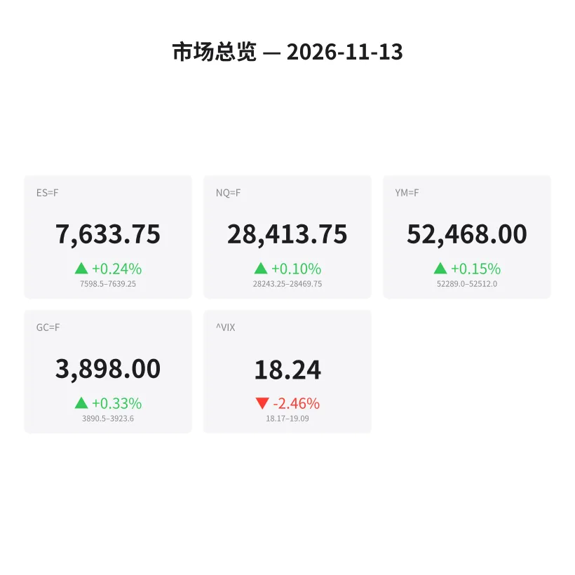
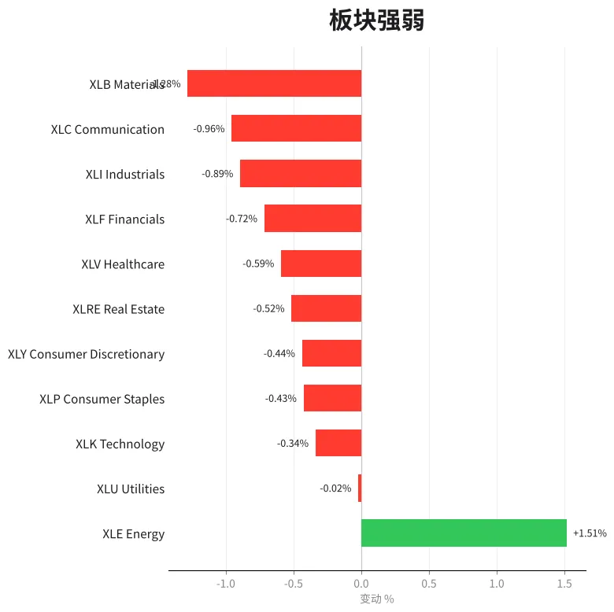
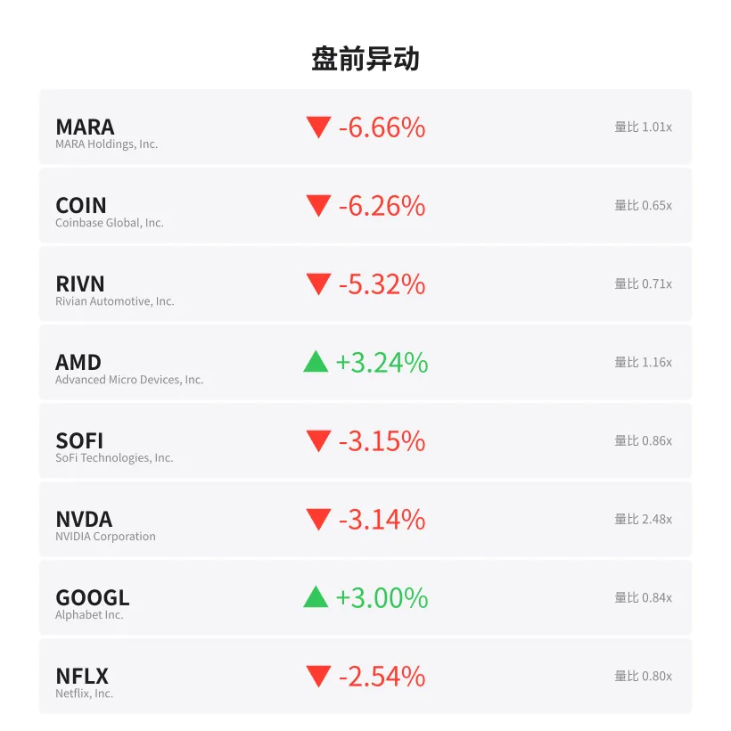
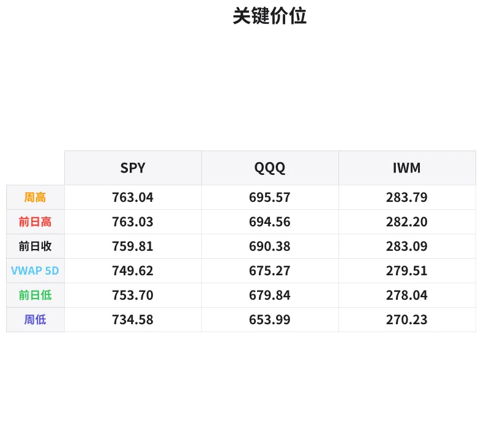

# 盘前分析报告 — 2026-11-13
*生成时间: 12:40:23 UTC*

---
## 数据速览

---
## 一、宏观环境

> [!info]- 详细数据：指数期货 & VIX
> ### 1.1 指数期货 & VIX
> | 品种 | 现价 | 涨跌幅 | 前收 | 日高 | 日低 |
> |------|------|--------|------|------|------|
> | ES=F | 7633.75 | +0.24% | 7615.25 | 7649.75 | 7598.75 |
> | NQ=F | 28413.75 | +0.10% | 28384.5 | 28607.75 | 28243.25 |
> | YM=F | 52468.0 | +0.15% | 52390.0 | 52564.0 | 52289.0 |
> | GC=F | 3898.0 | +0.33% | 3885.3 | 3926.1 | 3879.1 |
> | ^VIX | 18.24 | -2.46% | 18.7 | 19.09 | 18.17 |

> [!info]- 详细数据：隔夜走势
> ### 1.2 隔夜走势（Globex）
> | 品种 | 隔夜高 | 隔夜低 | 区间 | 亚洲高 | 亚洲低 | 欧洲高 | 欧洲低 |
> |------|--------|--------|------|--------|--------|--------|--------|
> | ES=F | 7639.25 | 7598.5 | 40.75 | 7620.75 | 7601.5 | 7639.25 | 7598.5 |
> | NQ=F | 28469.75 | 28243.25 | 226.5 | 28383.25 | 28257.25 | 28469.75 | 28243.25 |
> | YM=F | 52512.0 | 52289.0 | 223.0 | 52431.0 | 52296.0 | 52512.0 | 52289.0 |
> | GC=F | 3923.6 | 3890.5 | 33.1 | 3923.6 | 3891.8 | 3910.2 | 3890.5 |
> | ^VIX | 19.09 | 18.17 | 0.92 | — | — | 19.09 | 18.17 |

> [!info]- 详细数据：板块强弱
> ### 1.3 板块强弱
> | ETF | 板块 | 涨跌幅 |
> |-----|------|--------|
> | XLE | Energy | +1.51% |
> | XLU | Utilities | -0.02% |
> | XLK | Technology | -0.34% |
> | XLP | Consumer Staples | -0.43% |
> | XLY | Consumer Discretionary | -0.44% |
> | XLRE | Real Estate | -0.52% |
> | XLV | Healthcare | -0.59% |
> | XLF | Financials | -0.72% |
> | XLI | Industrials | -0.89% |
> | XLC | Communication | -0.96% |
> | XLB | Materials | -1.28% |

---
## 二、消息面

- **五年前投入100万美元买SCHD，现在值多少？** — *Trefis*
  > $1 Million In SCHD Five Years Ago: What Is It Worth Now?
- **英伟达占你标普500基金的6.1%，你的占比是多少？** — *Trefis*
  > Nvidia Is 6.1% Of Your S&P 500 Fund. What Is Your Number?
- **SPDR标普500 ETF (SPY) 11月11日增持苹果3.359亿美元** — *GuruFocus.com*
  > SPDR S&P 500 ETF (SPY) Buys $335.9 Million More Apple on Nov. 11
- **特斯拉(TSLA)周三获ETF净买入7620万美元** — *GuruFocus.com*
  > Tesla (TSLA) Sees $76.2 Million in Net ETF Buying on Wednesday
- **42只ETF周三增持Alphabet (GOOG)** — *GuruFocus.com*
  > 42 ETFs Add to Alphabet (GOOG) on Wednesday
- **英伟达股价下跌可能如何影响你的401(k)和投资组合** — *Yahoo Finance Video*
  > How Nvidia’s stock decline might impact your 401(k) and portfolio
- **高盛据称认为AI超大规模资本开支企业在科技抛售后"相对防御性"——预测标普500还有14%上涨空间** — *Stocktwits*
  > Goldman Sachs Reportedly Sees AI Hyperscalers As ‘Relatively Defensive’ After Tech Selloff — Forecasts 14% S&P 500 Upside
- **Invesco QQQ (QQQ) 11月11日减持苹果和英伟达** — *GuruFocus.com*
  > Invesco QQQ (QQQ) Sells Apple and NVIDIA on Nov. 11
- **ETF在11月11日净卖出Synopsys (SNPS)** — *GuruFocus.com*
  > ETFs Are Net Sellers of Synopsys (SNPS) on Nov. 11
- **股市接下来将面临真正考验** — *Barrons.com*
  > Now Comes the Hard Part for the Stock Market
- **Tom Lee称VIX信号指向股市已见底** — *BeInCrypto*
  > Tom Lee Says a VIX Signal Points to a Stock Market Bottom
- **美股指数收复大选后跌幅，成长板块强势反弹，原油下跌** — *MT Newswires*
  > Update: US Equity Indexes Recover Post-Election Losses as Growth Sectors Rally Hard While Crude Oil Sinks
- **股市正在崩盘。历史表明最聪明的投资者正在做这一件简单的事** — *Motley Fool*
  > The Stock Market Is Crashing. History Says the Smartest Investors Are Making This 1 Simple Move.
- **美股指数大涨，成长板块强势领涨，原油下挫** — *MT Newswires*
  > Update: US Equity Indexes Jump as Growth Sectors Rally Hard While Crude Oil Sinks
- **今日金价（11月13日周五）：黄金过去五天跌超4%** — *Yahoo Personal Finance*
  > Gold price today, Friday, November 13, 2026: Gold's down over 4% in the last five days
- **"所有人都必须做好准备"：市场专家警告12月冲击将令美国人面临高风险，需在12月8日前行动** — *Moneywise*
  > ‘Everybody needs to prepare’: Market expert warns of December shock that puts Americans at high risk. Act by Dec. 8
- **法兴银行称美债收益率突破关键水平，美元指数维持19个月高位附近** — *MT Newswires*
  > US Treasury Yields Rise Above Key Levels as Dollar Index Holds Near 19-Month High, SocGen Says
- **Amaroq获Panmure Liberum维持"买入"评级，盈利预期上调** — *Proactive*
  > Amaroq keeps Panmure Liberum ‘buy’ as profit forecast rises
- **Aris Mining发布圭亚那Toroparu金矿项目预可行性研究** — *Mining Technology*
  > Aris Mining releases PFS for Toroparu Gold Project in Guyana
- **今日美股：道指大涨，标普500和纳指上涨，AI恐慌情绪消退** — *Yahoo Finance*
  > Stock market today: Dow jumps, S&P 500, Nasdaq gain as AI jitters fade

---
## 三、盘前异动

> [!info]- 详细数据：盘前异动
> | 代码 | 名称 | 现价 | 缺口 | 量比 |
> |------|------|------|------|------|
> | MARA | MARA Holdings, Inc. | 7.15 | -6.66% | 1.01x |
> | COIN | Coinbase Global, Inc. | 127.74 | -6.26% | 0.65x |
> | RIVN | Rivian Automotive, Inc. | 12.82 | -5.32% | 0.71x |
> | AMD | Advanced Micro Devices, Inc. | 570.83 | +3.24% | 1.16x |
> | SOFI | SoFi Technologies, Inc. | 15.76 | -3.15% | 0.86x |
> | NVDA | NVIDIA Corporation | 168.27 | -3.14% | 2.48x |
> | GOOGL | Alphabet Inc. | 302.26 | +3.00% | 0.84x |
> | NFLX | Netflix, Inc. | 62.9 | -2.54% | 0.8x |
> | TSLA | Tesla, Inc. | 400.5 | +2.48% | 0.73x |
> | XOM | ExxonMobil Holdings Corporation | 170.52 | +2.28% | 0.74x |

---
## 四、关键价位

> [!info]- 详细数据：SPY 关键价位
> ### SPY
> | 价位类型 | 价格 |
> |----------|------|
> | Prior Day High | 763.03 |
> | Prior Day Low | 753.7 |
> | Prior Day Close | 759.81 |
> | Premarket Price | 758.97 |
> | Approx Vwap 5D | 749.62 |
> | Weekly High | 763.04 |
> | Weekly Low | 734.58 |

> [!info]- 详细数据：QQQ 关键价位
> ### QQQ
> | 价位类型 | 价格 |
> |----------|------|
> | Prior Day High | 694.5599 |
> | Prior Day Low | 679.84 |
> | Prior Day Close | 690.38 |
> | Premarket Price | 688.5 |
> | Approx Vwap 5D | 675.27 |
> | Weekly High | 695.57 |
> | Weekly Low | 653.99 |

> [!info]- 详细数据：IWM 关键价位
> ### IWM
> | 价位类型 | 价格 |
> |----------|------|
> | Prior Day High | 282.2 |
> | Prior Day Low | 278.04 |
> | Prior Day Close | 283.09 |
> | Premarket Price | 278.91 |
> | Approx Vwap 5D | 279.51 |
> | Weekly High | 283.79 |
> | Weekly Low | 270.23 |

---
## 五、AI 技术分析 & 操盘建议

## 第一部分：隔夜市场回顾

### 亚洲时段（18:00–02:00 ET）

亚洲时段整体走势偏弱，ES在7601.5–7620.75区间窄幅整理，NQ在28257.25–28383.25区间震荡。市场缺乏方向性，亚洲时段低点成为Globex低点的初步支撑参考。黄金GC在亚洲时段走出当日最高点3923.6，随后开始回落，反映亚洲资金对避险资产仍有一定需求。

### 欧洲时段（02:00–09:30 ET）

欧洲开盘后波动显著放大。ES区间扩展至7598.5–7639.25，NQ从28243.25反弹至28469.75，日内振幅达226.5点。注意欧洲时段制造了ES和NQ的Globex低点（ES 7598.5, NQ 28243.25），随后被买盘迅速回收。GC在欧洲时段回落至3890.5创出Globex低点，黄金过去五天累计下跌超4%，空头压力明显。

### 对美盘的启示

1. **VIX回落至18.24（-2.46%）**：恐慌情绪明显减退，但仍高于长期均值，表明市场仍处于波动期。Tom Lee提到的VIX触底信号值得关注。
2. **板块分化严重**：能源XLE独涨(+1.51%)，其余板块全线下跌。材料XLB(-1.28%)和通讯XLC(-0.96%)跌幅最深，科技XLK(-0.34%)相对抗跌。资金明显从成长转向防御+能源。
3. **美债收益率突破关键水平+美元指数维持19个月高位**：法兴银行提示的宏观环境偏紧，高利率环境仍对成长股估值构成压制。
4. **Globex区间已建立**：ES 7598.5–7649.75（51点区间），NQ 28243.25–28607.75（364.5点区间）。美盘开盘需关注是否打破该区间形成趋势。

## 第二部分：期货品种分析

### ES（E-mini S&P 500）— 当前 7633.75

**多时间框架分析：**
- **日线**：前日收于7615.25，今日盘前已涨至7633.75（+0.24%），处于周线7345.8–7630.4区间上沿附近。周内从低点7345.8反弹近300点，多头动能强劲但接近阻力区。
- **4H/1H**：Globex区间7598.5–7649.75。当前价格处于区间上半部分，欧洲时段V型反转后多头占优。
- **15min**：从欧洲低点7598.5持续上行，目前在7633附近盘整，短线结构偏多。

**关键价位：**
| 级别 | 价位 | 说明 |
|------|------|------|
| R3 | 7665–7670 | 周高点上方延伸目标 |
| R2 | 7649.75 | Globex高/日高 |
| R1 | 7639.25 | 隔夜高点 |
| **现价** | **7633.75** | |
| S1 | 7615.25 | 前收盘 |
| S2 | 7598.5–7601.5 | Globex低/亚洲低 |
| S3 | 7580 | 周中枢支撑 |

**方向偏多 | 置信度：65%**

- **做多方案**：回踩7615–7620区域（前收+亚洲高点）企稳后入场做多。止损7595（Globex低下方），T1: 7645, T2: 7665。
- **做空方案**：若开盘冲高7650失败回落跌破7630，可轻仓试空。止损7655，T1: 7615, T2: 7600。
- **失效条件**：跌破7595（Globex低点）则多头逻辑失效，转为观望或试空。

---

### NQ（E-mini Nasdaq 100）— 当前 28413.75

**多时间框架分析：**
- **日线**：前收28384.5，微涨+0.10%。NQ明显弱于ES，AI板块恐慌虽消退但余波犹在。NVDA盘前-3.14%，但AMD +3.24%、GOOGL +3.00%，板块内部分化。
- **4H/1H**：Globex区间28243.25–28607.75，振幅364.5点。当前28413处于区间中偏下位置，多空均衡。
- **15min**：欧洲低点28243后反弹至28469后回落，目前在28413附近震荡，短线动能偏弱。

**关键价位：**
| 级别 | 价位 | 说明 |
|------|------|------|
| R3 | 28700 | 周高点延伸 |
| R2 | 28607.75 | 日高 |
| R1 | 28469.75 | 隔夜高/欧洲高 |
| **现价** | **28413.75** | |
| S1 | 28384.5 | 前收盘 |
| S2 | 28257–28243 | 亚洲低/Globex低 |
| S3 | 28100 | 周支撑区 |

**方向中性偏多 | 置信度：55%**

- **做多方案**：回踩28250–28300（Globex低点区域）不破则入场。止损28200，T1: 28450, T2: 28600。
- **做空方案**：若反弹至28470–28500受阻回落，可试空。止损28550，T1: 28350, T2: 28250。
- **失效条件**：跌破28200则本周反弹结构破坏，可能测试28000心理关口。

---

### GC（黄金期货）— 当前 3898.0

**多时间框架分析：**
- **日线**：五天连跌超4%，空头趋势确立。前收3885.3，今日小幅反弹+0.33%。美元指数维持19个月高位对黄金构成持续压制。
- **4H/1H**：Globex区间3879.1–3926.1。亚洲时段冲高3923.6后回落，欧洲时段跌至3890.5。当前3898处于区间中部。
- **15min**：从欧洲低点3890.5反弹至3898，短线有企稳迹象但上方3910–3923压力重重。

**关键价位：**
| 级别 | 价位 | 说明 |
|------|------|------|
| R3 | 3940 | 前日高点区 |
| R2 | 3923.6 | 亚洲高/Globex高区域 |
| R1 | 3910.2 | 欧洲高 |
| **现价** | **3898.0** | |
| S1 | 3890.5 | 欧洲低/Globex低区域 |
| S2 | 3879.1 | 日低 |
| S3 | 3860 | 下方关键支撑 |

**方向偏空 | 置信度：70%**

- **做空方案（主策略）**：反弹至3910–3920区域受阻做空。止损3930，T1: 3885, T2: 3865。强势美元+利率走高环境下黄金空头占优。
- **做多方案（反弹）**：仅在3880附近出现明确止跌信号时轻仓试多。止损3870，T1: 3910, T2: 3925。纯反弹交易，快进快出。
- **失效条件**：站稳3925上方则空头逻辑暂缓，可能回补至3940–3950。

## 第三部分：ETF品种分析

### SPY — 盘前 758.97（前收 759.81）

**关键价位：**
| 级别 | 价位 | 说明 |
|------|------|------|
| R2 | 763.04 | 周高/前日高 |
| R1 | 759.81 | 前收盘 |
| **盘前** | **758.97** | 略低于前收 |
| S1 | 753.70 | 前日低 |
| S2 | 749.62 | 5日VWAP |
| S3 | 734.58 | 周低 |

**交易计划：**
- SPY盘前微幅低开，处于前收759.81下方。5日VWAP在749.62提供中期支撑。
- **偏多策略**：开盘若能快速收复760关口（前收上方），可做多目标763（周高/前日高）。止损757。
- **偏空策略**：若开盘走弱跌破757，可试空目标754（前日低）。止损760。
- 周内已从734.58反弹至763，涨幅接近4%，需警惕获利回吐。VIX虽回落但仍在18以上，振幅不会小。

---

### QQQ — 盘前 688.50（前收 690.38）

**关键价位：**
| 级别 | 价位 | 说明 |
|------|------|------|
| R2 | 695.57 | 周高 |
| R1 | 694.56 | 前日高 |
| 枢轴 | 690.38 | 前收盘 |
| **盘前** | **688.50** | 低于前收 |
| S1 | 679.84 | 前日低 |
| S2 | 675.27 | 5日VWAP |
| S3 | 653.99 | 周低 |

**交易计划：**
- QQQ盘前低于前收约2点，弱于SPY。NVDA盘前-3.14%拖累科技板块，但AMD+3.24%和GOOGL+3.00%形成对冲。
- **偏多策略**：若开盘回收690（前收）上方企稳，可做多目标694–695（前日高/周高）。止损687。
- **偏空策略**：若开盘持续走弱跌破686，可试空目标680（前日低附近）。止损690。
- NQ弱于ES的格局下，QQQ相对SPY也会偏弱。如果做多，SPY优于QQQ；如果做空，QQQ优于SPY。
- 关注NVDA在168附近的表现——它是QQQ的最大权重，NVDA企稳则QQQ企稳。

## 第四部分：今日市场总览

### 整体情绪判断

**中性偏多，但需保持谨慎。** 周内大幅反弹后市场处于消化阶段。成长板块收复选后跌幅、AI恐慌情绪消退是正面因素。但美元强势+美债收益率上升+板块极度分化（仅能源上涨）暗示资金并非全面风险偏好。

### VIX 分析

VIX 18.24（-2.46%），从19.09高位回落。仍然高于15的"安全区"，意味着：
- 日内波动较大，ES可能出现30–50点的单边波段
- Tom Lee的VIX触底信号给出偏多参考
- VIX若跌破18.0将进一步确认风险偏好回归

### 重要时间窗口

| 时间(ET) | 事件 | 影响 |
|----------|------|------|
| 08:30 | 经济数据窗口（PPI/失业金等） | 高——可能引发剧烈波动，建议08:25–08:45不开新仓 |
| 09:30–10:00 | 开盘前30分钟 | 高——流动性差，假突破多，观察为主 |
| 10:00 | 可能有密歇根消费者信心等数据 | 中——二次波动 |
| 11:30–13:00 | 午盘低流动性区间 | 中——避免在此区间追趋势 |
| 15:00–16:00 | 收盘前一小时 | 高——机构调仓，可能出现趋势加速 |

### 板块轮动观察

- **能源独强(XLE +1.51%)**：可能与原油反弹或能源股估值修复有关。如果做板块配对，可考虑多XLE/空XLB（最弱板块）。
- **科技相对抗跌(XLK -0.34%)**：AI恐慌虽消退但NVDA -3.14%仍是拖累。AMD和GOOGL的逆势上涨说明资金并非全面撤离科技，而是在板块内部做轮动。
- **加密相关股暴跌(MARA -6.66%, COIN -6.26%)**：风险偏好选择性回归，加密板块被抛弃。回避。

### 盘前异动解读

- **AMD +3.24%**：可能受益于AI算力需求预期+NVDA的份额担忧转移。关注570–575能否站稳。
- **TSLA +2.48%**：ETF净买入支撑。400关口心理位重要。
- **NVDA -3.14%**：量比2.48x极高，抛压重。168是关键支撑，跌破可能引发连锁止损。
- **GOOGL +3.00%**：42只ETF增持，资金流入明显。
- **XOM +2.28%**：能源板块领涨的缩影，关注170–172区间。

---

### 核心交易论点

> **本周市场已完成V型反转，周五处于高位消化阶段。方向偏多但动能衰减。策略上优先做回踩买入（buy the dip），而非追高。ES重点关注7615–7620支撑和7650阻力；NQ关注28250支撑和28470阻力。黄金趋势偏空，反弹做空为主。VIX回落确认情绪修复，但18以上仍意味着高波动环境——控制仓位，严格止损。**
