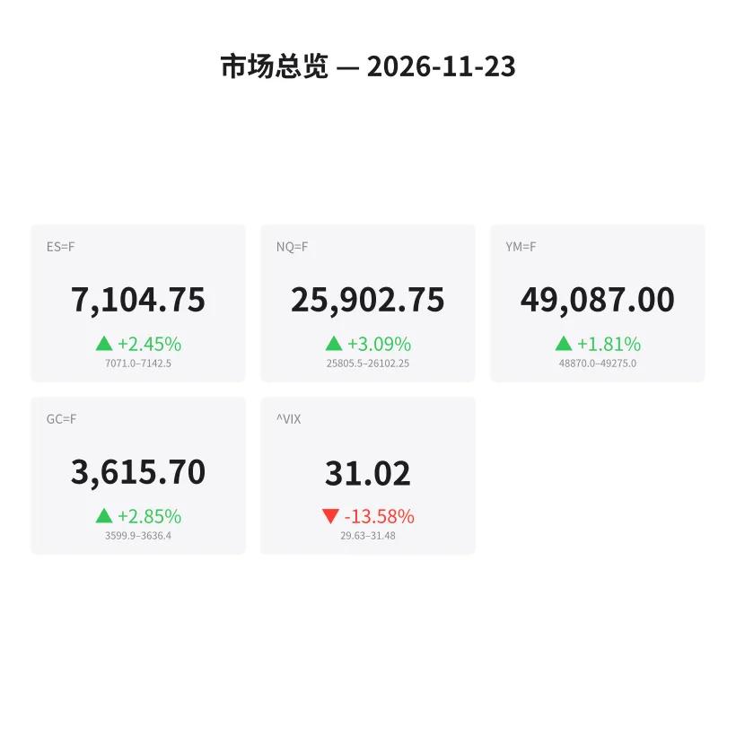
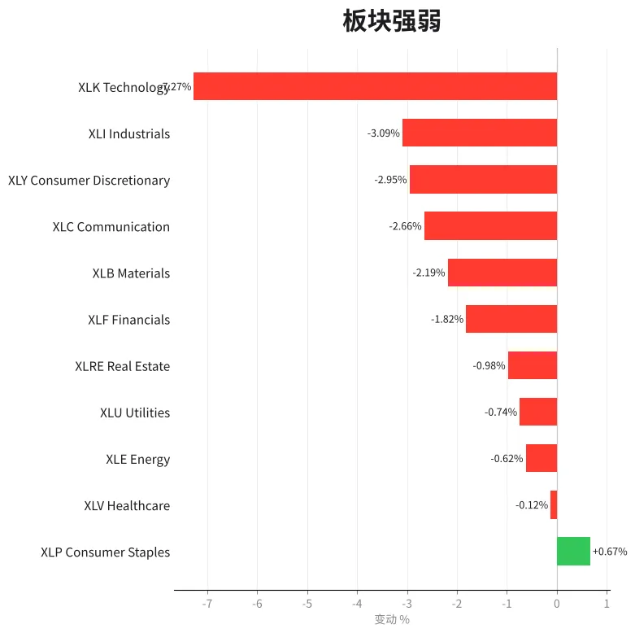
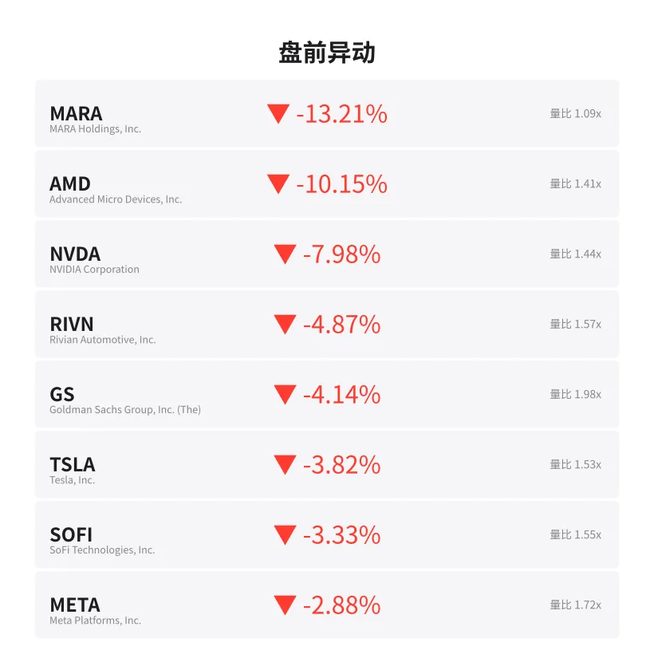
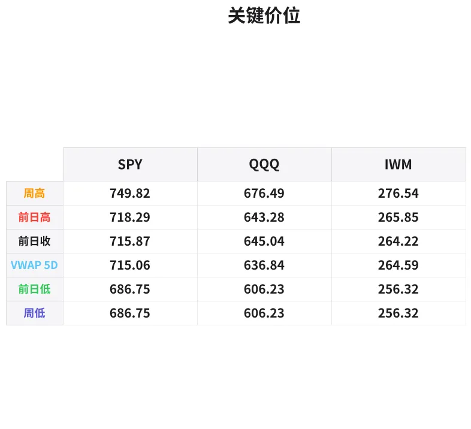

# 盘前分析报告 — 2026-11-23
*生成时间: 12:40:32 UTC*

---
## 数据速览

---
## 一、宏观环境

> [!info]- 详细数据：指数期货 & VIX
> ### 1.1 指数期货 & VIX
> | 品种 | 现价 | 涨跌幅 | 前收 | 日高 | 日低 |
> |------|------|--------|------|------|------|
> | ES=F | 7104.75 | +2.45% | 6935.0 | 7142.5 | 6992.0 |
> | NQ=F | 25902.75 | +3.09% | 25126.5 | 26102.25 | 25426.75 |
> | YM=F | 49087.0 | +1.81% | 48216.0 | 49275.0 | 48433.0 |
> | GC=F | 3615.7 | +2.85% | 3515.4 | 3636.4 | 3552.3 |
> | ^VIX | 31.02 | -13.58% | 28.44 | 31.48 | 29.63 |

> [!info]- 详细数据：隔夜走势
> ### 1.2 隔夜走势（Globex）
> | 品种 | 隔夜高 | 隔夜低 | 区间 | 亚洲高 | 亚洲低 | 欧洲高 | 欧洲低 |
> |------|--------|--------|------|--------|--------|--------|--------|
> | ES=F | 7142.5 | 7071.0 | 71.5 | 7096.25 | 7071.0 | 7142.5 | 7075.75 |
> | NQ=F | 26102.25 | 25805.5 | 296.75 | 25941.5 | 25805.5 | 26102.25 | 25814.25 |
> | YM=F | 49275.0 | 48870.0 | 405.0 | 48981.0 | 48870.0 | 49275.0 | 48903.0 |
> | GC=F | 3636.4 | 3599.9 | 36.5 | 3627.0 | 3604.6 | 3636.4 | 3599.9 |
> | ^VIX | 31.48 | 29.63 | 1.85 | — | — | 31.48 | 29.63 |

> [!info]- 详细数据：板块强弱
> ### 1.3 板块强弱
> | ETF | 板块 | 涨跌幅 |
> |-----|------|--------|
> | XLP | Consumer Staples | +0.67% |
> | XLV | Healthcare | -0.12% |
> | XLE | Energy | -0.62% |
> | XLU | Utilities | -0.74% |
> | XLRE | Real Estate | -0.98% |
> | XLF | Financials | -1.82% |
> | XLB | Materials | -2.19% |
> | XLC | Communication | -2.66% |
> | XLY | Consumer Discretionary | -2.95% |
> | XLI | Industrials | -3.09% |
> | XLK | Technology | -7.27% |

---
## 二、消息面

- **SPY与黄金同步下跌，债券能否挽救60/40投资组合？** — *Trefis*
  > SPY And Gold Fell Together. Did Bonds Save 60/40?
- **SPDR S&P 500 ETF (SPY) 卖出持仓：苹果领跌（11月19日）** — *GuruFocus.com*
  > What SPDR S&P 500 ETF Trust (SPY) Sold: Apple Leads on Nov. 19
- **ETF基金周四净卖出Meta Platforms (META)** — *GuruFocus.com*
  > ETFs Are Net Sellers of Meta Platforms (META) on Thursday
- **ETF基金周四净卖出Visa (V)** — *GuruFocus.com*
  > ETFs Are Net Sellers of Visa (V) on Thursday
- **ETF基金11月19日净卖出Alphabet (GOOGL)** — *GuruFocus.com*
  > ETFs Are Net Sellers of Alphabet (GOOGL) on Nov. 19
- **INVESCO QQQ Trust (QQQ) 卖出持仓：苹果领跌（11月19日）** — *GuruFocus.com*
  > What INVESCO QQQ Trust (QQQ) Sold: Apple Leads on Nov. 19
- **ETF基金周四净卖出苹果 (AAPL)** — *GuruFocus.com*
  > ETFs Are Net Sellers of Apple (AAPL) on Thursday
- **ETF基金11月19日净卖出亚马逊 (AMZN)** — *GuruFocus.com*
  > ETFs Are Net Sellers of Amazon (AMZN) on Nov. 19
- **今日股市：道指、标普500、纳指期货大涨，市场迎来超跌反弹** — *Yahoo Finance*
  > Stock market today: Dow, S&P 500, Nasdaq futures surge amid relief rally
- **Michael Burry称苹果、Costco和沃尔玛可能面临延迟抛售** — *GuruFocus.com*
  > Michael Burry Says Apple, Costco and Walmart Could Face a Delayed Selloff
- **Dan Ives称科技股抛售是"买入机会"——AI热潮仍有上升空间** — *GuruFocus.com*
  > Dan Ives Calls Tech Sell-Off a ‘Buying Opportunity’ -- AI Boom Has Room to Run
- **AI交易已经透支——年末反弹恐是一厢情愿** — *Barrons.com*
  > The AI Trade Is Tapped Out—and a Year-End Rally Looks Like Wishful Thinking
- **华尔街恐慌指数大跌但波动率仍处高位** — *Barrons.com*
  > Wall Street’s Fear Gauge Tumbles But Volatility Remains High
- **黄金3500美元关口考验：谁在疯狂抛售？** — *Investing.com*
  > Gold’s $3,500 test: Who’s behind the selling spree?
- **今日金价（11月23日周一）：金价开盘跌至2025年9月2日以来最低** — *Yahoo Personal Finance*
  > Gold prices today, Monday, November 23, 2026: Gold prices opened at lowest point since 9/2/25
- **黄金反弹3%，市场聚焦加息预期** — *The Wall Street Journal*
  > Gold Climbs 3%, Focus on Rate-Hike Bets
- **英国股市从五个月低点反弹，银行和矿业股领涨** — *Reuters*
  > UK shares rise from 5-month low as banks, miners gain
- **今日股市：道指大涨，标普和纳指随AI恐慌消退而反弹** — *Yahoo Finance*
  > Stock market today: Dow jumps, S&P 500, Nasdaq gain as AI jitters fade
- **今日股市：油价上涨拖累三大指数下滑，市场关注Alphabet和特斯拉财报** — *Yahoo Finance*
  > Stock market today: Dow, S&P 500, Nasdaq slip as oil prices rise, Alphabet and Tesla earnings in focus
- **今日股市：道指创新高，标普和纳指在AI乐观情绪回升中大涨** — *Yahoo Finance*
  > Stock market today: Dow posts record, S&P 500 and Nasdaq rally on revived AI optimism

---
## 三、盘前异动

> [!info]- 详细数据：盘前异动
> | 代码 | 名称 | 现价 | 缺口 | 量比 |
> |------|------|------|------|------|
> | MARA | MARA Holdings, Inc. | 5.42 | -13.21% | 1.09x |
> | AMD | Advanced Micro Devices, Inc. | 439.52 | -10.15% | 1.41x |
> | NVDA | NVIDIA Corporation | 134.33 | -7.98% | 1.44x |
> | RIVN | Rivian Automotive, Inc. | 10.74 | -4.87% | 1.57x |
> | GS | Goldman Sachs Group, Inc. (The) | 812.44 | -4.14% | 1.98x |
> | TSLA | Tesla, Inc. | 360.12 | -3.82% | 1.53x |
> | SOFI | SoFi Technologies, Inc. | 13.08 | -3.33% | 1.55x |
> | META | Meta Platforms, Inc. | 579.06 | -2.88% | 1.72x |
> | PLTR | Palantir Technologies Inc. | 149.57 | -2.67% | 1.87x |
> | GOOGL | Alphabet Inc. | 279.05 | +2.34% | 1.63x |

---
## 四、关键价位

> [!info]- 详细数据：SPY 关键价位
> ### SPY
> | 价位类型 | 价格 |
> |----------|------|
> | Prior Day High | 718.29 |
> | Prior Day Low | 686.752 |
> | Prior Day Close | 715.87 |
> | Premarket Price | 706.34 |
> | Approx Vwap 5D | 715.06 |
> | Weekly High | 749.82 |
> | Weekly Low | 686.75 |

> [!info]- 详细数据：QQQ 关键价位
> ### QQQ
> | 价位类型 | 价格 |
> |----------|------|
> | Prior Day High | 643.28 |
> | Prior Day Low | 606.2293 |
> | Prior Day Close | 645.04 |
> | Premarket Price | 627.7876 |
> | Approx Vwap 5D | 636.84 |
> | Weekly High | 676.49 |
> | Weekly Low | 606.23 |

> [!info]- 详细数据：IWM 关键价位
> ### IWM
> | 价位类型 | 价格 |
> |----------|------|
> | Prior Day High | 265.85 |
> | Prior Day Low | 256.32 |
> | Prior Day Close | 264.22 |
> | Premarket Price | 262.5346 |
> | Approx Vwap 5D | 264.59 |
> | Weekly High | 276.54 |
> | Weekly Low | 256.32 |

---
## 五、AI 技术分析 & 操盘建议

## 第一部分：隔夜市场回顾

### 亚洲时段（18:00–02:00 ET）
- **ES** 在亚洲时段交投区间 7071.0–7096.25，振幅仅25点，整体低位震荡，买盘力度偏弱。多头未能突破7100整数关口，说明上周五大跌后的修复行情仍显犹豫。
- **NQ** 亚洲时段区间 25805.5–25941.5，振幅约136点。科技股承压明显，NQ在25800附近反复测试支撑，显示卖压并未完全释放。
- **GC（黄金）** 亚洲时段区间 3604.6–3627.0，从低位温和反弹。金价此前跌至2025年9月以来最低水平，亚洲时段出现初步买盘介入。

### 欧洲时段（02:00–09:30 ET）
- **ES** 欧洲时段大幅走高至 7075.75–7142.5，区间上移近70点。欧洲资金入场推动反弹，突破7100整数关口后加速上行至7142.5隔夜高点。这一走势暗示opening drive可能偏多。
- **NQ** 欧洲时段区间 25814.25–26102.25，涨幅显著。NQ在欧洲时段突破26000心理关口，显示科技股超跌反弹动能增强。
- **GC** 欧洲时段区间 3599.9–3636.4，出现先跌后涨的V型走势。3600关口附近有明显买盘支撑，随后反弹至3636.4隔夜高点。

### 对美盘的启示
隔夜整体格局为"亚洲筑底、欧洲拉升"——典型的超跌反弹修复结构。VIX从高位回落13.58%至31.02，但绝对值仍处于高波动区间（>25），意味着今日盘中振幅依然会较大。**关键观察：** 期货反弹力度强劲（ES +2.45%，NQ +3.09%），但盘前个股数据显示科技龙头仍大幅跳空低开（AMD -10%，NVDA -8%，META -3%），说明现货市场的修复可能滞后于期货。板块上只有XLP（消费必需品）收绿，XLK（科技）暴跌7.27%，防御性轮动特征明显。

## 第二部分：期货品种分析

### ES（E-mini S&P 500）— 当前 7104.75

**多时间框架分析：**
- **日线级别：** 上周从高位大幅回落，周五收出长下影线（日低6992），隔夜反弹收复7100。周跌幅从749.82高点计算约5%，属于中等级别回调。日线RSI从超买区快速回落，尚未到超卖区域。
- **4小时级别：** 从6992低点展开V型反弹，当前站稳7100上方。4H结构初现higher low，若能守住7071（亚洲时段低点）则短线偏多。
- **1小时级别：** 欧洲时段突破7100后加速至7142.5，当前在7100–7142区间震荡整理。1H均线系统开始拐头向上。

**关键价位：**
| 类型 | 价位 | 说明 |
|------|------|------|
| 隔夜高点/阻力1 | 7142.5 | 欧洲时段高点，突破后看7175–7200 |
| 心理关口 | 7100 | 多空分界线，失守则回测7071 |
| 亚洲低/支撑1 | 7071 | 亚洲时段低点，日内关键支撑 |
| 日低/强支撑 | 6992 | 上周五日低，跌破则趋势转空 |
| 周低/极端支撑 | 6935 | 前收盘价，极端恐慌位 |

**方向偏向：** 🟢 偏多 | 置信度：65%
- **做多区间：** 7070–7085（回踩亚洲低点附近接多）
- **止损：** 7058（亚洲低点下方13点）
- **目标1：** 7142（隔夜高点测试）
- **目标2：** 7175（前期结构位）
- **失效条件：** 跌破6992日低，转为观望或反手做空

### NQ（E-mini Nasdaq 100）— 当前 25902.75

**多时间框架分析：**
- **日线级别：** 科技股遭受重创，上周从周高26102跌至25426低点，跌幅超过2.5%。AMD、NVDA等AI龙头盘前继续大跌，说明抛售尚未结束。日线出现大阴线后的反弹，属于技术性超跌修复。
- **4小时级别：** 从25426低点展开反弹，隔夜已触及26102.25（恰好在周高附近），这是关键的供给区。若无法突破，可能形成双顶回落。
- **1小时级别：** 欧洲时段强势拉升突破26000，但在26100附近遇阻。短线存在获利回吐压力。

**关键价位：**
| 类型 | 价位 | 说明 |
|------|------|------|
| 隔夜高/周高 | 26102 | 关键阻力，突破看26300 |
| 心理关口 | 26000 | 多空博弈焦点 |
| 当前价位 | 25903 | 位于26000下方，短线偏弱 |
| 亚洲低/支撑1 | 25806 | 回踩目标，失守看25600 |
| 日低/强支撑 | 25427 | 上周低点，极端支撑 |

**方向偏向：** 🟡 中性偏多 | 置信度：55%
- **做多区间：** 25780–25820（亚洲低点附近接多）
- **止损：** 25740（亚洲低点下方65点）
- **目标1：** 26000（心理关口回测）
- **目标2：** 26100（隔夜高点）
- **失效条件：** 跌破25600，科技股抛售升级，转空头思维
- ⚠️ **特别提醒：** NQ今日受科技股个股影响极大（AMD/NVDA盘前暴跌），开盘后需紧盯NVDA走势作为NQ领先指标

### GC（黄金期货）— 当前 3615.7

**多时间框架分析：**
- **日线级别：** 金价从高位大幅回落后出现超跌反弹（+2.85%），日线出现长下影线。消息面上"黄金开盘跌至2025年9月以来最低"和"黄金反弹3%"并存，说明市场正在寻底过程中。
- **4小时级别：** 从3552.3低点反弹至3636.4，反弹幅度约84点（2.4%）。4H级别出现初步的底部结构。
- **1小时级别：** 欧洲时段出现V型反转，从3599.9快速拉升至3636.4。1H级别趋势暂时转多。

**关键价位：**
| 类型 | 价位 | 说明 |
|------|------|------|
| 隔夜高/阻力1 | 3636 | 欧洲高点，突破看3660 |
| 当前价位 | 3616 | 位于隔夜区间中上部 |
| 欧洲低/支撑1 | 3600 | 整数关口+欧洲时段低点 |
| 亚洲低 | 3605 | 亚洲时段低点 |
| 日低/强支撑 | 3552 | 本轮回调低点 |
| 前收盘 | 3515 | 极端支撑位 |

**方向偏向：** 🟢 偏多 | 置信度：60%
- **做多区间：** 3598–3608（3600整数关口附近接多）
- **止损：** 3588（3600下方12点）
- **目标1：** 3636（隔夜高点测试）
- **目标2：** 3660（前期结构阻力）
- **失效条件：** 跌破3552日低，金价可能加速下探3515–3500区域

## 第三部分：ETF品种分析

### SPY — 盘前 706.34（前收 715.87，跌幅约 -1.3%）

**关键价位：**
| 类型 | 价位 | 说明 |
|------|------|------|
| 周高 | 749.82 | 本周最高，远端阻力 |
| 前日高 | 718.29 | 上周五日高 |
| 前日收盘 | 715.87 | 缺口上沿 |
| 5日VWAP | 715.06 | 均值回归目标 |
| 盘前价格 | 706.34 | 当前盘前报价 |
| 周低/前日低 | 686.75 | 本周极端低点 |

**交易计划：**
- **场景A（gap fill做多）：** 若开盘后SPY在700–704区间企稳并出现买盘信号（如1分钟/5分钟hammer、volume spike），可尝试做多。止损698（700下方2点），目标1：710，目标2：715（缺口回补）。
- **场景B（弱势延续做空）：** 若开盘直接跌破700整数关口且无法收回，可在700–702反弹做空。止损705，目标1：695，目标2：690。
- **注意事项：** SPY盘前跳空低开1.3%，VIX仍在31+，今日预计振幅较大（2-3%日内区间可能）。开盘前30分钟避免追涨杀跌，等待initial balance形成后再入场。

### QQQ — 盘前 627.79（前收 645.04，跌幅约 -2.7%）

**关键价位：**
| 类型 | 价位 | 说明 |
|------|------|------|
| 周高 | 676.49 | 本周最高，远端阻力 |
| 前日高 | 643.28 | 上周五日高 |
| 前日收盘 | 645.04 | 缺口上沿 |
| 5日VWAP | 636.84 | 均值回归第一目标 |
| 盘前价格 | 627.79 | 当前盘前报价 |
| 周低/前日低 | 606.23 | 本周极端低点 |

**交易计划：**
- **场景A（超跌反弹做多）：** QQQ跳空2.7%低开，幅度较大。若开盘后在625–628区间形成底部结构（higher low + 放量），可做多。止损622，目标1：636（5日VWAP），目标2：643（缺口回补）。
- **场景B（科技继续崩做空）：** 若开盘后NVDA/AMD继续走弱且QQQ跌破625，可在628–630反弹做空。止损633，目标1：615，目标2：610。
- **注意事项：** QQQ今日走势高度依赖NVDA（盘前-8%）和AMD（盘前-10%）。如果这两只在开盘后止跌反弹，QQQ可能出现强力gap fill；反之若继续下探，QQQ可能测试610甚至606周低。科技股波动率极高，务必控制仓位。

## 第四部分：今日市场总览

### 整体情绪判断
**谨慎偏多（Risk-On with Caution）**

上周市场经历了一轮剧烈的科技股抛售，AI/半导体板块首当其冲（XLK单日暴跌7.27%，AMD -10%，NVDA -8%），触发了全市场的risk-off情绪。隔夜期货出现强劲反弹（ES +2.45%，NQ +3.09%），VIX从高位回落至31，但绝对水平仍然很高。今日的核心矛盾在于：**期货的隔夜反弹能否在现货市场延续？** 盘前科技龙头仍大幅低开，说明反弹尚未在个股层面确认。

### VIX 分析
- **当前值：** 31.02（-13.58%）
- **含义：** VIX从高位大幅回落是积极信号，但31+的绝对值意味着市场预期日内SPY振幅约2%（即14点左右）。这是典型的"高波动修复期"——方向可能偏多，但过程会非常颠簸。
- **操作指引：** 在VIX>25的环境下，建议将正常仓位缩减至50-60%，止损放宽至正常的1.5倍，避免被波动洗出。

### 需要规避的时间窗口
1. **09:30–10:00 ET（开盘前30分钟）：** 今日跳空低开，opening drive方向不确定，大概率出现剧烈双向波动。等待initial balance形成。
2. **10:00 ET：** 关注是否有经济数据发布，可能引发额外波动。
3. **15:00–16:00 ET（尾盘）：** 周一尾盘机构可能进行仓位调整，注意突然的方向性波动。

### 板块轮动观察
- **极度防御性轮动：** 仅XLP（消费必需品+0.67%）收绿，其余全线下跌。这是典型的risk-off格局。
- **科技全面崩溃：** XLK -7.27%是罕见的单日跌幅，XLC（通信-2.66%）和XLY（消费可选-2.95%）也被大幅拖累。
- **周期股承压：** XLI（工业-3.09%）和XLB（材料-2.19%）表现疲弱，说明抛售不仅限于科技，有向更广泛市场蔓延的迹象。
- **今日关注：** 若科技股企稳反弹，XLF（金融）和XLI（工业）可能跟随走强，确认风险偏好回暖。若科技继续下跌，关注XLP和XLU（公用事业）作为防御性避风港。

### 🎯 核心交易论点（一句话）
**上周科技股恐慌性抛售后隔夜出现强劲反弹信号，今日以"耐心等待开盘定调、回踩关键支撑接多"为主策略，但需警惕VIX 31+环境下的高波动陷阱——控制仓位、放宽止损、不追涨杀跌。**
