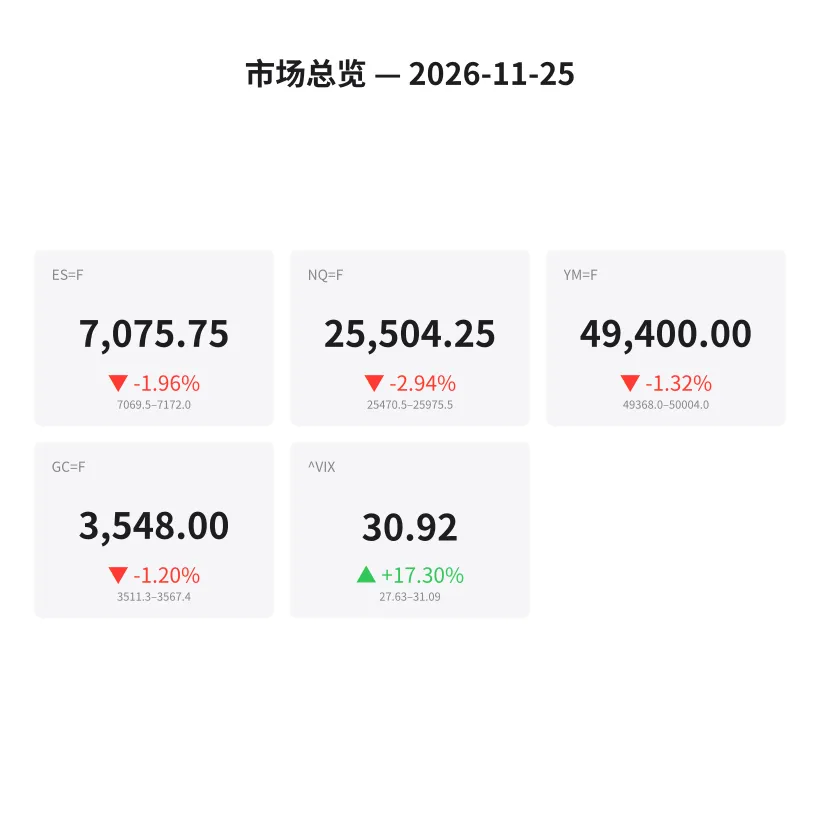
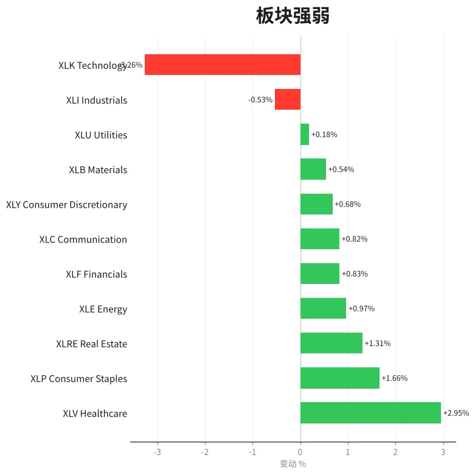
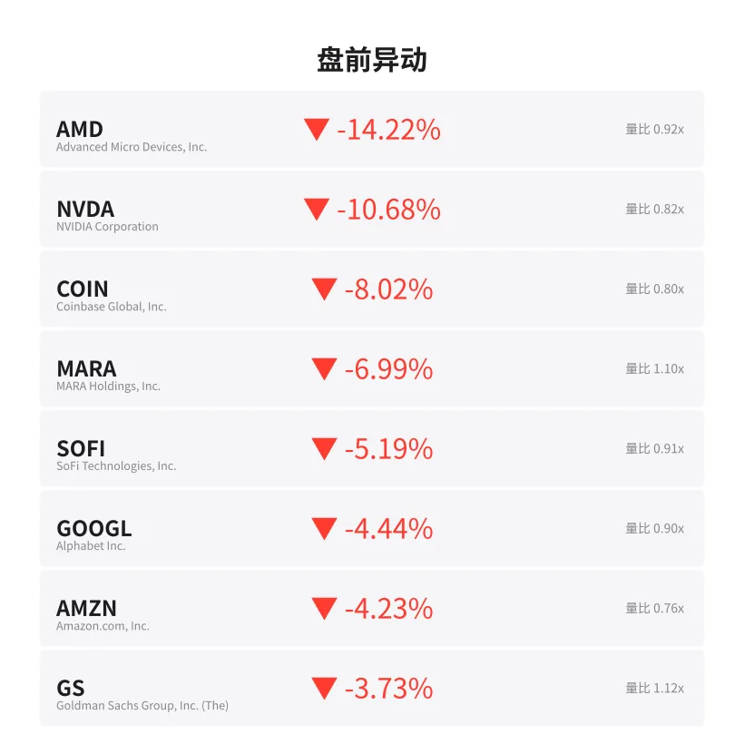
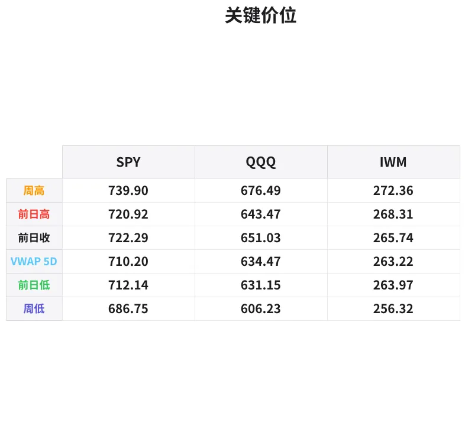

# 盘前分析报告 — 2026-11-25
*生成时间: 12:34:54 UTC*

---
## 数据速览

---
## 一、宏观环境

> [!info]- 详细数据：指数期货 & VIX
> ### 1.1 指数期货 & VIX
> | 品种 | 现价 | 涨跌幅 | 前收 | 日高 | 日低 |
> |------|------|--------|------|------|------|
> | ES=F | 7075.75 | -1.96% | 7217.5 | 7224.0 | 7069.5 |
> | NQ=F | 25504.25 | -2.94% | 26275.75 | 26350.75 | 25470.5 |
> | YM=F | 49400.0 | -1.32% | 50061.0 | 50060.0 | 49368.0 |
> | GC=F | 3548.0 | -1.20% | 3591.1 | 3602.9 | 3511.8 |
> | ^VIX | 30.92 | +17.30% | 26.36 | 31.09 | 27.63 |

> [!info]- 详细数据：隔夜走势
> ### 1.2 隔夜走势（Globex）
> | 品种 | 隔夜高 | 隔夜低 | 区间 | 亚洲高 | 亚洲低 | 欧洲高 | 欧洲低 |
> |------|--------|--------|------|--------|--------|--------|--------|
> | ES=F | 7172.0 | 7069.5 | 102.5 | 7171.0 | 7150.0 | 7172.0 | 7069.5 |
> | NQ=F | 25975.5 | 25470.5 | 505.0 | 25975.5 | 25830.75 | 25915.0 | 25470.5 |
> | YM=F | 50004.0 | 49368.0 | 636.0 | 49901.0 | 49791.0 | 50004.0 | 49368.0 |
> | GC=F | 3567.4 | 3511.3 | 56.1 | 3549.6 | 3511.3 | 3567.4 | 3511.8 |
> | ^VIX | 31.09 | 27.63 | 3.46 | — | — | 31.09 | 27.63 |

> [!info]- 详细数据：板块强弱
> ### 1.3 板块强弱
> | ETF | 板块 | 涨跌幅 |
> |-----|------|--------|
> | XLV | Healthcare | +2.95% |
> | XLP | Consumer Staples | +1.66% |
> | XLRE | Real Estate | +1.31% |
> | XLE | Energy | +0.97% |
> | XLF | Financials | +0.83% |
> | XLC | Communication | +0.82% |
> | XLY | Consumer Discretionary | +0.68% |
> | XLB | Materials | +0.54% |
> | XLU | Utilities | +0.18% |
> | XLI | Industrials | -0.53% |
> | XLK | Technology | -3.26% |

---
## 二、消息面

- **Jim Cramer称周二股市回调实际上是好消息** — *24/7 Wall St.*
  > Jim Cramer Says Tuesday’s Stock Market Pullback Is Actually Good News
- **"解放日2.0"？据报道特朗普下一轮关税即将到来** — *24/7 Wall St.*
  > Liberation Day Round 2.0? The Next Wave of Trump Tariffs Is Reportedly Close
- **SPDR标普500 ETF (SPY) 周一增持苹果和英伟达** — *GuruFocus.com*
  > SPDR S&P 500 ETF (SPY) Adds Apple and Nvidia on Monday
- **忘掉市盈率，DSTL依据现金流和低负债精选100只大盘股** — *24/7 Wall St.*
  > Forget the P/E Ratio. DSTL Picks 100 Large Stocks by the Cash They Generate and the Debt They Don’t Carry
- **标普4.7%的反弹是好兆头吗？** — *Trefis*
  > Is A 4.7% S&P Jump A Good Sign?
- **Invesco QQQ信托 (QQQ) 11月23日减持苹果和英伟达** — *GuruFocus.com*
  > INVESCO QQQ Trust (QQQ) Sells Apple and NVIDIA on Nov. 23
- **ETF在11月23日净卖出Alphabet (GOOG)** — *GuruFocus.com*
  > ETFs Are Net Sellers of Alphabet (GOOG) on Nov. 23
- **ETF周一净卖出Palantir (PLTR)** — *GuruFocus.com*
  > ETFs Are Net Sellers of Palantir (PLTR) on Monday
- **ETF周一卖出9690万美元Rocket Lab (RKLB)** — *GuruFocus.com*
  > ETFs Sold $96.9 Million of Rocket Lab (RKLB) on Monday
- **ETF周一净卖出亚马逊 (AMZN)** — *GuruFocus.com*
  > ETFs Are Net Sellers of Amazon (AMZN) on Monday
- **Jim Cramer的抛售法则：未来5年需要的钱不应放在股市** — *24/7 Wall St.*
  > Jim Cramer’s Sell-Off Rule: Money You Need in the Next 5 Years Doesn’t Belong in Stocks
- **恐慌指数对市场发出了什么信号** — *Barrons.com*
  > What the Fear Index Is Telling Us About the Market
- **Suze Orman警告退休人士避免一个代价高昂的股市错误** — *TheStreet*
  > Suze Orman warns retirees against one costly stock market mistake
- **盈透证券股价波动的背后原因是什么？** — *Trefis*
  > What Is Behind The Move In Interactive Brokers Stock?
- **铜价下跌3%，周一涨幅完全回吐** — *Investing.com*
  > Copper slides 3% as Monday’s bounce fully reverses
- **今日金价（11月25日周三）：通胀数据和潜在新关税阴影下金价下跌** — *Yahoo Personal Finance*
  > Gold price today, Wednesday, November 25, 2026: Gold prices fall as inflation data and potential new tariffs loom
- **泰森食品牛肉业务亏损6.54亿美元，美国牛群降至75年最低** — *Moneywise*
  > Tyson Foods lost $654M on beef as America’s cattle herd hits a 75-year low. How to protect your grocery budget
- **2026年11月25日今日金价** — *USA TODAY*
  > Gold Price Today on November 25, 2026
- **黄金ETF一周流出22亿美元，为6月以来最快撤资速度** — *BeInCrypto*
  > Gold ETFs Lose $2.2 Billion in a Week, Their Fastest Exit Since June
- **美联储加息预期打压金价，黄金交投于15个月低点附近** — *InvestorsHub*
  > Gold Trades Near 15-Month Low as Federal Reserve Rate Hike Expectations Weigh on Prices

---
## 三、盘前异动

> [!info]- 详细数据：盘前异动
> | 代码 | 名称 | 现价 | 缺口 | 量比 |
> |------|------|------|------|------|
> | AMD | Advanced Micro Devices, Inc. | 388.97 | -14.22% | 0.92x |
> | NVDA | NVIDIA Corporation | 147.42 | -10.68% | 0.82x |
> | COIN | Coinbase Global, Inc. | 100.06 | -8.02% | 0.8x |
> | MARA | MARA Holdings, Inc. | 5.19 | -6.99% | 1.1x |
> | SOFI | SoFi Technologies, Inc. | 12.41 | -5.19% | 0.91x |
> | GOOGL | Alphabet Inc. | 269.58 | -4.44% | 0.9x |
> | AMZN | Amazon.com, Inc. | 244.59 | -4.23% | 0.76x |
> | GS | Goldman Sachs Group, Inc. (The) | 792.94 | -3.73% | 1.12x |
> | PLTR | Palantir Technologies Inc. | 153.8 | -3.49% | 1.0x |
> | META | Meta Platforms, Inc. | 577.98 | -3.28% | 0.82x |

---
## 四、关键价位

> [!info]- 详细数据：SPY 关键价位
> ### SPY
> | 价位类型 | 价格 |
> |----------|------|
> | Prior Day High | 720.921 |
> | Prior Day Low | 712.14 |
> | Prior Day Close | 722.29 |
> | Premarket Price | 703.9 |
> | Approx Vwap 5D | 710.2 |
> | Weekly High | 739.9 |
> | Weekly Low | 686.75 |

> [!info]- 详细数据：QQQ 关键价位
> ### QQQ
> | 价位类型 | 价格 |
> |----------|------|
> | Prior Day High | 643.4664 |
> | Prior Day Low | 631.15 |
> | Prior Day Close | 651.03 |
> | Premarket Price | 619.73 |
> | Approx Vwap 5D | 634.47 |
> | Weekly High | 676.49 |
> | Weekly Low | 606.23 |

> [!info]- 详细数据：IWM 关键价位
> ### IWM
> | 价位类型 | 价格 |
> |----------|------|
> | Prior Day High | 268.31 |
> | Prior Day Low | 263.97 |
> | Prior Day Close | 265.74 |
> | Premarket Price | 263.47 |
> | Approx Vwap 5D | 263.22 |
> | Weekly High | 272.36 |
> | Weekly Low | 256.32 |

---
## 五、AI 技术分析 & 操盘建议

## 第一部分：隔夜市场回顾

### 整体格局

隔夜全球市场遭遇显著抛压，核心驱动因素为**特朗普"解放日2.0"关税升级预期**叠加**科技股集体重挫**。VIX飙升至30.92（+17.30%），突破30关口，表明市场恐慌情绪急剧升温，做市商被迫大幅对冲gamma敞口。

### 亚洲时段（18:00-02:00 ET）

- **ES**：亚洲时段交投区间狭窄（7150-7171），多空胶着，市场等待欧洲方向。亚洲段低点7150成为短线支撑参考。
- **NQ**：亚洲时段维持在25830-25975区间，抛压相对温和，但已显露出相比ES更大的弱势（-2.94% vs -1.96%），科技权重拖累明显。
- **GC**（黄金）：亚洲段下探至3511.3后小幅反弹至3549.6，黄金ETF持续流出（一周-22亿美元）叠加加息预期，黄金承压运行于15个月低位附近。

### 欧洲时段（02:00-09:30 ET）

- **ES**：欧洲开盘后先试探隔夜高点7172后快速回落，尾段加速下探至session低点7069.5。欧洲段形成明确的**做空结构**——higher high被拒绝后一路打出新低。
- **NQ**：欧洲段更为惨烈，从25915一路下杀至25470.5，跌幅超过500点。半导体板块（AMD -14.22%、NVDA -10.68%）的恐慌性抛售是主因。
- **铜**：下跌3%，周一涨幅完全回吐，工业金属走弱进一步确认Risk-Off情绪。

### 对美盘的启示

1. **结构性做空格局**：隔夜从高到低的走势形成了clean sell structure，美盘开盘若无强力买盘承接，大概率延续下行惯性
2. **板块极端分化**：XLK -3.26%（科技领跌）vs XLV +2.95%（医疗领涨），典型的**防御性轮动**，机构在减持高beta科技股转向低beta防御板块
3. **VIX >30 意味着**：波动率扩大，日内走势会更加剧烈，止损要适当放宽，仓位要适当缩小

## 第二部分：期货品种分析

### ES（E-mini S&P 500 期货）— 现价 7075.75

**多周期分析：**
- **日线**：前收7217.5，盘前-1.96%，大幅跳空低开。周线来看，从周高7224跌至当前7075，周线形态偏空。
- **4H**：隔夜构建了完整的下行通道（7172→7069.5），当前处于通道下沿附近。
- **1H**：欧洲时段形成了3根连续阴柱，动量持续向下，无明显反弹迹象。

**关键价位：**
| 类型 | 价位 | 意义 |
|------|------|------|
| R3 | 7172.0 | 隔夜/欧洲高点，强阻力 |
| R2 | 7150.0 | 亚洲低点，第一反弹阻力 |
| R1 | 7100.0 | 心理关口+盘中枢纽 |
| **现价** | **7075.75** | — |
| S1 | 7069.5 | 隔夜低点，首要支撑 |
| S2 | 7050.0 | 心理整数关 |
| S3 | 7000.0 | 重要心理大关 |

**方向偏向：看空** | 置信度：75%

**交易计划：**
- **首选 — 空单（顺势）**：反弹至7100-7120区域做空，止损7145（隔夜亚洲低点上方），T1=7050，T2=7000。入场确认：1分钟图在阻力区出现pin bar或engulfing。
- **备选 — 多单（逆势）**：若跌破7069.5后快速收回（false breakdown），可尝试短线多单至7100，止损7055。
- **失效条件**：若ES强势突破7150并站稳，空头逻辑失效，转为观望。

---

### NQ（E-mini Nasdaq 100 期货）— 现价 25504.25

**多周期分析：**
- **日线**：前收26275.75，盘前-2.94%，跌幅远超ES。AMD -14%、NVDA -10%拖累极大。
- **4H**：从26350.75周高一路下行至25470.5，跌幅近900点，空头完全控盘。
- **1H**：持续放量下跌，每一次反弹都被更大的卖盘压回，订单流极度偏空。

**关键价位：**
| 类型 | 价位 | 意义 |
|------|------|------|
| R3 | 25975.5 | 隔夜/亚洲高点 |
| R2 | 25830.0 | 亚洲低点 |
| R1 | 25600.0 | 盘中枢纽 |
| **现价** | **25504.25** | — |
| S1 | 25470.5 | 隔夜低点 |
| S2 | 25300.0 | 技术支撑区 |
| S3 | 25000.0 | 重要心理整数关 |

**方向偏向：强烈看空** | 置信度：80%

**交易计划：**
- **首选 — 空单**：反弹至25600-25700做空，止损25850（亚洲低点上方），T1=25300，T2=25000。NQ波动大，1合约风险控制在$500以内。
- **警惕**：半导体如果盘中出利好消息可能引发暴力轧空，NQ空单必须严格止损。
- **失效条件**：NQ突破25830并放量站稳，空头退出。

---

### GC（黄金期货）— 现价 3548.0

**多周期分析：**
- **日线**：前收3591.1，盘前-1.20%。金价运行在15个月低位附近，周线连续第三周下跌。
- **4H**：隔夜在3511.3-3567.4区间震荡，整体偏空但跌速放缓。
- **1H**：欧洲段从3511.8反弹至3567.4后回落，形成lower high结构。

**关键价位：**
| 类型 | 价位 | 意义 |
|------|------|------|
| R3 | 3602.9 | 日高 |
| R2 | 3591.1 | 前收盘 |
| R1 | 3567.4 | 隔夜/欧洲高点 |
| **现价** | **3548.0** | — |
| S1 | 3511.3 | 隔夜低点（亚洲段打出） |
| S2 | 3500.0 | 心理整数关 |
| S3 | 3480.0 | 技术支撑 |

**方向偏向：看空，但接近支撑区谨慎** | 置信度：60%

**交易计划：**
- **首选 — 空单**：反弹至3565-3575做空（欧洲高点附近），止损3595，T1=3515，T2=3500。
- **备选 — 多单**：若3511-3500区间出现放量止跌+delta反转，可短多至3550，止损3495。
- **注意**：黄金ETF连续流出+加息预期打压，中期趋势偏空，但3500是重要心理支撑，空单在此区域不宜追。
- **失效条件**：GC突破3591前收盘价，空头退出。

## 第三部分：ETF品种分析

### SPY — 盘前 703.9（前收 722.29）

**关键价位：**
| 类型 | 价位 | 意义 |
|------|------|------|
| R3 | 722.29 | 前收盘（缺口上沿） |
| R2 | 720.92 | 前日高 |
| R1 | 712.14 | 前日低 |
| 5D VWAP | 710.20 | 机构成本线 |
| **盘前** | **703.90** | — |
| S1 | 700.00 | 心理整数关 |
| S2 | 686.75 | 周低 |

**缺口分析：** SPY跳空低开约18点（-2.55%），缺口巨大。这种尺度的缺口在VIX>30环境下，**当日完全回补概率<20%**。更可能的情景是：开盘后先试探缺口方向（向上测试710-712区域），然后反转继续下行。

**交易计划：**
- **做空策略**：盘后如果反弹至710-712（前日低+5D VWAP汇合区），观察order flow出现卖方吸收后做空，T1=703，T2=700，止损714。
- **做多策略**：仅在700整数关出现明确止跌信号（大单买入、delta反转）时考虑短多至710，止损697。
- **GAP规则**：大缺口+高VIX = **不追缺口方向**，等待开盘后15-30分钟的价格发现完成再入场。

---

### QQQ — 盘前 619.73（前收 651.03）

**关键价位：**
| 类型 | 价位 | 意义 |
|------|------|------|
| R3 | 651.03 | 前收盘（缺口上沿） |
| R2 | 643.47 | 前日高 |
| R1 | 634.47 | 5D VWAP |
| R0 | 631.15 | 前日低 |
| **盘前** | **619.73** | — |
| S1 | 615.00 | 技术支撑 |
| S2 | 606.23 | 周低（极端支撑） |

**缺口分析：** QQQ跳空低开超31点（-4.81%），缺口极端巨大。半导体权重股（AMD -14%、NVDA -10%）的崩盘式下跌拖累。QQQ当前距离5D VWAP偏离约2.3%，处于极端超卖区域。

**交易计划：**
- **做空策略**：QQQ反弹至625-631区域（前日低点附近）做空，止损633，T1=615，T2=606。
- **做多策略（高风险逆势）**：若QQQ在606-610周低区域出现放量止跌+时间确认（至少15分钟横盘消化），可尝试反弹多单至620，止损603。
- **关键提醒**：QQQ今日波动率极大（ATR可能超过20点），仓位务必缩小至平时的50-60%。不要在半导体没有企稳信号时抄底。

## 第四部分：今日市场总览

### 市场情绪评估

| 指标 | 数值 | 信号 |
|------|------|------|
| VIX | 30.92 (+17.30%) | 🔴 高度恐慌，波动率极端扩张 |
| ES涨跌幅 | -1.96% | 🔴 大幅下跌 |
| NQ涨跌幅 | -2.94% | 🔴 科技领跌，重度Risk-Off |
| 板块轮动 | XLV +2.95% / XLK -3.26% | 🔴 极端防御轮动 |
| 黄金 | 3548 (-1.20%) | 🟡 避险资产同步走弱（加息预期压制） |
| 铜 | -3% | 🔴 工业需求预期恶化 |

**综合评分：强烈Risk-Off（2/10）**

### 核心驱动因素

1. **特朗普关税2.0威胁** — 市场已经开始定价新一轮关税冲击，这是本轮抛售的核心催化剂
2. **半导体板块崩塌** — AMD -14%、NVDA -10% 引发科技板块连锁反应，可能涉及关税对芯片出口的潜在影响
3. **VIX突破30** — 波动率进入"恐慌区"，做市商对冲gamma将加剧日内双向波动
4. **黄金与股市同跌** — 典型的流动性紧缩信号，机构在清仓一切风险资产换取现金

### 需要回避的时间窗口

- **09:30-10:00**：开盘前30分钟，大缺口+高VIX = 假信号频繁，不建议在此窗口开新仓
- **10:00**：经济数据释放窗口，注意Consumer Confidence等数据可能加剧波动
- **14:00**：FOMC会议纪要或任何联储官员讲话窗口
- **15:30-16:00**：收盘前，机构MOC订单可能引发方向性加速

### 板块轮动路径

**资金从高Beta科技（XLK -3.26%） → 防御性板块（XLV +2.95%, XLP +1.66%, XLRE +1.31%）**

这种轮动模式说明：
- 机构不是全面撤离，而是在**降低组合Beta**
- 医疗、必需消费品、房地产等板块受关税影响较小，成为避风港
- 工业板块（XLI -0.53%）同样承压，可能与关税对供应链的潜在冲击有关

### 一句话核心操盘论点

> **今日是典型的Risk-Off恐慌日——顺势做空为主，所有反弹都是卖出机会，直到VIX回落至28以下或ES收复7150。仓位缩减至常规的50%，严格止损，不抄底、不猜底。**
