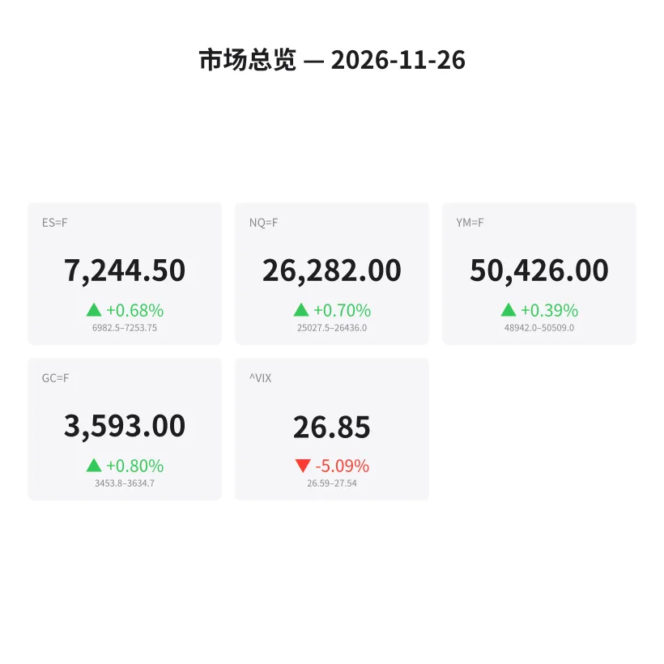
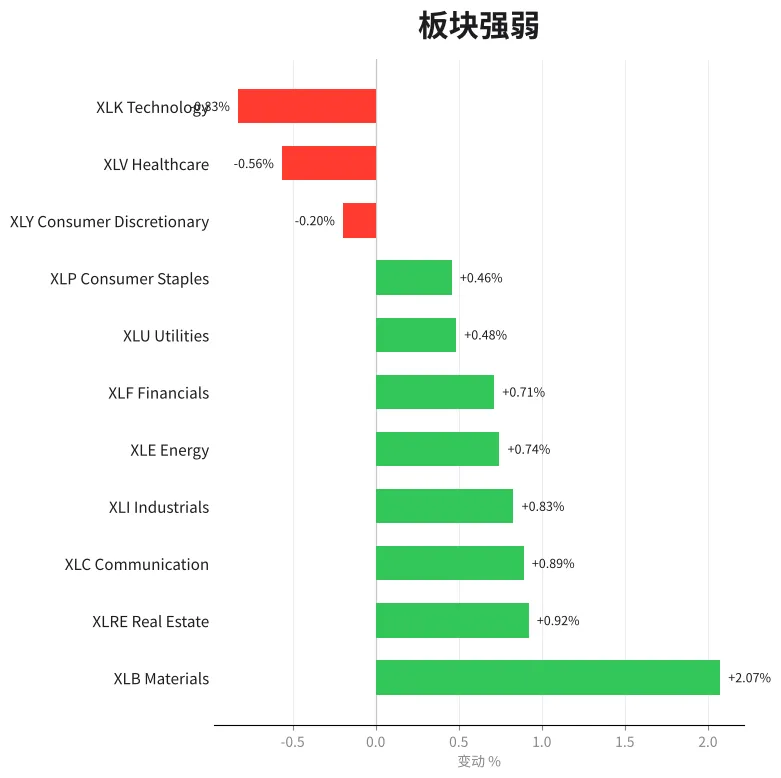
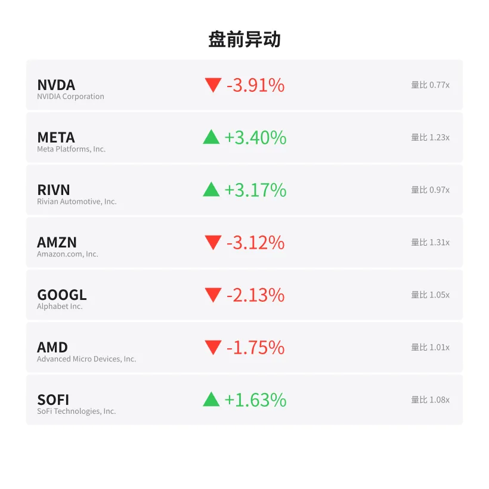
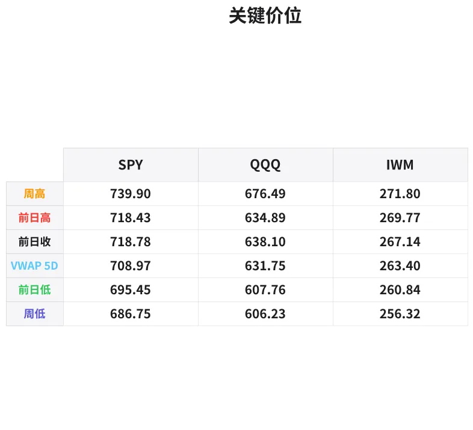

# 盘前分析报告 — 2026-11-26
*生成时间: 12:34:38 UTC*

---
## 数据速览

---
## 一、宏观环境

> [!info]- 详细数据：指数期货 & VIX
> ### 1.1 指数期货 & VIX
> | 品种 | 现价 | 涨跌幅 | 前收 | 日高 | 日低 |
> |------|------|--------|------|------|------|
> | ES=F | 7244.5 | +0.68% | 7195.75 | 7254.75 | 7187.0 |
> | NQ=F | 26282.0 | +0.70% | 26100.25 | 26436.0 | 25997.5 |
> | YM=F | 50426.0 | +0.39% | 50228.0 | 50509.0 | 50223.0 |
> | GC=F | 3593.0 | +0.80% | 3564.6 | 3634.7 | 3578.8 |
> | ^VIX | 26.85 | -5.09% | 28.29 | 27.54 | 26.59 |

> [!info]- 详细数据：隔夜走势
> ### 1.2 隔夜走势（Globex）
> | 品种 | 隔夜高 | 隔夜低 | 区间 | 亚洲高 | 亚洲低 | 欧洲高 | 欧洲低 |
> |------|--------|--------|------|--------|--------|--------|--------|
> | ES=F | 7253.75 | 6982.5 | 271.25 | 7253.75 | 7150.0 | 7172.0 | 7069.5 |
> | NQ=F | 26436.0 | 25027.5 | 1408.5 | 26436.0 | 25830.75 | 25915.0 | 25470.5 |
> | YM=F | 50509.0 | 48942.0 | 1567.0 | 50509.0 | 49791.0 | 50004.0 | 49365.0 |
> | GC=F | 3634.7 | 3453.8 | 180.9 | 3634.7 | 3511.3 | 3567.4 | 3511.8 |
> | ^VIX | 27.54 | 26.59 | 0.95 | — | — | 27.54 | 26.59 |

> [!info]- 详细数据：板块强弱
> ### 1.3 板块强弱
> | ETF | 板块 | 涨跌幅 |
> |-----|------|--------|
> | XLB | Materials | +2.07% |
> | XLRE | Real Estate | +0.92% |
> | XLC | Communication | +0.89% |
> | XLI | Industrials | +0.83% |
> | XLE | Energy | +0.74% |
> | XLF | Financials | +0.71% |
> | XLU | Utilities | +0.48% |
> | XLP | Consumer Staples | +0.46% |
> | XLY | Consumer Discretionary | -0.20% |
> | XLV | Healthcare | -0.56% |
> | XLK | Technology | -0.83% |

---
## 二、消息面

- **马斯克警告AI行业2027年现金缺口将"疯狂"，可能还需数十亿美元** — *Moneywise*
  > Elon Musk warns AI’s 2027 cash shortage will be ‘nuts’ as industry could need billions more. Protect your retirement
- **美股有望创下2008年以来最佳感恩节周表现** — *24/7 Wall St.*
  > The Stock Market Is Still on Track for Its Best Thanksgiving Week Since 2008
- **持有Palo Alto股票？关注其递延收入** — *Trefis*
  > Own Palo Alto Stock? Watch Its Deferred Revenue
- **SPDR S&P 500 ETF(SPY)11月24日卖出4.001亿美元苹果股票** — *GuruFocus.com*
  > SPDR S&P 500 ETF (SPY) Sells $400.1 Million of Apple on Nov. 24
- **ETF在11月24日净卖出赛默飞(TMO)** — *GuruFocus.com*
  > ETFs Are Net Sellers of Thermo Fisher (TMO) on Nov. 24
- **Invesco QQQ信托(QQQ)周二再买入1.874亿美元苹果股票** — *GuruFocus.com*
  > Invesco QQQ Trust (QQQ) Buys $187.4 Million More Apple on Tuesday
- **ETF在11月24日买入SanDisk(SNDK)** — *GuruFocus.com*
  > ETFs Are Buying SanDisk (SNDK) on Nov. 24
- **41只ETF周二增持T-Mobile(TMUS)** — *GuruFocus.com*
  > 41 ETFs Add to T-Mobile (TMUS) Holdings on Tuesday
- **ETF周二买入Shopify(SHOP)** — *GuruFocus.com*
  > ETFs Are Buying Shopify (SHOP) on Tuesday
- **49只ETF在11月24日增持亿滋(MDLZ)** — *GuruFocus.com*
  > 49 ETFs Add to Mondelez (MDLZ) Holdings on Nov. 24
- **尽管通胀和AI阴霾笼罩，美股仍从低点反弹** — *Kiplinger*
  > Stocks Rally Off Lows Despite Inflation and AI Gloom: Stock Market Today
- **美国股指涨跌不一，芯片股遭大幅抛售之际国债收益率下跌** — *MT Newswires*
  > Update: US Equity Indexes Mixed While Treasury Yields Drop Amid Sharp Sell-Off in Chipmakers
- **高盛标记出指向市场底部的3个信号** — *TheStreet*
  > Goldman Sachs flags 3 signals pointing to a market bottom
- **Tom Gardner谈应对这种行情的策略** — *Motley Fool*
  > What Tom Gardner Said About Days Like This
- **11月25日市场：纳斯达克、标普500收跌，AI交易持续承压，英伟达跌4%** — *Investopedia*
  > Markets News, Nov. 25, 2026: Nasdaq, S&P 500 Close Lower as AI Trade Remains Under Pressure; Nvidia Falls 4%
- **沃伦对特朗普10%信用卡利率上限"已做好准备"，当前平均利率达22%** — *Moneywise*
  > Elizabeth Warren is ‘ready to go’ on Trump’s 10% credit card cap. With rates averaging 22%, are you overpaying?
- **美联储官员就"令人忧虑"的报告向储户发出新警告——储蓄面临风险** — *Moneywise*
  > Fed official issues new warning for US savers after ‘distressing’ report — nest eggs now in danger from disturbing data
- **政府可在未经同意情况下削减社保：母亲被要求偿还6万美元** — *Moneywise*
  > The government can reduce your Social Security without consent: Mom stunned by $60K repayment demand. Protect your check
- **持有GLD对冲股市下跌？黄金这次错失良机** — *Trefis*
  > Holding GLD For Stock Falls? Gold Missed This One
- **山特维克收购巴西Del Rey矿业公司** — *Mining Technology*
  > Sandvik to acquire Brazil’s Del Rey Minerals

---
## 三、盘前异动

> [!info]- 详细数据：盘前异动
> | 代码 | 名称 | 现价 | 缺口 | 量比 |
> |------|------|------|------|------|
> | NVDA | NVIDIA Corporation | 149.3 | -3.91% | 0.77x |
> | META | Meta Platforms, Inc. | 609.89 | +3.40% | 1.23x |
> | RIVN | Rivian Automotive, Inc. | 11.71 | +3.17% | 0.97x |
> | AMZN | Amazon.com, Inc. | 244.43 | -3.12% | 1.31x |
> | GOOGL | Alphabet Inc. | 273.1 | -2.13% | 1.05x |
> | AMD | Advanced Micro Devices, Inc. | 406.03 | -1.75% | 1.01x |
> | SOFI | SoFi Technologies, Inc. | 13.07 | +1.63% | 1.08x |

---
## 四、关键价位

> [!info]- 详细数据：SPY 关键价位
> ### SPY
> | 价位类型 | 价格 |
> |----------|------|
> | Prior Day High | 718.43 |
> | Prior Day Low | 695.45 |
> | Prior Day Close | 718.78 |
> | Approx Vwap 5D | 708.97 |
> | Weekly High | 739.9 |
> | Weekly Low | 686.75 |

> [!info]- 详细数据：QQQ 关键价位
> ### QQQ
> | 价位类型 | 价格 |
> |----------|------|
> | Prior Day High | 634.89 |
> | Prior Day Low | 607.76 |
> | Prior Day Close | 638.1 |
> | Approx Vwap 5D | 631.75 |
> | Weekly High | 676.49 |
> | Weekly Low | 606.23 |

> [!info]- 详细数据：IWM 关键价位
> ### IWM
> | 价位类型 | 价格 |
> |----------|------|
> | Prior Day High | 269.77 |
> | Prior Day Low | 260.84 |
> | Prior Day Close | 267.14 |
> | Approx Vwap 5D | 263.4 |
> | Weekly High | 271.8 |
> | Weekly Low | 256.32 |

---
## 五、AI 技术分析 & 操盘建议

## 第一部分：隔夜市场回顾

### 美股昨日收盘回顾
11月25日（周一）美股收盘呈现明显分化格局。标普500和纳斯达克双双收跌，AI/半导体板块遭遇集中抛压，英伟达(NVDA)单日跌幅达4%，拖累整个科技板块。道指相对抗跌，受益于价值股和工业板块的资金轮动。VIX从28.29回落至26.85（-5.09%），恐慌情绪有所缓解但仍处于偏高水平。

### 亚洲盘交易时段（约18:00-02:00 ET）
亚洲时段表现强劲，为隔夜行情奠定了多头基调：
- **ES** 在亚洲时段触及隔夜高点7253.75，从7150区域强势反弹，区间7150-7253.75（约104点）
- **NQ** 同样在亚洲时段录得隔夜高点26436，从25830.75反弹，区间约605点
- **GC（黄金）** 亚洲时段创出隔夜高点3634.7，从3511.3区域强劲拉升，显示避险需求旺盛
- 亚洲盘的强势买盘可能反映了对周一美股超跌的抄底情绪

### 欧洲盘交易时段（约02:00-09:30 ET）
欧洲时段明显回落，多头动能减弱：
- **ES** 欧洲时段区间7069.5-7172（约103点），较亚洲高点回撤约80点
- **NQ** 欧洲区间25470.5-25915（约445点），回吐了亚洲时段大部分涨幅
- **GC** 欧洲区间3511.8-3567.4，从亚洲高点3634.7大幅回落
- 欧洲时段的回调主要受芯片股压力传导和获利了结影响

### 隔夜行情关键特征
1. **波动率极高**：ES隔夜区间271点，NQ隔夜区间1408点，远超正常水平
2. **V型反转结构**：从隔夜低点到高点的反弹幅度巨大（ES从6982.5到7253.75）
3. **亚强欧弱**：亚洲盘主导多头行情，欧洲盘回吐涨幅，呈典型的时段分化
4. **当前盘前企稳**：ES 7244.5(+0.68%)、NQ 26282(+0.70%)，位于隔夜区间上半部

## 第二部分：期货品种分析

### ES（E-mini S&P 500 期货）
**当前价格：7244.5 | 涨跌：+0.68% | 前收：7195.75**

**多周期分析：**
- **日线**：昨日大阴线后今日盘前反弹，但仍未收复昨日高点。日线结构处于短期调整中，5日VWAP参考约7090附近（基于SPY 708.97换算）
- **4H**：从隔夜低点6982.5的V型反弹已突破7200关口，形成higher low结构。关注7254.75（今日日高/隔夜高点区域）能否突破
- **1H/15min**：盘前在7187-7254区间震荡整理，短期支撑7187（今日日低），阻力7254.75

**关键价位：**
| 类型 | 价位 | 说明 |
|------|------|------|
| R3 | 7254.75 | 隔夜高/日高，突破后目标7280-7300 |
| R2 | 7200.00 | 心理关口/前收附近 |
| 现价 | 7244.50 | — |
| S1 | 7195.75 | 前收盘价 |
| S2 | 7187.00 | 今日日低 |
| S3 | 7150.00 | 亚洲时段低点 |
| S4 | 7069.50 | 欧洲时段低点，失守则看6982 |

**方向偏向：偏多 | 置信度：65%**
- 多头理由：VIX回落、隔夜V型反弹、亚洲时段买盘强劲、感恩节周季节性利好
- 空头风险：芯片股压力未解、隔夜波动率极高暗示不确定性、欧洲时段回落
- **入场区间**：7195-7210（回踩前收支撑区做多）
- **止损**：7180以下（日低7187失守确认）
- **目标T1**：7255（隔夜高点测试）
- **目标T2**：7290-7300（突破后看区间扩展）
- **失效条件**：跌破7150（亚洲时段低点），多头结构被破坏

---

### NQ（E-mini Nasdaq 100 期货）
**当前价格：26282 | 涨跌：+0.70% | 前收：26100.25**

**多周期分析：**
- **日线**：NVDA -3.91%、AMZN -3.12%、GOOGL -2.13%的权重股压力持续。日线连续两日承压，但未创新低
- **4H**：隔夜从25027.5的极端低点反弹至26436后回落，当前26282位于反弹区间中上部
- **1H/15min**：盘前在25997.5-26436区间的上半部整理，短期多空分界线约26100（前收）

**关键价位：**
| 类型 | 价位 | 说明 |
|------|------|------|
| R3 | 26436 | 隔夜高/亚洲高，关键阻力 |
| R2 | 26300 | 盘前整理区上沿 |
| 现价 | 26282 | — |
| S1 | 26100 | 前收盘价，重要心理关口 |
| S2 | 25998 | 今日日低 |
| S3 | 25830 | 亚洲时段低点 |
| S4 | 25470 | 欧洲时段低点 |

**方向偏向：中性偏多 | 置信度：55%**
- 多头理由：超跌反弹动能、VIX回落、盘前企稳于前收上方
- 空头风险：NVDA/AMD等芯片股领跌、AI叙事承压（马斯克AI现金危机言论）、隔夜1408点超大区间暗示巨大分歧
- **入场区间**：26080-26130（回踩前收支撑做多）
- **止损**：25970以下（日低失守）
- **目标T1**：26436（隔夜高点测试）
- **目标T2**：26600-26700（突破后看回补缺口）
- **失效条件**：跌破25830（亚洲低点），转为看空

---

### GC（COMEX 黄金期货）
**当前价格：3593.0 | 涨跌：+0.80% | 前收：3564.6**

**多周期分析：**
- **日线**：黄金从3453.8的隔夜低点大幅反弹至3634.7后回落至3593，日线呈现长下影线形态，买盘在低位有力支撑
- **4H**：V型反弹后在3570-3635区间整理。3600为近期多空分界线
- **1H**：盘前在3578.8-3634.7区间波动，当前3593处于中间位置

**关键价位：**
| 类型 | 价位 | 说明 |
|------|------|------|
| R2 | 3634.7 | 隔夜高/亚洲高点 |
| R1 | 3600.0 | 心理关口 |
| 现价 | 3593.0 | — |
| S1 | 3578.8 | 今日日低 |
| S2 | 3564.6 | 前收盘价 |
| S3 | 3511.0 | 亚洲/欧洲低点区域 |
| S4 | 3453.8 | 隔夜低点，极端支撑 |

**方向偏向：偏多 | 置信度：60%**
- 多头理由：美联储官员释放鸽派信号、国债收益率下跌、避险需求支撑、隔夜低点买盘强劲
- 空头风险：美元走强压力、VIX回落削弱避险逻辑、感恩节前流动性下降
- **入场区间**：3565-3580（回踩前收/日低支撑区做多）
- **止损**：3550以下
- **目标T1**：3635（隔夜高点测试）
- **目标T2**：3660-3680（突破后看延伸）
- **失效条件**：跌破3511（亚洲/欧洲低点区域），多头结构崩塌

## 第三部分：ETF品种分析

### SPY（SPDR S&P 500 ETF）
**前收：718.78 | 前日高：718.43 | 前日低：695.45 | 5日VWAP：708.97**

**关键价位：**
| 类型 | 价位 | 说明 |
|------|------|------|
| 周高 | 739.90 | 周内高点，中期阻力 |
| R2 | 718.78 | 前收盘价，重要参考 |
| R1 | 718.43 | 前日高点 |
| 5D VWAP | 708.97 | 机构成本线，关键多空分界 |
| S1 | 695.45 | 前日低点 |
| 周低 | 686.75 | 周内低点，极端支撑 |

**交易计划：**
- 若开盘在前收718附近：观察开盘5分钟能否站稳718上方。站稳则看向725目标（对应ES 7290区域）
- 若跳空高开至720+：等待回踩718-719支撑区确认后做多，止损715
- 若低开至710以下：关注708.97（5D VWAP）支撑。在709附近出现止跌信号可轻仓试多，止损705
- 若击穿695（前日低）：暂停多头思路，可能向686.75周低测试

**注意事项：**
- SPY盘前无报价（premarket_price为None），开盘后需根据ES期货走势换算预判
- ES 7244.5对应SPY约720-722区域（基于ES/SPY约10:1比率估算）
- 板块分化严重（科技-0.83% vs 材料+2.07%），SPY可能表现优于QQQ

---

### QQQ（Invesco QQQ Trust）
**前收：638.10 | 前日高：634.89 | 前日低：607.76 | 5日VWAP：631.75**

**关键价位：**
| 类型 | 价位 | 说明 |
|------|------|------|
| 周高 | 676.49 | 周内高点，中期阻力 |
| R2 | 638.10 | 前收盘价 |
| R1 | 634.89 | 前日高点 |
| 5D VWAP | 631.75 | 机构成本线 |
| S1 | 607.76 | 前日低点，重要支撑 |
| 周低 | 606.23 | 周内低点，失守则加速下行 |

**交易计划：**
- 若开盘在635附近：关注能否快速回到638上方（前收）。突破638.10确认后做多，目标645-650
- 若跳空高开至640+：等待回踩638支撑确认后入场，止损634
- 若低开至625以下：NVDA -3.91%的拖累效应可能持续，观望为主。在631.75（5D VWAP）附近若出现放量止跌可轻仓试多
- 若击穿607（前日低）：强烈空头信号，可能向606周低甚至600心理关口测试

**注意事项：**
- NQ 26282对应QQQ约637-640区域（基于NQ/QQQ约41:1比率估算）
- NVDA占QQQ权重约8%，其-3.91%的跌幅直接拖累约0.31%
- AI/半导体板块持续承压是QQQ最大不确定因素
- META +3.40%形成对冲，但权重不足以完全抵消芯片股压力

## 第四部分：今日市场总览

### 整体情绪评估
**偏谨慎乐观** — 隔夜V型反弹显示买盘在关键位置有力量，VIX从28回落至26.85表明极端恐慌正在消退。但芯片股压力未解（NVDA盘前-3.91%），且隔夜超大波幅（ES 271点、NQ 1408点）暗示市场分歧巨大，日内可能继续宽幅震荡。

### VIX分析
- **VIX 26.85**（-5.09%），隔夜区间26.59-27.54
- 仍处于20以上偏高区域，暗示期权市场定价较高波动预期
- VIX下行趋势有利于多头，但26+的绝对水平意味着日内波动空间大
- 若VIX跌破25，将显著利好多头；若回升至28+，警惕新一轮抛压

### 需要规避的时间窗口
1. **09:30-10:00 ET（开盘前30分钟）**：隔夜巨大波幅后开盘可能出现剧烈价格发现，建议观察至少15分钟再入场
2. **10:00 ET**：关注11月消费者信心指数等经济数据发布时点，可能引发波动
3. **13:00 ET后**：感恩节前一天（周三半天交易），今日下午流动性可能提前下降，注意尾盘异常波动
4. **注意**：感恩节周四休市、周五半天交易，机构可能提前调仓

### 板块轮动分析
今日板块分化极为显著：
- **强势板块**：材料(XLB +2.07%)、地产(XLRE +0.92%)、通信(XLC +0.89%)、工业(XLI +0.83%)
- **弱势板块**：科技(XLK -0.83%)、医疗(XLV -0.56%)、非必需消费(XLY -0.20%)
- **解读**：资金明显从高估值成长股（科技/AI）轮动至估值较低的价值/周期板块。材料板块领涨+2.07%可能与大宗商品反弹及矿业并购消息（山特维克收购Del Rey）有关
- **启示**：今日ES/道指可能表现优于NQ/纳斯达克，做多可优选ES或道指期货

### 🎯 核心交易论点

**今日是感恩节周的周四（2026年美股安排待确认），如为正常交易日：在隔夜超大波幅V型反弹的背景下，以ES多头为主要方向（7195-7210入场），利用VIX下行和季节性利好做波段。NQ因芯片股承压交易难度更高，宜降低仓位或观望。GC黄金在3565-3580区间可作为对冲多头配置。严格控制仓位——VIX 26+环境下，单笔风险不超过账户1%。**

> ⚠️ **风控提醒**：隔夜ES区间271点（约3.7%），NQ区间1408点（约5.4%），远超正常日均波幅。今日日内波动可能仍然极大，务必使用硬止损，不要抗单。感恩节前流动性逐步下降将放大波动效应。
