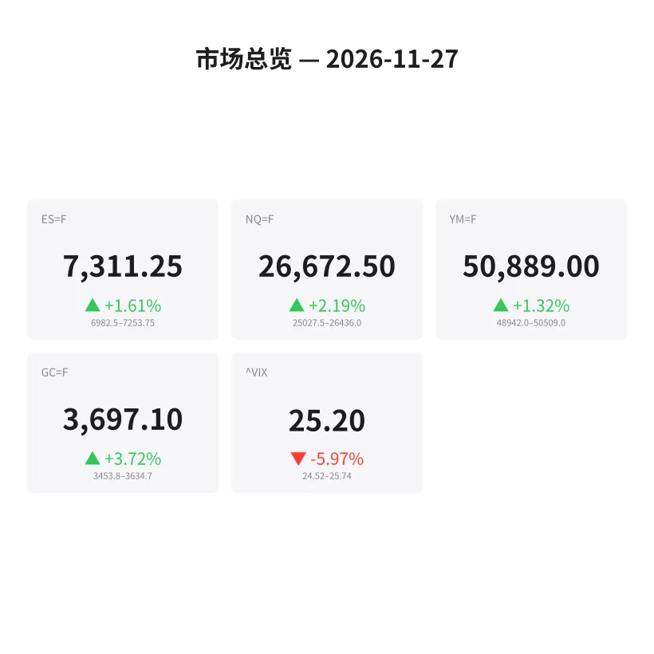
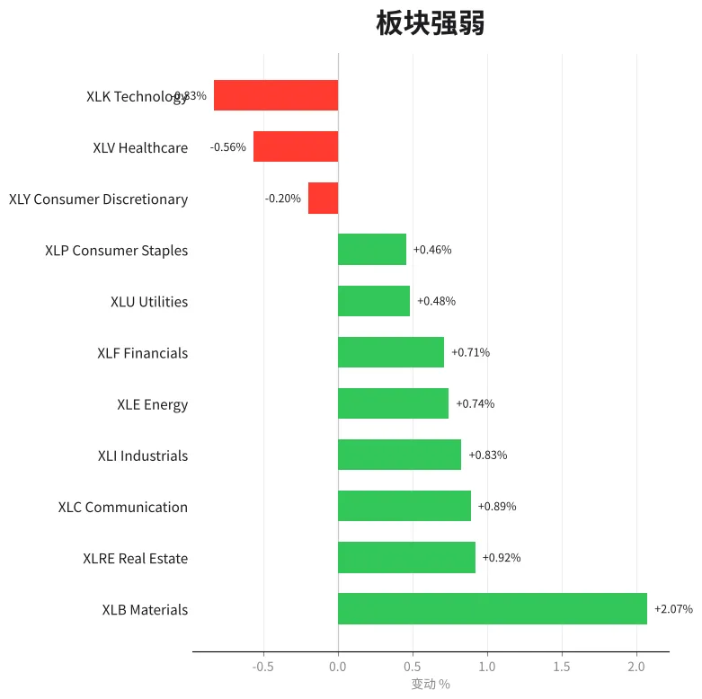
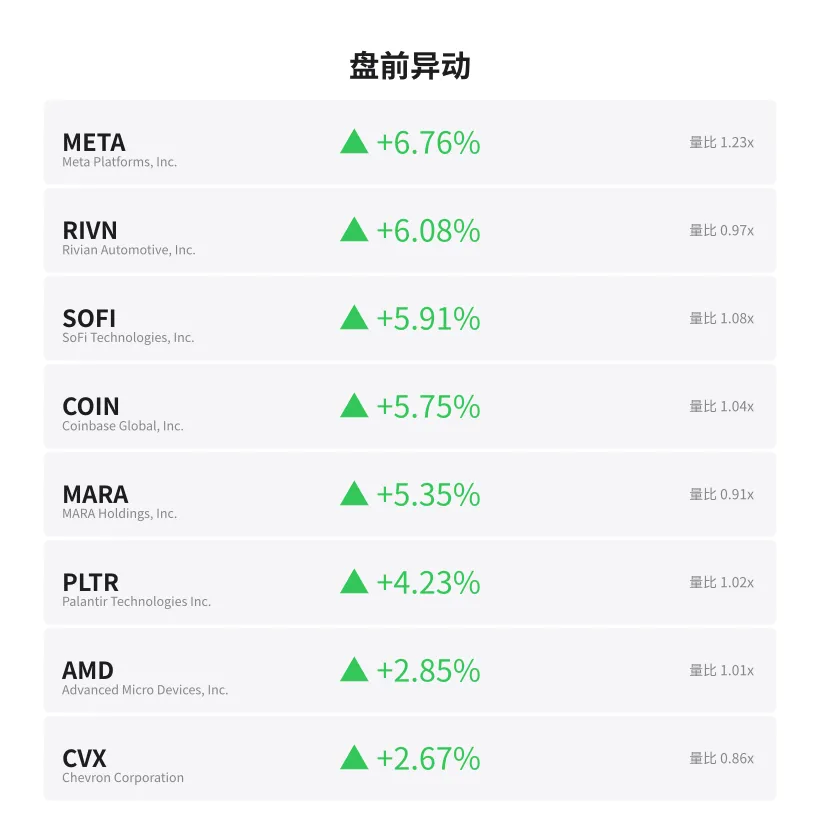
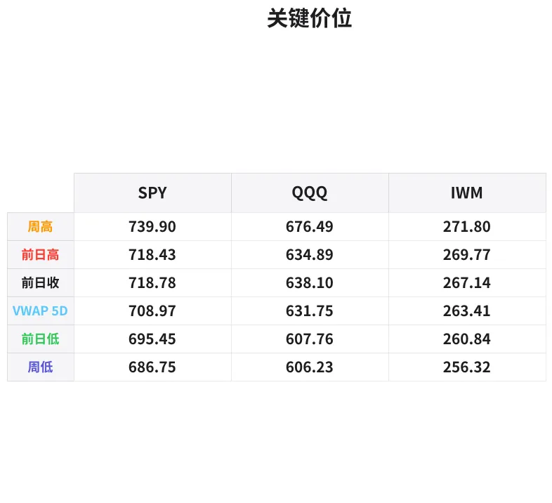

# 盘前分析报告 — 2026-11-27
*生成时间: 12:34:42 UTC*

---
## 数据速览

---
## 一、宏观环境

> [!info]- 详细数据：指数期货 & VIX
> ### 1.1 指数期货 & VIX
> | 品种 | 现价 | 涨跌幅 | 前收 | 日高 | 日低 |
> |------|------|--------|------|------|------|
> | ES=F | 7311.25 | +1.61% | 7195.75 | 7343.0 | 7187.0 |
> | NQ=F | 26672.5 | +2.19% | 26100.25 | 26868.75 | 25997.5 |
> | YM=F | 50889.0 | +1.32% | 50228.0 | 50979.0 | 50223.0 |
> | GC=F | 3697.1 | +3.72% | 3564.6 | 3712.8 | 3578.8 |
> | ^VIX | 25.2 | -5.97% | 26.8 | 25.74 | 24.52 |

> [!info]- 详细数据：隔夜走势
> ### 1.2 隔夜走势（Globex）
> | 品种 | 隔夜高 | 隔夜低 | 区间 | 亚洲高 | 亚洲低 | 欧洲高 | 欧洲低 |
> |------|--------|--------|------|--------|--------|--------|--------|
> | ES=F | 7253.75 | 6982.5 | 271.25 | 7253.75 | 7150.0 | 7172.0 | 7069.5 |
> | NQ=F | 26436.0 | 25027.5 | 1408.5 | 26436.0 | 25830.75 | 25915.0 | 25470.5 |
> | YM=F | 50509.0 | 48942.0 | 1567.0 | 50509.0 | 49791.0 | 50004.0 | 49365.0 |
> | GC=F | 3634.7 | 3453.8 | 180.9 | 3634.7 | 3511.3 | 3567.4 | 3511.8 |
> | ^VIX | 25.74 | 24.52 | 1.22 | — | — | 25.74 | 24.52 |

> [!info]- 详细数据：板块强弱
> ### 1.3 板块强弱
> | ETF | 板块 | 涨跌幅 |
> |-----|------|--------|
> | XLB | Materials | +2.07% |
> | XLRE | Real Estate | +0.92% |
> | XLC | Communication | +0.89% |
> | XLI | Industrials | +0.83% |
> | XLE | Energy | +0.74% |
> | XLF | Financials | +0.71% |
> | XLU | Utilities | +0.48% |
> | XLP | Consumer Staples | +0.46% |
> | XLY | Consumer Discretionary | -0.20% |
> | XLV | Healthcare | -0.56% |
> | XLK | Technology | -0.83% |

---
## 二、消息面

- **感恩节夜盘股指期货飙升，标普500期货突破7300** — *24/7 Wall St.*
  > Stock Futures Rip on Thanksgiving Night as S&P 500 Futures Top 7,300
- **美银预测标普500在2027年上涨8%：你的ETF准备好迎接软着陆了吗？** — *Zacks*
  > BofA Sees S&P 500 Rising 8% in 2027: Are Your ETFs Ready for a Soft Landing?
- **State Street SPDR标普500 ETF信托(SPY)值得关注吗？** — *Zacks*
  > Should State Street SPDR S&P 500 ETF Trust (SPY) Be on Your Investing Radar?
- **Dave Ramsey 66岁且未持有任何债券，退休人士是否应效仿？** — *24/7 Wall St.*
  > Dave Ramsey Is 66 and Owns Zero Bonds. Should Retirees Follow Him?
- **Jim Lebenthal称这”只是一次回调，并非更糟糕的情况”，为何他在加仓Alphabet** — *24/7 Wall St.*
  > Jim Lebenthal Says This Is “a Correction, Not Something Worse.” Why He’s Buying More Alphabet
- **Invesco QQQ信托(QQQ)周三买入：苹果领衔** — *GuruFocus.com*
  > What INVESCO QQQ Trust (QQQ) Bought: Apple Leads on Wednesday
- **ETF周三买入5890万美元吉利德科学(GILD)** — *GuruFocus.com*
  > ETFs Bought $58.9 Million of Gilead Sciences (GILD) on Wednesday
- **44只ETF于11月25日增持百事可乐(PEP)** — *GuruFocus.com*
  > 44 ETFs Add to PepsiCo (PEP) on Nov. 25
- **ETF周三持续买入Palantir(PLTR)** — *GuruFocus.com*
  > ETFs Are Buying Palantir (PLTR) on Wednesday
- **尽管通胀忧虑和AI阴霾笼罩，股市仍从低点反弹** — *Kiplinger*
  > Stocks Rally Off Lows Despite Inflation and AI Gloom: Stock Market Today
- **芯片股遭大幅抛售，美国股指涨跌互现，国债收益率走低** — *MT Newswires*
  > Update: US Equity Indexes Mixed While Treasury Yields Drop Amid Sharp Sell-Off in Chipmakers
- **高盛指出三大信号暗示市场已触底** — *TheStreet*
  > Goldman Sachs flags 3 signals pointing to a market bottom
- **Tom Gardner对这种市场行情的看法** — *Motley Fool*
  > What Tom Gardner Said About Days Like This
- **11月25日市场回顾：AI交易持续承压，纳指和标普500收跌，英伟达跌4%** — *Investopedia*
  > Markets News, Nov. 25, 2026: Nasdaq, S&P 500 Close Lower as AI Trade Remains Under Pressure; Nvidia Falls 4%
- **摩根大通、美银、花旗同时发出银行账户红色警告——政策变更将责任转嫁至客户** — *Moneywise*
  > JPMorgan, BofA, Citigroup issue same red alert over US bank accounts — official policy changes shift liability to you
- **美国富裕婴儿潮一代的5个残酷退休真相，2027年你准备好了吗？** — *Moneywise*
  > 5 brutal retirement truths that give rich US boomers a big advantage. Can you face the music in 2027?
- **比特币突破6.1万美元带动加密股上涨，但分析师期待突破6.2万** — *Stocktwits*
  > Crypto Stocks Gain After Bitcoin Tops $61K In Tech Rebound, But Analysts Want A Move Above $62K
- **今日金价：2026年11月27日黄金上涨3.13%** — *USA TODAY*
  > Gold Price Today: Gold Rises 3.13% on November 27, 2026
- **今日比特币新闻：BTC反弹8% — 比特币持有者最坏的时刻已过？** — *Coinspeaker*
  > Bitcoin News Today: BTC Rebounds 8% – Is The Worst Over for Bitcoin Holders?
- **今日股市：AI恐慌消退，道指大涨，标普500和纳指齐涨** — *Yahoo Finance*
  > Stock market today: Dow jumps, S&P 500, Nasdaq gain as AI jitters fade

---
## 三、盘前异动

> [!info]- 详细数据：盘前异动
> | 代码 | 名称 | 现价 | 缺口 | 量比 |
> |------|------|------|------|------|
> | META | Meta Platforms, Inc. | 629.69 | +6.76% | 1.23x |
> | RIVN | Rivian Automotive, Inc. | 12.04 | +6.08% | 0.97x |
> | SOFI | SoFi Technologies, Inc. | 13.62 | +5.91% | 1.08x |
> | COIN | Coinbase Global, Inc. | 108.23 | +5.75% | 1.04x |
> | MARA | MARA Holdings, Inc. | 5.7 | +5.35% | 0.91x |
> | PLTR | Palantir Technologies Inc. | 168.0 | +4.23% | 1.02x |
> | AMD | Advanced Micro Devices, Inc. | 425.06 | +2.85% | 1.01x |
> | CVX | Chevron Corporation | 214.3 | +2.67% | 0.86x |
> | NFLX | Netflix, Inc. | 60.01 | +1.94% | 1.12x |
> | GS | Goldman Sachs Group, Inc. (The) | 819.14 | +1.63% | 1.16x |

---
## 四、关键价位

> [!info]- 详细数据：SPY 关键价位
> ### SPY
> | 价位类型 | 价格 |
> |----------|------|
> | Prior Day High | 718.43 |
> | Prior Day Low | 695.45 |
> | Prior Day Close | 718.78 |
> | Premarket Price | 728.27 |
> | Approx Vwap 5D | 708.97 |
> | Weekly High | 739.9 |
> | Weekly Low | 686.75 |

> [!info]- 详细数据：QQQ 关键价位
> ### QQQ
> | 价位类型 | 价格 |
> |----------|------|
> | Prior Day High | 634.89 |
> | Prior Day Low | 607.76 |
> | Prior Day Close | 638.1 |
> | Premarket Price | 647.73 |
> | Approx Vwap 5D | 631.75 |
> | Weekly High | 676.49 |
> | Weekly Low | 606.23 |

> [!info]- 详细数据：IWM 关键价位
> ### IWM
> | 价位类型 | 价格 |
> |----------|------|
> | Prior Day High | 269.77 |
> | Prior Day Low | 260.84 |
> | Prior Day Close | 267.14 |
> | Premarket Price | 272.62 |
> | Approx Vwap 5D | 263.41 |
> | Weekly High | 271.8 |
> | Weekly Low | 256.32 |

---
## 五、AI 技术分析 & 操盘建议

## 第一部分：隔夜市场回顾

### 亚洲盘（18:00–02:00 ET）

亚洲时段表现强势，三大股指期货均在该时段录得隔夜高点。ES在亚洲盘触及7253.75高点后回落，NQ走势类似达到26436.0，YM触及50509.0。黄金在亚洲盘同样走强，GC触及3634.7高位，显示避险与风险资产同步走高的"risk-on"格局。亚洲盘的强势主要受到以下因素驱动：
- 感恩节假期前夕的低流动性环境放大了价格波动
- 市场对AI板块抛售的恐慌情绪出现初步缓解
- 比特币反弹8%突破6.1万美元，风险偏好改善

### 欧洲盘（02:00–09:30 ET）

欧洲时段出现明显回调，ES从亚洲高点7253.75回落至7069.5低点，回撤幅度达184点。NQ从26436回落至25470.5，回撤近966点。这一波回调主要源于：
- 欧洲交易员对周三芯片股大幅抛售的延续反应
- 英伟达跌4%后的技术性卖压扩散
- 国债收益率下行但未能提振科技股信心

### 对美国盘的影响

**关键判断：** 美国盘开盘前市场已从欧洲盘低点大幅反弹。ES盘前报7311.25（+1.61%），已远超隔夜高点7253.75，属于"gap-and-go"开盘格局。NQ报26672.5（+2.19%），同样突破隔夜区间上沿。VIX从26.8降至25.2（-5.97%），恐慌指数回落确认风险偏好改善。

**今日是感恩节（Thanksgiving Day），美国股市休市。** 期货市场仅交易至13:00 ET（半日交易），流动性将显著低于正常水平。这意味着：
- 价格波动可能被放大，但真实方向信号较弱
- 不建议在半日交易环境中建立大仓位
- 关注周五"黑色星期五"开盘后的延续性

## 第二部分：期货品种分析

### ES（E-mini S&P 500 期货）

**多时间框架分析：**
- **日线级别：** 周三收盘7195.75，今日盘前7311.25强势跳空+115.5点。价格已从周内低点7187.0反弹至接近周高7343.0。日线结构暂时维持在20日均线上方，但周三的大阴线形成了潜在的"inside day"格局需要关注。
- **4小时级别：** 隔夜从6982.5（Globex低点）到盘前7311.25的V型反弹，幅度达328.75点。这种急速反弹通常在50%-61.8%回撤位面临阻力。
- **1小时级别：** 盘前动量强劲，价格已突破隔夜区间上沿7253.75，当前处于隔夜高点上方的真空区。

**关键价位：**
| 价位 | 价格 | 说明 |
|------|------|------|
| R3 | 7343.0 | 日高/周高附近，强阻力 |
| R2 | 7311.0 | 当前盘前价格，心理关口 |
| R1 | 7253.75 | 隔夜高点，突破后转支撑 |
| 枢轴 | 7195.75 | 前收盘价 |
| S1 | 7187.0 | 日低 |
| S2 | 7069.5 | 欧洲盘低点 |
| S3 | 6982.5 | 隔夜低点/Globex低点 |

**方向偏向：** 偏多 | **置信度：** 65%

⚠️ 今日为感恩节半日交易，流动性极低。以下建议仅适用于周五正常交易日参考。

**入场区域：** 7240–7260（隔夜高点回测区域）
**止损：** 7220（隔夜高点下方30+点，防止假突破）
**T1：** 7340（日高附近）
**T2：** 7380（本周新高延伸目标）
**失效条件：** 若ES回落并收于7195（前收盘）下方，多头格局失效，转为观望。

---

### NQ（E-mini Nasdaq 100 期货）

**多时间框架分析：**
- **日线级别：** 周三受AI板块抛售影响大跌，英伟达-4%拖累。今日盘前26672.5（+2.19%）强势反弹，但需关注该反弹是否为"dead cat bounce"。
- **4小时级别：** 隔夜从25027.5到盘前26672.5的反弹达1645点，波动率极大。NQ的隔夜区间1408.5点远超正常水平，显示市场处于高波动状态。
- **1小时级别：** 盘前已突破隔夜高点26436.0并持续走高，动量偏强。

**关键价位：**
| 价位 | 价格 | 说明 |
|------|------|------|
| R3 | 26868.75 | 日高 |
| R2 | 26672.5 | 当前盘前价格 |
| R1 | 26436.0 | 隔夜/亚洲高点 |
| 枢轴 | 26100.25 | 前收盘价 |
| S1 | 25997.5 | 日低 |
| S2 | 25830.75 | 亚洲低点 |
| S3 | 25027.5 | 隔夜低点 |

**方向偏向：** 偏多（但波动大，需谨慎） | **置信度：** 60%

**入场区域：** 26350–26450（隔夜高点回测）
**止损：** 26200（前收附近下方）
**T1：** 26850（日高附近）
**T2：** 27100（扩展目标）
**失效条件：** 若NQ回落至26100（前收）下方且无法快速收复，AI板块抛售可能延续，放弃多头。

---

### GC（黄金期货）

**多时间框架分析：**
- **日线级别：** 今日表现极为强势，+3.72%是近期少见的单日涨幅。从3564.6前收直接跳空至3697.1，显示避险需求急剧升温。
- **4小时级别：** 隔夜从3453.8低点反弹至当前3697.1，涨幅243.3点。这种急速上涨往往伴随着获利回吐压力。亚洲盘高点3634.7已被美国盘前突破。
- **1小时级别：** 盘前触及3712.8日高后小幅回落至3697.1，短线在3700整数关口附近整理。

**关键价位：**
| 价位 | 价格 | 说明 |
|------|------|------|
| R3 | 3750.0 | 心理整数关口 |
| R2 | 3712.8 | 日高 |
| R1 | 3697.1 | 当前盘前价 |
| 枢轴 | 3634.7 | 隔夜/亚洲高点 |
| S1 | 3578.8 | 前收附近 |
| S2 | 3511.3 | 亚洲低点 |
| S3 | 3453.8 | 隔夜低点 |

**方向偏向：** 强多 | **置信度：** 70%

**入场区域：** 3670–3690（整数关口下方回踩）
**止损：** 3645（隔夜高点下方）
**T1：** 3712（日高重测）
**T2：** 3750（心理关口）
**失效条件：** 若GC跌破3634.7（亚洲高点转支撑）并持续走弱，说明避险情绪缓解，多头逻辑减弱。

## 第三部分：ETF品种分析

### SPY（SPDR S&P 500 ETF）

**关键价位：**
| 价位 | 价格 | 说明 |
|------|------|------|
| 周高 | 739.90 | 本周高点，强阻力 |
| 盘前价 | 728.27 | 当前盘前报价 |
| 前日高 | 718.43 | 周三高点 |
| 前日收 | 718.78 | 周三收盘 |
| 5日VWAP | 708.97 | 五日成交量加权均价 |
| 前日低 | 695.45 | 周三低点 |
| 周低 | 686.75 | 本周低点 |

**交易计划：**
SPY盘前728.27，较前收718.78跳空+9.49点（+1.32%）。价格已突破前日高718.43并远离5日VWAP（708.97），显示短线超买但动量强劲。

- **多头场景：** 若开盘后SPY站稳725上方，可考虑在725–728区域做多，目标739.90（周高）。止损720（前日高下方）。
- **空头场景：** 若SPY在开盘30分钟内无法突破730并出现放量回落，可能回测718–720区域（前日高/收盘价转支撑区）。
- **关键观察：** 5日VWAP（708.97）距离当前价较远，若出现深度回调，708–710是强支撑区域。

**注意：** 今日感恩节休市，以上计划适用于周五交易参考。关注周五开盘是否延续今日盘前的gap-up势头。

---

### QQQ（Invesco QQQ Trust）

**关键价位：**
| 价位 | 价格 | 说明 |
|------|------|------|
| 周高 | 676.49 | 本周高点，强阻力 |
| 盘前价 | 647.73 | 当前盘前报价 |
| 前日收 | 638.10 | 周三收盘 |
| 前日高 | 634.89 | 周三高点 |
| 5日VWAP | 631.75 | 五日成交量加权均价 |
| 前日低 | 607.76 | 周三低点 |
| 周低 | 606.23 | 本周低点 |

**交易计划：**
QQQ盘前647.73，较前收638.10跳空+9.63点（+1.51%）。科技股受AI板块情绪主导，波动性显著高于SPY。

- **多头场景：** QQQ若站稳645上方，可做多目标660（前周支撑转阻力），进而看676.49（周高）。止损638（前收盘下方）。
- **空头场景：** 若AI板块消息面再度恶化（英伟达、AMD等继续走弱），QQQ可能快速回测630–635区域（5日VWAP附近）。
- **关键风险：** QQQ的周内振幅（676.49–606.23 = 70.26点，约10.6%）极端偏大，显示市场处于高波动区间。在这种环境下，仓位管理比方向判断更重要。

**注意：** META盘前+6.76%是今日最强大型科技股，可作为QQQ方向的领先指标。若META开盘后持续走强，QQQ多头逻辑更可靠。

## 第四部分：今日市场总览

### 整体情绪评估

**市场情绪：偏多，但需警惕假日低流动性陷阱**

今日盘前数据显示市场正从周三的AI板块恐慌中强势反弹：
- 三大股指期货全线跳空高开（ES +1.61%, NQ +2.19%, YM +1.32%）
- VIX从26.8降至25.2（-5.97%），恐慌指数明显回落
- 黄金+3.72%的强势上涨反映出市场在"risk-on"的同时仍保留避险配置
- 比特币反弹8%突破6.1万，加密板块全线走强（COIN +5.75%, MARA +5.35%）
- 高盛"三大见底信号"言论和多家机构的积极展望提振信心

### VIX分析

VIX当前25.2，仍处于相对高位（>20为高波动区间），但方向性下降（-5.97%）是积极信号。VIX隔夜区间24.52–25.74，波动收窄说明市场恐慌峰值可能已过。**关注25.0整数关口**：若VIX跌破25并维持在24以下，确认市场进入修复阶段；若VIX反弹至27以上，说明抛售尚未结束。

### 板块轮动

今日板块表现出明显的"risk-on"特征：
- **最强板块：** 材料（XLB +2.07%）、房地产（XLRE +0.92%）、通信（XLC +0.89%）
- **最弱板块：** 科技（XLK -0.83%）、医疗（XLV -0.56%）
- **解读：** 资金从科技/AI板块轮出，流入周期性板块（材料、工业）和防御性板块（房地产、公用事业）。这种轮动格局说明：(1) AI抛售尚未完全结束，科技股仍在消化卖压；(2) 市场并非系统性恐慌，而是局部调整+板块再平衡。

### 重要时间窗口

| 时间（ET） | 事件 | 注意事项 |
|------------|------|----------|
| 全天 | 🦃 感恩节休市 | 美国股市休市，期货半日交易至13:00 ET |
| 09:30前 | 盘前阶段 | 仅期货交易，流动性极低 |
| 13:00 | 期货收盘 | CME期货提前收盘 |
| 周五09:30 | 黑色星期五开盘 | 半日交易至13:00，关注gap延续性 |

### 盘前异动重点

- **META +6.76%** — 大型科技股中最强反弹，可能带动FAANG板块企稳
- **RIVN +6.08%** — EV板块反弹，关注特斯拉联动
- **加密板块** — COIN +5.75%, MARA +5.35%，BTC突破6.1万带动整个板块
- **AMD +2.85%** — 芯片股反弹，但力度弱于大盘，需关注周五延续性

---

### 🎯 核心交易论点

**今日（感恩节）不交易。** 市场休市，期货仅半日交易且流动性极低，不适合建立任何有意义的仓位。

**周五（黑色星期五）核心思路：** 市场正从AI板块恐慌中修复，高盛见底信号+VIX回落确认短线反弹格局。若周五开盘维持今日盘前的gap-up（ES>7250, SPY>725），偏多操作，以隔夜高点为支撑做多；若gap被回补（ES回落至7195以下），说明反弹力度不足，转为观望或短空。**仓位控制在平时的50%以内**——黑色星期五同样是半日交易，流动性低于正常水平。

> ⚡ 一句话：感恩节后的修复性反弹正在展开，VIX退潮确认风险偏好改善，但AI/科技板块的阴影尚未完全散去——周五轻仓试多，严守止损。
